<!-- Dedicated to my best friend, Osoko Emmanuel (July 1998 to June 2026). From Al-Ameen. -->

  <picture>
    <source media="(prefers-color-scheme: dark)" srcset="apps/client/public/brand/japacity-mark-dark.svg">
    
  </picture>

<h1 align="center">Japacity</h1>

  <b>Live a Nigerian life, one month at a time, and see how ready you are to japa.</b> 
  A life-sim for your phone's browser about leaving Nigeria, or staying.

<!-- teaser: the asset link below and the two pictures' links point at mp4s uploaded through GitHub's editor, the only way GitHub plays a video in a README. The sources are docs/teaser/japacity-teaser.mp4 and japacity-teaser-portrait.mp4. A new render needs new uploads (see apps/teaser/README.md). -->

https://github.com/user-attachments/assets/5949493c-b849-43f5-b139-ab0121b32426

  <a href="https://github.com/user-attachments/assets/5949493c-b849-43f5-b139-ab0121b32426">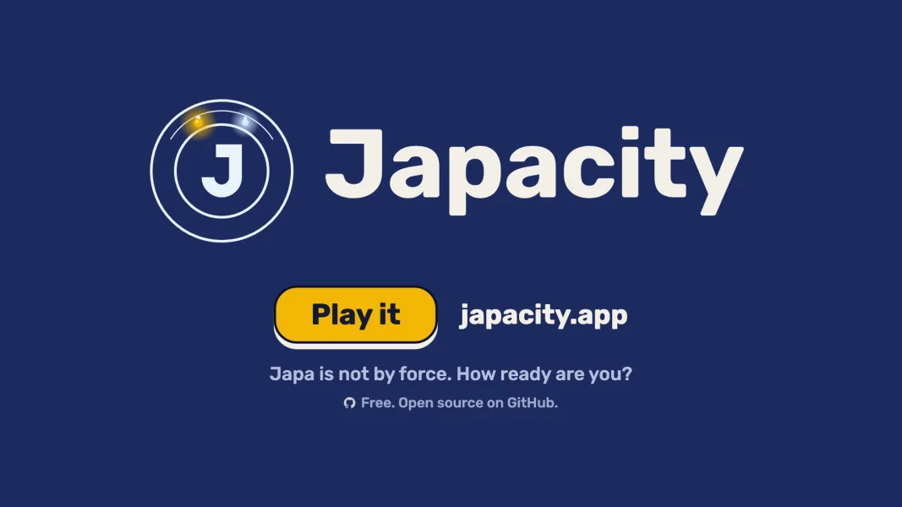</a>
  <a href="https://github.com/user-attachments/assets/ac24031c-08e9-4ffb-abff-049f8905343b">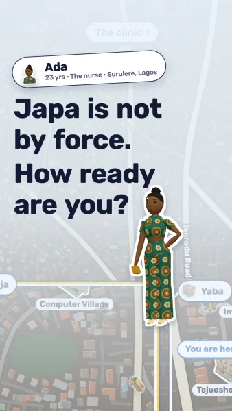</a>

Left: the teaser for a screen. Right: the teaser for a phone. Each is 28 seconds, with sound. Tap a picture to play it. The files: <a href="docs/teaser/japacity-teaser.mp4">landscape</a>, <a href="docs/teaser/japacity-teaser-portrait.mp4">portrait</a>.

  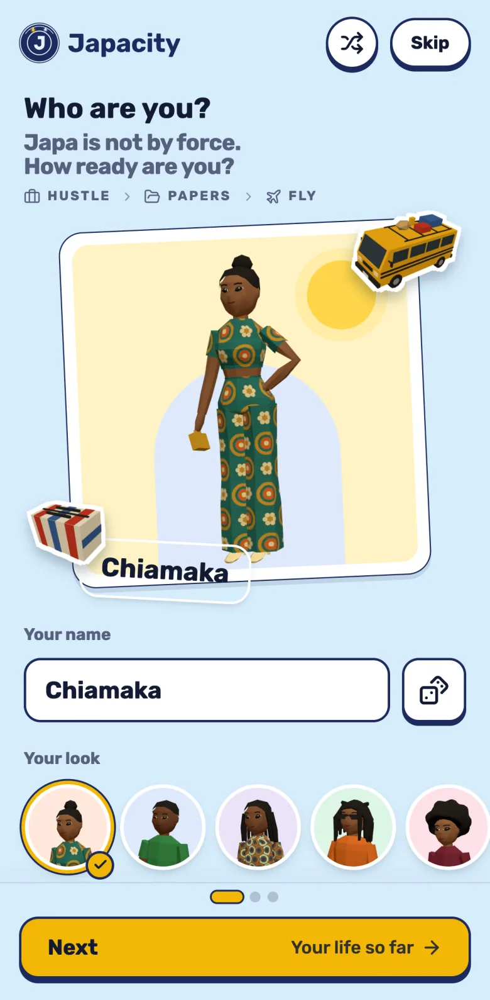
  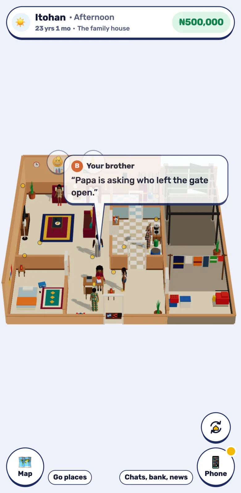
  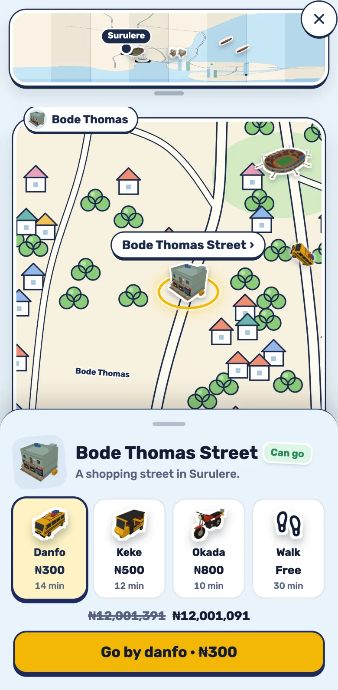

## How it plays

*Japa* is Nigerian for leaving the country for good. One life goes like this:

1. **Start.** Pick a look, a name, a life so far and a place to live. A travel data page is printed with your years on it.
2. **Months.** Each night you sleep is one month. You fill the month with work, study, family and errands, and cross the city by danfo, keke or okada, paying each fare.
3. **Your phone.** The Bank holds your savings for the move, jobs appear on the board, the family talks in the group chat, and your papers are kept in the box under the bed.
4. **Ways out.** You do not pick one at the start. A master's in the UK, a tech job abroad, health care in the UK, Canada's points or a Gulf contract appear once your life matches them. The Japa app shows the brief for the next step.
5. **The application.** Gather the papers, save the money, sit the test and wait for the answer. A refusal is not the end.
6. **Leaving.** If the visa is granted, the family walks you to Departures, the counter asks window or aisle, Papa says go well at the gate, and the plane leaves Lagos at night. You land at a cold bus stop with a bag and three messages from home, and the life continues abroad. If you stay, the life continues at home.

  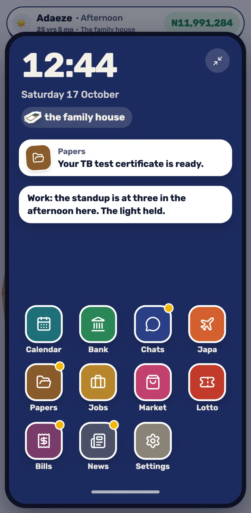
  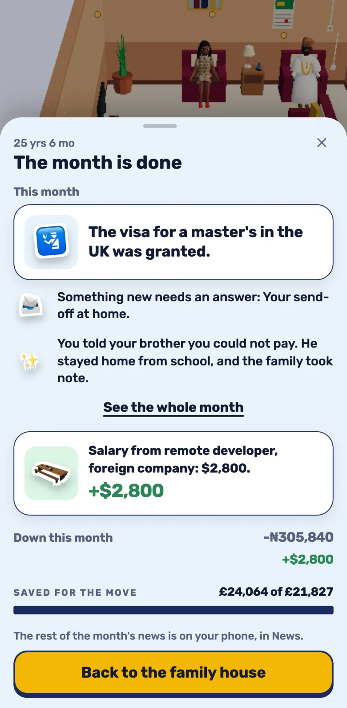
  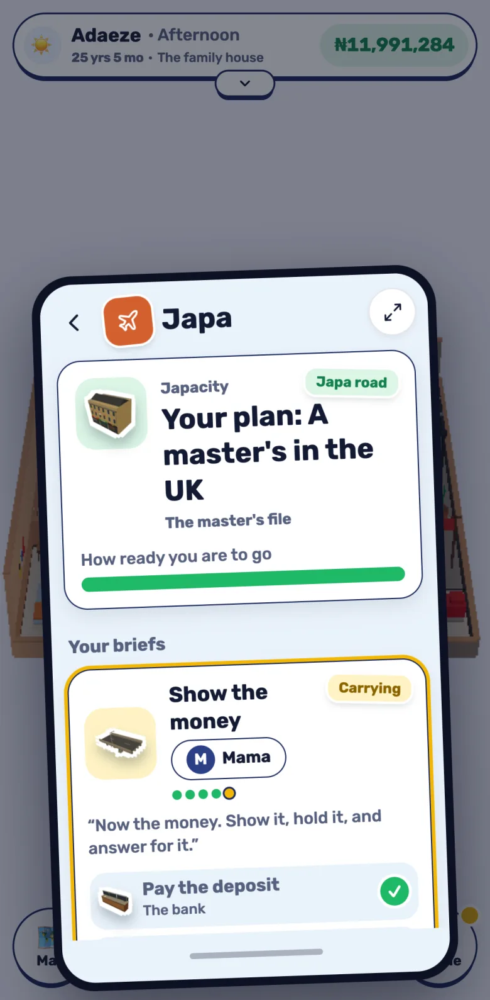

  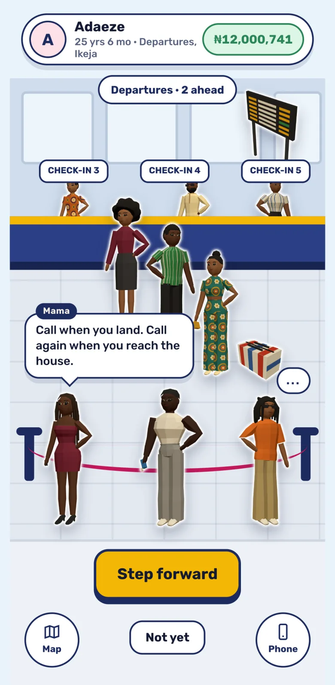
  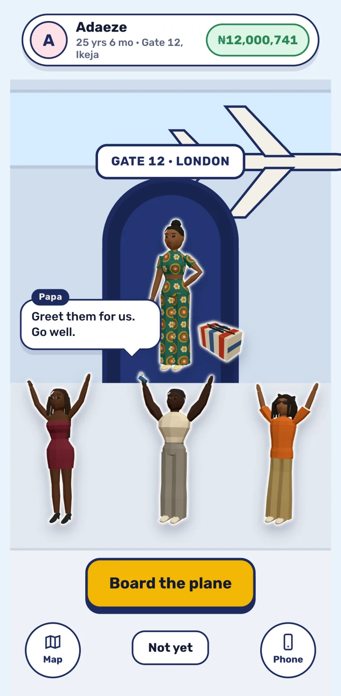
  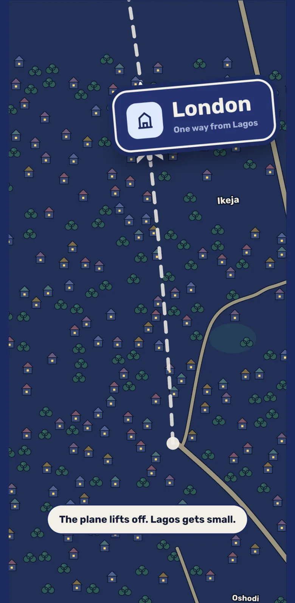

  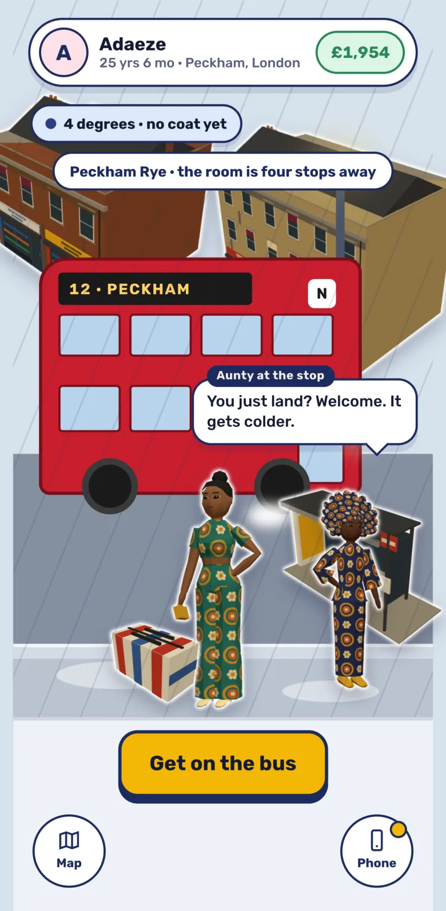
  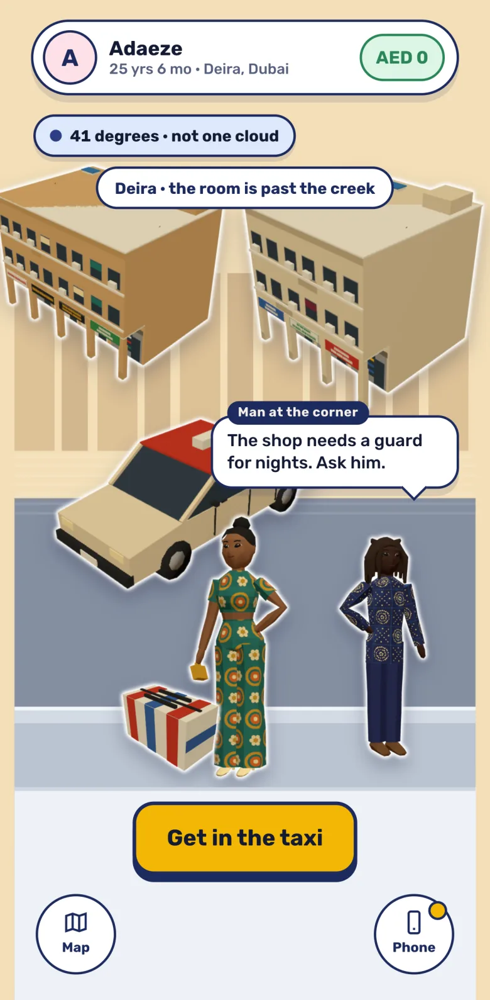
  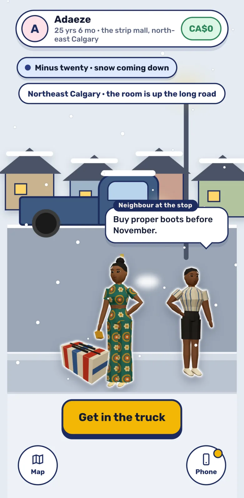
  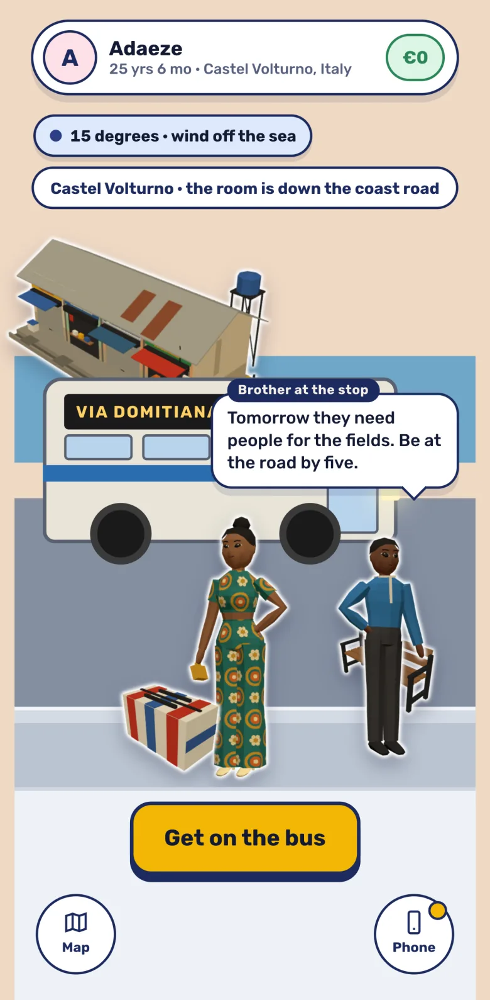

## Play it

Play it in your browser, on a phone or a computer. Nothing to download.

## How it is built

- **[A deterministic simulation](docs/site/built/simulation.md):** pure functions over whole numbers, so the same choices give the same life on the phone and on the server.
- **[One Cloudflare Worker](docs/site/built/server.md):** serves the game and its API, keeps each life's log and stores lives in Postgres.
- **[Named, tested rules](docs/rules/engine.md):** every rule has a name, every name has a test that cites it, and the check fails when one is missing.

## Read more

- [How it plays](docs/site/plays/index.md)
- [How it is built](docs/site/built/index.md)
- [The rules](docs/rules/engine.md)
- [Design notes](docs/design/)
- [Working on it](docs/site/built/working.md): requirements, commands, the check and CI
- [Run your own copy](docs/site/built/your-own-copy.md), with your own domain, database and keys
- [Contributing](CONTRIBUTING.md)
- [Decisions](docs/decisions/)

## Licences

Code is MIT. Docs are CC BY 4.0. Game content and our own art are CC BY-SA 4.0. The name and logo are reserved. See [LICENSES.md](LICENSES.md).
