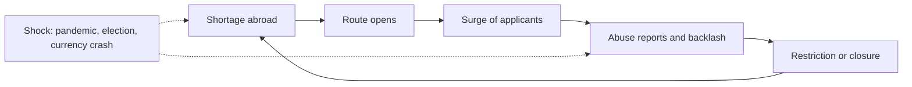

# Japacity: concept

> What the game is: its concept. Where another page differs on the concept, this page wins.
> Sections 9 and 15 pace the life by a budget of turns. In the game the month is lived by hand (`08-the-lived-month.md`, decision 0011), and the bank of turns gates nothing (`../rules/turn.md`). The 3D city is set out in `07-the-world-first.md`.
> Evidence: the research pages in `../research/`. The rules for the dangerous route: `../rules/road.md`, "What the road holds to".

## 1. The game in one paragraph

A shared online world where you live a Nigerian life a month at a time. You do not pick a way out. You study, work, hustle, build things, meet people, and marry, and ways out appear as your life comes to match them. The world keeps changing for everyone at once: a pandemic, a new government abroad, a currency crash, a labour shortage that opens a door and a scandal that shuts it. Getting out is the main journey, and it can be finished in the first few sessions. After that the game opens up: a job to keep, a car on finance, a credit file, family to bring over, December at home, and the way back.

## 2. Pillars

1. **You build a life. Routes find you.**
2. **The world moves and everyone feels it.**
3. **A main journey you can finish early, then a life to keep living.**
4. **The path you leave by decides the life you get.**
5. **The people in your life can be real, and they can let you down.**
6. **Coming back is part of the game.**
7. **Honest about the dangerous routes.**

## 3. The profile

Everything the game knows about a character. Routes, offers, and news all read from it.

| Group | Qualities |
|---|---|
| Education | Level, field, grade, standing of the school |
| Work | Occupation, years in each occupation, seniority |
| Skills | English test band, French, German, technical, care, trade, driving |
| Proof | Things you can show: products launched, talks given, press, awards, publications, references |
| Money | Naira, hard currency, debts, assets, and abroad a credit file |
| People | Partner, siblings, parents, dependants, contacts (a professor, a mentor, an agent) |
| Record | Travel history, refusals, overstays, arrests |
| Self | Age, wellbeing, standing at home |

The standing of the school decides what its degree is worth abroad, so a dearer school is more than a higher fee. A life's traits, what it carries from its background and prologue, stand on its data page.

Every gain is tagged with the routes it counts toward, and the game shows the tags. A talk at a tech event reads "counts toward: talent route, scholarship essays".

## 4. Routes as eligibility

A route is a set of requirements over the profile, plus a window that the world opens and closes. Nobody selects a route at the start.

**Three states per route:**

| State | What the player sees | How it changes |
|---|---|---|
| Unknown | Nothing | You hear of it from news, a person, or a place |
| Heard of | A name and a rough idea, possibly wrong | You look into it: ask someone who went, pay a consultant, read the official page |
| Known | A checklist with met items crossed out, and clocks for slow items like savings and years of experience | Stays known. The checklist updates when rules change |

**Rules:**

- Where you spend time decides what you hear. Tech meetups carry talk of talent visas. The salon and the motor park carry talk of Dubai. The campus carries talk of professors and funding.
- When several routes qualify, the player chooses. The game never assigns one.
- Every route is guaranteed to reach every near-qualifier through at least one story or contact. Hiding things is pointless in a multiplayer game. Timing is what matters.
- A refusal on one route goes on the record and is asked about on every later one.

**Japacity, the headline number.** A percentage for how ready a character is to leave. The game is named after it.

- Every known route has its own percentage: how much of its checklist is met, with harder items counting for more.
- Your japacity is the highest of those among routes whose window is open.
- It moves with the world. A window closing can drop it overnight. A new route can lift it.
- After leaving it keeps counting, toward the next status: settlement, then a passport.

**Worked example.** A student plans a US student visa and builds grades and an English score. She never applies. She takes a job, speaks at events, and launches a product. At a meetup she hears of a talent visa. Her checklist shows two of three proofs already met, from things she did for other reasons. Meanwhile her husband, a nurse, qualifies for a healthcare draw. They now have two ways out and must choose who leads and who goes as the dependant.

**Routes that run through people**, added to the catalogue:

| Route | What it needs | Real rule behind it |
|---|---|---|
| Dependant on a partner's route | A partner who qualifies, and dependant rules that allow it | Dependant bans on student and care routes |
| Partner visa | A partner already abroad earning above a threshold, and evidence the relationship is real | An income bar. The visa is cut to 60 days if the relationship ends |
| Sibling abroad | A sibling with settled status | A small fixed points bonus, 15 in the real system |
| Bringing parents | Settled status and a place in a lottery | Sponsorship by lottery, sometimes paused, with a signed undertaking in both countries |

```ts
interface Route {
  id: Id<"route">;
  hearIf: Requirement[];     // when talk of it starts reaching this profile
  checklist: Requirement[];  // shown once known, each item met or not
  window: Id<"world-var">;   // open, narrowing, or closed, set by the director
  grants: Id<"status">;      // the status you hold abroad if it succeeds
}
```

## 5. Background

Background is drawn and then played. It is never picked from a menu.

- **The draw**: family money, city or town, family size and obligations. Random, weighted to real distributions.
- **The prologue**: ages 16 to 22 in about eight minutes. A dozen choices: subjects, the admission exam, a course, a strike that costs a year, a side skill, a first hustle. News passes while you play. A route opens and closes before you are old enough to use it. A friend leaves.
- **The result** is a starting profile, and with it the set of offers that will find you. A graduate from a comfortable Lagos family hears about master's degrees. A school leaver in a small town with five siblings hears from a recruiter.
- **The hometown and the capital are journeys from Lagos**: the bus home to the hometown, and a trip to Abuja.
- **A friend who joins as your sibling skips the draw.** They inherit your family: same parents, same town, same obligations.

## 6. People

Partner, siblings, and parents are slots. A slot holds a real player or a computer character. **Nobody is ever blocked for lack of real friends.**

**Three ways a slot gets filled:**

| Way | How it works |
|---|---|
| Invite | You share a card with your japacity and what you need: "Looking for: a sibling already in Canada" or "a partner who is a nurse". The link drops your friend straight into that slot |
| The matchmaker | An aunty who keeps looking. She offers computer characters at once and real players who fit when she finds them, which can take days or weeks. Not part of the game (section 16) |
| Computer character | Always available, always labelled as one |

**What people give you**, all drawn from real rules:

- A partner's profile can lead the application, with you as the dependant.
- A partner abroad opens the partner route.
- A sibling abroad adds a small fixed bonus on points routes, a couch when you land, and news from there before it reaches home.
- Siblings share the family's requests for money. One sibling abroad raises what the family expects of them.

**People can let you down. That is the point.**

- Either side can end a relationship. If a joint application is in progress, it collapses. The dependant gets a 60-day clock to find another way, as in the real rule.
- The one who leaves pays a cost in standing. The one left gets a recovery path, and never loses anything they earned alone.
- Courting more than one person is possible. Word travels through gossip.
- A partner who stops playing gets a warning at 7 real days. At 14 a labelled stand-in takes over so the other player's plan keeps moving.

**The genuineness interview.** Any route that rests on a relationship ends in an interview where both partners answer questions about their shared history separately, and the answers are compared. A marriage made only for papers is a choice players can make. If it is caught, both carry a long ban on their record.

**Sponsoring someone is a long promise**, as it is in the real rules:

- The sponsor must earn above a floor, or meet it the other ways the real rules allow, such as savings.
- The financial undertaking outlives the relationship. A divorce does not end it.
- Someone who arrived through a partner cannot sponsor a new partner for five years, which is 60 turns.

**Safety rules.** These come from the cases in research file 05.

1. Adults only, checked by the same date-of-birth screen for everyone: section 16.
2. Characters only. No real names or photos. The game matches characters and is not a dating service.
3. Friends who invite each other already have their own way to talk. Strangers matched by the game get preset phrases and in-game actions only. There is no free text. It would open only by mutual consent, with phone numbers, links, and payment details blocked.
4. **Money is counted together and never moved.** A couple's funds are added up for an application without leaving either wallet. No shared wallets and no sending spendable money to another player. "My partner abroad needs money for fees" is the standard romance scam. Money can move between characters in your own family, through the channels in section 13.
5. Family requests are paid to the computer-run family, never to another player.
6. Invite rewards come from what the friend goes on to do, never from sending, and never anything worth cash.
7. Block and report on every interaction.

## 7. The world director

Events are not a replay of history. They come from a pool of things that have really happened, fired in an order that cause and effect allows.

**World variables** per destination: labour shortage by sector, public mood on migration, government stance, economy. At home: exchange rate, inflation, security, strikes.

**The policy cycle** that the director runs for each route:



**Eras.** One at a time, announced by name, about four real weeks each:

| Era | What changes for everyone |
|---|---|
| Open door | Shortages abroad. Routes open faster than people can qualify |
| Pandemic | Borders shut, exams move online, flights stop. Health workers and remote workers gain. People abroad cannot get home |
| Hard line | A new government abroad changes rules every few days. Players spread their bets across countries |
| Crash at home | The naira falls. Fees double. Anyone holding hard currency is suddenly rich at home |
| Scandal | Abuse on a popular route is exposed. That route narrows or closes. Scams multiply as it does |
| Strike | Universities shut. Transcripts and graduations slip. Study routes stall |

**What keeps the order sensible:**

- An event fires only when its world variables allow it. A route cannot close before it has opened and surged.
- Effects arrive with a delay. Every rule change passes through rumour, announcement, and in force.
- One shock per era, with a minimum gap. Most checks produce nothing.
- Personal offers follow the same logic. An offer reaches you because of who you are right now. A funded PhD holder does not meet the recruiter from the motor park. Someone who has lost status and owes money does.

**Fairness rules**, from the cases where server-wide changes drove players away:

1. Every era is named and has an end.
2. Nothing earned is deleted. Qualifications, experience, and proofs survive every era.
3. Applications already submitted are decided under the old rules.
4. Nothing takes effect less than two real days after it is announced.

## 8. News

| Part | What it carries | Same for everyone? |
|---|---|---|
| Front page | Era-level stories and shocks | Yes |
| For you | Stories ranked by relevance: routes you are close to, your occupation, your partner's and siblings' profiles, countries you follow | No |
| World | Everything else | Yes |

- Each "for you" story says why it was picked.
- Ranking decides what you see first. It does not tell you what is true. Sources still differ in reliability, and rumours can be false.
- Alerts can be dismissed and return while they still matter.
- **Luck in the news**: a Canadian draw can come in two points under the score, the director lowering the cut-off for one tick (group `openings`, luck:japa-luck-in-existing-systems).
- **Voiced radio**: news bulletins read aloud in Nigerian English or Pidgin, with the text always shown. It is not part of the game. Detail in `05-audio.md`.

## 9. Time

**Your life moves when you play. The world moves in real time.** The month is lived by hand (page 08), and the bank of turns below is kept but gates nothing (`../rules/turn.md`). The reasons below are why a life moves by play and not by the wall clock.

| Clock | Runs on | What it drives |
|---|---|---|
| Your life | Turns. One turn is one month of your character's life | Work, study, savings, experience, age, applications, payments due |
| The world | Real time, the same for everyone | Rumours becoming law, eras, prices and the exchange rate, festivals on the real calendar. Real December is December |

**The turn budget:**

| Setting | Working number |
|---|---|
| New turns | One every 2 real hours, 12 a day |
| Most you can bank | 24, which is two days away with nothing lost |
| Starting bank | 24 |
| Refills | A full refill at the end of each chapter of the main journey |

**Why this model:**

- On any wall clock a first departure sits days away. On turns, a keen player can reach it in one sitting, and a player who comes by for a few minutes still moves forward.
- It is the one pacing model with 15 to 20 years of precedent in shared browser games. In each the character moves on a budget and the world's events run on the real calendar.
- Absence costs nothing. Your character stands still while you are away. Only the world moves.
- It matches how returning players behave: 4 to 5 visits a day of about 5 minutes is two or three turns a visit.
- Energy systems are disliked when they block play, so the early game is generous: the starting bank plus chapter refills allow about an hour on day one.

**What a turn is.** Plan the month: the main activity, plus two or three free slots for study, a hustle, an event, a date, paperwork, or rest. Resolve it. Read what it earned, what happened, and what the world did since you last looked. Quiet months can be run several at a time and stop when something needs a decision. Exams, interviews, and negotiations are set pieces inside a turn.

**Every turn is a month of your life.** Twelve turns age the character a year, and points routes favour the young. The budget is therefore a real resource, and a wasted turn costs youth.

**Walking around is free.** The city, other players, and live events cost no turns.

**Ageing.** Age counts turns played and affects only the routes that really use it, such as points systems. It never ends a character. Nothing resets and nothing earned is lost. A player who wants a fresh start adds a relative (section 11). There is no handing over to an heir and no forced ageing.

## 10. The main journey

A short guided sequence that every player can finish, modelled on a racing game's menu books: each chapter is a small checklist, teaches one system, and ends with a reward and a refill.

| Chapter | What you do | What it teaches | Reached by |
|---|---|---|---|
| Prologue | Ages 16 to 22 in a dozen choices | The profile, the news, a window opening and closing | Minute 8 |
| 1. Find your feet | First job, first pay, hear of a route and look into it | Turns, the routine, routes and checklists | Session one |
| 2. Build the file | A test, the documents, the savings | Requirements, clocks, queues, agents | Day one or two |
| 3. Decision day | Apply, hold the funds, the interview, the answer | Windows, set pieces, refusal and regrouping | Day one to three |
| **The send-off** | The airport. A card to share, with your route and your japacity | **First ending.** About 45 to 60 minutes of play | |
| 4. Landing | A room, a job, the first rule of your status, the first request from home | Status, obligations, the credit file | Week one |
| 5. Secure | Settlement or a passport, or a chosen return | The long clocks | Weeks two to four |

- A refusal in chapter 3 is part of the journey. Regrouping onto another route counts as progress.
- Even paid games see only 20 to 55% of players reach the credits. The send-off has to sit inside the first few sessions.

## 11. The long game

What stays open after the main journey, like the extra menus, licence tests, and free play in the games this is modelled on.

| Menu | Contents |
|---|---|
| Life goals | A car, a home, a career ladder, a business, the house back home, bringing family over, December visits. Free-form and in any order |
| Tests | Fixed-profile timed scenarios with bronze, silver, and gold: "Get out before the care route closes", "Survive a sponsor losing its licence". This is where real history is replayed exactly, using the timeline in research file 02 |
| Collections | A passport stamp for every route experienced, endings seen, and the "real story" cards |
| Family | Siblings, a partner, children, parents to bring over, and a relative you play yourself |
| Sponsor | Once settled, bring a partner or a relative over, and carry the undertaking that comes with it |
| Live world | Eras, festivals on the real calendar, in-game elections |
| Roles | Mentor, referee for someone else's talent application, host for a new arrival, organiser of a savings circle |

The cards a life collects go past the moment cards: Japa Wrapped at the send-off (four or five cards), each achievement stamp in its numbered series, the data page as a scrapbook page, the weekly shared-world result, and "Started as" at the front door (share:cards-due-at-set-moments).

**A relative as a second character.** This is the restart for players who want one, and it loses nothing.

- It unlocks through the real rules: once your first character is settled, a sibling or cousin at home can be started.
- The relative inherits the family: the house, the standing, the obligations, and a sibling abroad.
- Both characters share one turn budget, so a second character is never an advantage in turns.
- Money sent home to them goes through the remittance channels and the rate, like any other.
- The first character keeps living. Nothing is traded away.

Test scores are checked on the server. Leaderboards with client-trusted scores fill with fakes.

## 12. Abroad

**The route you arrived on sets the rules you live under.**

| Status | Work | What it hangs on | Way up |
|---|---|---|---|
| Student | Capped weekly hours | Fees paid on time | Find a sponsor before the post-study period ends |
| Sponsored worker | One employer only | That employer keeping its licence | Switch sponsor, then settle |
| Talent | Anyone, or your own company | Little | Fastest settlement |
| Dependant | Anyone | The relationship, and dependant rules | Your own route |
| Resident through points | Anyone | Little | Citizenship clock |
| Gulf contract | One employer only | The employer | None. No settlement exists |
| Overstayed visitor | Cash work only | Not being found | Almost none |
| No status | Whatever the handler allows | The debt | Rescue or return |

**When a sponsored job goes, a clock starts.** The numbers are the real ones.

| Country | The clock | Inside it |
|---|---|---|
| US | 60 days, 2 turns | A new employer files and you start at once. Or switch to dependant, student, or visitor with no right to work. Or leave, with the employer owing the fare |
| UK | 60 days, 2 turns, with no right to work | A new sponsor, another visa, or leave |
| Canada | The permit runs to its end date but only for that employer. Then 90 days, 3 turns, to restore status, with no work | A new permit, restoration, or leave |

**The US work visa** adds a lottery to get in, weighted toward higher pay, and in a hard-line era a fee large enough that employers stop sponsoring.

**Past the clock is a slope:**

- A short overstay, then leaving by choice, costs little. In the UK, 30 days or less carries no ban.
- A long one closes the country: in the US, over 180 days means a 3-year bar on leaving, and a year or more means 10.
- Cash work is what is left: kitchens, care shifts, deliveries on a rented account. It pays badly, pay can be withheld, and the threat of being reported is the employer's leverage. In the US it also blocks most later routes, except marriage to a citizen.
- Being removed is the worst exit: 10 years for the UK, up to 20 for the US.

**Ladders**: care home shifts to senior carer to nursing conversion. Survival job to professional job once local experience counts. Tech or finance to a high salary, a house in Texas, a passport, and trips home only in December.

**Obligations.** Everything owed on a schedule is one kind of record: an amount, how often, a grace period, a ladder of consequences, and what it makes possible.

| Obligation | Makes possible | If it slips |
|---|---|---|
| Rent | An address, which everything else needs | Arrears, then eviction |
| Car on finance | Jobs that need a car, more shifts, less commuting | See the chain below |
| Phone contract, starter card | A credit file | Marks on the file |
| Health surcharge and visa fees | Staying legal. Charged as a lump at each renewal | Status lapses |
| Tuition instalments | The student visa | Withdrawn, visa cancelled |
| The family at home | Standing | Trust falls |
| Agent debt | Nothing. It only drains | It follows you |

**The credit file** starts empty for every arrival, whatever they earned at home. Small on-time payments build it. It decides whether a landlord, a phone company, or a car dealer says yes, and at what rate: from about 6% for the best files to over 20% for the worst. No mainstream game found has one.

**The car chain**, as a worked example with the real thresholds:

1. A home carer needs a car to take the better-paid visiting work. The home licence is valid for 12 months, then the local test must be passed.
2. With a thin credit file the finance is expensive: a deposit, monthly payments, and a large final payment.
3. The sponsor loses its licence. The job goes, and a 60-day clock starts on the visa.
4. Two missed payments bring a notice. **Under a third paid, the car can simply be taken. Over a third, the lender needs a court. At half paid, you can hand it back and owe nothing more.**
5. Without the car it is the bus: fewer shifts reachable, a longer day, less money, and a mark on the file for six years.
6. There is no state safety net. Most visas bar public funds.

**Spiral dampers**, built in from the start because falling behind with no way back is why players quit this kind of game:

- A grace period before any penalty.
- A soft exit on every obligation: hand it back, downsize, renegotiate.
- No kicking while down: when a character is struggling, events tilt toward help.
- One rescue per life: a whip-round from the church, the mosque, or the town association.
- Going home is always available and is never game over.

**Debt at home works differently.** Cars are bought with cash. Loan apps shame borrowers to their contacts. Savings circles run on trust, and the collector can vanish.

## 13. Money and the rate

**Money is held per currency.** Naira, and the currency of each country in the game: dollars, pounds, Canadian dollars, euros, dirhams. Each is either **in the bank** (documented) or **cash**.

**Two naira rates for each currency**, both moving:

| | Official rate | Street rate |
|---|---|---|
| Where | The bank | Aboki |
| Speed | Slow. Queues from days to months in a crisis | Instant |
| Limits | Quotas: a travel allowance that needs a ticket and visa, school fees paid straight to the school | None |
| Price | Lower | Higher by a premium that runs from about 3% in calm times to about 65% in a crisis |
| What you get | Documented money | Cash |
| Risk | Rules and quotas change | A short count, a raid |

**How the rates move:**

- They belong to the world, not to your turns. Both tick twice a real day, on a weekly pattern players can learn.
- The gap between them comes from one world variable: how many official dollars are being supplied. The director moves it. A crash era blows the gap open. A float closes it by dropping the official rate to meet the street.
- **Simulated, calibrated to real history.** The game never shows live real street rates. The real past appears only in dated tests.

**Why it matters in play:**

- **Fees abroad are in foreign currency. Savings start in naira.** A crash can double the bill mid-plan.
- **Proof of funds must be documented, held for 28 days, and valued at the official rate on the day.** Street cash paid in as a lump is a red flag until it has a history. A falling naira can push a balance under the line mid-window.
- **Dollars are the hedge.** A dollar account at home protects savings, with the risk that the rules on such accounts change.
- **Sending money home is a choice of channel**: an app with a fee and its own rate, or informal routes that pay more and leave no record. Payout rules flip between dollars and naira.
- **Coming home with foreign savings after a crash makes you rich in naira.** The same $10,000 was worth over three times as much naira eight months after the 2023 float.
- **Round-tripping** is a hustle: take a travel allowance at the official rate and sell it on the street. It pays best when the gap is widest, which is also when names get published and accounts frozen.

**Keeping it a part of the game and not the whole game:**

- Quotas, spreads, and a cap on conversions per turn limit what trading can earn.
- Rates are computed on the server, so the pattern cannot be read from the client.
- The rate is a small choice to weigh on a short visit, and it must never become a chore.

**Topped-up naira.** The wallet can hold naira that came from outside play as a top-up, marked apart from naira earned (wallet:top-ups-are-marked, decision 0015). Every debit spends earned naira first, and topped-up naira never buys a ticket, since the draw is fair only when every ticket is bought with money earned in the game. Only the authority's command credits a top-up; no server route sends it and no content entry carries it, so there is no cap and no Bank screen for it, and a life with no top-up is unchanged.

**Naming.** Street changers are called aboki in the game, as they are in everyday speech.

## 14. Home again

| Shape of return | What it carries |
|---|---|
| Removed | A ban on the record. Nothing saved |
| Assisted | A free flight and a small grant, only for those with no status left |
| Broke | Must first earn the fare. The cheap ticket has long layovers and costs a turn |
| Burnt out, by choice | Savings in hard currency that go far at home, and questions from everyone |
| With capital | A business, a house, standing |
| With a passport | Any of the above, with the door still open |

- **The family house is always there.** Whatever happens abroad, the home you started in takes you back, rent-free, with the family's opinions included.
- **How you leave decides whether you can go back.** Leaving by choice keeps doors open. Being removed closes that country for years.
- **Fares swing with the real calendar.** December is several times the off-peak price.
- **The December visit is a set piece**: inflated prices, pressure to look successful, a chance to raise standing or burn a year of savings.
- **The house back home** is a long project with one hard decision: who supervises it.
- **Stigma** rises with visible failure and falls with visible capital. Returnees still have to work, and some leave again.

## 15. What play looks like

| When | What happens |
|---|---|
| First 8 minutes | The prologue, then arrival in the live world with a full bank of turns |
| First sitting, if keen | Chapters 1 to 3 and the send-off, in about an hour |
| A visit, 5 minutes | Two or three turns. What the months earned, a few stories, one decision, maybe a set piece |
| A real day | Up to a game year. The rate moves twice |
| A real week | Landed and working. The first obligations |
| A real month | Status secured or a return chosen. The long game open. A new era begins |

Places still matter. The 3D city is where set pieces happen, where other players are, and where you overhear the routes you did not know existed.

## 16. Who can play, and how players meet

Every player, from any country. A neutral date-of-birth screen turns away under-18s, and sign-up is open everywhere. Contact is only between players who joined through each other's invites, in preset phrases, with block, report, and complaints under clear terms. The game has no matchmaker for strangers and no typed text; either would need the date-of-birth screen, a one-time acknowledgement that the player is responsible for who they talk to, and block and report.

**So**: one game for everyone. There is no table of regions and nothing a player may do turns on their country; contact is fixed behaviour in the server (`../rules/region.md`). No strong age check is asked for.

## 17. What is in the game

The game holds the full baseline: accounts, the whole life from prologue to securing status, six routes, the shared world, both rates, life abroad, friends as partners and siblings, the 3D city, and sound. Voiced radio is not part of the game. The other design pages are listed in `README.md`.

The matchmaker for strangers and free text are not part of the game (section 16). Every country plays the same game. **Desert then sea is the dangerous route.** How it works:

- It is never labelled. It arrives as an offer, on the radio or at the motor park, that beats the formal routes on every number the player can see.
- The truth comes in steps: a deposit, a night meeting, the news that it is by road, then more money. Turning back early costs the deposit. After that the choices shrink.
- Some cheap offers are the road, some are fraud, a few are real.
- **Anyone can take it.** It is ranked like the news: low down for a player with better options, nearer the top for one without. A curious player can go and ask for it. The game never pushes it.
- Every dealer is a computer character. No player profits from another.
- An account can turn the road off for itself, as the content switch turns it off for everyone (road:road-route-has-no-figure).
- The chain under way has a screen of its own.
- The full rules are in `../rules/road.md`, "What the road holds to".

## 18. What could go wrong in play, and how the design answers it

| What could go wrong | How the design answers it |
|---|---|
| A second character becomes a feeder for the first, or feels compulsory | One shared turn budget. Transfers pay the same fees and rates as anyone's. The main journey never needs one |
| The rate becomes a chore, or trading becomes the whole game | Quotas, spreads, a cap per turn, and a pattern that rewards two looks a day, not twenty |
| The game reads as a source of real street rates | Simulated rates only, never a live feed of real ones |
| Matching strangers as partners invites scams and harassment | The safety rules in section 6. Contact only between friends who invited each other; no matchmaker and no typed text |
| Family points with no check would teach fraud | The genuineness interview and long bans |
| Debt chains become spirals with no way out | The dampers in section 12 |
| Many qualities and routes are hard to write and balance | Storylet model. Simulated profiles run through the system to find dead ends |
| A personal feed hides the wider world | Fixed shared front page |
| A change to the whole world undoes what a player has built | The four fairness rules |

## 19. Decisions

1. The name is Japacity, at `japacity.app`.
2. Licences are chosen: code MIT, docs CC BY 4.0, content and art CC BY-SA 4.0, name reserved. See `../../LICENSES.md`.
3. The platform is Cloudflare at the edge with Postgres on Neon, London (`04-where-things-live.md`).
4. Six formal routes and the unlabelled road (`../rules/route.md`, `../rules/route-gates.md`, `../rules/road.md`).
5. Traditional clothing and hair are written as code from reference photos (`06-assets-and-visuals.md` sections 3 and 4).
6. Real place names stay, at home and abroad, with the notice (`../rules/city.md`; the research is `../research/08-real-places-and-map-data.md`).
7. One game for every player, from any country: sign-up open everywhere and the same contact for all (section 16, `../rules/region.md`).
