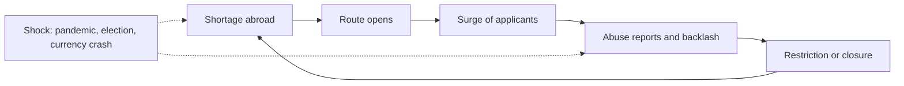

# Japacity: concept

## Context and scope

This page says what the game is: a whole life, the world it is lived in, and the ways out of Nigeria and back. Where another design page differs on the concept, this page wins. The month as it is lived is on [page 08](08-the-lived-month.md), the 3D city on [page 07](07-the-world-first.md), overstaying on [page 12](12-overstaying.md). Each rule is stated once on its rule page in `../rules/`, and the facts behind the numbers are in `../research/`.

**Japacity** is the game's name and its headline number: how ready a character is to japa, to leave, as a percentage (section 4).

## Goals and non-goals

**Goals.** The pillars in section 2: a life that is built, not a route that is picked; a world that moves for everyone at once; a main journey that can be finished early, then a life to keep living; honest dangerous routes; coming back as part of the game.

**Non-goals.** The game does not have:

- a matchmaker that pairs strangers, or typed free text between players (section 16);
- voiced radio;
- the United States as a destination: the countries are the UK, Canada, the UAE and Italy;
- a relative played as a second character, or children;
- bringing parents over;
- timed medal tests or replays of real history;
- money moved from one player to another (section 6, safety rule 4);
- live real exchange rates (section 13);
- a turn budget that paces play (section 19).

## 1. The game in one paragraph

A shared online world where you live a Nigerian life a month at a time. You do not pick a way out. You study, work, hustle, save, meet people and marry, and ways out appear as your life comes to match them. The world keeps changing for everyone at once: a currency crash, a new government abroad, a labour shortage that opens a door and a scandal that shuts it. Getting out is the main journey, and it can be finished in the first few sessions. After that the game opens up: a job to keep, a car on finance, a credit file, a partner to bring over, December at home, and the way back.

## 2. Pillars

1. **You build a life. Routes find you.**
2. **The world moves and everyone feels it.**
3. **A main journey you can finish early, then a life to keep living.**
4. **The path you leave by decides the life you get.**
5. **The people in your life can be real, and they can let you down.**
6. **Coming back is part of the game.**
7. **Honest about the dangerous routes.**

## 3. The profile

Everything the game knows about a character. Routes, offers and news all read from it.

| Group | Qualities |
|---|---|
| Education | Level and grade |
| Work | The job held, months in each job, and abroad the months worked in that country |
| Skills | English band, tech, care, driving |
| Proof | Portfolio and network: talks, launches, open-source work, people who know your name |
| Money | A wallet per currency, bank and cash; obligations; abroad a credit file |
| People | Partner, siblings and parents, each a slot (section 6) |
| Record | Refusals, returns, overstays and bans |
| Self | Age, wellbeing, energy, standing at home, the family's means |

A life's traits, what it carries from its background and prologue, stand on its travel data page.

Every gain names the routes it counts toward, and the game shows them (quality:gains-name-their-routes). A talk at a tech meetup reads "Counts toward: the talent route".

## 4. Routes as eligibility

A route is a checklist over the profile, plus a window that the world opens and closes. Nobody selects a route at the start.

**The states of a route:**

| State | What the player sees | How it changes |
|---|---|---|
| Unknown | Nothing | You hear of it from news, a person or a place |
| Heard of | A name and a rough idea | You look into it: the official page, someone who went, an adviser, an agent |
| Known | A checklist with met items ticked, and slow items such as savings filling as they grow | Stays known. The checklist reads the state as it is |
| Applying, granted, refused, departed | The application and its answer | A refusal puts the route back to known |

**Rules:**

- Where you spend time decides what you hear. Tech meetups carry talk of the talent route. The salon and the motor park carry talk of the Gulf.
- When several routes qualify, the player chooses which the chapters follow (decision 0022). The game never assigns one.
- A route can name the month by which a life that meets its hearing conditions has heard of it (`hearBy`), so a route reaches everyone close to it. Timing is what matters.
- An earlier refusal weighs on every later decision (route:visa-refusal-chance).

**Japacity, the headline number.**

- Every known route has its own figure: how much of its checklist is met, with harder items weighing more. A granted or departed route scores 100.
- Your japacity is the highest figure among known routes whose window is not closed, and routes applying, granted or departed (japacity:best-open-route-is-japacity).
- It moves with the world. A window closing can drop it. A new route can lift it.
- Abroad, the status shows the lawful months counted toward settlement and then citizenship.

**Worked example.** A graduate means to do the UK master's and builds savings for it. She never applies. She takes a job, gives talks and ships open-source work. At a meetup she hears of the talent route. Its checklist shows most of the proof already met, from things she did for other reasons. Her husband qualifies for Canada's points. They have two ways out and must choose who leads and who goes as the dependant.

**Routes that run through people:**

| Route | What it needs | Real rule behind it |
|---|---|---|
| Dependant on a partner's route (`route.uk-dependant`, `route.canada-accompany`) | A partner who leads a route that allows a dependant | The UK master's and care routes take no dependant |
| Partner visa (`route.uk-partner`, `route.canada-spouse`) | A partner settled abroad, above the UK's earnings floor of £29,000, and a relationship the interview finds real | The partner status is cut to 60 days if the relationship ends |

A sibling settled in Canada adds 15 points to a Canadian score (person:canada-sibling-bonus). It is a bonus, not a route.

The route's shape in content, abridged from `RouteEntry` in `packages/sim/src/engine/types.ts`:

```ts
interface RouteEntry {
  id: Id<"route">;
  gate: RouteGate;              // the steps it runs: study, sponsor, points, endorsement, contract, partner, dependant or road
  country: Id<"country"> | null;
  status: Id<"status"> | null;  // the status held abroad after departure
  hearIf: Requirement[];        // when talk of it reaches this profile
  hearBy: number | null;        // the month by which a life that meets hearIf has heard of it
  window: Id<"var"> | null;     // open, narrowing or closed, set by the world; null for the road
  checklist: ChecklistItem[];   // weighted items, shown once known
}
```

## 5. Background

Background is drawn and then played. It is never picked from a menu.

- **The draw**: the family's means, city or town, siblings, the parents' schooling. Random, on the prologue's own stream.
- **The prologue**: a dozen steps from sixteen, through secondary school, the entrance exam, a course or a trade, to the end of the service year. Two headlines pass as flavour, and a friend's route is heard of at step 10.
- **The front door** builds the person: a look, a first name, one archetype and an age from 18 to 29 (prologue:front-door-builds-a-person). An archetype is a preset of the prologue's answers; Begin plays them, the draws still run, and the travel data page prints how the years went. The life starts at the age picked, to the year (decision 0023).
- **The result** is a starting profile, and with it the offers that will find you. A graduate from a comfortable Lagos family hears about master's degrees. A school leaver from a town with a big family hears from a recruiter.
- **A friend who joins as your sibling shares your family's draw**: same means, same town, same parents (person:real-sibling-shares-family-draw).

## 6. People

Partner, siblings and parents are slots. A slot holds a real player or a computer character. **Nobody is ever blocked for lack of real friends** (person:nobody-real-is-needed).

**Two ways a slot gets filled:**

| Way | How it works |
|---|---|
| Invite | You share a card with what you are looking for: "a sibling already in Canada" or "a partner who is a nurse". The link brings your friend into that slot |
| Computer character | Always available, always labelled as one |

**What people give you**, all drawn from real rules:

- A partner's profile can lead the application, with you as the dependant.
- A partner settled abroad opens the partner route.
- A sibling abroad adds a fixed bonus on Canada's points, a couch when you land, and news from there before it reaches home.
- Siblings share the family's requests for money. One sibling abroad raises what the family expects of them.

**People can let you down. That is the point.**

- Either side can end a relationship. A joint application in progress collapses. The dependant gets a 60-day clock to find another way, as in the real rule.
- The one who ends it pays in standing. The one left loses nothing they earned alone.
- Courting more than one person is possible. Word travels through gossip.
- A partner who stops playing gets a warning at 7 real days. At 14 a labelled stand-in takes over, so the other player's plan keeps moving.

**The genuineness interview.** Any route that rests on a relationship ends in an interview where both partners answer questions about their shared history separately, and the answers are compared. A marriage made only for papers is a choice players can make. If it is caught, both carry a long ban on their record.

**Sponsoring someone is a long promise**, as it is in the real rules:

- The sponsor must be settled in the country and, for the UK, earn above the floor.
- Canada's undertaking outlives the relationship. A divorce does not end it.
- Someone who arrived through a partner cannot sponsor a new partner for five years, 60 months (undertaking:sponsored-arrivals-wait-to-sponsor).

**Safety rules.** These come from the cases in `../research/05-real-people-family-and-safety.md`.

1. Adults only, checked by the same date-of-birth screen for everyone: section 16.
2. Characters only. No real names or photos. The game matches characters and is not a dating service.
3. Contact is only between friends who joined through each other's invites, and even they talk in the game only in preset phrases and in-game actions (pair:preset-phrases-only). There is no free text.
4. **Money is counted together and never moved.** A couple's funds are added up for an application without leaving either wallet (person:money-counted-never-moved). No shared wallets and no sending spendable money to another player. "My partner abroad needs money for fees" is the standard romance scam.
5. Family requests are paid to the computer-run family, never to another player.
6. Invite rewards come from what the friend goes on to do, never from sending, and never anything worth cash.
7. Block and report on every interaction.

## 7. The world director

The world director is the part of the simulation's world step that decides which stories happen. Events are not a replay of history. They come from a pool of things that have really happened, fired in an order that cause and effect allows. The world is built from the world seed and the tick, the same for every player (director:world-stepped-from-seed).

**World variables**: for each route a window (open, narrowing, closed), a strictness and a surge of applicants; the exchange rates and the supply of official dollars; at home inflation and the December season; and the fees and thresholds the routes read (director:world-variables-per-route).

**The policy cycle** the director runs for each route:



**Eras.** One at a time, announced by name. An era tilts which stories fire; it sets no rule of its own. Online an era lasts from about ten real days to about a month.

| Era | What it tilts |
|---|---|
| Calm | Nothing: every group of stories weighs the same. The world starts here |
| Open door | Openings weigh three times, closures not at all |
| Hard line | Closures and stricter decisions |
| Crash at home | Rate stories and stories at home. Anyone holding hard currency is suddenly rich at home |
| Scandal | Closures, and stories about life abroad |
| Strike | Stories at home and about study |
| Pandemic | Closures, remote work and the rates. It comes once |

**What keeps the order sensible:**

- A story fires only when the world's variables allow it. A route cannot close before it has opened and surged.
- Effects arrive with a delay. Every rule change passes through rumour, announcement and in force.
- Shocks keep a minimum gap, and most rolls produce nothing.
- Personal offers follow the same logic. An offer reaches you because of who you are right now. Someone who has lost status and owes money meets the recruiter from the motor park.

**Fairness rules**, from the cases where server-wide changes drove players away:

1. Every era is named and has an end.
2. Nothing earned is deleted. Qualifications, experience and proofs survive every era (director:stories-never-undo-player-gains).
3. Applications already submitted are decided under the figures recorded when they were sent (route:application-fixes-figures).
4. Nothing takes effect less than two real days after it is announced.

## 8. News

- Each story moves through rumour, announced, in force and ended, and a character is told of each stage once (news:changed-stages-delivered-once).
- A story is marked "for you" when it touches a route the character has heard of or knows (news:for-you-when-touching-route). Era stories go to everyone's front page.
- Ranking decides what you see first. It does not tell you what is true: rumours can be false.
- **Luck in the news**: a Canadian care draw can lower the care cut-off for a while (`news.canada-care-draw`, group `openings`).

## 9. Time

**Your life moves when you play. The world moves in real time.**

| Clock | Runs on | What it drives |
|---|---|---|
| Your life | Months, lived by hand. A month's free time is spent in half-days, and the month ends when you sleep (turn:month-lived-in-half-days, world:sleep-ends-the-month) | Work, study, savings, experience, age, applications, payments due |
| The world's day | Real time, the same for everyone: one game day every 105 real minutes (clock:game-day-on-real-time) | The city's light, what is open, who is about |
| The world's tick | Real time online: one tick every 12 real hours | The rates, the stories and the eras. Real December is December |

**The bank of turns.** Each life keeps a bank of turns, and real time fills it: one turn every 2 real hours, 12 a real day, up to 24, which is two real days of filling, so two days away lose nothing. A new life starts with 24, and a closed chapter fills the bank. Each month lived takes one while it holds any, and it never holds a month back: the month turns at sleep whatever the bank holds (turn:month-turns-on-empty-bank). Its one use is the bank-full notice, sent once when it fills while the player is away (clock:full-bank-push-notification). No screen shows it.

**Why a life moves by play and not by the wall clock:**

- On any wall clock a first departure sits days away. Lived by play, a keen player can reach it in one sitting, and a player who comes by for a few minutes still moves forward.
- Absence costs nothing. Your character stands still while you are away. Only the world moves.
- The early game is generous: nothing makes the player wait to play.

**Ageing.** Age moves with the months played and matters only to the routes that really use it, such as points tables. It never ends a character, and nothing earned is lost. A player who wants a fresh start ends the life and starts a new one (account:start-a-new-life); every bond with the old life ends (person:leaving-player-ends-bonds).

## 10. The main journey

A short guided sequence that every player can finish: each chapter is a small checklist, teaches one system, and fills the bank of turns as it closes (chapter:met-items-close-the-chapter). The chapters follow the way out the player made the plan (decision 0022).

| Chapter | What you do | What it teaches |
|---|---|---|
| Prologue | The front door and the presets, from sixteen to the service year's end | The profile, the family's draw |
| 1. Find your feet | First job, first pay, hear of a route and look into it | The lived month, routes and checklists |
| 2. Build the file | The passport, the transcript, the English, an offer | Requirements, waits, agents |
| 3. Decision day | The deposit, the funds held, the application, the answer | Windows, set pieces, refusal and regrouping |
| 4. The send-off | The flight. A card to share | **The first ending** |
| 5. Landing | A room, a job held a month, the first rule of your status, the first request from home | Status, obligations, the credit file |
| 6. Secure | Settlement, a citizenship, a chosen return, or a second route | The long clocks |

A set piece is a scene that holds the month until it is answered: an exam, an interview, the December visit.

- A refusal in chapter 3 is part of the journey. Regrouping onto another route counts as progress.
- The send-off has to sit inside the first few sessions, since most players of any game never reach its end.

## 11. The long game

What stays open after the main journey.

| Menu | Contents |
|---|---|
| Life goals | A car, your own door, a step up the ladder, a clean credit file, the house back home, money sent home, December at home, settling, a second route, a return with capital (`../rules/goal.md`). In any order |
| Cards | A card at each set moment: a chapter closed, a visa granted, the send-off and its ticket stub, the first pay abroad, a status secured, the December visit, a Friday draw won, the real-story card after the road (share:cards-due-at-set-moments). The japa type once it is read (decision 0024). The stamps on the travel data page |
| Family | Siblings, a partner and parents, real or computer |
| Sponsor | Once settled, bring a partner over, and in Canada carry the undertaking that comes with it |
| Live world | Eras, December on the real calendar, the Friday draw |
| Hosting | A real friend who lands can stay with you, and your upkeep rises while they do (home:hosting-costs-the-host) |

## 12. Abroad

**The route you arrived on sets the rules you live under** (status:status-sets-work-rule).

| Status | Work | What it hangs on | Way up |
|---|---|---|---|
| UK student | One part-time job, the 20-hour cap | Fees paid on time, the course passed | The graduate status, then a sponsor |
| UK graduate | Any | 24 months, 18 once the shortening story is in force | A sponsor before it runs out |
| UK sponsored worker | One employer only | The job | Settlement after 60 lawful months |
| UK talent | Any | Little | Settlement after 36 months |
| UK partner or dependant | Any | The relationship, or the lead's status | Settlement |
| Canada permanent resident | Any | Little | Citizenship after 36 lawful months |
| Gulf contract worker | One employer only; the employer holds the passport | The employer | None. No settlement exists |
| Overstayer, in any of the four countries | Cash work only | Not being found | The grace's ways out, or home (page 12) |

The road ends, when it arrives, in Italy with no papers (road:sea-arrival-in-italy).

**When a sponsored job goes, a clock starts** (status:lost-job-starts-clock):

| Country | The clock | Inside it |
|---|---|---|
| UK | 60 days, 2 months | A job with a sponsor's certificate, which grants a new status, or leave (ladders:sponsor-job-ties-status) |
| UAE | None: the status lapses at once | Leave, or overstay |

Canada's arrivals hold permanent residence, so a lost job starts no clock.

**Past the clock is a staged overstay** (decision 0028, [page 12](12-overstaying.md)):

- First a grace: the UK 1 month, Canada 3, the UAE 1, Italy none. Leaving inside it at your own fare carries no ban, and some ways stay open from inside the country.
- After the grace, each month may bring detection, and detection brings a notice. Every way out stays open while it stands.
- Removal comes only at the notice's end, with the country's ban: 120 months for the UK and Canada, 60 for the UAE, 36 for Italy (status:notice-ends-in-removal).
- Cash work is what is left: kitchens, deliveries on a rented account, farm work in Italy. It pays badly, and part of the pay can be withheld.

**Ladders**: care shifts to senior carer, or to nursing with the NMC pin. A survival job to a professional job once local experience counts. A skilled job to senior developer, and settlement. Trips home in December.

**Obligations.** Everything owed on a schedule is one kind of record: an amount, how often, a grace, what a miss does, and what it makes possible.

| Obligation | Makes possible | If it slips |
|---|---|---|
| Rent | An address, which everything else needs | Arrears, then eviction |
| Car on finance (UK) | Jobs that need a car, the visiting round's bonus | See the chain below |
| Phone contract | A credit file | Marks on the file |
| Visa fees and the health surcharge | Staying legal. Charged as a lump at each application and renewal | Status lapses |
| Tuition instalments | The student visa | Withdrawn, visa cancelled |
| The family at home | Standing | Trust falls |
| Agent debt | Nothing. It only drains | It follows you |

**The credit file** starts empty for every arrival, whatever they earned at home (credit:file-starts-at-zero-abroad). Small on-time payments build it. It decides whether a landlord, a phone company or a car dealer says yes, and at what rate: about 9% a year for the best files to about 22% for the worst (credit:rate-follows-credit-ladder).

**The car chain**, as a worked example with the real thresholds:

1. A home carer needs a car to take the better-paid visiting work. The licence from home is valid for 12 months after arrival, then the UK test must be passed.
2. With a thin credit file the finance is expensive: a deposit, monthly payments and a final payment.
3. The sponsor loses its licence. The job goes, and a 60-day clock starts on the visa.
4. Two missed payments in a row bring a notice. **On the third, under a third paid, the car is taken at once. A third or more paid, the lender needs a court. Once half is paid, you can hand it back and owe nothing more** (car:missed-payments-take-the-car, car:car-handed-back-after-half).
5. Without the car it is the bus: fewer shifts reachable and less money. A shortfall left after the car is taken goes to court, and the judgment stays on the file for six years.
6. There is no state safety net. Most visas bar public funds.

**Brakes on a downward spiral**, built in because falling behind with no way back is why players quit this kind of game:

- A grace before any penalty.
- A way out at every stage: pay ahead, hand back, move somewhere cheaper (obligation:way-out-at-every-stage).
- No kicking while down: when a character is struggling, bad luck rolls at half its chance and good luck at double (luck:no-kicking-while-down).
- One rescue per life: a whip-round from the church, the mosque or the town association (luck:whip-round-once-per-life).
- Going home is always open and is never game over.

**Debt at home works differently.** Cars are bought with cash. Quick loan apps shame borrowers to their contacts. Savings circles run on trust, and the collector can vanish.

## 13. Money and the rate

**Money is held per currency**: naira, pounds, dollars, Canadian dollars, dirhams and euros. Each is either **in the bank** (documented) or **cash**.

**Two naira rates for each currency**, both moving:

| | Official rate | Street rate |
|---|---|---|
| Where | The bank | The aboki |
| Speed | Queued for months while the world's bank queue stands | Instant |
| Limits | A monthly allowance on buying foreign currency (wallet:monthly-fx-allowance) | None |
| Price | Lower, with a 1.5% charge | Higher by a premium |
| What you get | Documented money | Cash |
| Risk | The allowance and the queue change with the world | A short count |

**How the rates move:**

- They belong to the world, not to your months. Online they tick twice a real day.
- The street premium follows one world variable: how many official dollars are being supplied. It never falls under 2%, sits near 4% at the start, and heads for about 45% when supply falls to 40 (rate:street-premium-tracks-target). A crash era blows the gap open. A float closes it by moving the official rate to meet the street.
- **Simulated, calibrated to real history.** The game never shows live real rates.

**Why it matters in play:**

- **Fees abroad are in foreign currency. Savings start in naira.** A crash can double the bill mid-plan.
- **Proof of funds must be documented, held for a month, and valued at the official rate.** Large cash paid into the bank is recorded as a lot, and the unexplained share of the funds raises the chance of refusal (route:unexplained-share-of-funds).
- **Dollars are the hedge.** A remote job pays into a dollar account, documented, with nothing to explain later.
- **Sending money home is a choice of channel**: an app with a fee and its own rate, the bank at the official rate a month later, or informal routes that pay the street rate as cash and sometimes do not arrive (abroad-money:remit-sends-money-home).
- **Coming home with foreign savings after a crash makes you rich in naira.**

**Keeping it a part of the game and not the whole game:**

- The allowance, the spread and the charges limit what trading can earn.
- The world is built on the server from a seed that never leaves it, so the rates cannot be read ahead from the client (engine:seed-never-leaves-authority).
- The rate is a small choice to weigh on a short visit, and it must never become a chore.

**Topped-up naira.** The wallet can hold naira that came from outside play as a top-up, marked apart from naira earned (wallet:top-ups-are-marked, decision 0015). Every debit spends earned naira first, and topped-up naira never buys a ticket, since the draw is fair only when every ticket is bought with money earned in the game. Only the authority's command credits a top-up, and a life with no top-up is unchanged.

**Naming.** Street changers are called aboki in the game, as they are in everyday speech.

## 14. Home again

| Shape of return | What it carries |
|---|---|
| Removed | A ban on the record. Standing falls hardest |
| Assisted | A free flight, for those with no status or fare left; from the UK the returns service adds a grant of £1,500 |
| Broke | The fare was paid, and little is left |
| By choice | Savings that go far at home, and questions from everyone |
| With papers | A settled or citizen status, or a status a trip home keeps, with the door still open |

The shapes are decided at the moment of return (place:return-shape-decided-at-once). A return with capital is a goal, not a shape.

- **The family house is always there.** Whatever happens abroad, the family house takes you back, with the family's opinions included (place:family-takes-you-back).
- **How you leave decides whether you can go back.** Leaving by choice keeps doors open. Being removed closes that country for years.
- **Fares swing with the real calendar.** December costs several times the off-peak fare.
- **The December visit is a set piece**: inflated prices, pressure to look successful, a chance to raise standing or burn a year of savings.
- **The house back home** is a long goal: land, then the money held for it.
- **Standing** moves with the shape of the return. Returnees still have to work, and some leave again: every route runs again from home.

## 15. What play looks like

| When | What happens |
|---|---|
| The first minute | The front door: three screens, Next, Next, Begin. The page prints, and the life starts in Lagos |
| A sitting | A few lived months: acts spent in half-days, a sleep to end each month, what the month earned, a few stories, one decision, maybe a set piece |
| A first keen sitting | Chapters 1 to 3 and the send-off |
| A real day | The city's day turns about fourteen times. The rates move twice. Stories move on |
| A real month | An era or two. Status secured or a return chosen. The long game open |

Places matter. The 3D city is where set pieces happen, where other players are, and where you overhear the routes you did not know existed.

## 16. Who can play, and how players meet

Every player, from any country. A neutral date-of-birth screen turns away under-18s, and sign-up is open everywhere. Contact is only between players who joined through each other's invites, in preset phrases, with block, report, and complaints under clear terms. The game has no matchmaker for strangers and no typed text; either would need the date-of-birth screen, a one-time acknowledgement that the player is responsible for who they talk to, and block and report.

**So**: one game for everyone. There is no table of regions and nothing a player may do turns on their country; contact is fixed behaviour in the server (`../rules/region.md`, decision 0021). No strong age check is asked for.

## 17. What is in the game

Accounts, the whole life from the prologue to securing status and coming back, the shared world, both rates, life abroad, friends as partners and siblings, the 3D city, and sound. The other design pages are listed in `README.md`.

The ways out: six of the player's own effort (the UK master's, care, skilled work and talent, Canada's points, the Gulf contract), four through a partner (the UK dependant and partner routes, Canada's accompanying spouse and spousal sponsorship), and the road. Every country plays the same game.

**The road, desert then sea, is the dangerous route.** How it works:

- It is never labelled. It arrives as an offer, on the radio, at the motor park or through a cousin, that beats the formal routes on every number the player can see.
- The truth comes in steps: a deposit, a night meeting, the news that it is by road, then more money. Turning back early costs the deposit. After that the choices shrink.
- Some cheap offers are the road, some are fraud, a few are real.
- **Anyone at home can take it.** It is ranked like the news: seen less often and lower down by a player with better options. The game never pushes it.
- Every dealer is a computer character. No player profits from another.
- A content switch, `tuning.road.enabled`, turns the road off for everyone.
- The chain under way has a screen of its own.
- The full rules are in `../rules/road.md`, "What the road holds to".

## 18. What could go wrong in play, and how the design answers it

| What could go wrong | How the design answers it |
|---|---|
| The rate becomes a chore, or trading becomes the whole game | The monthly allowance, the spread and the charges, and rates that move only twice a real day |
| The game reads as a source of real street rates | Simulated rates only, never a live feed of real ones |
| Matching strangers as partners invites scams and harassment | The safety rules in section 6. Contact only between friends who invited each other; no matchmaker and no typed text |
| Family points with no check would teach fraud | The genuineness interview and long bans |
| Debt chains become spirals with no way out | The brakes in section 12 |
| Many qualities and routes are hard to write and balance | Content is plain data checked before play, and simulated players run lives on the real content to find dead ends (engine:player-never-stuck) |
| A personal feed hides the wider world | The shared front page |
| A change to the whole world undoes what a player has built | The four fairness rules |

## 19. Alternatives considered

| Instead of | The game does | Why |
|---|---|---|
| Picking a route at the start | Routes found through the life | A picked route makes the life a checklist; a found one makes the life the game |
| Pacing by the wall clock | Months lived by play | A first departure on any wall clock sits days away |
| A turn budget as the pacing: a month costs a turn, and an empty bank stops play | A month lived by hand that ends at sleep; the bank never holds a month back | A month lived by hand needs no budget, and a budget would stop a player mid-sitting |
| A relative as a second character for a restart | A new life | One life at a time keeps the people rules simple, and a second character would feed the first |
| Live real rates | Simulated rates calibrated to real history | A live feed would read as a source of real street rates |
| A matchmaker for strangers, or typed text | Invites and preset phrases | Each would open the romance scam and harassment the safety rules close |
