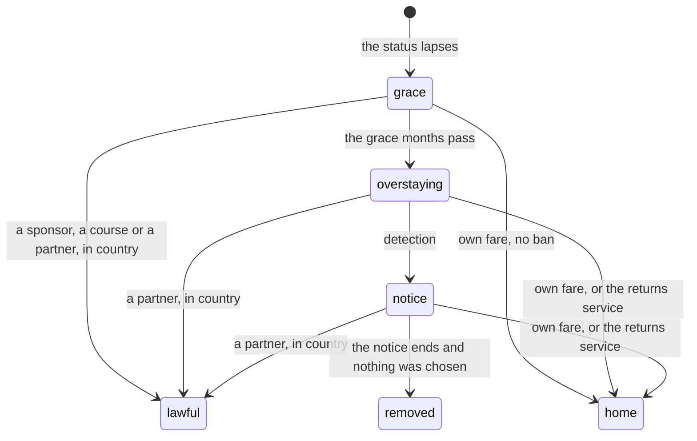

# Overstaying

**Context and scope.** This page covers what happens when a status abroad runs out and the character stays. Overstaying runs in three stages: the grace (a first month or months to put things right from inside the country), the overstay itself, and the notice (a warning with a deadline to leave or fix it). Removal is the last case, and every way out is priced in real terms. The rules are in `../rules/status.md` (status:overstayer-risks-detection to status:uae-amnesty), `../rules/place.md` (place:leaving-an-overstay-bans, place:returns-service-takes-you-home), `../rules/route.md` (route:lapsed-route-known-again), `../rules/route-gates.md` (route-gates:in-country-grant-switches-status, route-gates:canada-return-asks-authorisation), `../rules/person.md` (person:partner-route-in-country), `../rules/abroad-money.md` (abroad-money:right-to-rent-check) and `../rules/road.md` (road:sea-arrival-in-italy). This page is for game design, not immigration advice.

**Goals.**

- A lapse is a shock, but a door stays open. The grace says plainly what can still be done from inside the country.
- The overstay narrows the life but is never a trap. The ways out are at the room's bag, each with its price and its ban stated in words, and a player who takes one is never removed.
- Removal is rare and fair. It comes only after a notice, and only to a player who let the notice run out.

**Non-goals.** Removal at once on detection; showing the player a detection chance; a ban the player is not told about before tapping.

## 1. Summary

Losing status is a hard turn, not an ending. The player gets a month to fix it from inside, then a narrower life with the ways out still open. Removal comes only to someone who was told and chose nothing.

## 2. Why

- **Real enforcement is slow.** The UK removed about 9,914 people in 2025, against an estimated 700,000 to 900,000 people without papers: about 1% to 1.5% a year.
- **Real life keeps doors open.** A late application within days, leaving by choice for a short ban, the returns service, a settled partner.

So the game removes no one at once. The player can still apply for another master's, join someone on a visa, or go home by choice; removal is the last case. Detection is 1% a month in the UK, Canada and Italy and 2% in the UAE, one point more in a month with cash work. That is about eight times real enforcement, so the risk is felt without ending lives at random.

## 3. The three stages

**1. The grace.** The first month after a lapse (three months in Canada; none for the road's arrival in Italy). No one is looking yet and the room is safe. Three ways are open from inside the country:

- a job with a sponsor's certificate;
- a new course;
- a partner or dependant visa with someone who holds the right status.

An application sent in the grace keeps the grace going until it is answered. Going home in the grace at your own fare carries no ban.

**2. Overstaying.** From the month after the grace:

- Work is cash only.
- Each month carries a small chance of detection (1%, 2% in the UAE, one point more with cash work). It is never shown.
- Life narrows. In the UK the landlord's check can end the room, and the next room asks no papers but costs more. The hospital charges half as much again. In the UAE the fine grows every month.
- The ways out stay open: home at your own fare, the returns service, a settled partner. Each carries a ban, stated in plain words before the tap.

**3. The notice.** Detection brings a notice, not removal: three months in the UK, one month elsewhere. Every way out stays open, and an application to a partner's route holds the notice until it is answered. Removal, with the country's full ban, comes only at the notice's end with nothing chosen and nothing pending.

## 4. The ways out

| Way | When | What it costs | Ban (the UK) |
|---|---|---|---|
| A sponsor's job | The grace | A job hunt, as for any job | None: the job is the new status |
| A new course | In the grace, in country; from home after any ban | A school's offer, a deposit, the funds held for a month: rarely ready within a month, as in life | None in country; from home, after the ban |
| A partner's or dependant's visa | Partner: any time while overstaying. Dependant: the grace | The partner route's needs; the overstay counts as one earlier refusal; a partner status granted after the grace leads to settlement in ten years, not five | None |
| Home at your own fare | Any time | The fare; standing by the shape of the return | None in the grace, 12 months after it |
| The returns service (the Home Office's paid way home) | Any time | Nothing: the ticket is paid and £1,500 arrives in naira at home | 24 months |
| Removal | The notice's end, nothing chosen | Standing -20 | 120 months |

Every return after the grace, and every removal, stays on the record as one earlier refusal on the next application into that country. On any loss of status the route flown on goes back to known, so the master's can be applied for again once the ban lifts.

## 5. Each country

**The UK.** As above: a grace of 1 month, a notice of 3, bans of none, 12, 24 and 120 months, the right-to-rent check, the hospital charge, and the returns service.

**Canada.**

- The grace is the 90-day restoration window: three months.
- The notice works as a departure order: leave inside it and there is no ban.
- Leaving at your own fare is never banned. An assisted return is an exclusion order: 12 months.
- Removal is a deportation order: 120 months. After it, the first application into Canada also pays for the Authorisation to Return and repays the removal costs.
- No Canadian status in the game runs out, because permanent residence does not lapse. Canada's overstay figures are in content all the same.

**The UAE.**

- Leaving the employer is absconding. The grace is one month.
- After the grace the fine grows by AED 1,500 a month (AED 50 a day). It is paid with the fare at the airport, or an assisted return carries it home as a debt in naira.
- A return after the grace, at your own fare or assisted, brings the one-year labour ban. Removal bans for 60 months.
- An amnesty story, as in 2024, lets anyone leave for four months with no fine and no ban.

**Italy.**

- The road arrives with no papers, so there is no grace.
- Detection brings an expulsion order with a month to leave.
- The assisted return, before or during the order, carries no ban. Removal bans for 36 months, the real minimum.

## 6. Real rules compared with the game

| Where | Real life | The game | The factor |
|---|---|---|---|
| UK grace for applying | 14 days, with a good reason (the Immigration Rules, part Suitability, paragraph 13.1) | 1 month, no reason asked | About twice as kind |
| UK grace for leaving | 30 days or less at your own expense, no ban (part Suitability, paragraph 11.5) | 1 month | The same |
| UK own fare after the grace | 12 months (part Suitability, paragraph 12.1) | 12 months | 1.0 |
| UK returns service ban | 2 years within 6 months of a notice, 5 years later | 24 months always | Kinder past six months |
| UK returns service money | The ticket if you cannot pay, and up to £3,000 | The ticket for anyone, and £1,500 at once | 0.5 of the maximum, paid to all |
| UK notice before removal | None set | 3 months | Kinder |
| UK removal ban | 10 years | 120 months | 1.0 |
| Detection | About 1% to 1.5% a year | 1% a month, about 11% a year (2% a month in the UAE) | About 8 times real, so the risk is felt |
| UK in-country partner route | Only where there are insurmountable obstacles to family life abroad (the family rules' exception EX.1); then the ten-year route | No obstacles test; ten years to settle; one earlier refusal counted | Kinder on the test, 1.0 on the years |
| UK right to rent | Landlords must check; no figure for how often a room ends | 15% a month, and a room with no papers at £840 against £670 | Working values |
| UK hospital | 150% of the NHS tariff; A&E and GP free | 150% of the game's own hospital figure | 1.0 on the share |
| Canada grace | 90 days, with a fee of C$246.25 plus the permit's fee | 3 months, no fee | Kinder on the fee |
| Canada removal | Barred for good unless an Authorisation to Return is granted, after repaying C$3,840 | 120 months, then C$492.50 and C$3,840, certain | Finite where real life is permanent |
| UAE grace | An absconding report can follow 7 days' absence | 1 month | Kinder |
| UAE fine | AED 50 a day | AED 1,500 a month | 1.0 |
| UAE unpaid fine | Must be paid before leaving | An assisted return carries it home as a debt | Kinder |
| UAE labour ban | One year on a new work permit | 12 months on routes into the UAE | 1.0 in effect |
| Italy order | 7 to 30 days to leave; ban of 3 to 5 years, revocable on leaving in time | 1 month; no ban if you leave; 36 months if removed | The real minimum |

## 7. Costs of an overstay

- **Cash work.** It pays in hand, costs energy, and raises the chance of detection by one point that month. Wages can be withheld, as ladders:cash-jobs-paid-in-hand sets.
- **The room with no papers.** A fixed rent about a quarter above the shared room: £840 against £670.
- **The UAE's fine.** AED 1,500 for each month past the grace, paid with the fare at the airport or carried home as a debt in naira.
- **The returns service.** £1,500 once, arriving in naira at home.
- **Canada's authorisation to return.** C$4,332.50 once (the fee of C$492.50 and removal costs of C$3,840), on the first application after a removal's ban.

## 8. How sure the figures are

- Confirmed from each country's rules, listed with the date each was read in the Sources of `../rules/status.md`: the UK's refusal periods, the 14-day and 30-day rules, the returns service, Canada's three orders and fees, the UAE's daily fine and amnesty, Italy's order and ban.
- Inferred: the real anchor for the detection rate (enforced returns over an estimate of people without papers from 2017); the UAE's removal ban; the right-to-rent chance; the current form of the hospital charge.

## 9. Alternatives considered

- **Removal at once.** A lapsed status becomes an overstay, and a detection draw sends the character home at once with the country's longest ban. Rejected: real enforcement is slow and real life keeps doors open, and a draw of a few percent a month would end lives at random. The grace, the notice and the ways out keep removal for someone who was told and chose nothing.
- **No overstay at all.** The life ends, or the character flies home, the month the status runs out. Rejected: it hides the hardest real choice of a life abroad. The narrow life of the overstay shows it.
