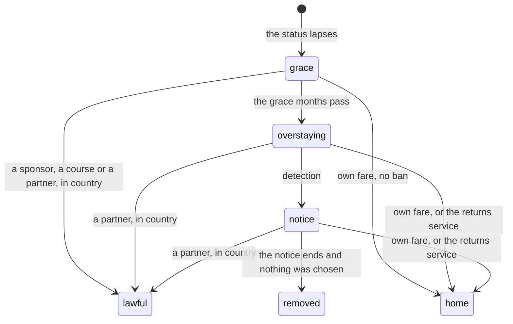

# Overstaying

**Context and scope.** Why a status abroad that runs out leads to a staged overstay rather than removal: the grace (a first month or months to put things right from inside the country), the overstay itself, and the notice (a warning with a deadline to leave or fix it), with removal as the last case and every way out priced in real terms (decision 0028). The rules, and each country's figures in the table "Entries: overstaying, country by country", are on [`status.md`](../rules/status.md) (status:overstayer-risks-detection to status:uae-amnesty). The ways home and their bans are on [`place.md`](../rules/place.md) (place:leaving-an-overstay-bans, place:returns-service-takes-you-home). In-country applications are route:lapsed-route-known-again, route-gates:in-country-grant-switches-status and person:partner-route-in-country; Canada's return after a removal is route-gates:canada-return-asks-authorisation; the room is abroad-money:right-to-rent-check; Italy's arrival is road:sea-arrival-in-italy. This page is for game design, not immigration advice.

**Goals.**

- A lapse is a shock, but a door stays open. The grace says plainly what can still be done from inside the country.
- The overstay narrows the life but is never a trap. The ways out are at the room's bag, each with its price and its ban stated in words, and a player who takes one is never removed.
- Removal is rare and fair. It comes only after a notice, and only to a player who let the notice run out.

**Non-goals.** Removal at once on detection; showing the player a detection chance; a ban the player is not told about before tapping.

## 1. Summary

Losing status is a hard turn, not an ending. The player gets time to fix it from inside, then a narrower life with the ways out still open. Removal comes only to someone who was told and chose nothing.

## 2. Why

- **Real enforcement is slow.** The UK removed about 9,914 people in 2025, against an estimated 700,000 to 900,000 people without papers: about 1% to 1.5% a year.
- **Real life keeps doors open.** A late application within days, leaving by choice for a short ban, the returns service, a settled partner.

So the game removes no one at once. The player can still apply for another master's, join someone on a visa, or go home by choice; removal is the last case. The game's monthly chance of detection (status:overstayer-risks-detection) comes to about eight times real enforcement over a year, so the risk is felt without ending lives at random.

## 3. The three stages

**1. The grace** (status:grace-before-overstaying, status:grace-allows-in-country-applications). No one is looking yet and the room is safe. It stands for the real short windows in which a late application or a quick departure is forgiven. Three ways are open from inside the country: a job with a sponsor's certificate, a new course, or a partner or dependant visa with someone who holds the right status. Going home in the grace at your own fare carries no ban.

**2. Overstaying** (status:overstayer-risks-detection). Work is cash only, each month carries a small chance of detection that is never shown, and life narrows: in the UK the landlord's check can end the room and the hospital charges more; in the UAE a fine grows every month. The ways out stay open, each with its ban stated in plain words before the tap.

**3. The notice** (status:detection-gives-notice, status:notice-ends-in-removal). Detection brings a notice, not removal, because real removal follows a notice or an order. Every way out stays open while it stands. Removal, with the country's full ban, comes only at the notice's end with nothing chosen and nothing pending.

## 4. The ways out

| Way | Why it is there | Rule |
|---|---|---|
| A sponsor's job | A new sponsor is the real way to stay lawfully after a job goes | status:grace-allows-in-country-applications, ladders:sponsor-job-ties-status |
| A new course | The student's way back in. From inside the country it is rarely ready in time, as in life; from home it waits for any ban | status:grace-allows-in-country-applications, route:lapsed-route-known-again |
| A partner's or dependant's visa | Real life allows the partner route from an overstay, on the longer road to settlement | person:partner-route-in-country |
| Home at your own fare | Leaving by choice is the real way to keep the ban short | place:leaving-an-overstay-bans |
| The returns service | The UK pays some people to go home; the game offers it to anyone who asks | place:returns-service-takes-you-home |
| Removal | The last case, only at a notice's end | status:removal-sends-home-banned, place:removal-bans-the-country |

Every return after the grace, and every removal, counts against the next application into that country (status:overstay-counts-as-refusal). On any loss of status the route flown on goes back to known, so the master's can be applied for again once the ban lifts (route:lapsed-route-known-again).

## 5. Each country

Each country's stages stand for its own real orders; the figures are in the overstaying table of [`status.md`](../rules/status.md).

- **The UK.** The grace, the right-to-rent check, the hospital charge and the returns service, with the UK's real refusal periods as the bans.
- **Canada.** The grace is the real 90-day restoration window. The notice works as a departure order, an assisted return as an exclusion order, and removal as a deportation order, after which the first application into Canada also pays for the Authorisation to Return (route-gates:canada-return-asks-authorisation). No Canadian status in the game runs out, because permanent residence does not lapse, but Canada's overstay figures are in content all the same.
- **The UAE.** Leaving the employer is absconding. After the grace the fine grows each month, and a return brings the real one-year labour ban (status:uae-fine-accrues). An amnesty story, as in 2024, lets anyone leave with no fine and no ban (status:uae-amnesty).
- **Italy.** The road arrives with no papers, so there is no grace. Detection brings an expulsion order with time to leave, the assisted return carries no ban, and removal bans for the real minimum.

## 6. Real rules compared with the game

[`status.md`](../rules/status.md) sets each figure against the real rule it stands for, with its source, in its Numbers. The pattern:

- **The same as real life:** the UK's ban for leaving at your own fare after the grace and its ban on removal, the UAE's daily fine and labour ban, the in-country partner route's ten years to settle, and the UK hospital's share of the tariff.
- **Kinder than real life:** the graces (no reason asked, and longer than the UAE's real seven days), a notice before every removal where the UK sets none, the returns service paid to anyone at once, an assisted return that carries the UAE's fine home as a debt, and a finite ban from Canada where the real one lasts until an Authorisation to Return is granted.
- **Harsher than real life:** detection, at about eight times the real rate, so the risk is felt.
- **Working values:** how often the landlord's check ends a room, and the UAE's removal ban.

## 7. Costs of an overstay

Each cost stands for something an overstayer really pays:

- **Cash work** pays in hand, costs energy, raises the month's chance of detection, and can be withheld (ladders:cash-jobs-paid-in-hand).
- **The room with no papers** asks no papers but costs more than the shared room (abroad-money:right-to-rent-check).
- **The UAE's fine** for each month past the grace, paid with the fare at the airport or carried home as a debt in naira (status:uae-fine-accrues).
- **The returns service's grant**, paid once, arriving in naira at home (place:returns-service-takes-you-home).
- **Canada's Authorisation to Return**, its fee and the removal costs, paid once on the first application after a removal's ban (route-gates:canada-return-asks-authorisation).

## 8. How sure the figures are

- Confirmed from each country's rules, listed with the date each was read in the Sources of [`status.md`](../rules/status.md): the UK's refusal periods, the 14-day and 30-day rules, the returns service, Canada's three orders and fees, the UAE's daily fine and amnesty, Italy's order and ban.
- Inferred: the real anchor for the detection rate (enforced returns over an estimate of people without papers from 2017); the UAE's removal ban; the right-to-rent chance; the current form of the hospital charge.

## 9. Alternatives considered

- **Removal at once.** A lapsed status becomes an overstay, and a detection draw sends the character home at once with the country's longest ban. Rejected: real enforcement is slow and real life keeps doors open, and a draw of a few percent a month would end lives at random. The grace, the notice and the ways out keep removal for someone who was told and chose nothing.
- **No overstay at all.** The life ends, or the character flies home, the month the status runs out. Rejected: it hides the hardest real choice of a life abroad. The narrow life of the overstay shows it.
