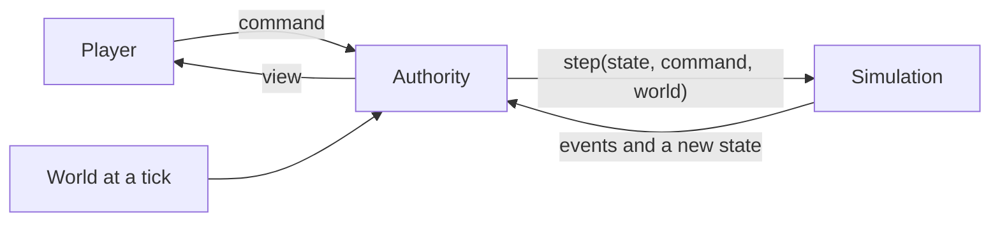

# The engine contract

> Every kind is built against this page. Changing it needs a decision record.
> Background: `../design/02-quality-and-testing.md`, `../design/03-structure-and-conventions.md`, `../design/04-where-things-live.md` section 7.
> The types that go with this page are in `packages/sim/src/engine/types.ts`.

## 1. The shape of it



| Word | Meaning |
|---|---|
| State | One character's whole life as plain data. It holds ids and whole numbers, never content |
| Content | The data tables: routes, jobs, offers, text. Versioned, shipped with the code |
| World | What is the same for everyone at one tick: rates, rule numbers, news. Passed in, never stored in the state |
| Command | What a player asks for: `turn/end`, `offer/choose` |
| Event | What happened, past tense: `wallet/credited`. Only events change state |
| Authority | Whoever holds the full state and the seed, and runs `step`. For the public game it is the server; for development, tests and offline play it runs in the same browser tab (engine:browser-authority-for-dev-only) |
| View | What one player may see of the state. The interface reads only this |

One function does the work:

```ts
step(state, command, world, content) -> { ok: true, state, events, lines } | { ok: false, code, detail }
```

## 2. Rules

**engine:same-inputs-same-result** The same starting state, world and command give the same result, every time and on every machine.

**engine:only-events-change-state** Only events change state. A rejected command changes nothing and records no event.

**engine:stale-commands-rejected** Every command carries the state version it was based on. If the state has moved on, the command is rejected with the code `stale`. Each accepted command raises the version by one.

**engine:turn-phases-in-fixed-order** A turn resolves in the fixed order in section 4. Each phase sees the state left by the phase before it.

**engine:randomness-from-named-streams** Random numbers come from named streams. The nth draw of a stream depends only on the seed, the stream's name and n. A draw from one stream never changes what another stream gives.

**engine:money-in-whole-minor-units** Money is a whole number of the smallest unit: kobo, pence, cents. No balance is ever below zero. Every change to a balance is an event with a named source or sink.

**engine:view-holds-no-hidden-field** The view holds no hidden field: no seed, no draw counts, no `secret` object, and nothing about a result that has not been announced to the player. The view's keys include `passbook` (wallet:passbook-against-plan-cost), and the wallet's events include `wallet/paced` and `wallet/stamped` (wallet:savings-stamps, wallet:saving-pace).

**engine:seed-never-leaves-authority** The seed never leaves the authority. A result that needs a random draw or a hidden field is decided by the authority alone.

**engine:no-fractions-in-simulation** The simulation uses no fractions. Division happens only through the helpers in `engine/int.ts`, which round down unless their name says otherwise.

**engine:state-is-plain-data** A state is plain data. Turning it to JSON and back gives an equal state. A save at its simplest is one segment: the `schema` number, the scenario, the seed, the world seed, the content version, the overlay version if one was applied, and the list of accepted commands, each with its tick and its sender. Replaying that list under that content rebuilds the state exactly. Online, a save is a list of such segments (decision 0004; `engine/replay.ts`; server:save-is-list-of-segments, server:newer-content-upgrades-state and server:upgrade-state-is-pure): each holds the commands accepted under one content version and one overlay, the first starting from the scenario and the seeds, a later one from a base state carried to the newer content by `upgradeState`. Replaying the segments in order rebuilds the state exactly.

**engine:player-never-stuck** A player is never stuck. With a turn banked and no set piece open, ending the turn with every free slot resting is legal, whatever the character owes. With a set piece open, at least one answer is legal.

**engine:simulation-reads-no-clock** The simulation never reads a clock. The world's tick arrives with each command, and a command whose tick is lower than the last accepted one is rejected with the code `clock-went-back`.

**engine:kinds-own-their-state** An event belongs to one kind, named by the part before the slash. Only that kind's own code changes that kind's part of the state. The engine keeps four counters of its own, the version, the tick, the draw counts and the next instance number, and each accepted command ends with one `engine/stepped` event that carries them.

**engine:content-checked-before-play** Content is checked before play: every entry fits its schema, every id an entry mentions exists, and every amount is a whole number. For the public content this runs in the test suite; for any content the authority loads with an overlay it runs at load, and a failure refuses the content.

**engine:browser-authority-for-dev-only** The in-browser authority exists for development, tests and offline play. A production build runs it only when the build is told to in so many words (`VITE_ALLOW_LOCAL_AUTHORITY=1`), and never accepts a state, a balance or a result from the client in any other way. A test proves the production resolver refuses the local authority without that setting. The server is the only authority for the public game. The online authority fails loudly and in kind. Every `/api` request goes through one request function (`apps/client/src/shared/net/http.ts`) with a clock (8 s for a read, 15 s for a command), the cookie sent same-origin only, no redirect followed, and its answer sorted into a class: `ok`; `rejected` (the game's own refusal with its code, at any status); `wall` (a redirect, an opaque redirect, a 401 or 403 with no JSON body of the server's, or a page where JSON was expected; account:session-is-secure-cookie); `server` (a 5xx without the game's refusal, or with the server's own `unavailable`, server:no-platform-error-page: that failure carries the refusal's shape but is no refusal, so the card shows for it); `network` (the fetch threw or ran out of time). No catch in the authority is empty. A failed view is asked for again twice, after 1 s and 3 s, then a card says what happened in a person's words ("The server did not answer.", "Your session ended: open the game again.", "Something broke on our side.") with Retry, and Reload for a wall. A failed command or Begin keeps what was sent and shows the same card over the sheet that sent it; Retry sends it again on the version it was first sent on, so a command that landed before its answer was lost comes back stale and is never played twice. "Opening your life..." adds "Still opening..." after 5 s, and "The game could not start" never shows a browser's own words. On `pageshow` and on turning visible the view is read again (one request, the usual card on failure); the clock and the month kept on the device stay. The door's run stays on the device until Begin is answered: before, a reload comes back to the page filled in; after, the authority holds the life and a reload opens it where it stands. Every call to the server goes through that request function, not the authority's alone: the age screen, the guest start, the auth library's code, Google and passkey calls (through the same function as a `fetch`), and the notice's routes; each sends the cookie same-origin. The interface counters stay on `navigator.sendBeacon` (analytics:client-batches-counters), which has no answer to sort. No screen shows an error's own text: a failed request is said by the trouble words of its kind, and a test scans the client for an error's message read to be shown. No file under `apps/client/src` sets raw HTML (`dangerouslySetInnerHTML`, `innerHTML`, `insertAdjacentHTML`, `document.write` and the like). React escapes every string it renders, so a player's words never become markup, and a test scans the sources for each of these. Online, a visitor this device keeps no life for never sees "Opening your life". While the first view is asked for, the start screen's frame stands (the sheet with the hook and the three steps, text:hook-not-explanation, over the scene's ground; the city need not draw), saying only that it is checking; when the view cannot be read (server:no-platform-error-page's `unavailable` included), the trouble card stands in that sheet with the game's name at its head, and Retry asks again with the frame still up, so the start screen itself takes the frame's place once the server answers. A player whose life is kept on the device keeps the opening words and the card in their place. The page's first paint is the splash: the game's ground on the body, the brand's small mark drawn inline in index.html (one symbol, never a request) and the game's name under it, about a third down the screen; it carries no other words, since before its script the page cannot know whether this device keeps a life. The opening screen renders the same splash from one component (`shared/ui/Splash.tsx`, held equal to index.html by a test) and adds "Opening your life..." under the name, pulsing by opacity over two seconds and still under reduced motion, with "Still opening..." after five seconds as a second line. A fault takes the game's card dress, never red text: on the splash under the mark where a life was opening, in its place elsewhere (the start screen's sheet, over the sheet that sent it); the line by its kind, a plain detail under it with no status or code, Retry as the yellow pressed button and Reload as the quiet one for a wall; the game's own fault ("The game could not start") is the same card with Reload. The splash's inline style and drawing stay under 1.5 KB. Every wait takes one bar (`shared/ui/Loader`): 4 px, the ink on the sheet line, running by transform alone when the share is unknown and filling to the share when known, standing still under reduced motion; the opening's words carry it, and "Still opening..." arrives under the bar so the bar never moves.

**engine:first-download-has-budget** What a first visit downloads has a budget. `pnpm check:size` (a step of `pnpm check` after `check:assets`, and of the check workflow) builds the client in production mode with placeholder settings in a deploy's shape, takes the chunks the page loads first (the entry and every chunk it imports statically, which its modulepreload links name), and compares each part's gzipped size with `tools/check/size-budget.json`: the main chunk, three.js's core, the simulation with the content, the model loader, the other shared chunks, and their total. Each budget is the size measured when it was set plus five percent, kept beside it in whole bytes; a part over its budget fails the check with its name and both numbers. A budget is lowered on purpose and never raised quietly: every change to the file adds a dated line saying why, and no budget may stand above its measured size plus five percent. The same check fails when any of the admin page's code is in those chunks (moderation:admin-view-for-admin-list). The served folder `apps/client/public` holds only what the page uses and never a markdown page: the brand's notes live in `apps/client/brand/`, and a test holds the folder to it. A build for players (`forPlayers` in `apps/client/vite/shipping.plugin.ts`, every `vite build` outside development mode, staging and production alike) ships no source map and no `sourceMappingURL`; drops every console call but `console.error` (the boundary's report, analytics:client-sends-interface-counts) and the one `console.info` build line (server:production-and-staging), and every `debugger`, through the bundler's pure-function list and minifier (one `console.warn` inside react-three-fiber's dispose stays, named as the only exception); keeps the development switches (`?fan=off`, `?paint=`, `?clock=`, `?sleep=`, `?tiles`, `?lively`, `?morning=`, `__wink`) and the development-page chunks behind `import.meta.env.DEV`, so they leave the shipped code; writes every bundled library's licence, the fonts' and Tailwind's with them, to `licenses.txt` beside the page; and minifies with the default minifier and hashed file names, no obfuscation beyond that. `tests/shipped-build.test.ts` builds the client both ways and proves each point.

**engine:limits-tested-through-step** Every limit the player can meet is a rule of the simulation with a test that sends the over-limit command through `step`: the slot count, the bank allowance, an offer's amount range, an obligation's payment, a deposit without an offer, a departure without a grant. No limit lives only in the interface.

**engine:numbers-read-from-content** Content is one plain object, and every number the game runs on is read from it: the tuning table and the entries. A pure function `applyOverlay(content, overlay)` returns a copy with any part of that object replaced, runs the schemas and `checkContent` on the result, and throws when they fail. An overlay carries a `version` that the save records. No rule number lives in code: the offer chance per grade and its cap, the good grade, the funds share that makes a refusal reason, the band step and the soft-cap share are all tuning. The public defaults alone run the whole game and pass every test; a private overlay may change the live numbers without touching a rule.

**engine:report-money-is-typed** Money in a report line's params is a typed `{ currency, amount }` in minor units, never a bare number; a bare number in a line is a count, a band or a point. The words page (`text.md`, "Money on screen") says how the screen shows it.

## 3. Commands

Every command has `type`, `basedOn` (the state version) and its own fields. The authority adds the tick.

| Command | Fields | Costs a turn |
|---|---|---|
| `turn/end` | `slots`: what fills each free slot this month | Yes, one |
| `activity/quit` | `side`: true to quit the side job (activity:side-job-holds-a-slot); missing quits the main job | No |
| `offer/choose` | `offer` (the instance), `choice`, and `amount` where the offer asks for one | No |
| `wallet/convert` | `from`, `to`, `amount` of the first currency, `via`: bank or aboki | No |
| `wallet/move` | `currency`, `amount`, `to`: bank or cash | No |
| `obligation/pay` | `obligation` (the instance), `amount` | No |
| `route/pay-deposit` | `route`, `school` | No |
| `route/depart` | `route` | No |
| `setpiece/answer` | `question`, `answer` | No |
| `turns/grant` | `count`. Sent by the authority only | No |
| `wallet/remit` | `currency` (a foreign one), `amount`, `channel`: app, bank or informal (abroad-money:remit-sends-money-home) | No |
| `prologue/choose` | `step`, `answer` (prologue:steps-offer-legal-answers) | No |
| `status/renew` | (status:renewing-a-status, status:view-shows-status) | No |
| `return/home` | `scheme`: true asks the UK's returns service (place:returns-service-takes-you-home); otherwise nothing. The shape of the return is worked out, not sent (place:return-home-paid-or-assisted, place:return-shape-decided-at-once) | No |
| `place/ride` | `from`, `to`, `way`: danfo, keke or okada (place:rides-between-city-places) | No |
| `activity/now` | `activity`, `param`: a now-act answered at once where it is staged (activity:now-acts-and-month-acts) | No |
| `chapter/lean` | `route`: make a way out heard of or looked into the plan the chapters follow (chapter.md) | No |
| `home/move` | `to`: the home place moved to (home:move-home-once-a-month, home:taken-in-after-eviction) | No |
| `home/host` | `pair`, `until`. Sent by the authority only: a joined player's character stays with this one (home:hosting-costs-the-host) | No |
| `interview/answer` | `question`, `option` (interview.md) | No |
| `interview/open`, `interview/scored` | Sent by the authority only: the genuineness interview opened for a pair, and the other side's answers (interview:partner-application-opens-interview, interview:thin-record-triggers-interview, interview:draws-made-in-one-life) | No |
| `lottery/buy` | `tickets` (lottery.md) | No |
| `lottery/pay` | `draw`, `prizes`. Sent by the authority only, after the draw | No |
| the people commands | `people/invite`, `court`, `propose`, `answer`, `withdraw`, `consent`, `end` from the player; `people/link`, `facts`, `moments`, `proposal`, `agreed`, `ended`, `declined`, `withdrawn`, `gossip`, `stand-in`, `family-request` from the authority alone (person:nobody-real-is-needed, person:courting-opens-a-bond, person:time-together-is-an-act, person:talking-adds-moments, person:proposing-a-step, person:agreed-partner-and-marriage, person:one-partner-at-a-time, person:routes-name-dependant-routes, person:statuses-name-dependants, person:family-requests-shared, person:either-side-ends-a-bond, person:joint-collapses-with-bond, person:ender-pays-in-standing, person:one-left-keeps-own-gains, person:ended-bond-record-kept and person:leaving-player-ends-bonds) | No |

**Rejection codes**: `stale`, `clock-went-back`, `no-turns`, `setpiece-open`, `not-legal`, `cannot-afford`, `unknown-id`, `bad-amount`, `not-yours` (a player sent an authority command), `ended` (the life is over: the road's `lost`, turn:finish-ends-the-life, road:lost-is-final), `prologue-open` (the prologue is open: only `prologue/choose` and `turns/grant` are accepted, prologue:prologue-life-starts-empty).

**engine:player-keys-read-as-own** A record read with a key the player sent (an obligation, offer, route, school, bond, slot or question id) is read as an own property only (`ownOf` in `engine/kind.ts`): a built-in name such as `constructor` finds nothing and is refused `unknown-id` like any unknown id. No player command makes the simulation throw.

## 4. The order of a turn

`turn/end` is checked first, by every kind that has a validator for it, in registry order: a turn must be banked, no set piece may be open, every slot must hold an activity the character may do now and fit a free slot (turn:free-slots-per-month), and no interview question may be open (the interview kind refuses with `setpiece-open`). If any check fails the command is rejected and nothing happens.

Then the phases run in this order (`PHASES` in `engine/kind.ts`). In each, every kind that has the phase runs, in registry order, and its events are applied before the next kind runs.

| # | Phase | Kinds, in registry order | What happens |
|---|---|---|---|
| 1 | spend | turn, credit, people, home | One banked turn is spent and the month number goes up by one; spent locks drop; the first month of a second stay takes the penalty off the kept credit file (credit:file-starts-at-zero-abroad); the sibling slots not yet drawn are drawn (person:computer-siblings-drawn-with-family); the family house takes a returned character back and a hosted stay that has run out ends |
| 2 | main | activity | The job, if any: the licence and status checks, then pay and tax, then the side job |
| 3 | slots | activity, interview | Now-acts answered this month are counted, each free slot resolves first slot first, empty slots rest; the interview's month |
| 4 | due | obligation, home | Everything owed this month is charged, oldest first. What cannot be paid moves along its ladder; the hosting rise |
| 5 | settle | wallet | Queued conversions and bank remits arrive. The allowance resets. Old lots drop |
| 6 | papers | document | Papers due are issued. Old ones expire |
| 7 | clocks | route, status, home | Schools answer, each gate's clock runs, the funds check runs, a due visa decision is made, a refund or a lifted ban lands; a status is detected, clocked, renewed by the employer, expired or settled, in that order; the Makoko draw (home:makoko-eviction-draw) and a guest whose stay is up is asked where next (home:taken-in-after-eviction) |
| 8 | expire | offer | Offers past their date lapse |
| 9 | news | news, lottery | Stories the world has released since the last turn are delivered; the draw is told |
| 10 | hear | route | Talk of routes reaches the character |
| 11 | month | quality, place, status, credit, people | Age goes up a month and wellbeing drifts; December abroad; a status counts a month held and a lawful month (status:lawful-months-reach-settlement); a clean year on the credit file (credit:clean-mark-drifts-up); the bonds' facts refresh, December weddings, gossip and drift |
| 12 | come-up | offer | New offers, requests and events are rolled |
| 13 | chapter | chapter, goal | At most one finished chapter closes and the next opens, refilling the turn bank; every open goal whose `doneIf` holds is done |
| 14 | close | turn, activity, wallet | The month's report is stored for the view with japacity after; the month's now-acts are done with (activity:now-acts-and-month-acts); the month's money is told with its net (a month that moved nothing tells nothing) |

The close phase stores the report before activity and wallet close their month, so a kind that must be read by the report closes earlier or writes to the draft.

A set piece that opens during a turn does not stop the turn. It blocks the next `turn/end` until it is answered.

## 5. Kinds

Each kind is one module of plain functions. A kind adds only what it needs.

| Part | Signature | Job |
|---|---|---|
| `initial` | `(scenario, content) -> slice` | The kind's part of a new state |
| `commands` | `{ [type]: (ctx, command) -> events or a rejection }` | Check a command and say what happened |
| `effects` | `{ [type]: (ctx, effect, cause) -> events }` | Carry out an effect that names this kind |
| `phases` | `{ [phase]: (ctx) -> events }` | The kind's work in a turn |
| `evolve` | `(slice, event, ctx) -> slice` | Apply one of the kind's own events |
| `invariants` | `(state, content) -> string[]` | What must hold in every state. Empty when all is well |
| `lines` | `(event, state, content) -> ReportLine[]` | What the player is told about an event |
| `requirements` | `{ [type]: (read, requirement, terms) -> result }` | Judge the requirement types that are about this kind |
| `view` | `(read) -> part of the view` | This kind's part of what the player sees |

- **A kind may read any part of the state. It may change only its own**, and only in `evolve`.
- **Kinds talk through effects.** An offer that pays money emits `{ type: "money/add", ... }`. The engine hands it to the wallet, which answers with `wallet/credited`.
- **Requirements are data too**: `{ type: "quality/min", quality: "quality.tech", value: 60 }`. One function in the engine evaluates them all, so content never needs code. The part before the slash names the kind that judges it (`job/*` is judged by `activity`, `money/*` by `wallet`). The engine judges six types itself, as they read no kind's slice: `not` (the one requirement inside fails), `any` (at least one inside holds), `month/min` (months played at least this), `var/min` and `var/max` (a world variable at least or at most this), and `era/is` (the running era is one of these). The pages of the kinds name the rest.
- **Text never lives in the state.** The simulation emits a line as a key and numbers. Content holds the words.

## 6. Random streams

| Stream | Used for |
|---|---|
| `job` | Job hunting |
| `gig` | Side work |
| `test` | The English test band |
| `school` | Admissions and discounts |
| `document` | How long an office takes |
| `visa` | Interview questions and the decision |
| `offer` | Which offers and requests come up |
| `fraud` | Whether an agent is honest |
| `street` | What happens at the aboki, and the informal remittance that may not arrive (abroad-money:remit-sends-money-home) |
| `prologue` | The prologue's opening draw and the draws after its answers (prologue:family-draw-on-first-answer, prologue:steps-offer-legal-answers) |
| `status` | The overstayer's detection (status:overstayer-risks-detection), then the landlord's check in the same month (abroad-money:right-to-rent-check, decision 0028), cash pay withheld (ladders:cash-jobs-paid-in-hand), the driving test (car:licence-and-driving-test) |
| `credit` | Reserved for the credit kind. No rule draws on it |
| `road` | The road pitch's hidden kind (road:taking-pitch-pays-deposit) and each step of the chain (road:chain-steps-monthly) |
| `lotto` | The kiosk, the bet slip and the savings circle's pot (luck:kiosk-sells-lotto-tickets, luck:bet-slip-stake-and-odds, luck:savings-circle-holds-pot) |
| `health` | Illness and its relapse (health:illness-rolls-when-run-down) |
| `home` | The eviction draw in Makoko (home:makoko-eviction-draw), so a Makoko life shifts no other draw |

The world has its own seed and its own streams: `rate`, `shock`, `rule`, and `era` for the director's next era (director:one-era-at-a-time). A character's draws never touch them.

How a draw is made: `engine/random.ts` hashes the seed and the stream's name to a 32-bit base, and the nth output is SplitMix32 at `base + n * 0x9e3779b9`. The state stores only how many draws each stream has made. Reason: rule 5 needs the nth draw by position, which a generator with internal state cannot give. Recorded in `../decisions/0003-random-draws-by-position.md`.

## 7. The stand-in world

Online, the server produces the world in real time, one stored row per tick (`apps/server/src/world/ticks.ts`, `clock.md`). The in-browser authority produces it with `world/standIn.ts` from a world seed and a tick, in the same shape.

- **In the in-browser authority one tick passes for each month played**, so a tester sees the rate move in one sitting. Online, ticks follow real time and a sitting sees one or two. This difference is deliberate.
- The stand-in world's rules are in `rate.md` and `news.md`.

## 8. What the contract leaves to others

| Part | Where it stands |
|---|---|
| The client predicting results before the authority answers | The client predicts nothing: it shows the command as sent until the reply arrives (server:client-never-predicts) |
| State shared by two players | None: each life keeps its own state, and what another life must know reaches it as an authority command (person:lives-meet-by-authority-command) |
| Upgrading old saves | The state carries a `schema` number; `upgradeStateWith` in `engine/state.ts` carries a state from one content to the next and fills what grew in a newer schema |
| The segmented save | Decision 0004 (`engine/replay.ts`, engine:state-is-plain-data): a list of segments, each with its own content and overlay version and a base state after the first, so a life crosses a content change |
