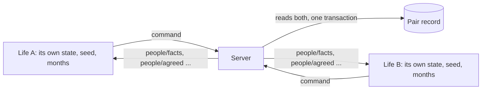

# People: partners, siblings, parents

> Immigration figures are the real ones on the dates given; everything else is a working value. Sources at the end.
> Kind: `person`, one slice per character (the state's `people`), with the content table `person` for computer characters. Background: `../design/01-concept.md` sections 6 and 16, `../design/04-where-things-live.md` sections 2 and 4, `../research/05-real-people-family-and-safety.md`.
> Rests on: `engine.md`, `route.md`, `route-gates.md`, `status.md`, `wallet.md`, `prologue.md`, `abroad-money.md`. Companion pages: `pair.md` (the record two players share, invites, phrases, block and report), `interview.md` (the genuineness interview), `undertaking.md` (sponsoring a partner).
> For game design. Not immigration advice. Every computer character is invented.

A character's partner, siblings and parents are slots. A slot holds either a real player or a computer character, so nobody is ever blocked for lack of real friends. People open routes, add points, give a couch and early news, share the family's requests, and can let you down.

The simulation stays single-player inside: one life per state. Another person reaches that state only as facts the authority hands over.

## How two lives connect

**person:others-known-by-facts** A state never holds another character's state. What it knows of another person is a `PersonFacts` snapshot kept on the bond. For a real player, the authority command `people/facts` puts it there; for a computer character, the people kind builds it from the `person` entry. Every rule on these four pages (this one, `pair.md`, `interview.md` and `undertaking.md`) reads facts the same way for both, so a computer character works offline under the same rules.

**person:lives-meet-by-authority-command** Anything one life does that another must know reaches the other only as an authority command. It is recorded in the receiving save with its tick like any command (engine:state-is-plain-data), so each life replays alone. The authority commands are `people/link`, `people/facts`, `people/moments`, `people/proposal`, `people/agreed`, `people/ended`, `people/declined`, `people/withdrawn`, `people/gossip`, `people/stand-in`, `people/family-request`, `interview/open` and `interview/scored`. A player who sends one is rejected with `not-yours`. They cost no turn and are accepted while a set piece or an interview is open.

**person:both-lives-step-together** A step that reads both lives (agreeing a joint application, a sponsor's agreement, the interview's comparison) is run by the authority with both states loaded in one transaction, locking the two rows in sorted id order (`../design/04-where-things-live.md` section 7). It first sends `people/facts` with fresh facts to each life, then runs the step. After any accepted command that changes a character's facts, the authority sends `people/facts` to every life bonded with it.

**person:money-counted-never-moved** Money is counted together and never moved. No command, effect or event moves money from one life's wallet to another's.

- A partner's funds count toward a joint application only as `funds` in the facts. They are given by consent (`people/consent` with `countFunds`) and valued by that partner's own state, the way route:funds-shown-exclude-cash values funds.
- A life's funds count toward one application at a time: while counted for a partner, they do not count for that life's own route.
- Every fee is paid from the payer's own wallet.
- Family requests are paid to the computer-run family only.

**person:facts-function-is-pure** `factsOf(state, content, world)` is a pure function of the people kind. It never reads the seed, the draw counts or any `secret`. The facts it returns carry no wallet figure except `funds` under consent, and no pay figure except `meetsFloor`. A test proves that clearing every secret in a state leaves its facts unchanged.

## Slots

**person:family-and-partner-slots** A character has the slots `partner` (one), `sibling-1` to `sibling-n`, `mother` and `father`. `n` is the prologue draw's `siblings`, or the scenario's `siblings` for a fixed life. A slot is `empty`, `computer`, `invited`, `player` or `stand-in`.

- The partner slot starts `empty`.
- Each sibling slot starts `computer`, with a life drawn by person:computer-siblings-drawn-with-family.
- The parents are `computer` and stay computer-run, because bringing parents is not among the game's routes.

**person:three-ways-to-fill-slots** A slot is filled in one of three ways: an invite card (`pair.md`), the matchmaker, or a computer character. The matchmaker is off while `tuning.people.matchmaker` is false: no stranger is ever offered and the view shows no matchmaker. It is off for every player alike.

**person:computer-candidates-labelled** The view's `candidates` lists every `person` entry of role `partner` whose `when` holds and with whom the character has no bond. Each carries the label `computer` on every screen where it appears.

No screen shows `candidates` as a list (world:nobody-picked-from-list); the list only tells the world who stands where. Each candidate has a meeting place in content (`packages/content/src/person/person.meet.data.ts`) and stands there as a person the player can tap. While the list holds them, a candidate stands still at the thing of their meeting place, with their name on its chip and the `computer` mark; once courted, they are gone. The meetup's two stand at the hub's meetup; the people met after the service, and a friend of the family, stand at the family house (world:nobody-picked-from-list).

On screen the label reads "Not a player" (`ui.people.mark.computer`), because "Computer" reads as a system word. The mark stays on every screen. Beside a name, in the world and in Chats, the chip says "Not a player" quietly, in sentence case, never in capitals (text:bands-not-figures). For a person the game plays, the mark sits on the name pill of their fan (world:fan-of-sticker-buttons).

**person:invite-fills-a-slot** `people/invite` (`slot`, `looking`, `fill`) is legal on an `empty` partner slot or a `computer` sibling slot. It sets the slot to `invited` with the card's terms; a computer sibling keeps its life until the slot is linked. `people/link` from the authority fills the slot:

- a sibling slot becomes `player`;
- a partner invite opens a bond at `connected`, and the partner slot becomes `player` only when that bond reaches `partner`.

`people/invite` with `slot` and no `looking` withdraws the card.

**person:real-sibling-shares-family-draw** A real sibling is a new character made from the invite. Its prologue takes the inviter's family draw (family means, town, sibling count, parents' schooling) instead of drawing its own (prologue:family-draw-on-first-answer), and its own sibling slots mirror the inviter's family, with the inviter in one of them. An existing character never becomes anyone's sibling: siblings share parents, so only a life begun inside that family can be one.

**person:nobody-real-is-needed** No rule on any page needs a real person. Every benefit below can be had with a computer character or not at all, and the main journey needs nobody.

## Courting, partners and marriage

**person:courting-opens-a-bond** `people/court` (`with`: a candidate's entry id, or the id of a pair at `connected`) opens a bond at `courting`, or moves a bond up to it. It is legal while fewer than `tuning.people.maxCourting` bonds are courting.

- Where: the world offers courting a computer partner only in their meeting place (world:nobody-picked-from-list). A person marked `decemberOnly` stands there, and can be courted, only while `var.season-december` is 1. The simulation does not know places (city:places-change-no-state), so the command takes no place; keeping to the place is the client's job.
- The card: talking to a person where they stand opens their card, whose one button sends `people/court` with them. While `maxCourting` bonds are courting, the button is shut and says Not yet, and the card gives the reason.
- The answer: courting is answered. The person's own line, `<person>.courted` in content (one per person, in the voice of their `met` line), is told in the corner as theirs ("Dele: ..."), before the plain line of person:computer-mark-is-quiet. It waits until the corner shows (nothing covering the world, the home's card put away). The same line is the first message of their thread in Chats.
- Courting a second person while the first is only at `courting` is allowed up to `maxCourting` and costs nothing under these rules, so the card says nothing more then. Courting while partnered is person:gossip-when-two-timing.

**person:time-together-is-an-act** Time together is an act of the month; the player never sees the word slot.

- `activity.see-someone` is a visit in the world (world:nobody-picked-from-list), staged at the bond's home (`place.their-room`, dressed for them) or their meeting place. Its param is a bond at `courting` or later whose other side is in the same place: home, or the same country. It costs the entry's cost in the place's currency, reason `social`, and gives wellbeing +3.
- `activity.call-someone` lives in Chats. Its param is a bond whose other side is elsewhere. It costs nothing.

Each applies the effect `people/moment`, which adds one moment to the bond: kind `met` or `call`, with a `spot` and a `what` drawn on stream `people` from the bond's lists (a computer's entry lists, or the shared lists for a real pair). In a real pair, the authority copies the moment into the pair record and sends it to the other life with `people/moments`.

**person:talking-adds-moments** In a real pair, a phrase sent in the pair's conversation also adds a moment, of kind `said` (pair:conversation-phrases-stored). Talking counts.

**person:proposing-a-step** `people/propose` (`bond`, `step`) asks the other side.

- `partner` needs the bond at `courting`, at least `tuning.people.partnerMoments` moments, and no other bond at `partner` or `married`.
- `marry` needs the bond at `partner` for at least `tuning.people.marryAfterMonths` of the proposer's months, and each side able to pay its wedding share.

A real player answers with `people/answer` (`bond`, `step`, `yes`). Until then, or until the proposer sends `people/withdraw`, the proposal waits as pending in both lives. A computer answers at once: yes when its behaviour's conditions hold (person:behaviour-block-fields) and a draw on `people` at its `agreeBp` succeeds. A no blocks the same proposal for `tuning.people.proposeCooldown` months, and the thread says how many months away it is.

**person:agreed-partner-and-marriage** An agreed `partner` moves the bond to `partner`, puts it in the partner slot and records the month in each life. An agreed `marry`:

- moves the bond to `married` and records the month;
- takes `tuning.people.weddingShare` from each real side's own naira (`any` pocket, reason `wedding`);
- gives standing +8;
- adds a moment of kind `wedding`, its spot drawn on `people` from the wedding spots `family-compound`, `church`, `mosque`, `registry`, `event-hall`.

A computer pays nothing and is paid nothing.

**person:one-partner-at-a-time** Only one bond at a time may be at `partner` or `married`. Courting others while partnered is allowed, and gossip follows (person:gossip-when-two-timing).

## Going as a partner's dependant

**person:routes-name-dependant-routes** A route entry names `dependants`: the route a partner takes to go with the one who leads, or null.

- `route.uk-skilled` and `route.uk-talent` name `route.uk-dependant`.
- `route.canada-points` names `route.canada-accompany`.
- `route.uk-masters` is null: taught master's students may not bring a partner for courses starting on or after 1 Jan 2024.
- `route.uk-care` is null: care workers sponsored from 11 Mar 2024 may not.
- `route.gulf-contract` is null: the contract's pay is under the AED 4,000 a resident needs to sponsor a wife.
- The road is null.

**person:statuses-name-dependants** A status entry names `dependants`: `none`, `any`, or a list of jobs. `status.uk-sponsored` lists `activity.job-uk-skilled`, `activity.job-uk-senior-developer`, `activity.job-uk-graduate` and `activity.job-uk-nurse`. `status.uk-talent` is `any`. Every other status is `none`: a graduate may not add a new partner, and a settled partner sponsors through the partner gate instead.

**person:joint-application-proposed** `people/propose` with `step: "joint"`, a `route` and a `lead` (`me` or `them`) asks to set up a joint application. It needs:

- the bond at `partner` or `married`;
- the route's `dependants` not null;
- the lead either holding the route at `known` or later in their own life, or already holding a status whose `dependants` allows the other to join.

A computer leads only in the second way: it already holds its status and never applies for one, because leading a route it would have to apply for needs a life that is played. Agreement records the joint in both lives. In the dependant's life the dependant route moves to `known` at once. The lead's route then reads the partner's facts (person:canada-spouse-points, person:dependant-gate-needs).

**person:dependant-gate-needs** Applying on the `dependant` gate needs:

- the joint agreed and the bond intact;
- the lead's facts showing the joint route `applying`, `granted` or `departed`, or a status whose `dependants` allows joining;
- the passport;
- for the UK, the TB certificate, and `var.uk-dependant-maintenance` (£285) covered at one month end, unless the lead's facts show 12 months in the country;
- the route's fee. For `route.uk-dependant` it is the lead route's visa fee var plus the surcharge for the lead's years; for `route.canada-accompany` it is `var.canada-accompany-fee`.

Sending opens the genuineness interview only when the pair record is thin (interview:thin-record-triggers-interview). The fee is the apply act's own cost as the view shows it (`cost`, read from the gate, since it follows the lead's route). While it cannot be paid, the act is marked like any act whose cost cannot be met (`affordable` false, with the money it needs), and taking it is refused `cannot-afford` with nothing spent: no half-day and no money. The gate itself takes the fee as the application goes in.

**person:dependant-application-decided** A dependant application is decided in the `clocks` phase of its decision month or later, once the lead's facts show the joint route `granted` or `departed`, or the status that allows joining. The decision is one draw on `visa` at the route's `refusalBaseBp` plus 800 for each earlier refusal (route-gates:gate-decision-draw-terms, with earlier refusals only), made after the interview's result where one was held (interview:result-applies-to-application). While the lead's route is `applying`, the dependant waits. If the lead's route is refused, the dependant is refused with the reason `lead`: the fee is kept and the surcharge refunded.

**person:dependant-status-ends-with-lead** A granted dependant departs with `route/depart`, paying their own flight, and gets the route's status. `status.uk-dependant` expires when the lead's does: its `expiresMonth` is the dependant's month plus the facts' `statusMonthsLeft` at grant. When a player leads a joint route with a computer as dependant, the computer's fee and surcharge are added to the player's own application and paid from the player's wallet; on the player's departure, the computer's facts move to that country.

## The partner route

**person:partner-routes-heard-via-bond** `route.uk-partner` and `route.canada-spouse` have the gate `partner`. A character hears of one when a bond at `partner` or `married` has facts showing the other side abroad in the route's country, holding a status in the route's `sponsorStatuses`. The character then looks into it as with any route.

**person:partner-gate-needs** Applying on the `partner` gate needs:

- the bond `married`, or, for `route.uk-partner`, the bond at `partner` for 24 of the applicant's months while both lived in the same place;
- the joint agreed with the sponsor as lead. This runs the sponsor's checks in the sponsor's own life: undertaking:agreeing-to-sponsor, undertaking:sponsor-settled-in-country, undertaking:sponsor-earnings-floor, undertaking:sponsored-arrivals-wait-to-sponsor and undertaking:defaults-bar-sponsoring;
- the sponsor's facts showing a status in `sponsorStatuses`, in the country, and `meetsFloor` true for this route;
- English met, where the route has a `bandMin`: by a bachelor's degree, by the degree's English statement (document:degree-english-statement), or by an English result at or above `bandMin`;
- the passport, and for the UK the TB certificate, unless the application is made in country (person:partner-route-in-country);
- no ban on the country;
- the route's fee var plus the surcharge for its `surchargeYears`.

Sending opens the genuineness interview in both lives (interview:partner-application-opens-interview).

**person:partner-route-in-country** A character on a country's overstayer status may apply for that country's partner route from inside it: in the grace, after it, and while a notice stands (status:grace-allows-in-country-applications, status:detection-gives-notice). The needs are those of person:partner-gate-needs, without the TB certificate and the flight.

- While the application is pending, no detection is drawn and a notice holds (status:notice-ends-in-removal).
- The decision adds one earlier refusal for the overstay (status:overstay-counts-as-refusal).
- A grant switches the status in country (route-gates:in-country-grant-switches-status).
- A `status.uk-partner` granted this way to an overstayer past the grace settles at `tuning.status.overstayPartnerSettleMonths` (120) months, not `var.uk-partner-settle-months`.

Real life: an overstayer in the UK may apply as the partner of a British or settled person only where paragraph EX.1 applies (a genuine relationship and insurmountable obstacles to family life abroad), and such a grant is on the ten-year route to settlement. The game asks for no insurmountable obstacles, a kinder rule, and keeps the ten years (factor 1.0). Canada's inland spousal sponsorship also takes a spouse who has lost status.

A dependant route (person:dependant-gate-needs) may be applied for in country in the grace only (status:grace-allows-in-country-applications), with no TB certificate. Real life: a partner may switch into a Skilled Worker's dependant route inside the UK, though not from a visit visa or immigration bail.

**person:partner-application-decided** A partner application is decided in the `clocks` phase of its decision month or later, once the interview is scored. A `caught` or `fail` result refuses it as `interview.md` says. Otherwise there is one draw on `visa` at the route's `refusalBaseBp`, plus 800 for each earlier refusal, plus `tuning.interview.doubtBp` for a `doubt` result. A grant moves the route to `granted`. `route/depart` grants the status and records `arrived` (`route`, `month`) in the people slice. For `route.canada-spouse`, the departure tells the authority to send `people/agreed` with `step: "landed"` to the sponsor's life, which opens the undertaking (undertaking:landing-opens-undertaking).

**person:partner-status-renews** `status.uk-partner` lasts 33 months and allows any work. It renews by `status/renew` for 30 months at `var.uk-partner-renew-fee` plus the surcharge. Renewal is legal only while the bond is `partner` or `married` and the sponsor's facts show `meetsFloor` for the route. Its lawful months count to settlement at `var.uk-partner-settle-months` (60).

**person:tied-status-clock-on-breakup** `status.uk-partner` and `status.uk-dependant` carry `tiedTo: "partner"`. When the bond ends, the people kind applies `status/clock-start` with the clock set to the entry's `clockMonths`, 2 (the 60 days to which permission is cut after a relationship breaks down). Any `status/grant` replaces the status and its clock (status:granting-a-status). Getting a job marked `sponsor: true` grants one (ladders:sponsor-job-ties-status) and is the usual way out. At zero the status lapses (status:overstayer-risks-detection). `status.canada-resident` is not tied: permanent residence stays after a break-up (Canada removed conditional permanent residence for spouses in April 2017).

## Spouse points for Canada

**person:canada-spouse-points** While a joint on `route.canada-points` names a dependant, the lead's score uses `points.canada-spouse`: the with-spouse column for the lead's age, education and language, plus the spouse's own factors from the facts (education by `eduLevel`, language by band for each of four abilities, and Canadian work 0 for a spouse who has not worked there), capped at 40. The transferability part is unchanged. The route's view shows the score both ways, alone and with this spouse, so the couple can choose who leads.

## What a sibling gives

**person:canada-sibling-bonus** A sibling, real or computer, aged 18 or over whose facts show `status.canada-resident` or `status.canada-citizen` in Canada adds `points.canada.siblingBonus` (15) to the score. One sibling is enough; a second adds nothing.

**person:sibling-couch-delays-rent** The couch. On `place/move` abroad to a country where a sibling's facts show them living, `rent-room` (abroad-money:arrival-opens-upkeep-and-room) opens `tuning.people.couchMonths` months later instead of at once. Upkeep is charged as usual.

**person:sibling-hears-news-early** Early news. While a sibling's facts show them abroad in a country, the hearing of news:announcement-makes-routes-heard also runs when a story reaches its rumour stage, for the routes into that country, with `via: "sibling"`. Everyone else hears at the announced stage.

**person:family-requests-shared** Shared requests. A family request (offer group `family`) that opens in a life with a real sibling at home is opened in every such sibling's life too, with the same terms, by `people/family-request`. The copy counts as rolled for that life's cooldown. The first paying choice taken in any of them closes the others: each other sibling gets standing +1 and the line `line.people.handled` instead of the lapse choice. A request nobody pays lapses in each life as written. A sibling abroad already carries the larger requests of abroad-money:family-asks-more-abroad.

## Ending a bond

**person:either-side-ends-a-bond** `people/end` (`bond`) ends a bond at any stage, at any time, from either side, without the other's agreement. It is never rejected unless the bond has already ended. The other life learns of it by `people/ended`.

**person:joint-collapses-with-bond** A joint collapses when its bond ends. In either life:

- every application resting on it that is not yet decided is withdrawn by the effect `route/withdraw`: the route goes back to `known`, the surcharge is refunded to its own bank pocket, the fee is kept, and an open interview is closed unscored;
- a dependant grant not yet used is voided the same way;
- the lead's own application continues alone, its score and funds worked out without the partner;
- counted funds stop counting;
- a sponsor's pending agreement is cleared.

After departure, person:tied-status-clock-on-breakup applies.

**person:ender-pays-in-standing** The one who ends the bond pays in standing: -2 at `courting`, -6 at `partner`, -12 at `married`, and -6 more while a joint application is `applying`. They also take wellbeing -4. An end by block (pair:block-ends-every-bond), by absence (person:stand-in-acts-narrowly) or by a computer drifting away (person:computer-partner-drifts) costs nobody standing.

**person:one-left-keeps-own-gains** The one left loses nothing they earned alone: their qualities, money, documents, own routes and refusal record are untouched, and only the joint parts go. They take wellbeing -8 and no standing loss, and `offer.people-recovery` opens. Abroad on a tied status, the view's `nextStep` names the sponsor jobs that clear the clock.

**person:ended-bond-record-kept** An ended bond keeps its record, read-only, in both lives. The two may court again after `tuning.people.recourtMonths` months. The ended bond's thread stays in Chats, read-only, through the month the bond ended in, and then goes (person:computer-partner-drifts).

**person:leaving-player-ends-bonds** When a player leaves, every bond with them ends in the other life:

- An account deleted: each bond ends as an absence end (person:stand-in-acts-narrowly). The deleted side's moments stay in the other life's record as `them`, with no name.
- A player ending their life to start another (account:start-a-new-life, decision 0020): each bond ends as a `restart` end at no cost, the moments kept, told as `line.people.ended-restart`. A sibling slot ended this way goes back to a computer sibling, drawn again at the start of the next month (person:computer-siblings-drawn-with-family).

The one who stays keeps their own history, and the one who left takes their name with them.

**person:gossip-when-two-timing** Gossip. In the `month` phase, for each bond at `courting` while the character has a bond at `partner` or `married`, there is one draw on `people` at `tuning.people.gossipBp`. On a hit, the courter's standing falls by 3 and the partner hears:

- a real partner by `people/gossip`, with the line `line.people.gossip`, which never says with whom;
- a computer partner ends the bond on a draw on `people` at its `jealousBp`, and the courter then pays the cost of person:ender-pays-in-standing as if they had ended it. A computer partner who leaves this way gives its reason in its own words, `<person>.left`, in the head of the thread for the month it stays (person:computer-partner-drifts).

While a bond is at `partner` or `married`, the talk card of anyone met in a place warns of this on its button's second line, before the tap ("You are with Dele. Seeing Hauwa too costs standing if it comes out, and Dele may leave.").

**person:computer-partner-drifts** A computer partner drifts. When its bond has had no moment for its `patienceMonths`, it ends the bond in the `month` phase, and the character is the one left (person:one-left-keeps-own-gains). Courting starts the patience clock, so a bond courted and never visited ends after `patienceMonths` (3 for Dele and Hauwa, 2 for those abroad).

No bond ends unseen. The end's line is told in the month's results, never left to News alone. The ended bond's thread stays in Chats through the month it ended in, its head saying what happened ("Dele stopped calling.") with the reason in their own words (`<person>.drifted`, or `<person>.left` for person:gossip-when-two-timing). It goes once that month ends. Nothing can be asked or ended there.

## The stand-in

**person:stand-in-after-absence** The server keeps each account's last command time; the simulation never reads it. When a player bonded with a real player has sent no command for `tuning.people.warnDays` (7) real days, the other life is sent `people/stand-in` with `stage: "warned"`. At `tuning.people.standInDays` (14) days it is sent `stage: "on"`, and the slot shows `stand-in`, with its label, in both views. Any command from the absent player clears it, and the other life is sent `stage: null`.

**person:stand-in-acts-narrowly** A stand-in acts only through commands with the sender `stand-in`. It answers the genuineness interview (interview:stand-in-answers-when-absent), and says yes to a pending joint step only when the absent side had set `standInMay` for that joint by `people/consent`. It never proposes, ends, marries, sponsors, consents, spends, or ends a turn, and the absent life's facts stay as last sent. While the stand-in is on, the waiting player may end the bond as an absence end, costing nobody standing.

**person:computers-need-no-stand-in** A computer character never needs a stand-in.

## Computer characters

**person:computer-is-a-person-entry** A computer character is a `person` entry: a profile that sets its facts, and a behaviour block that the rules on these pages read. It has no wallet, no turns and no state of its own. Its draws are on the character's stream `people`.

**person:computer-siblings-drawn-with-family** Computer siblings are drawn with the family: at the prologue's draw (or from the scenario, for a fixed life), one `person` entry of role `sibling` for each sibling slot, by weight, on `people`. Its facts follow the entry: at home until `abroadFromMonth`, then abroad in its country with its `status`, and with its `settledStatus` from `settledFromMonth`.

**person:computer-partner-facts** A computer partner's facts are its entry's profile. Its age moves with the character's months and its pay is fixed. The people kind rebuilds the facts in the `month` phase.

**person:behaviour-block-fields** The behaviour block holds:

- `courtMonths`: months from the first moment before it agrees to be partners;
- `agreeBp`;
- `marryAfterMonths`;
- `marryInDecember`: true for one abroad, whose wedding waits for `var.season-december` at 1;
- `patienceMonths`;
- `jealousBp`;
- `recallBp`, for the interview;
- `plan`: its answer to the interview's plans question;
- `papers`.

**person:papers-marriage-offer** A `person` with `papers: true` comes only through `offer.papers-marriage`. Taking the offer pays its `fee` from the naira by size (decision 0014: cash first at or under `tuning.wallet.cashUpTo`, the bank first above it), reason `fee-agent`. It opens a bond at `married` with no moments, and a joint for `route.uk-partner` with that person as sponsor. If the offer is a fraud (offer:fraud-effects-replace-ordinary), the fee is paid and nothing else happens. The interview then meets a thin record and a partner who recalls little (interview:computer-answers-by-recall).

## The view

**person:view-shows-people** The view's `people` part shows:

- each slot, with its state and label;
- each bond, with its stage, the other's label (`player`, `computer` or `stand-in`), its moments (hidden while an interview is open, interview:one-question-at-a-time), pending proposals both ways, the stand-in stage, and the other's facts, without `funds` unless consent was given and with pay shown only as `meetsFloor`;
- `candidates`;
- the joint, with both scores where person:canada-spouse-points applies;
- the sponsor's agreement and undertaking state;
- `barUntilMonth` (undertaking:sponsored-arrivals-wait-to-sponsor).

Each bond also carries `person` (the computer entry, or null), `pair` (the other player's pair id, or null), `lastMomentMonth`, `cooldownUntil`, `consent` (`countFunds`, `standInMay`; null before any was given) and `partnerMonth`, so a screen can count the months as partners (decision 0002). The joint carries `scores` (`mine`, `theirs`; null until the points gate gives them).

The view never shows a computer's interview answers, any draw before it is made, or the other side's last-seen time beyond the stand-in stage.

## Marking computer characters, and their limits

While players are few, the game must feel alive without pretending a computer is a person. Computer characters are marked quietly: nothing shouts it. The one place the mark must be clear is a relationship, because the player invests in it.

**person:computers-follow-same-rules** A computer character runs on the same engine as a player: the same `step`, rules and content judge it, through the same facts (person:others-known-by-facts). No rule has a branch that lets a computer skip a check, pay less or draw differently. Which side is a computer is a flag in the data, never hidden: `PersonFacts.label` is `computer`, and the view carries it (person:view-shows-people). A computer side is a `person` entry whose facts the rules read, not a life played turn by turn, because every rule here reads facts and a played life would add turns nobody watches.

**person:computer-names-generated** A computer character's name comes from a generated list in content: a given name, with a title or a role where the card needs one ("Iya Bisi, trader"). No name is a real person's.

- A name is one to three words of letters, each starting with a capital. The content check fails any name with a digit, an underscore, a dot, an `@` or no capital, so a computer name never looks like a handle.
- A username may still spell a computer name (account:username-and-unconfirmed-email does not refuse one); the `computer` mark tells them apart (person:view-shows-people).
- Lanre, who hands out briefs at the business centre, and Tolu at the hub are on the list, so the briefs' givers pass this check.
- Sewanu, an Egun fisherman at Makoko's net shed (activity:boat-work-at-the-net-shed), is a fixed person of the story with his own name in content, and Egun in his words. He is not in the drawn pool, so no draw gives his name and no draw moves for him.

**person:computer-mark-is-quiet** The mark is quiet. When a computer partner or sibling is chosen or accepted, the report gives one plain line, `ui.people.chosen` ("{name} is a computer character. They live in the game."), and their card carries a small mark: the `computer` label of person:computer-candidates-labelled and person:view-shows-people. There is no floating label over their head and no banner anywhere else. A person standing in a place shows their name with the `computer` tag on tap, and for the two seconds of a place's first entry, as every thing does (world:things-are-tappable-models); no label floats over them otherwise. When they are courted in a place, the corner tells the plain line after the person's own answer (person:courting-opens-a-bond). A person's acts (Talk, the court) are their fan's buttons under their name pill.

**person:computers-never-counted** A computer character is never counted. It never appears in a player count, a board (city:boards-switch-when-and-who), the public stats page or any analytics counter of players (`analytics.md`). A test builds every count and board from a world holding computer characters and finds none of them.

**person:computers-never-win-scarce** A computer character never wins anything scarce. It never buys a lottery ticket, never wins a pot or a prize, and never takes a place that is limited in number. A test tries each directly: no command, effect or authority step puts a ticket, a prize or a limited place on a `person` entry or a computer bond.

**person:computers-never-handle-money** A computer character never receives or gives money. It holds no wallet (person:computer-is-a-person-entry) and is never the source or target of a money effect. What a player pays toward the computer-run family, or for a computer dependant's fees (person:dependant-status-ends-with-lead), leaves the player's own wallet under the player's own sink reason, and nothing a computer does credits any pocket. A test tries every money effect with a computer as the other side and finds that none credits or debits it.

**person:computers-never-free-text** A computer character never sends free text. Everything it says is a preset phrase (pair:preset-phrases-only) or a line from content, and a test proves that no computer output carries text that is not a phrase or a text key.

**person:computers-never-shown-as-players** A computer character is never presented as a player in a post, a share card or a news line. A card shows only the player's own character (share:card-shows-only-own-character), a news line never names a computer as a player, and the game's own posts never show one as a player. A test builds every card and every news line from a life with computer bonds and finds no computer shown as a player.

**person:computer-partner-offer-dial** The dial for how readily computer partners are offered. Since no list is shown, it decides who stands in the meeting places. person:computer-candidates-labelled lists computer candidates only once the partner slot has been `empty`, with no open invite card, for `tuning.people.computerAfterMonths` of the character's months; at 0 they are listed at once. The number lives in the private settings (server:private-settings-and-dials), so computer partners can fade out as real players arrive. Sibling slots start `computer` (person:family-and-partner-slots) and keep that life while an invite is open, so the dial does not touch them: a sibling slot is never left empty.

**person:one-mixed-name-pool** One name pool serves every named person in events, every resident and every computer character (`packages/content/src/person/person.names.data.ts`). Sewanu of the net shed is the exception: a fixed person with his own name (person:computer-names-generated).

- The pool is grouped by people, with a set mix in basis points: Hausa-Fulani, Yoruba and Igbo as the three largest, then a real share each for Edo, Efik and Ibibio, Ijaw, Tiv, Urhobo and Isoko, Kanuri, Idoma, Igala and Nupe. It holds Christian and Muslim names in both the north and the south.
- A content check fails the build when the named people of the game's words span fewer than eight peoples, when the two largest hold more than half, or when a people has no name for a woman or for a man.
- A computer person never carries the player's name. The player names the character at the door from this same pool (prologue:front-door-builds-a-person). When the player's first name is the name of a person in the game's words (`namedPeople`, or any entry's name that is the player's name whole), the screen calls that person by another name of their own people and sex (a name given to both sexes is replaced by another given to both): the first in the pool's order that is neither the player's nor any named person's. For a player named Hauwa, Hauwa becomes Aisha.
- This changes the interface's words only, read from the name the door gave (account:person-kept-with-character). It is deterministic and moves nothing in the simulation: no stream and no recorded life. The player's own words (the share card's first name, the band) keep the player's name.

**person:names-predict-nothing** A name never predicts a trait, a job or a flaw: who is the landlord, the agent, the trader or the fraudster is drawn apart from the name. The content check fails any people holding two money-taking roles, and any role held by more than one person whose holders all come from one people.

**person:no-institution-tied-to-crime** No real cultural institution is tied to wrongdoing: no masquerade, title, palace, church, mosque, shrine or named community stands beside a crime or fraud word in any text. The content check fails the pair.

## Entries: computer partners

Each partner's id carries the name it shows, from the name pool (person:one-mixed-name-pool): `person.dele-banker` shows as Dele, `person.hauwa-nurse` as Hauwa, `person.kelechi-developer` as Kelechi, `person.ejiro-uk` as Ejiro, `person.uduak-canada` as Uduak, `person.tonye-dubai` as Tonye. `person.papers-uk`, a stranger, goes by what he is.

All are invented. Names are text keys, and the words file holds the names shown.

| Id | Profile | Where | Pay a year | Court months | Agree | Marry after | Patience | Jealous | Recall | Plan | Shown when |
|---|---|---|---|---|---|---|---|---|---|---|---|
| `person.dele-banker` | Bank officer, bachelor's, band 55, city | home | ₦4,800,000 | 4 | 6000 | 8 | 3 | 5000 | 8500 | `with-you-abroad` | age 21 or more, at home |
| `person.hauwa-nurse` | Staff nurse, bachelor's, care 60, band 60, town | home | ₦2,400,000 | 5 | 6000 | 8 | 3 | 4000 | 8500 | `canada` | age 21 or more, at home |
| `person.kelechi-developer` | Developer on `status.uk-sponsored`, `activity.job-uk-skilled`, master's, band 75 | uk | £48,000 | 9 | 5000 | 12, December | 2 | 6000 | 8000 | `uk` | age 22 or more |
| `person.ejiro-uk` | Senior carer, `status.uk-settled`, diploma, band 65 | uk | £31,000 | 9 | 5000 | 12, December | 2 | 5000 | 8000 | `uk` | age 22 or more |
| `person.uduak-canada` | Analyst, `status.canada-resident`, bachelor's, band 80 | canada | C$62,000 | 9 | 5000 | 12, December | 2 | 5000 | 8000 | `canada` | age 22 or more |
| `person.tonye-dubai` | Driver, `status.gulf-worker`, secondary | uae | AED 30,000 | 6 | 6000 | 10, December | 2 | 5000 | 8000 | `home` | age 21 or more |
| `person.papers-uk` | Unknown, `status.uk-citizen` | uk | £30,000 | 0 | 10000 | 0 | never | 0 | 2000 | `not-decided` | only through `offer.papers-marriage` |

Each has the spot list `beach`, `suya-spot`, `church`, `cinema`, `mall`, `friends-wedding`, `campus`, `bus-stop` and the what list `talked`, `ate`, `walked`, `watched-film`, `met-family`, `argued-made-up`, `prayed`, `danced`. The computers abroad also have `video-call`, `voice-note` and `long-call` for calls.

## Entries: computer siblings

| Id | Weight | Age gap months | Lives | Abroad from month | Status | Settled from month |
|---|---|---|---|---|---|---|
| `person.sibling-home` | 6000 | -60 to 60 by the draw | home | never | | |
| `person.sibling-lagos-hustle` | 1800 | -36 to 36 | home, city | never | | |
| `person.sibling-uk-later` | 900 | 12 to 60 (older) | uk | 36 | `status.uk-sponsored` | 96, `status.uk-settled` |
| `person.sibling-gulf` | 700 | -24 to 36 | uae | 12 | `status.gulf-worker` | never |
| `person.sibling-canada` | 300 | 24 to 96 (older) | canada | 0 | `status.canada-resident` | 36, `status.canada-citizen` |
| `person.sibling-uk-settled` | 300 | 36 to 120 (older) | uk | 0 | `status.uk-settled` | 60, `status.uk-citizen` |

## Entries: activities and offers

| Id | Values |
|---|---|
| `activity.see-someone` | slot; `where: "any"`; param a bond in the same place; cost ₦20,000, £30, C$40 or AED 100 by country, reason `social`; wellbeing +3; effect `people/moment` |
| `activity.call-someone` | slot; `where: "any"`; param a bond elsewhere; no cost; effect `people/moment` with kind `call` |
| `offer.people-recovery` | group `life`; opened only by person:one-left-keeps-own-gains; lapses 2. "Your cousin says come for Sunday rice. 'You don't have to talk about it.'" `go`: wellbeing +6, network +2. `alone`: wellbeing +2 |
| `offer.papers-marriage` | group `money`; when at home, age 21 or more, no bond at `partner` or `married`; chance 1%; cooldown 12; lapses 1; fraud 30%; terms `fee` a draw ₦6,000,000 to ₦12,000,000 by ₦500,000; signs `cash-only` (40, 90), `no-meeting` (90, 95), `friend` (30, 10). "A woman at the salon: 'He is a citizen over there. A wedding, papers, and you go your way after. {fee}, half now.'" `take`, `walk-away` |

## Entries: routes and statuses

| Id | Gate | Country | Status | Base refusal | Fee | Surcharge years | Decision months | Band | Other |
|---|---|---|---|---|---|---|---|---|---|
| `route.uk-partner` | partner | uk | `status.uk-partner` | 500 | `var.uk-partner-fee` £2,064 | 3 | 3 | 30, or a degree or the degree's statement | `sponsorStatuses` uk-settled, uk-citizen; window `var.uk-family-window` start 2; checklist married 20, sponsor 20, floor 15, english 10, passport 5, tb 5, applied 25 |
| `route.canada-spouse` | partner | canada | `status.canada-resident` | 600 | `var.canada-sponsor-fee` C$1,345 | 0 | 12 | none | `sponsorStatuses` canada-resident, canada-citizen; window `var.canada-family-window` start 2; checklist married 25, sponsor 25, passport 10, applied 40 |
| `route.uk-dependant` | dependant | uk | `status.uk-dependant` | 300 | the lead route's visa fee | the lead's | 1 | none | no window of its own; checklist joint 30, lead 30, passport 10, tb 10, funds 10 (partial), applied 10 |
| `route.canada-accompany` | dependant | canada | `status.canada-resident` | 300 | `var.canada-accompany-fee` C$1,600 | 0 | 1 | none | no window; checklist joint 40, lead 40, applied 20 |

| Status | Months | Work | Tied to partner | Clock | Renew | Settles at | Dependants |
|---|---|---|---|---|---|---|---|
| `status.uk-partner` | 33 | any | yes | 2 | 30 months, `var.uk-partner-renew-fee` £1,407 | `var.uk-partner-settle-months` 60 | none |
| `status.uk-dependant` | the lead's months left | any | yes | 2 | with the lead | `var.uk-settle-months` | none |

## Entry: `points.canada-spouse`

The lead's columns with a spouse, then the spouse's factors (cap 40).

| Part | Points |
|---|---|
| Age 18 / 19 / 20 to 29 / 30 / 31 / 32 / 33 / 34 / 35 / 36 / 37 / 38 / 39 / 40 / 41 / 42 / 43 / 44 / 45 and over | 90 / 95 / 100 / 95 / 90 / 85 / 80 / 75 / 70 / 65 / 60 / 55 / 50 / 45 / 35 / 25 / 15 / 5 / 0 |
| Education: secondary / diploma / bachelor's / master's / doctorate | 28 / 91 / 112 / 126 / 140 |
| Language per ability: CLB 7 / 8 / 9 / 10 and over | 16 / 22 / 29 / 32 |
| Spouse's education: secondary / diploma / bachelor's / master's or doctorate | 2 / 7 / 8 / 10 |
| Spouse's language per ability: CLB 5 or 6 / 7 or 8 / 9 and over | 1 / 3 / 5 |
| Spouse's Canadian work: none / 1 / 2 / 3 / 4 / 5 years | 0 / 5 / 7 / 8 / 9 / 10 |

## Numbers

| Setting | Value | Source or "working value" | In content as |
|---|---|---|---|
| Student dependants | Only research degrees for courses from 1 Jan 2024 | gov.uk, Student visa: family members | `route.uk-masters.dependants` null |
| Care worker dependants | None for those sponsored from 11 Mar 2024 | gov.uk, Health and Care Worker visa: partner and children | `route.uk-care.dependants` null |
| Graduate visa | No new partner | gov.uk, Graduate visa: partner and children | `status.uk-graduate.dependants` none |
| Gulf family sponsorship pay | AED 4,000 a month, or AED 3,000 with housing | u.ae, archived page | `route.gulf-contract.dependants` null |
| Skilled worker partner funds | £285, held 28 days, unless 12 months in the UK | gov.uk, Skilled Worker visa: partner and children | `var.uk-dependant-maintenance` 28500 |
| Dependant ends with the lead | Same end date | the same page | person:dependant-status-ends-with-lead |
| Partner visa fee from outside the UK | £2,064 | From 8 Apr 2026, adviser summary | `var.uk-partner-fee` 206400 |
| Partner visa extension fee in the UK | £1,407 | From 8 Apr 2026, adviser summary | `var.uk-partner-renew-fee` 140700 |
| Health surcharge | £1,035 a year | In force (status.md) | `var.uk-surcharge-year` |
| Partner visa length, then extension | 33 months, then 30 | gov.uk, partner visa | `status.uk-partner` months 33, renewMonths 30 |
| Partner route to settlement | 5 years | gov.uk, partner visa | `var.uk-partner-settle-months` 60 |
| Partner route relationship | Married, or 2 years living together | gov.uk, partner visa | person:partner-gate-needs |
| English for the partner route | A1 in speaking and listening (A2 at 30 months), also met by a qualification taught in English; mapped to band 30, and met in the game by any bachelor's degree or the degree's statement, where real life asks the degree to be confirmed (kinder) | gov.uk, Appendix FM, E-LTRP.4.1 and 4.1A; the band is a working value | `route.uk-partner.bandMin` 30 (person:partner-gate-needs) |
| Partner route decision | 3 months | working value | `route.uk-partner.decisionMonths` |
| Permission cut after a break-up | 60 days | gov.uk caseworker guidance, version 12.0, 11 Sep 2026 | `clockMonths` 2 |
| Canada conditional residence | Removed for spouses, April 2017 | canada.ca notice | `status.canada-resident` not tied |
| Canada spousal sponsorship fees | C$1,345 (C$1,260 for the sponsorship, the processing and the right of permanent residence, and C$85 biometrics) | IRCC fee list | `var.canada-sponsor-fee` 134500 |
| Canada accompanying spouse fee | C$1,600 | working value from the processing and residence fees | `var.canada-accompany-fee` 160000 |
| Canada spousal decision | 12 months | working value | `route.canada-spouse.decisionMonths` |
| Spousal refusals, 2010 | About 16%, mostly bad faith | IRCC regulatory statement, 2012, archived | `route.canada-spouse.refusalBaseBp` 600 plus the interview |
| CRS with a spouse | Core cap 460, spouse factors 40, the tables above | canada.ca, CRS criteria, modified 22 Jun 2026 | `points.canada-spouse` |
| Sibling in Canada | 15 points, sibling 18 or over, citizen or resident | the same page | `points.canada.siblingBonus` 15 |
| Bonds courting at once | 3 | working value | `tuning.people.maxCourting` |
| Moments before partners | 6 | working value | `tuning.people.partnerMoments` |
| Months partnered before marrying | 6 | working value | `tuning.people.marryAfterMonths` |
| Wedding share, each side | ₦3,000,000 | working value | `tuning.people.weddingShare` 300000000 |
| Proposal cooldown after a computer's no | 3 months | working value | `tuning.people.proposeCooldown` |
| Months before courting again | 6 | working value | `tuning.people.recourtMonths` |
| Gossip chance a month | 25% | working value | `tuning.people.gossipBp` 2500 |
| Standing for a wedding | +8 | working value | `tuning.people.weddingStanding` 8 |
| Standing the courter loses to gossip | -3 | working value | `tuning.people.gossipStanding` -3 |
| Ending: courting, partner, married, during an application | standing -2, -6, -12, -6 more | working values | `tuning.people.endStanding` |
| The one left | wellbeing -8 | working value | `tuning.people.leftWellbeing` |
| Couch | 3 months | working value | `tuning.people.couchMonths` |
| Warning, stand-in | 7 and 14 real days | the concept, section 6 | `tuning.people.warnDays`, `standInDays` |
| Matchmaker | off | the concept, sections 6 and 17 | `tuning.people.matchmaker` false |
| Months an empty partner slot waits before computer candidates are listed | 0 | Working value; private settings, raised as real players arrive | `tuning.people.computerAfterMonths` |

## Sources

All read on 8 Oct 2026.

- [GOV.UK: Student visa, family members](https://www.gov.uk/student-visa/family-members)
- [GOV.UK: Health and Care Worker visa, your partner and children](https://www.gov.uk/health-care-worker-visa/your-partner-and-children)
- [GOV.UK: Skilled Worker visa, your partner and children](https://www.gov.uk/skilled-worker-visa/your-partner-and-children)
- [GOV.UK: Graduate visa, your partner and children](https://www.gov.uk/graduate-visa/your-partner-and-children)
- [GOV.UK: Family visa, partner or spouse](https://www.gov.uk/uk-family-visa/partner-spouse)
- [GOV.UK: Cancellation and curtailment of permission, caseworker guidance, version 12.0](https://www.gov.uk/government/publications/considering-immigration-status-and-deciding-enforcement-action/cancellation-and-curtailment-of-permission-accessible)
- [Whytecroft Ford: UK immigration fees from 8 April 2026](https://www.whytecroftford.com/uk-immigration-fees-08-april-2026/)
- [u.ae: sponsoring family residency by expatriates (archived)](https://u.ae/en/archived-content/residence-visa/sponsoring-family-residency-visa-by-expatriates)
- [canada.ca: CRS criteria](https://www.canada.ca/en/immigration-refugees-citizenship/services/immigrate-canada/express-entry/check-score/crs-criteria.html)
- [canada.ca: Government of Canada eliminates conditional permanent residence](https://www.canada.ca/en/immigration-refugees-citizenship/news/notices/elminating-conditional-pr.html)
- [canada.ca: regulatory impact analysis statement, 2012 (archived)](https://www.canada.ca/en/immigration-refugees-citizenship/news/archives/backgrounders-2012/regulatory-impact-analysis-statement.html)
- [Amir Ismail: cost to sponsor a spouse to Canada, July 2026](https://www.amirismail.com/how-much-does-it-cost-to-sponsor-a-spouse-to-canada/)
- [IRCC: fee list](https://ircc.canada.ca/english/information/fees/fees.asp), the spousal sponsorship and biometrics fees (read 24 Oct 2026)
- [canada.ca: changes to open work permits for family members, Jan 2025](https://www.canada.ca/en/immigration-refugees-citizenship/news/notices/changes-open-work-permits-family-members-temporary-residents.html) (background: Canada's temporary routes narrowed spouses' permits; the game's Canada route is permanent residence, which they do not touch)

## Not verified

- The UK fees from 8 Apr 2026 come from an adviser's table, not gov.uk's fee page.
- No source was found for the time a partner or spousal decision takes from Nigeria; both decision months are working values.
- The UAE family threshold is on an archived government page.

## Contract

What `packages/sim/src/engine/types.ts` holds for this page:

1. `KindName` has `people` and `person`.
2. `Stream` has `people`.
3. `Reason` has `wedding` (out).
4. `RouteGate` has `partner` and `dependant`. `RouteEntry` has `dependants: Id<"route"> | null`, and a `partner?: { sponsorStatuses: Id<"status">[]; bandMin: number | null; feeVar: Id<"var">; surchargeYears: number; decisionMonths: number; livingTogetherMonths: number | null }` block and a `dependant?: { maintenanceVar: Id<"var"> | null; leadMonthsExempt: number | null; feeVar: Id<"var"> | null; feeFromLead: boolean; decisionMonths: number }` block.
5. `RouteGateState` has `{ gate: "partner"; bond: string | null }` and `{ gate: "dependant"; bond: string | null }`; `RouteGateView` the same with the lead's route state.
6. `StatusEntry` has `dependants: "none" | "any" | Id<"activity">[]`, `tiedTo: "partner" | null`, and `months` may be `"lead"`.
7. `PointsEntry` has `siblingBonus: number` and `spouse?: { education: { level: number; points: number }[]; language: { band: number; points: number }[]; canadianWork: { years: number; points: number }[]; cap: number }`.
8. `ScenarioEntry` has `siblings: number`. `PrologueSlice.draw` is set from the save's `family` when present (below).
9. `Save` has `family?: { from: string; draw: NonNullable<PrologueSlice["draw"]> }` for a sibling made from an invite. `Sender` has `stand-in`.
10. The entry kind `PersonEntry`: `{ id: Id<"person">; role: "partner" | "sibling"; weight: number; when: Requirement[]; profile: { ageGapMonths: [min: number, max: number]; eduLevel: number; englishBand: number | null; care: number; tech: number; home: "city" | "town"; job: Id<"activity"> | null; pay: Money | null; country: Id<"country"> | null; status: Id<"status"> | null; abroadFromMonth: number | null; settledStatus: Id<"status"> | null; settledFromMonth: number | null }; behaviour: { courtMonths: number; agreeBp: number; marryAfterMonths: number; marryInDecember: boolean; patienceMonths: number | null; jealousBp: number; recallBp: number; plan: string; papers: boolean }; spots: string[]; whats: string[]; calls: string[] }`. `Content` has `person: Record<Id<"person">, PersonEntry>`.
11. `PersonFacts`: `{ label: "player" | "computer" | "stand-in"; ageMonths: number; where: Where; country: Id<"country"> | null; status: Id<"status"> | null; statusMonthsLeft: number | null; monthsInCountry: number; job: Id<"activity"> | null; meetsFloor: Partial<Record<Id<"route">, boolean>>; eduLevel: number; englishBand: number | null; home: "city" | "town"; joint: { route: Id<"route">; state: RouteStateName } | null; funds: Money | null; assistanceTaken: number; sponsorReady: Id<"route"> | null }`.
12. `PeopleSlice`: `{ slots: Record<string, { state: "empty" | "computer" | "invited" | "player" | "stand-in"; bond: string | null; person: Id<"person"> | null; invite: { looking: string; fill: string | null } | null }>; bonds: Record<string, Bond>; joint: { bond: string; route: Id<"route">; lead: "me" | "them"; countFunds: boolean; standInMay: boolean } | null; sponsoring: { bond: string; route: Id<"route">; month: number } | null; arrived: { route: Id<"route">; month: number } | null; assistanceTaken: number; secret: { computerAnswers: Record<string, string> | null } }` where `Bond` is `{ with: { kind: "computer"; entry: Id<"person"> } | { kind: "player"; pair: string }; role: "partner" | "sibling"; stage: "connected" | "courting" | "partner" | "married" | "ended"; firstMonth: number | null; partnerMonth: number | null; marriedMonth: number | null; lastMomentMonth: number | null; moments: Moment[]; facts: PersonFacts | null; pending: { mine: Proposal | null; theirs: Proposal | null }; standIn: "warned" | "on" | null; ended: { month: number; by: "me" | "them" | "absence" | "block" | "drift" | "restart" } | null; cooldownUntil: number | null; consent: { countFunds: boolean; standInMay: boolean } | null }`, `Moment` is `{ n: number; by: "me" | "them"; kind: "met" | "call" | "said" | "wedding"; spot: string | null; what: string; tick: number }` and `Proposal` is `{ step: "partner" | "marry" | "joint" | "landed"; route: Id<"route"> | null; lead: "me" | "them" | null }`. `State` has `people: PeopleSlice`.
13. Commands (player): `people/invite` (`slot`, `looking?`, `fill?`), `people/court` (`with`), `people/propose` (`bond`, `step`, `route?`, `lead?`), `people/answer` (`bond`, `step`, `yes`), `people/withdraw` (`bond`), `people/consent` (`bond`, `countFunds?`, `standInMay?`), `people/end` (`bond`).
14. Commands (authority only): `people/link` (`slot`, `pair`, `facts`), `people/facts` (`pair`, `facts`), `people/moments` (`pair`, `moments`), `people/proposal` (`pair`, `proposal`), `people/agreed` (`pair`, `step`, `route?`, `lead?`), `people/ended` (`pair`, `why`: `them`, `absence`, `block` or `restart`; decision 0020), `people/declined` (`pair`, `step`) and `people/withdrawn` (`pair`, `step`) for the other life's answer (decision 0020), `people/gossip` (`pair`), `people/stand-in` (`pair`, `stage`), `people/family-request` (`offer`, `terms`, and `handled?: true` when another copy was handled, person:family-requests-shared; the effect `offer/close` then closes this copy), and the two interview commands in `interview.md`.
15. Effects: `people/moment` (`kind`; the slot's param names the bond), `route/withdraw` (`route`), owned by the route kind.
16. Events: `people/invited`, `people/linked`, `people/courted`, `people/moment-added`, `people/moments-synced`, `people/proposed`, `people/proposal-received`, `people/answered`, `people/agreed`, `people/declined`, `people/withdrawn`, `people/consented`, `people/ended`, `people/facts-updated`, `people/gossip-heard`, `people/stand-in-changed`, `people/request-shared`; `route/withdrawn`.
17. Requirements: `people/bond` (`role`, `stages`, `where?`, `country?`, `statuses?`), `people/sibling-abroad` (`country`, `statuses`, `minAgeMonths`), `people/joint` (`route`, `as`: `lead` or `dependant`).
18. View: `PlayerView.people` as person:view-shows-people lists it.
19. Tuning: `people: { matchmaker: boolean; maxCourting: number; partnerMoments: number; marryAfterMonths: number; weddingShare: number; proposeCooldown: number; recourtMonths: number; gossipBp: number; weddingStanding: number; gossipStanding: number; endStanding: { courting: number; partner: number; married: number; applying: number }; endWellbeing: number; leftWellbeing: number; couchMonths: number; warnDays: number; standInDays: number; computerAfterMonths: number }` (`computerAfterMonths`: person:computer-partner-offer-dial).
20. Vars: `var.uk-dependant-maintenance`, `var.uk-partner-fee`, `var.uk-partner-renew-fee`, `var.uk-partner-settle-months`, `var.uk-family-window`, `var.canada-sponsor-fee`, `var.canada-accompany-fee`, `var.canada-family-window`.
21. A pure `factsOf(state, content, world): PersonFacts` exported from the people kind for the server.
22. Text keys: `ui.people.chosen` and `ui.people.mark.computer` (person:computer-mark-is-quiet, person:computer-candidates-labelled); the generated names list as text keys `person.name.<n>` (`packages/content/src/person/person.names.text.ts`), shared with the residents of city:residents-carry-no-tag, and a content check on their shape (person:computer-names-generated).
23. The tests of person:computers-never-counted, person:computers-never-win-scarce, person:computers-never-handle-money, person:computers-never-free-text and person:computers-never-shown-as-players use a test helper that builds a world and a life with computer bonds and runs every count, board, card, news line and money effect over it.
