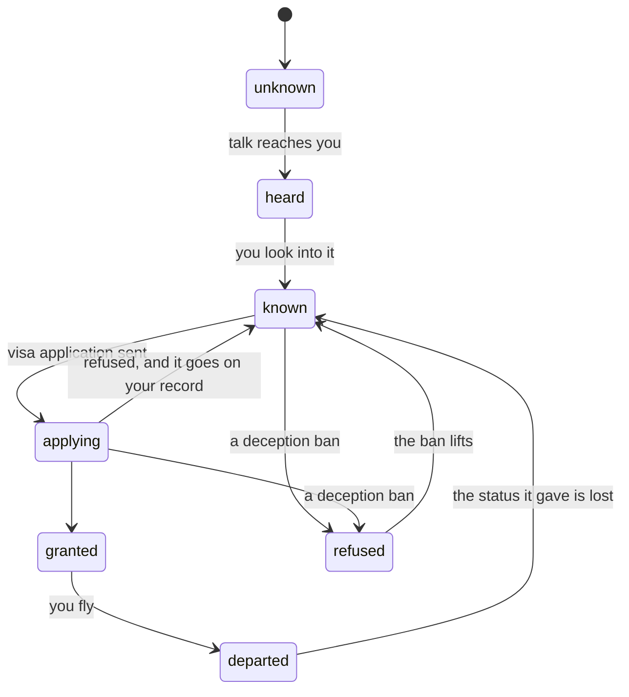

# Routes, schools and the interview

> The study route: a one-year taught master's in the UK. Figures are from `../research/09-uk-masters-numbers.md`; where the game differs from real life, the real value and the factor stand beside it. The three universities are invented.
> Kinds: `route`, `school`, `setpiece`. Background: `../design/01-concept.md` sections 4 and 10.
> For game design. Not immigration advice.

A route is a way out: a set of requirements, a window the world opens and closes, and a decision at the end. Nobody picks a route at the start. They hear of it, look into it, and find out how much of it their life already meets.

## The states of a route

`refused` is the state of a route closed to one character by a ban: a deception ban sets it until `bannedUntil` (route-gates:deception-bans-country); no rule of this page does.

## Rules: hearing and knowing

**route:routes-move-along-arrows** A route only moves along the arrows above. Any effect or command that would move it another way does nothing or is rejected.

**route:hearing-a-route** `route/hear` moves an unknown route to heard if the route's `hearIf` holds, and otherwise does nothing. With a chance given, it first draws on that chance, on the `offer` stream, and only for a route still unknown.

**route:friend-tells-by-month** In the `hear` phase, a character who meets `hearIf`, has not heard of the route, and has reached the route's `hearBy` month hears of it, through a friend.

**route:looking-into-makes-known** Looking into a heard route makes it known. The checklist is shown from then on. Any of the four ways in advice:four-ways-to-learn-route looks into a route (the official page, someone who went, the adviser, an agent); the effect `route/look-into` is what each of them emits. The view lists the routes in content order (the order of `content.route`), never in the order the stored state's keys come back in, since a database may reorder them; so the list online is the list offline. The view is not hashed.

**route:lapsed-route-known-again** A route flown can be tried again once the permission it gave is gone. When a character abroad loses permission in a country (the status lapses to the overstayer, status:overstayer-risks-detection; a removal; or a return home of any shape but `with-papers`), every route into that country that is `departed` moves back to `known`: its school, deposit, university's confirmation, sponsor and count of months held are cleared, and its refusals and record are kept. So a new master's can be applied for, in country in the grace (status:grace-allows-in-country-applications) or from home once any ban has lifted (place:leaving-an-overstay-bans). A `with-papers` return keeps its route as it was (return:papers-return-keeps-status).

**route:closed-window-blocks-applying** While the route's window is closed, applying to a school and applying for the visa are not legal. An application already sent is still decided.

## Rules: schools

**route:applying-to-a-school** A character may apply to a school on a known route when their grade meets the school's minimum and they have no application or offer there already. No school asks an English band (route:degree-meets-masters-english). A school that rejected them takes a new application once `tuning.route.reapplyMonths` months have passed since its answer, and the view says how long is left. The answer is due after a wait drawn between the school's two figures.

**route:school-answers-by-grade** In the `clocks` phase a school answers when its month has come. The chance of an offer is the school's base chance plus 5% for each grade above its minimum, never more than 95%. An offer carries a discount: the automatic one if the grade earns it, plus the merit one if its draw succeeds.

**route:deposit-secures-school** `route/pay-deposit` needs an offer from that school and no deposit paid on the route. The deposit is paid as a foreign fee with the reason `fee-school`. The school becomes the route's school and the university's confirmation is granted.

## Rules: showing funds

**route:funds-required** The funds a route requires, in pence, are the school's tuition, less its discount, less the deposit paid, less what an education loan has paid the school (route:education-loan-pays-the-school), plus the living line times the living months. Before a deposit is paid, the figure is worked out for the cheapest school the character holds an offer from, or failing that the cheapest school on the route with no discount.

**route:funds-shown-exclude-cash** The funds a character shows, in pence, are the bank and locked pockets of every currency valued at the official rate, plus any family support on the route valued the same way. Cash never counts. Each pocket goes to pence in one step and is rounded down once, so naira is valued as kobo times 100 over the pound rate. The study route counts as every route does.

**route:funds-held-month-count** In the `clocks` phase of each month in which a deposit is paid and no visa application is pending, the funds check runs. If the funds shown cover the funds required, the count of months held goes up by one. If not, it goes back to zero.

**route:visa-application-needs** Applying for the visa needs all of: the route known and its window not closed, a deposit paid, the passport, TB certificate and university's confirmation all held (the TB certificate is not asked of an application made in country, status:grace-allows-in-country-applications), the English met (route:degree-meets-masters-english), the funds covered now, and the count of months held at one or more. The visa fee and the health surcharge are the activity's cost. "Covered now" is judged when the slot is checked, before those fees come out of the funds shown.

**route:degree-meets-masters-english** For the UK master's the degree is the English. A bachelor's degree meets the route's English with no paper, no fee and no test: the `english` checklist item reads the degree, and no school asks a band. The English test stays open to anyone who wants a band for another route (route-gates:sponsor-application-needs, route-gates:entering-the-pool). Real: for a degree-level course the university may assess English itself, and many waive a test for a Nigerian degree taught in English (Birmingham asks none of Nigerian nationals with a Nigerian degree; Manchester may waive it; Leicester asks nothing more after a year at a recognised Nigerian university; Heriot-Watt takes the school certificate's English). The game's three schools all waive, where in life many do and some do not.

**route:education-loan-pays-the-school** A regulated education loan pays the school, never the student (decision 0033). `offer.education-loan` comes up for `route.uk-masters` once its deposit is paid (offer.md). Taking it pays the lender's processing fee, `tuning.route.loanProcessing` (£380), from the pounds by wallet:foreign-fee-payment-order under `fee-agent`, and opens `obligation.education-loan` in pounds for the amount picked plus the lender's fee, `tuning.route.loanFeeBp` (4.2%), crediting nothing: the amount goes to the school. The route records it as `loanPaid`, which comes off the funds required (route:funds-required) and off the tuition the student owes on arrival (abroad-money:tuition-paid-in-instalments); a loan is not money shown and adds nothing to the unexplained share, since the agreement and the lender's licence are its papers. The loan charges nothing while the student status holds and its course runs; its charges start the month after the Graduate status is granted, or after the student status ends without it, whichever is first, at `obligation.education-loan`'s 0.8% a month flat over 180 months, and a default is recovered as any loan's is (obligation:loan-default-and-recovery). A refusal of the visa sends the money back from the school to the lender (route:refusal-refunds-and-resets): the loan closes with nothing owed and `loanPaid` is cleared, and only the processing fee is lost. One loan a route. Real: Appendix Finance counts a regulated educational loan for the funds (FIN 8.3(c)(iii)); a lender that funds Nigerian students' master's abroad, with no collateral or co-signer, pays the school direct, at a representative 13.48% a year variable (rates from 11.94%), with a 4.2% administration fee added to the loan and a $500 processing fee, over 15 years in its example, full-time students repaying from six months after the course (Sources).

**route:family-pledge-pays-tuition** The pledge pays the school (decision 0033). While the family's pledge stands on `route.uk-masters` (`route/support`'s `show`, route:funds-shown-exclude-cash), each charge the school makes, the enrolment deposit at home (route:deposit-secures-school) and every tuition charge abroad, is met from the pledge first, up to what is left of it, and the student's own money meets only what the pledge no longer covers: the charge is valued in naira at the day's official rate, lowered from the pledge's `show`, and credited to the pound bank under `gift`, not flagged, at once (in the `due` phase for a tuition charge), so the charge is paid whole (obligation:charges-paid-whole-or-missed) and the student's pay is left for the living. The line says it in the family's words ("Your father paid the school {amount}."). A pledge spent to nothing pays nothing more, and the living stays the student's. Real: the visa counted a parent's account with written consent (Appendix Finance FIN 5.1 and 5.3), and that is the account the fees come from.

**route:unexplained-share-of-funds** The unexplained share is the value of the wallet's lots, at the official rate, as a share of the funds required, never more than 100%.

## Rules: decision day

**route:application-fixes-figures** Sending the application moves the route to applying and records the month, the decision month one month later, the unexplained share, and the living line, living months and strictness on that day. The decision uses those recorded figures, whatever the world does afterwards.

**route:application-opens-interview** Sending the application opens the credibility interview. It must be finished before the next turn can end.

**route:visa-refusal-chance** In the `clocks` phase of the decision month the visa is decided by one draw. The chance of refusal, in basis points, is 900, plus 10 for each point of strictness, plus 40 for each whole percent of unexplained share, plus 800 for each earlier refusal, minus 150 for each interview point, minus 200 for a grade of second upper or better. It is never below 300 or above 8000.

**route:grant-moves-to-granted** A grant moves the route to granted.

**route:refusal-refunds-and-resets** A refusal moves the route back to known and adds one to its refusals. The health surcharge is refunded to the pound bank pocket at once. The deposit, less `tuning.route.depositAdminFee` (£500), is refunded `tuning.route.depositRefundMonths` (2) months later. The route's school is cleared, the university's confirmation is voided, and the count of months held goes to zero. The school's offer stands, so the deposit can be paid again.

**route:refusal-reasons-recorded** A refusal records its reasons, most telling first: `funds` if the unexplained share was 30% or more, `interview` if the interview score was below zero, `history` if there was an earlier refusal, and `credibility` if none of those apply.

**route:departure-pays-flight** `route/depart` needs the route granted, no held-funds obligation open, and the flight paid: `tuning.route.flight`, ₦1,100,000, naira, with the reason `flight`, unless the route's entry has `flightPaidByEmployer`. The route becomes departed. The life does not end: `place/move` takes the character abroad and `status/grant` gives the route's status (route-gates:departure-grants-status). `turn/finish` is not applied at departure (turn:finish-ends-the-life). Once the route is granted, no held-funds loan is offered (`offer.held-funds` asks that the route is not granted or departed): the funds have done their work.

## Rules: the interview

**route:set-piece-draws-questions** A set piece opens with as many questions as its entry asks for, drawn without repeats on `visa` from the questions whose conditions hold; an entry with `order: "fixed"` asks instead the first that many whose conditions hold, in the order written (the December visit: the going question first).

**route:answer-may-ask-follow-up** A follow-up question tied to the answer given: a question's entry may name, per answer, one follow-up question with its own answers; when the player taps an answer that names one, the follow-up is asked next, before the remaining drawn questions, at most one follow-up per question. The follow-up is chosen by which answer was tapped, never by what it scored, so the score stays hidden (route:view-shows-progress-not-score); its answers score like any other. The view shows it as one more question; the count asked includes it.

**route:open-set-piece-holds-month** While a set piece is open, `turn/end` is rejected with `setpiece-open`. Other commands work as usual. In the world the month is held at the bed's Sleep while a set piece is open.

**route:set-piece-answers-in-order** `setpiece/answer` must name the first question not yet answered and one of its answers, and the answer's `requires` must hold (a spending answer requires `money/min` in the country's currency for its price, since the answer takes from that currency alone, so a visit that cannot be paid for is never half taken). Anything else is rejected with `not-legal`; the view marks an answer whose requirements fail as not allowed.

**route:answers-score-and-close** An answer scores its plain score, or its other score when its conditions hold, judged at the moment the answer is given, and the open set piece keeps the running sum. When the last question is answered, or an answer marked `closes` is given (staying home in December), the set piece closes and the sum is recorded on the visa application.

**route:view-shows-progress-not-score** The view shows one question at a time and never a score. It carries `asked` (answers given so far) and `total` (questions this opening asks), so the screen can say how far along the scene is. With interview prep at 40 or more, the view marks the answers that would score below zero.

**route:last-answers-remembered** The slice keeps the last answer given to each question of each set piece (`given`), and the requirement `setpiece/answered-with` (`setpiece`, `question`, `answer`) holds when that answer was the last one given. The December goal reads it: the visit counts only when the going answer was given (goal.md).

**route:answers-carry-effects** An answer may carry `effects`, applied the moment it is given, under the set piece as source. A set piece opened by `setpiece/open` with `route` null (the December visit, the road's scenes) records no score anywhere. Each close adds one to the slice's `answered` count for that set piece, which the requirement `setpiece/answered` (`times`, default 1) reads.

## Entry: `route.uk-masters`

- **Hear if**: a bachelor's degree. **Heard by**: month 3. **Window**: `var.uk-study-window`.

| Checklist item | Weight | Met when | Earns part as it fills |
|---|---|---|---|
| `degree` | 6 | Bachelor's degree | |
| `grade` | 4 | Second lower or better | |
| `passport` | 4 | Passport held | |
| `transcript` | 3 | Transcript held | |
| `english` | 12 | A bachelor's degree, taught in English (route:degree-meets-masters-english) | |
| `offer` | 12 | An offer from a school | |
| `deposit` | 12 | Deposit paid | |
| `funds` | 28 | Funds shown cover funds required | Yes |
| `held` | 8 | Covered at one month end or more, and now | |
| `tb` | 4 | TB certificate held | |
| `applied` | 7 | Application sent | |

## Entries: schools

| Id | Name | Tuition | Deposit | Lowest grade | Offer chance | Automatic discount | Merit discount | Answers in |
|---|---|---|---|---|---|---|---|---|
| `school.northgate` | Northgate University, north-east England | £17,000 | £4,000 | Second lower | 85% | £2,000 for second upper or better | None | 1 month |
| `school.ashby` | University of Ashby, the Midlands | £24,250 | £5,000 | Second upper | 60% | None | £3,000, 30% | 1 to 2 months |
| `school.kingsmere` | Kingsmere University, north-west England | £35,200 | £6,000 | Second upper | 30% | None | £5,000, 15% | 1 to 2 months |

The dearer schools only cost more. The deposits against real life, for Nigerian applicants in 2026: £4,000 is the common figure (Essex for 2027 to 2028, with Nigeria named; UEA for September 2026; Keele; Teesside, whose fee Northgate takes), with Nottingham £4,500, Brighton £5,000, Leicester £3,000, Manchester £2,500, York £3,000, King's College London £2,000 and Coventry £8,000. Northgate's £4,000 is real (factor 1.0); Ashby's £5,000 is 1.25 times the common figure and Kingsmere's £6,000 1.5 times, a game choice that keeps the dearer schools dearer in every line, since in life a dearer university does not ask a bigger deposit. The schools ask no English band (route:degree-meets-masters-english).

## Entry: `setpiece.credibility-interview`

Three questions are asked. Scores are hidden from the player.

| Question | Asked when | Answer | Score |
|---|---|---|---|
| `why-uk`: "Why this university, and why not study in Nigeria?" | Always | `course`: "This course has modules I cannot get at home, and I can name them." | +2 with interview prep 20 or more, else 0 |
| | | `better`: "Abroad is just better." | -1 |
| | | `admission`: "It was the course I could get admission for." | -2 |
| `course-about` (follow-up to `admission`, route:answer-may-ask-follow-up): "Then what is the course about, in your own words?" | After `admission` | `modules`: "It builds on my work, and I can name the modules." | +1 with interview prep 20 or more, else -1 |
| | | `leave`: "Any course would do. I need to leave." | -2 |
| | | `little`: "I would have to check the papers." | -1 |
| `who-pays`: "Who is paying for your studies?" | Always | `own`: "My savings and my family. The statements show the history." | +2 with an unexplained share of 20% or less, else -2 |
| | | `lender`: "Part of it is a loan from a lender. I have the agreement." | 0 |
| | | `sponsor`: "A sponsor." | -1 |
| `sponsor-who` (follow-up to `sponsor`, route:answer-may-ask-follow-up): "Who is the sponsor, and what do they do?" | After `sponsor` | `relative`: a named relative and their work | +1 with an unexplained share of 20% or less, else -1 |
| | | `friend`: "A friend." | -2 |
| `after`: "What will you do when the course ends?" | Always | `return`: "Go back to my work in Lagos, better qualified." | +2 |
| | | `undecided`: "I have not decided." | -1 |
| | | `stay`: "Find any job there and stay." | -2 |
| `course`: "Tell me what the course covers." | Always | `detail`: You walk through the modules and the project. | +2 with interview prep 40 or more, else -1 |
| | | `brief`: "It is a one-year master's in my field." | 0 |
| `papers`: "We checked your transcript with the university. They have no record of it. Explain." | The transcript held is not genuine (advice:agent-loss-is-the-fee) | `genuine`: "It is genuine. The university must have made a mistake." | -2 |
| | | `agent`: "An agent arranged it for me." | -2 |
| | | `admit`: "Someone sold it to me. I did not know it was not real." | -1 |
| `deposit`: "A large sum reached your account recently. Explain it." | Unexplained share above 30% | `agreement`: "It is a loan. Here is the agreement and the lender's licence." | 0 |
| | | `gift`: "A gift from an uncle." | -2 |
| `gift-uncle` (follow-up to `gift`, route:answer-may-ask-follow-up): "Which uncle, and is there a letter?" | After `gift` | `letter`: a named uncle and a letter | 0 |
| | | `unknown`: "I would have to ask." | -2 |
| | | `savings`: "Savings I moved from another account." | -2 |
| `living`: "Where will you live, and what will it cost you a month?" | Always | `figures`: You give the hall, the rent and the bus fare. | +1 with interview prep 20 or more, else -1 |
| | | `sort`: "I will sort that out when I arrive." | -1 |

## Numbers

| Setting | Value | In content as | Source |
|---|---|---|---|
| Refusal chance, base | 9% for the UK master's, 0 for the road | each route's `refusalBaseBp` | Working value |
| For each point of strictness | 0.1% | `refusalPerStrictnessBp` = 10 | Working value |
| For each percent of unexplained share | 0.4% | `refusalPerUnexplainedBp` = 40 | Working value |
| For each earlier refusal | 8% | `refusalPerRefusalBp` = 800 | Working value |
| For each interview point | -1.5% | `refusalPerInterviewPointBp` = 150 | Working value |
| Second upper or better | -2% | `refusalGoodGradeBp` = 200 | Working value |
| Floor and ceiling | 3% and 80% | `refusalMinBp`, `refusalMaxBp` | Working value |
| Grade that takes the good-grade figure off | Second upper or better | `goodGrade` = 4 | Working value |
| Unexplained share that makes `funds` a refusal reason | 30% | `fundsReasonBp` = 3000 | Working value |
| Offer chance for each grade above the school's minimum | 5% | `offerPerGradeBp` = 500 | Working value |
| Offer chance at most | 95% | `offerMaxBp` = 9500 | Working value |
| Months from application to decision | 1 | `decisionMonths` | Working value |
| Fee kept from a refunded deposit | £500. Real: Essex keeps £500 of a refunded deposit, and £2,000 when the refusal was the applicant's own doing; Leicester refunds nothing after a refusal for misleading papers or credibility. The game keeps £500 on every refusal (factor 1.0 for the common case) | `depositAdminFee` = 50000 | Universities' deposit policies (Sources) |
| Months until the deposit refund arrives | 2. Real: York aims to decide in 14 working days and pay within 28 working days of approval (factor 1.0) | `depositRefundMonths` | Universities' deposit policies (Sources) |
| Flight, Lagos to London, one way | ₦1,100,000, about US$810 at ₦1,361.34 to the dollar (23 Oct 2026): a direct one-way in the September rush with bags. Real: Royal Air Maroc returns from US$579 through Casablanca and Virgin Atlantic direct returns from US$1,134 (Nov and Dec 2026), a one way averaging about US$521, so about ₦700,000 to ₦1,200,000 one way; the game about 1.0 to 1.5 times | `flight` | Royal Air Maroc, Virgin Atlantic and FareCompare (Sources) |
| The education loan | the processing fee £380; the lender's fee 4.2% added to the loan; 0.8% a month flat on what is owed at the start, over 180 months, from the month after the Graduate status or the course's end. Real: a representative 13.48% a year variable, from 11.94%, a 4.2% administration fee, $500 to process (£380 at the start rates), 15 years in the lender's example, full-time students repaying from six months after the course. The flat 0.8% charges about 1.04 times what the representative rate does | `tuning.route.loanProcessing` 38000, `loanFeeBp` 420; `obligation.education-loan` rateBp 80, term 180 (route:education-loan-pays-the-school) | Prodigy Finance, read 24 Oct 2026 (Sources) |
| Interview prep that reveals weak answers | 40 | `hintPrep` | Working value |
| Months before a school that refused takes a new application | 6 | `reapplyMonths` | Working value |

A clean file with a good interview is refused about 6 times in 100. A file resting on borrowed funds, with a poor interview, is refused more often than not. The real rate for Nigerian applicants was about 21 in 100 from January to March 2026 (Times Higher Education, on Home Office data; `../research/09-uk-masters-numbers.md`, Refusals and interviews).

## Sources

Read on 23 Oct 2026, beside `../research/09-uk-masters-numbers.md`:

- [GOV.UK: Student visa, knowledge of English](https://www.gov.uk/student-visa/knowledge-of-english): the university may assess English for a degree-level course
- The universities' pages for Nigerian applicants: Birmingham, Manchester, Leicester and Heriot-Watt on English; Essex (deposit policy for 2027 to 2028, sections 3.2, 5.1.1 and 5.1.2), UEA, Keele, Nottingham, Brighton, York and King's College London on deposits and refunds
- Royal Air Maroc and Virgin Atlantic fare pages for Nigeria, Nov and Dec 2026; FareCompare's average one way; the dollar at ₦1,361.34, official, 23 Oct 2026 (`../research/09-uk-masters-numbers.md`)

Read on 24 Oct 2026:

- [GOV.UK: Immigration Rules, Appendix Finance](https://www.gov.uk/guidance/immigration-rules/immigration-rules-appendix-finance): a parent's account with written consent (FIN 5.1, 5.3) and a regulated educational loan (FIN 8.3(c)(iii)) count toward the funds. route:education-loan-pays-the-school, route:family-pledge-pays-tuition.
- [Prodigy Finance: the interest rate on an education loan abroad, 6 Oct 2026](https://prodigyfinance.com/resources/blog/interest-rate-abroad-education-loan-india-2026/): a representative APR of 13.48% variable on a $40,000 example over 180 months, from 11.94%; an administration fee of 4.2% added at disbursement; a $500 processing fee before the loan is advanced; paid direct to the school. route:education-loan-pays-the-school.
- [Prodigy Finance: loans without collateral or a co-signer](https://prodigyfinance.com/resources/blog/can-you-get-a-student-loan-to-study-abroad-without-collateral-or-a-co-signer-/), and [8B: Prodigy Finance lender review](https://www.8b.africa/prodigy-finance-8b-lender-reviews): no collateral or co-signer; graduate degrees in business, science, technology, engineering, law, policy, economics and health; full-time students repay from six months after graduating. The lender has lent to students from Nigeria since April 2024 (its press release, Business Wire, 30 Apr 2024, as reported). route:education-loan-pays-the-school.

## Effects and requirements this kind handles

The part before the slash names the kind that carries an effect out or judges a requirement (`engine.md` section 5). The types are in `packages/sim/src/engine/types.ts`.

| Type | | What it does |
|---|---|---|
| `route/hear` | effect | The route is heard of, at `chanceBp` on stream `offer` when given; `via` names how (route:hearing-a-route) |
| `route/look-into` | effect | The route the slot's param names moves from heard to known (route:looking-into-makes-known) |
| `route/apply-school` | effect | An application to the school the slot's param names (route:applying-to-a-school) |
| `route/apply` | effect | The visa application, once its conditions hold (route:visa-application-needs, route:unexplained-share-of-funds, route:application-fixes-figures and route:application-opens-interview) |
| `route/support` | effect | The family pledge: money in a parent's account that counts toward the route (route:funds-shown-exclude-cash) |
| `route/interview-scored` | effect | The finished interview's score goes on the open visa application (route:answers-score-and-close) |
| `route/lapse` | effect | On a loss of permission in `country` other than a return with papers, a departed route into that country goes back to known, its school, deposit, confirmation and sponsor cleared and its record kept (route:lapsed-route-known-again) |
| `setpiece/open` | effect | Opens a set piece, scored onto the route's application when a route is given (route:set-piece-draws-questions, route:answers-carry-effects). Judged by the `setpiece` kind |
| `route/state` | requirement | The route's state is one of `in` |
| `route/offer` | requirement | An offer from at least one school on the route is held |
| `route/deposit` | requirement | A school's deposit on the route is paid |
| `route/funds` | requirement | The funds check passed at the last month end for `heldMonths` in a row, and passes now (route:funds-held-month-count) |
| `route/unexplained-max` | requirement | The share of shown funds from flagged sources is at most `bp` (route:unexplained-share-of-funds) |
| `setpiece/answered` | requirement | The set piece has closed at least `times` times, default 1 (route:answers-carry-effects). Judged by the `setpiece` kind |
| `setpiece/answered-with` | requirement | The last answer to this question of this set piece was this one (route:last-answers-remembered). Judged by the `setpiece` kind |
