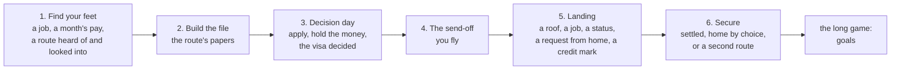
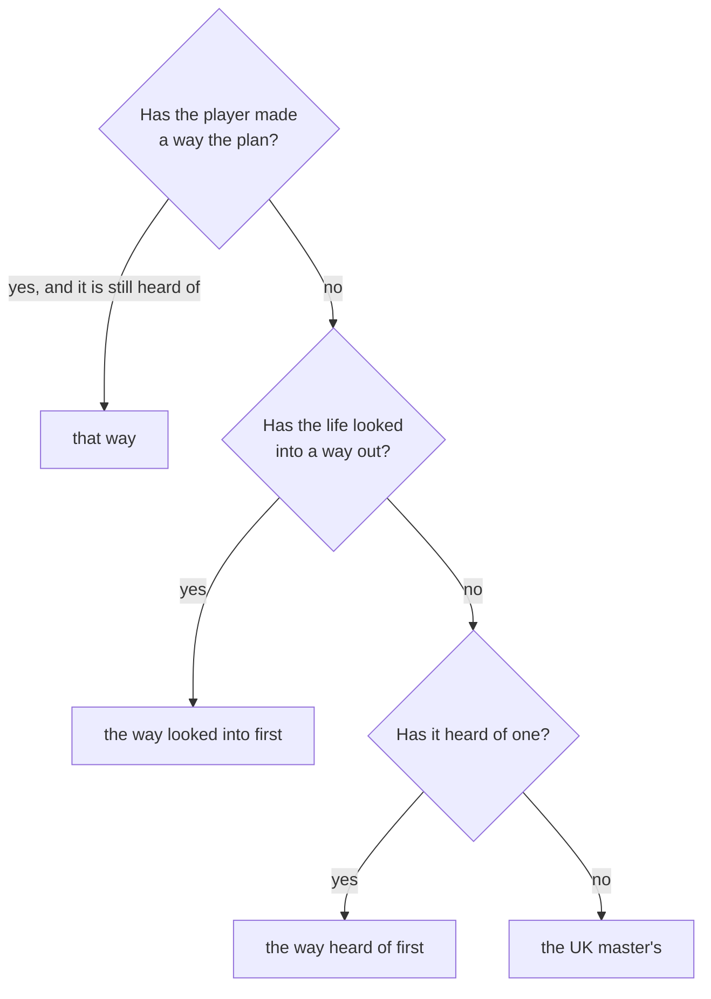
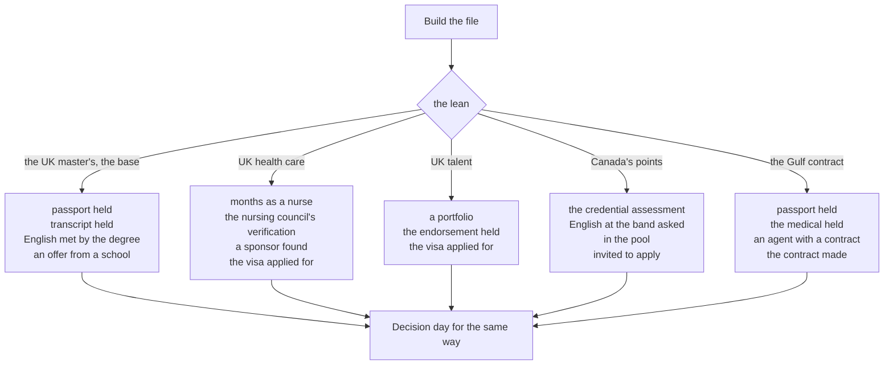
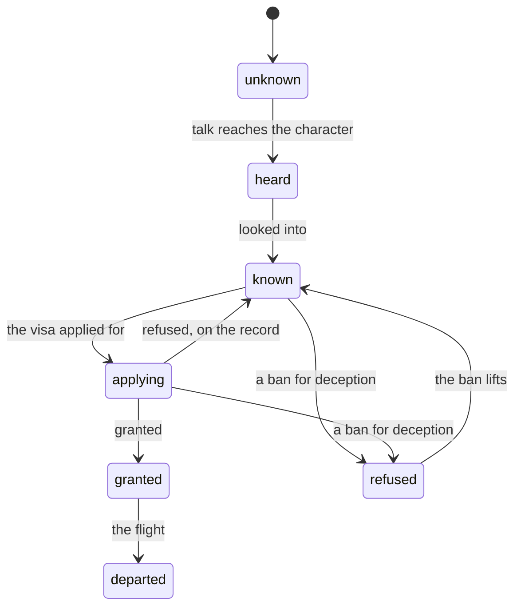
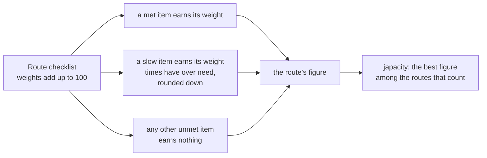

# Chapters and routes

A life has six chapters (`docs/design/03-structure-and-conventions.md` section 1), from finding your feet in Lagos to securing a life abroad, and a set of routes, the ways out of the country. This page shows how the chapters follow a route and how japacity reads one; the rules are on the pages each section links.

## The six chapters

Chapters are content (`packages/content/src/chapter/chapter.data.ts`); their rules are on [the chapters page](../../rules/chapter.md). The engine follows the base chapters in order.

A chapter is a short list of items, each a requirement judged against the state as it stands. When every item is met, the chapter closes in the month's `chapter` phase and the next opens, refilling the bank of turns. After Secure the view shows the long game's goals instead ([Life goals](../../rules/goal.md)). The exact rules, including the items that close a chapter on their own, are on [the chapters page](../../rules/chapter.md).

## The plan and the lean

Chapters two and three have variants, one for each way out of the player's own effort that has its own file. When the base chapter's turn comes, the variant for the life's lean (the route it leans towards) takes its place (chapter:chapters-follow-lean-route). The lean is chosen like this:

A grant comes before all of this: once a route is granted or flown, the chapters and the plan follow it. The player can choose the plan with `chapter/lean` while at home with no visa granted (decision 0022). The tie order, the grant's place and the lean command's limits are in chapter:chapters-follow-lean-route.

The view carries `plan: { route, ways }`: the way the chapters follow, and each way of the player's own effort with the figure its checklist earns now, so the Japa app can say what switching would do.

## The file chapter

In "Build the file" a route becomes papers. The base is the UK master's; each variant swaps in its own route's papers.

Decision day follows the same pattern: each way asks for its own certificates, the application and the grant, and closes on the grant. Each variant's exact items are in [the chapters page's table of variants](../../rules/chapter.md).

::: info Why the variants exist
Without variants, a nurse's chapters would lead to the master's file. The variants give each way of the player's own effort its own file, and the plan lets the player see and change which file they are on.
:::

## Routes

A route is a way out: a set of requirements, a window the world opens and closes, and a decision at the end. Nobody picks a route at the start: the character hears of it, looks into it, and finds out how much of it the life already meets. Rules: [the routes page](../../rules/route.md), [the route gates page](../../rules/route-gates.md) and [the road page](../../rules/road.md).

A route only moves along these arrows (route:routes-move-along-arrows).

- **Hearing of a route:** through friends, meetups, the motor park, a returnee or the route's own hearing month.
- **Looking into a route:** one of four acts in the city: the official page, someone who went, a licensed adviser, or an agent (route:looking-into-makes-known, [Finding out where you stand](../../rules/advice.md)).

Every route has a gate: the part of its journey that is its own.

| Route | Gate | In short |
|---|---|---|
| `route.uk-masters` | study | A school's offer, a deposit, funds shown and held, the visa |
| `route.uk-care`, `route.uk-skilled` | sponsor | An employer who sponsors the job |
| `route.canada-points` | points | A score, the pool and an invitation |
| `route.uk-talent` | endorsement | A portfolio and an endorsement |
| `route.gulf-contract` | contract | An agent and a contract with an employer |
| `route.road` | road | The road through the desert: no checklist, no figure, and its own chain of steps |
| `route.uk-partner`, `route.canada-spouse` | partner | Through a partner who is abroad |
| `route.uk-dependant`, `route.canada-accompany` | dependant | Going with a partner who goes |

The gates are in `packages/sim/src/route/gates/`. The partner and dependant routes rest on a bond with another character, a computer one or a real player ([People](../../rules/person.md), [Sponsoring a partner](../../rules/undertaking.md), [The genuineness interview](../../rules/interview.md)).

::: warning For game design only
The route pages model real rules with figures from public sources, read on the dates their pages give. They are written for the game, not as guidance for anyone's own move.
:::

## Japacity

Japacity is how ready the character is to leave, worked out from the state on each request and never stored (`packages/sim/src/japacity/japacity.logic.ts`). The rules are on [the japacity page](../../rules/japacity.md):

The month's report carries japacity before and after the month, so the results sheet can show the change (turn:turn-stores-a-report).

## Related rules

- [Chapters](../../rules/chapter.md)
- [Routes, schools and the interview](../../rules/route.md)
- [Route gates](../../rules/route-gates.md)
- [The road](../../rules/road.md)
- [Japacity](../../rules/japacity.md)
- [Finding out where you stand](../../rules/advice.md)
- [Life goals](../../rules/goal.md)
