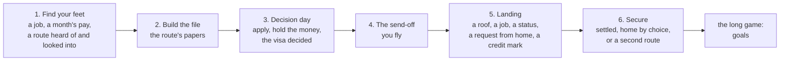
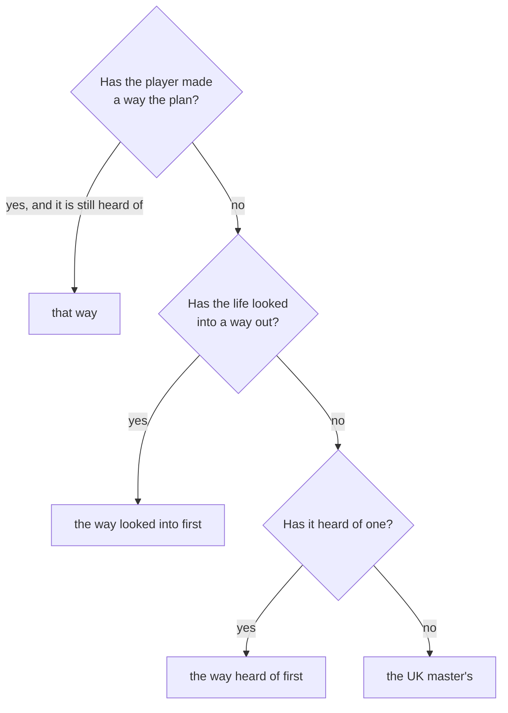
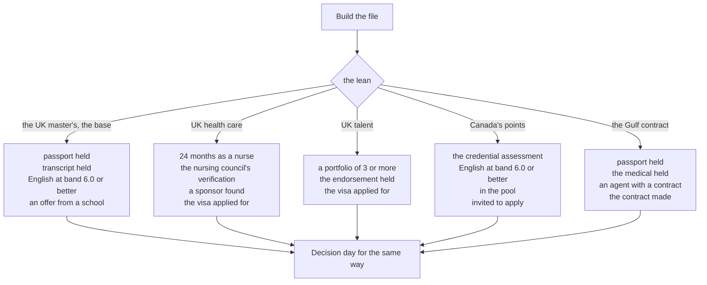
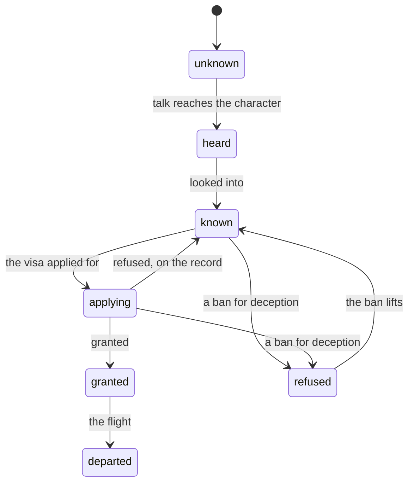
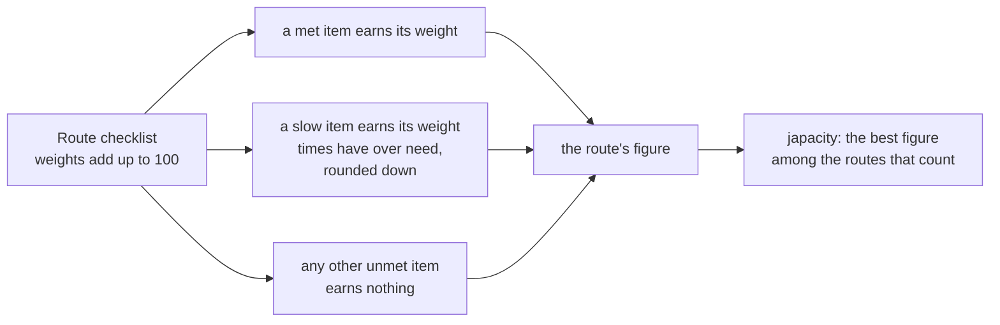

# Chapters and routes

A life in Japacity has a story with six chapters, from finding your feet in Lagos to securing a life abroad, and a set of routes, the ways out of the country. A chapter is a short list of things to get done; when they are all done, the chapter closes and the next one opens. A route is a way out with its own checklist and its own decision at the end. The two are tied together: once a life leans towards one way out, the middle chapters turn into that route's own file and decision day. Japacity, the headline figure, is how much of a route's checklist the life already meets.

## The six chapters

Chapters are content (`packages/content/src/chapter/chapter.data.ts`) and their rules are on [the chapters page](../../rules/chapter.md). The engine follows the base chapters by their order.

- A new life opens on the first chapter (chapter:first-chapter-starts-current). In the `chapter` phase of a month, if every item of the current chapter is met, it closes, the next opens and the turn bank is refilled. At most one chapter closes in a month (chapter:met-items-close-the-chapter).
- An item is a requirement, judged against the state as it stands; the view shows each as met or not (chapter:items-are-live-requirements). A done chapter stays done (chapter:done-chapter-stays-done).
- A chapter may name one `closesOn` item that closes it on its own: decision day closes on the grant, whether or not the held funds lasted.
- Closing the send-off makes the send-off card (chapter:send-off-card-on-close). After Secure there is no current chapter, and the view shows the long game's goals in its place (chapter:long-game-after-last-chapter; [Life goals](../../rules/goal.md)).
- The view's chapter part also says whether the chapter would close at this month's end as things stand, and which chapter comes next (chapter:view-says-closes-and-next).

## The plan and the lean

Chapters two and three are not the same for everyone. Each has variants, one for each way out of the player's own effort that has a file of its own. When the base chapter's turn comes, the variant for the life's lean stands in for it (chapter:chapters-follow-lean-route).

A tie in the same month is broken in content's order: health care, talent, points, the Gulf, then the master's. The lean is read again each time a chapter closes (`leanRoute` in `packages/sim/src/chapter/chapter.logic.ts`).

The grant decides before all of this (chapter:chapters-follow-lean-route): once any route but the road is granted or flown (a partner's and a dependant's too), the chapters and the plan follow it, a grant finishes the chapters up to decision day, and the flight's turn closes them through the send-off (chapter:met-items-close-the-chapter).

The player can choose: `chapter/lean` makes a heard-of way the plan, while the character is at home and no visa has been granted (decision 0022). The view carries `plan: { route, ways }`: the way the chapters follow, and each way of the player's own effort with the figure its checklist earns now, so the Japa app can say what switching would do.

## The file chapter

"Build the file" is where a route becomes papers. Its base is the UK master's; each variant swaps in its own route's papers.

Decision day follows the same pattern. The master's base asks for the deposit, the funds held for a month, the TB certificate, the application and the grant. Each variant asks for its own route's certificates (a TB certificate, a police certificate), the application and the grant, and each closes on the grant.

::: info Why the variants exist
Without them, a nurse's chapters would lead to the master's file. The variants give each way of the player's own effort its own file, and the plan lets the player see and change which file they are on.
:::

## Routes

A route is a way out: a set of requirements, a window the world opens and closes, and a decision at the end. Nobody picks a route at the start; they hear of it, look into it, and find out how much of it their life already meets. The rules are on [the routes page](../../rules/route.md), [the route gates page](../../rules/route-gates.md) and [the road page](../../rules/road.md).

A route only moves along these arrows (route:routes-move-along-arrows). Talk of a route reaches the character through friends, meetups, the motor park, a returnee or a route's own hearing month; looking into a route is one of four acts in the city: the official page, someone who went, a licensed adviser, or an agent (route:looking-into-makes-known, [Finding out where you stand](../../rules/advice.md)).

Every route has a gate: the part of its journey that is its own.

| Route | Gate | In short |
|---|---|---|
| `route.uk-masters` | study | A school's offer, a deposit, funds shown and held, the visa |
| `route.uk-care`, `route.uk-skilled` | sponsor | An employer who sponsors the job |
| `route.canada-points` | points | A score, the pool and an invitation |
| `route.uk-talent` | endorsement | A portfolio and an endorsement |
| `route.gulf-contract` | contract | An agent and a contract with an employer |
| `route.road` | road | The road through the desert: no checklist, no figure, and its own chain of steps |
| `route.uk-partner`, `route.canada-spouse` | partner | Through a partner who is abroad |
| `route.uk-dependant`, `route.canada-accompany` | dependant | Going with a partner who goes |

The gates are in `packages/sim/src/route/gates/`. The partner and dependant routes rest on a bond with another character, a computer one or a real player ([People](../../rules/person.md), [Sponsoring a partner](../../rules/undertaking.md), [The genuineness interview](../../rules/interview.md)).

::: warning For game design only
The route pages model real rules with figures read from public sources on the dates their pages give. They are written for the game, not as guidance for anyone's own move.
:::

## Japacity

Japacity is how ready the character is to leave, as a whole number from 0 to 100. It is worked out from the state each time it is asked for and never stored (japacity:figure-derived-each-time; `packages/sim/src/japacity/japacity.logic.ts`).

- A route's figure is the sum of what each checklist item earns (japacity:figure-sums-checklist-items). A route granted or flown is 100 (japacity:granted-route-scores-full).
- The routes that count are those known with a window not closed, and those applying, granted or departed. With none, japacity is empty and shown as "no route yet" (japacity:best-open-route-is-japacity).
- A route only heard of has no figure in the view's routes; its figure is in the plan's ways (japacity:heard-routes-have-no-figure).
- The road has no checklist and no figure (japacity:figure-is-whole-percent).

The month's report carries japacity before and after the month, so the results sheet can say what the month did to it.

## Rules this page rests on

- [Chapters](../../rules/chapter.md)
- [Routes, schools and the interview](../../rules/route.md)
- [Route gates](../../rules/route-gates.md)
- [The road](../../rules/road.md)
- [Japacity](../../rules/japacity.md)
- [Finding out where you stand](../../rules/advice.md)
- [Life goals](../../rules/goal.md)
