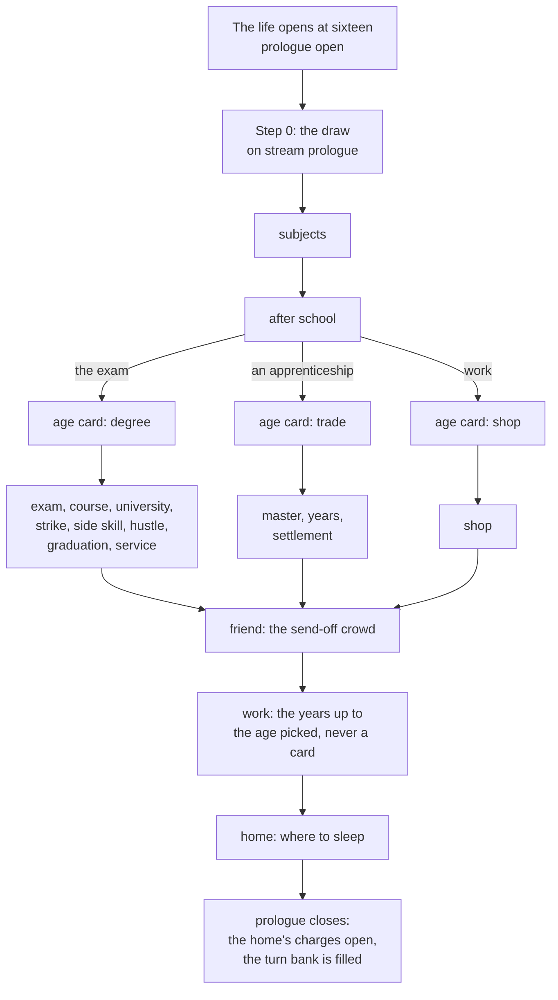
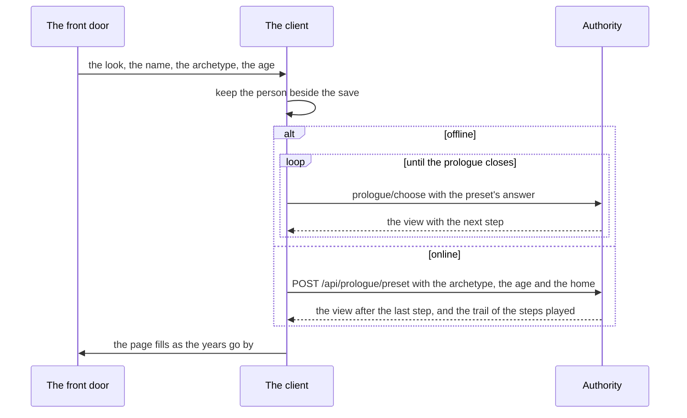
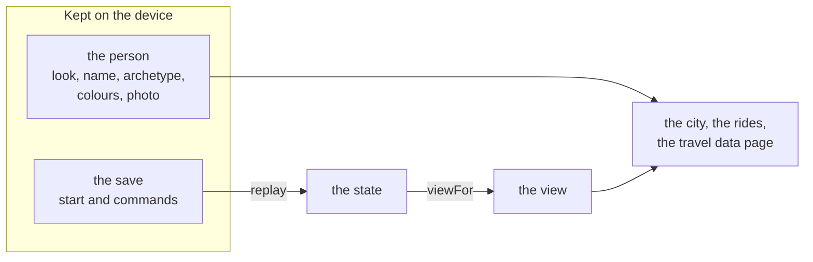
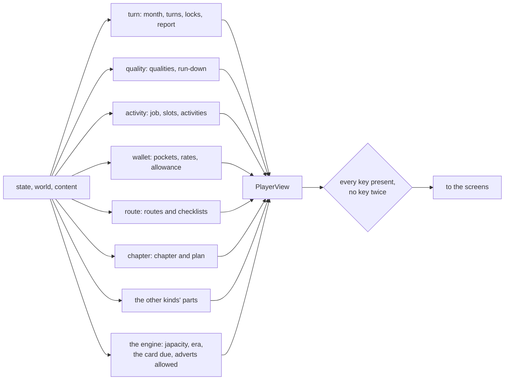

# The character

A character is one life: who they are, what they have, their papers, who they know and where they stand with every way out. In code it is one plain object, the state (`docs/design/03-structure-and-conventions.md` section 1), made of twenty-one slices, one per kind. The player never sees the state. They see the view, which the engine builds from it on each request.

This page covers how a life starts, what the state holds, and how the view is built.

## Starting a life

A life starts in one of two ways.

| Start | Scenario | How it goes |
|---|---|---|
| From sixteen | `scenario.prologue` | Every quality at its minimum, age sixteen, no money, no job, no papers. The prologue is open, and the years to the start are played as answers (prologue:prologue-life-starts-empty) |
| A ready life | `scenario.graduate`, `scenario.banker`, `scenario.developer`, `scenario.nurse`, `scenario.teacher` | A fixed starting life with the prologue already closed and no steps recorded (prologue:fixed-life-skips-prologue). Offered behind Settings, never on the door |

The front door's three screens build the person and start a life from sixteen. The ready lives are reached through Settings' "Start from a ready life", which asks the next door to open on them. How each looks: [The front door](../plays/front-door.md) and [The ready lives](../plays/ready-lives.md).

## The prologue

The prologue is the years from sixteen to the first month, played as cards. Rules: [the prologue page](../../rules/prologue.md). Steps: content, in `packages/content/src/prologue/prologue.data.ts`.

The diagram leaves out side branches (a retake, a strike that drags on). Each step's answers and conditions are in content.

- **The draw.** When the prologue opens, step 0 draws the family's means, city or town, the number of siblings, and whether the parents were schooled. It uses the `prologue` stream, so the life's seed fixes it (prologue:family-draw-on-first-answer).
- **The answers.** Each later step offers its answers, sent as `prologue/choose`. An answer must be one whose requirements hold. Answers change qualities, add family money or earned cash, and may set flags. Some answers end in a draw on the same stream, whose outcome is the next card (prologue:steps-offer-legal-answers).
- **Age.** Each step adds months to the character's age. Right after school, each path's age card sets the age the life starts at, never younger than the path allows. The years from the path's end to that age are the `work` step, answered by the prologue kind itself, never shown as a card (prologue:age-advances-with-steps; decision 0023).
- **The close.** When the last step is answered, the chosen home opens its charges, the turn bank is set from the tuning, and the state is a legal starting life (prologue:closing-opens-home-charges).
- **While it is open,** every other command is refused with `prologue-open`.

## Archetypes

The door does not show the prologue's cards. The player picks an archetype tile, and the prologue is played for them. An archetype is a preset of answers, one for every step; the simulation never holds it (prologue:archetype-presets-answers).

- The presets are in content (`packages/content/src/prologue/prologue.preset.ts`), so the offline client and the online server play the same source.
- The tiles, with the routes each names, are in the client (`apps/client/src/shared/front-door/archetypes.ts`).

For each step the answer sent is the first of the archetype's answers that is allowed. Where a draw has shut them all, it is the open answer that suits the archetype.

- Offline, the client sends each answer as `prologue/choose`.
- Online, the server plays the whole preset in one transaction, one log row per step (server:server-plays-prologue-preset, decision 0008).

No card shows for a new life, but the draws still run, and the travel data page says how the years went.

| Archetype | Routes its tile names |
|---|---|
| `developer` | UK talent, UK skilled work, the UK master's |
| `nurse` | UK health care, the Gulf contract, Canada's points |
| `accountant` | Canada's points, UK skilled work, the UK master's |
| `writer` | The UK master's, Canada's points |
| `trader` | The Gulf contract, the road |
| `shop-worker` | The Gulf contract, the road |
| `water` | The Gulf contract, the road. Starts in a room in Makoko (prologue:makoko-start-never-a-trap) |

::: details The door's seeds
A tile's path must be open from the first card (prologue:tile-path-open-from-start). In the local authority, where a life may be started over, the door tries a few named seeds in turn and starts on the first whose draws keep open every step the tile chooses (`apps/client/src/shared/front-door/draw.ts`). Online, the server draws once, and the life is lived as drawn.
:::

## The person, kept on the device

What the door builds about the person is not part of the simulation. The look, the first name, the archetype, the player's own colours on the look and the page's photo are kept on the device under their own key beside the save (`apps/client/src/shared/front-door/person.ts`). The look is a whole shipped character, never a stat, and the colours are paint only. The simulation holds none of it, so how a character looks never changes a number in their life (prologue:front-door-builds-a-person, prologue:player-colours-on-looks).

Online, the save is on the server, but the person is still read from the device: the city, the data page and the share cards draw the character in the kept look.

## What the state holds

The state is the twenty-one slices plus the engine's own fields: the save's shape number, the content version, the state version, the tick of the last command, the next instance number, and two hidden fields, the seed and the draw counts. Every value is an id or a whole number.

| Slice | Holds |
|---|---|
| `turn` | The month, the free time spent so far this month in half-days, the turns banked (filled on real time, read by the bank-full notice, never holding a month back), whether the life has ended, the last month's report, slot locks |
| `quality` | The qualities as whole numbers: age in months, education level and grade, English, tech, care, driving, portfolio, network, standing, wellbeing, family means and stake, credit mark, land, and a few counters |
| `activity` | The job and side job, months in each, last month's slots, months each activity was done, raises, the acts done now this month |
| `wallet` | The pockets: for each currency, bank, cash and locked. Queued conversions, lots, totals by reason, and the month's net |
| `document` | Each paper by id: pending, held or expired, with its ready and expiry months and value (an English band, for one) |
| `route` | Each way out: its state, heard and known months, schools, deposit, funds check, visa application, refusals, its gate's own state |
| `setpiece` | The open set piece, if any, and every answer given before |
| `obligation` | Everything owed: rent, upkeep, loans, with amounts, months left, misses and its state |
| `offer` | Open offers and requests, when they lapse, their terms. Whether one is a fraud is a hidden field |
| `chapter` | The current chapter, the chapters done, and the way the player chose as the plan |
| `news` | Which stories this character has been shown, and at what stage |
| `place` | Home, abroad or on the road; the country; returns; a status kept after a return |
| `status` | The immigration status held abroad, its clock and lawful months; removals |
| `credit` | A credit file per country |
| `goal` | The long game's goals open and done |
| `prologue` | Whether it is open, the step, the draw, the answers, flags |
| `lottery` | Tickets in the open draw, the last paid and seen draws |
| `people` | The slots for partner, siblings and parents, each a computer character or a real player, the bonds with their history, a joint application, sponsoring |
| `interview` | An open genuineness interview and the last result. The true answers are hidden |
| `home` | The home place (the family house, the room in a compound, the hostel room or Makoko), since when, a guest stay, moves, an eviction, a player being hosted |
| `things` | What the life owns, each thing once, with the month it came and the price paid |

The plan is the chapter slice's `chosen` way; the plan's figures are worked out in the view ([Chapters and routes](./chapters.md#the-plan-and-the-lean)). Japacity is never stored: it is worked out from the state each time (japacity:figure-derived-each-time).

::: info Ids, not words
A slice holds `activity.job-nurse`, never "Nurse". A route's state is `known`, never a sentence. The words come from content when the client draws the view, so a content change can reword the whole game without touching a save.
:::

## How the view is built

The view is the only thing the screens read (`PlayerView` in `engine/types.ts`, built by `viewFor` in `engine/view.ts`). Each kind gives its own part, and the engine adds four parts no kind owns:

- **Japacity** is the best figure among the routes that count, with the route it comes from (japacity:best-open-route-is-japacity).
- **The era** is the world's era read as this player's months.
- **The card** is the share card due now, the rarest moment first: the send-off, the road, a grant, a status secured, the first pay abroad, December, a draw win, a chapter (share:cards-due-at-set-moments).
- **Adverts** say whether an advert may show: only at home or abroad, never on the road or in a set piece (advert:no-adverts-on-protected-screens).

A route only heard of carries its figure in the plan's `ways`, not in `routes` (japacity:heard-routes-have-no-figure). A checklist item shows whether it is met, its weight, what it has earned, and how far along it is when it fills slowly.

The view holds no hidden field (engine:view-holds-no-hidden-field). Online, the server builds it and sends it whole, and the client predicts nothing (server:client-never-predicts).

## Related rules

- [The prologue](../../rules/prologue.md)
- [Qualities](../../rules/quality.md)
- [Money](../../rules/wallet.md) and [Documents](../../rules/document.md)
- [People](../../rules/person.md) and [Home](../../rules/home.md)
- [Starting lives](../../rules/scenario.md)
- [The engine contract](../../rules/engine.md): the view (engine:view-holds-no-hidden-field, engine:seed-never-leaves-authority)
