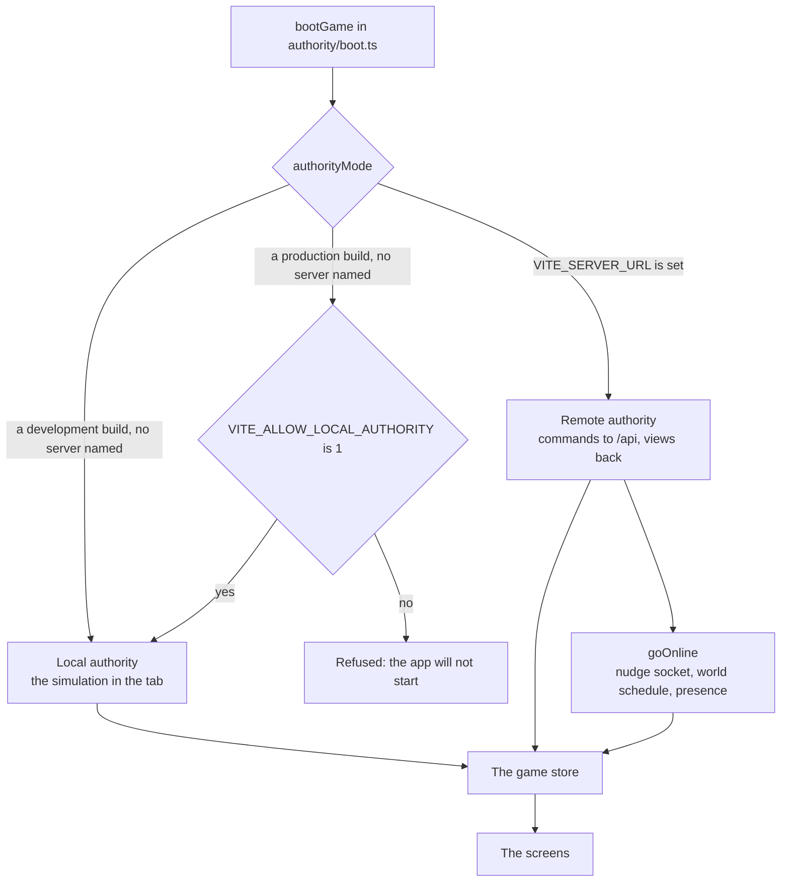

# The client

The client is the game a player sees: a React app in `apps/client` that draws a Lagos place in 3D, lets the player walk it and tap the things in it, and keeps the month, the money and the papers on a phone in the character's hand. It never decides anything itself. Every change to a life goes as a command to an authority, the simulation running in the tab or the server online, and what comes back is a view the screens read.

## The stack

| Piece | Used for |
|---|---|
| React 19 with Vite 8 | The app and its build (`apps/client/src`, `vite.config.ts` and its plugins in `apps/client/vite`) |
| zustand | The one game store the screens read and send through |
| three.js with React Three Fiber | The city scene, the rides, and the compound behind the account's screens |
| Tailwind 4 and Base UI | Styles, configured in CSS, and a few accessible pieces such as dialogs |
| lucide-react | The icons, by name, so plain data can carry them |
| better-auth | Signing in, online only |

The code is split by kind: `src/features/<kind>/` holds one kind's screens, and `src/shared/` holds what two features need. A feature never imports another feature, and neither `src/shared/` nor `src/authority/` imports a feature; `tests/boundaries.test.ts` holds both, and the shell in `src/app/App.tsx` composes the features and hands each what it needs from the others. The tests that cut across features, such as the voice of every words table, sit in `src/cross-feature/`.

## The authority

The client talks to one authority, and which one is decided when the app boots (`src/shared/net/authorityMode.ts`, engine:browser-authority-for-dev-only in [the engine contract](../../rules/engine.md)).

- **Local** (`authority/local.ts`): the simulation runs in the browser. It holds the state and the save and is the only part of the client that ever sees the seed. The save is kept in `localStorage` under one key, and the person made at the front door (the look, the first name, the archetype, the colours and the page's photo) under another beside it; the simulation holds none of the person. In development the fast clock grants turns freely (`authority/clock.ts`); a production build ignores that setting. This is what `pnpm dev` runs, and what the browser tests and offline play use.
- **Remote** (`authority/remote.ts`): the server holds the state and the seed. The client sends commands and receives views, keeping only the last view's version and the clock beside it. It predicts nothing (server:client-never-predicts in [the server rules](../../rules/server.md)). `authority/online.ts` keeps it fresh: a socket for the character's place that only hears that something changed and then asks with an ordinary request, the world fetched on its schedule, and a fetch when the tab comes back into focus.
- **Refused**: a production build with no server named runs the local authority only when told to in so many words. A test proves the resolver refuses it otherwise.

Both authorities fit one interface, `StoreAuthority`: `view()` and `send(command)`, with an optional clock. So a screen never knows which one it is talking to.

## The store

`src/authority/store.ts` builds a zustand store over the authority, and `GameProvider` hands it to every screen. Screens read one field at a time with `useGame` and the current view with `useView`. None of them holds a state, a seed or a version number of its own.

The store holds the current view, the month's plan, the last refusal, the lines of the last command and of the month so far, the staged wins waiting to be shown, the clock, the world and who else is in the place, and whether the player is choosing a life or signed out. Its actions are the game's verbs: `send`, `endMonth`, `addToPlan`, `stopPick`, `clearPlan`, `chooseLife`, `endLife`.

::: info Commitments, not a plan each month
A month-act the player starts (a course, study, the portfolio) carries on into every month until it is stopped or ends itself. The client keeps the plan across the month's end and sends it with each `turn/end`; the simulation is unchanged (world:month-acts-carry-on in [the world rules](../../rules/world.md)).
:::

## The world on screen

Once a life is playing, the world is the game (world:world-fills-the-screen). The place fills the screen. Over it sit a top band (the name first with the age and the place small under it, the part of the day in words beside the name, and the money as a counter) and two round thumb buttons: Map at the left and Phone at the right. The month has no button: it turns when the character sleeps (world:top-band-is-a-pill, world:sleep-ends-the-month). A wide home adds a round button over Phone that turns the house a quarter (world:thumb-buttons-carry-dots). A sheet, the phone, the map and the results open over the world and close back to it.

### Places, things and acts

`src/features/city/` draws a place from its `place.json` under `public/assets/places/<folder>/`: the ground and roads, the models at their spots, the crowd, the light, what moves, and the camera's raised shot. A place with no file is drawn as open ground with its crowd, so every place can be entered. The place file is read and built in `src/shared/scene/`, which the front door draws from too; the city keeps its own scene (the camera, the labels, the marks) in `scene/`, what the things do in `acts/` and the nudge in `nudge/`. The 3D scene loads only where WebGL exists, so the panels never wait for it.

- **Tap to walk.** A tap on a thing walks the character to it in a straight line; a tap on the ground walks there only inside the place's walkable ground. This is the screen's own state: no command, no turn (city:places-change-no-state and city:tap-to-walk in [the city rules](../../rules/city.md)).
- **Things.** A thing is a model copy the place file declares in `stage.things`, with a label and its acts. Tapping it walks the character there and opens its fan: the acts as round sticker buttons on a curve out of the thing, each with its picture and its price where it has one. When the screen has no room beside the thing, or it has more than eight acts, the same acts open as a sheet (`fan/`, world:things-are-tappable-models, world:fan-of-sticker-buttons).
- **Acts.** An act's kind says what it does: `plain` happens at once (sit), `do` fills a free slot with no sheet (rest on the bed), `sheet` opens the entry it stages (an activity, an offer, a set piece), `ride` opens the ride sheet, `enter` and `out` cut into and out of a room, `end` ends the month from the bed, `command` opens a card for a command such as paying a deposit, and `app` opens the phone on an app (the papers box opens Papers). The types are in `src/shared/world/contract.ts`.
- **Marks.** Things show no label by default. Each carries a small still dot, and the one the nudge points at pulses. Names show over the dots for two seconds the first time a place is entered (`scene/mark.ts`).
- **The nudge.** One line of at most eight words, shown only when something waits on the player: an ask, a due abroad, the night's bed. The journey's step shows only in the moment, as a chip under the band for about two seconds after a brief is handed and again while the player is at the step's place, with a marker over the thing or person to go to. A tap opens the way to it (`nudge/nudge.ts`, `brief/`, world:nudge-says-one-thing).
- **The crowd.** Who stands in a place today is a hash of the place, the real date and the slot, so a screenshot taken twice is the same. It never uses `Math.random` or a stream of the simulation (`src/shared/scene/crowd.ts`). The residents who stand at the place's parts with no one online (a spot `prefer` names for a role, a spot an act poses) keep them; other players take every other slot, the last first.

### The lines

The world talks in two channels (`src/shared/world/Lines.tsx`). Pictures over people carry the street's life and cost no reading. Words over a person come only when that person is near the player's figure: one bubble at a time, at most eight words, for about four seconds, then a quiet; a longer line opens in a sheet with their name on a tap. The bottom corner holds only the answer to the player's own act, one line at a time. Nothing is narrated in a card across the middle of the world. An act the scene shows (sit, lie down, cook, fetch water) says nothing at all (`actLines.ts`, world:street-talk-budget and text:show-then-tell).

### The map and the rides

`src/features/map/` holds the map and the rides between places with their fares. The map is one painted Lagos drawn as SVG (`map/paper/`, decision 0026): folded into a strip at the top over a card for each neighbourhood, swiped sideways, and unfolded to the whole city by a tap or a drag on the strip. Every built place stands on it as a sticker of its own picture, and the sticker is the pin. A place tied to a chapter shows as not yet until that chapter is current, so the first map holds the places that matter now (`features/city/nudge/stops.ts`, world:map-is-painted-lagos, world:one-country-at-a-time and world:ride-sheet-shows-fares). The paper draws one city from a descriptor (`map/paper/city.ts`): Lagos is the default, and London (`map/paper/london.tsx`, world:painted-maps-abroad) comes in a chunk of its own loaded only once the map shows the UK, with the Thames across its top, the railway through Peckham Rye, five neighbourhood cards and Heathrow on an inset in its corner. The ride sheet reads the ways where the character is from the view (`place.ways`), so London offers the bus, the train and on foot in pounds, and the bus says "£0, bus pass" in a month the pass is bought (world:ride-abroad-and-workplace, place:country-pass-covers-ways). London's words for its places and rides ride their own chunk too (`shared/words/late.ts`), so a first visit at home carries none of them.

## The phone

The phone (`src/features/phone/`) rises over the scene: a plain navy lock screen with the big clock, the day in words and the place as a pill, and eleven apps, four across, each a card in the game's light dress. Each app has one job and one short screen, and carries a dot when it holds something the player has not seen (`seen.ts`, kept on the device). The shell hands the phone what it needs from other features, so the phone imports none of them (world:phone-rises-over-scene and world:phone-holds-what-phones-hold).

| App | Does |
|---|---|
| Calendar | The month in order: the job held, what carries on until it is stopped, the chores done, and what is coming and how many months away. Nothing in it ends the month. It lives in `features/turn/Calendar.tsx` and is handed to the phone by the shell |
| Bank | At home it opens on the passbook: the money held for the road against its whole cost, the stamps, the pace line and the roads to the money. Behind it stand what is saved toward the move and the last money lines, with Change money and Move money at the foot. Abroad the balance stands first |
| Chats | The family group, the month's people lines, and a partner's or friend's messages, sent as preset phrases from chips. Nobody types |
| Japa | The road's log: the way's card with how ready you are as a bar, the briefs handed so far (the one carried first, then those done, the next faint), a file for each way looked into, the goals, and each other way heard of with the switch to make it the plan |
| Papers | The box under the bed: every paper the life has or waits on, its state, what it counts toward and the act that moves it. A call or a message opens its card here; a visit says where and opens the map on it |
| Jobs | The job held and the offers, each taken or quit on its own card |
| Market | Things for the home as picture tiles, each with what it does and its price, bought and delivered at once and sold back once owned. Only at home (world:phone-rises-over-scene, home:things-a-life-owns) |
| Lotto | The next draw, the tickets held, the last result. Buying stays at the kiosk in the street |
| Bills | The bill notices and what is due this month, with the home card on top |
| News | The era, last month's report lines and the stories that have reached the character |
| Settings | The sound, the city's graphics, the account, the feedback box, and "Start a new life" |

Every app act that costs or decides opens the shared sheet with its own card, and its main button sends the same command the world would (`act.tsx`).

## The front door and the data page

The front door is three screens on the door's own sky (`src/features/front-door/FrontDoor.tsx` with `src/shared/front-door/`): you (a sticker of the look, a first name filled from the pool with a dice for another, your own colours), your life so far (the lives as cards swiped sideways, with the age under them), and where you live (the homes as postcards). The page prints after Begin. Everything is already chosen, so Next, Next and Begin starts a life. The archetype's preset answers every step of the prologue (`src/features/prologue/`) while the page fills as the years go by, and the page itself is the handover. The ready lives are not on the door; Settings opens them. See [The front door](../plays/front-door.md) and prologue:front-door-builds-a-person, prologue:archetype-presets-answers, prologue:tile-path-open-from-start, prologue:makoko-start-never-a-trap, prologue:front-door-three-screens, prologue:printed-page-hands-over, prologue:player-colours-on-looks and prologue:nothing-behind-the-door in [the prologue rules](../../rules/prologue.md).

The travel data page (`src/shared/datapage/`) prints on the door, after Begin and from the band, where the name over the age opens it. It shows the photo, the name, the age kept current, the path, the family and how ready, with a machine-readable strip built from the game's own data and the game's own made-up country code, never a real one. It carries no stamp until a visa is granted. Each answer at the door is kept on the device, so a reload comes back to the same step; the life itself is written only at Begin.

## The share cards

A share card marks a moment the view carries: a chapter, a visa granted, the send-off, the first pay abroad, a status secured, the December visit, a win on the draw, and on the road the real story or a life lost (`src/features/share/`, `src/shared/share/`). The card is drawn on the player's own device from the view alone, encoded as a JPEG under a size limit, and shared through the Web Share API or downloaded, only after the player taps. Every card says in plain sight that Japacity is a game, carries no sum of money, and is never stored on the server (share:card-carries-no-money, share:card-drawn-on-device and share:card-never-stored in [the share rules](../../rules/share.md)). The cards a player has had are kept on the device; the send-off card carries the japa type, which the data page then shows.

## The screenshot moments

Every big outcome is one clean card over the scene, the screen a player posts: a visa granted or refused, the agent who was a scam, the one chance on the bus home, a big win on the draw, landing abroad and a chapter closing (`src/features/moment/`, with which lines are moments in `src/shared/moment/`). The card holds one line in the game's voice, the figure that carries it, and the game's small mark with japacity.app in its corner. At a month's end it stands over the results sheet, after an act over the world, and one tap puts it away. It is drawn on screen only and never looks like a bank alert; the share cards keep their own rules. See [the moments rules](../../rules/moment.md).

## What else lives here

- **Results and moments** (`src/features/turn/`): the staged wins (the first salary, the visa grant, the send-off) each get the whole screen first, then the month's results sheet.
- **Accounts** (`src/features/account/`): what a signed-out player sees online, the age screen, the guest start and securing an account. Online only.
- **One month view.** The world is the only month view; every address opens it (world:no-classic-view-kept).
- **Development addresses** (`?look`, `?tiles`, `?paint=`, `?clock=`, `?sleep=`, `?morning=`) are read only under `import.meta.env.DEV`, so a build for players leaves them and their code out.
- **The lively layer** (`src/shared/ui/look/`, `src/shared/tiles/`, decision 0025): the role tokens in `index.css`, the Rubik type, the primitives every surface is built from (the sticker, the sticker chip, the pressed button, the pill, the card and the sheet), and the picture tiles cut from the game's own models by the shooter's `tile` view (`tools/assets/shoot.ts`). The night paint follows the world's clock (`src/shared/world/paint.ts`).
- **Words** (`src/shared/words/`): `say`, the formatters and the functions that read a view into words, with each feature's reader in its `<kind>.words.ts`. The interface's string tables are content's, in `packages/content/src/ui/`. See [The content](./content.md) for how a key becomes a line.

## Tests

Screen tests sit beside the screens as `*.test.tsx` and run in jsdom under Vitest, as part of `pnpm check`. The browser tests in `apps/client/e2e/` run in Playwright on a phone profile with `pnpm test:browser`, and are not part of the check. See [Working on it](./working.md).
