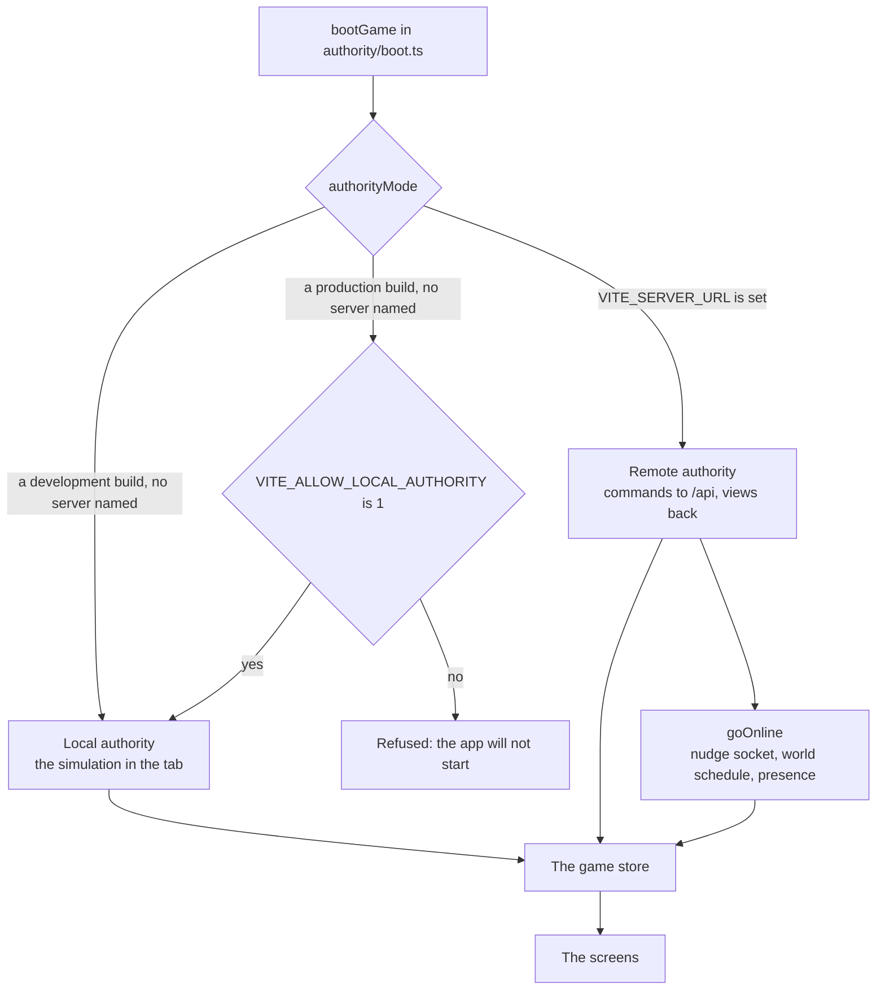

# The client

The client is the game the player sees: a React app in `apps/client`. It draws a Lagos place in 3D, lets the player walk it and tap the things in it, and keeps the month, the money and the papers on a phone in the character's hand. It decides nothing. Every change to a life is sent as a command to an authority (the simulation in the tab, or the server online), and the screens read the view that comes back.

## The stack

| Piece | Used for |
|---|---|
| React 19 with Vite 8 | The app and its build (`apps/client/src`, `vite.config.ts` and its plugins in `apps/client/vite/`) |
| zustand | The one game store the screens read and send through |
| three.js with React Three Fiber | The city scene, the rides, and the compound behind the account screens |
| Tailwind 4 and Base UI | Styles (configured in CSS) and a few accessible pieces such as dialogs |
| lucide-react | Icons by name, so plain data can carry them |
| better-auth | Signing in, online only |

## Code layout

- `src/features/<kind>/` holds one kind's screens.
- `src/shared/` holds what two or more features need.
- `src/app/App.tsx` is the shell: it composes the features and hands each what it needs from the others.
- `src/cross-feature/` holds tests that cut across features, such as the voice of every words table.

A feature never imports another feature, and neither `src/shared/` nor `src/authority/` imports a feature. `tests/boundaries.test.ts` at the repository root enforces both.

## The authority

The client talks to one authority, chosen when the app boots (`src/shared/net/authorityMode.ts`; engine:browser-authority-for-dev-only in [the engine contract](../../rules/engine.md)).

- **Local** (`authority/local.ts`): the simulation runs in the browser. It holds the state and the save, and is the only part of the client that sees the seed.
  - The save is kept in `localStorage` under one key. The person made at the front door (look, first name, archetype, colours, the page's photo) is kept under a second key; the simulation holds none of the person.
  - It fills the bank of turns on real time, as the server does. In development a fast clock refills an empty bank at once (`authority/clock.ts`); a production build ignores that setting.
  - A sealed result waits for the world's next morning (clock:envelopes-show-real-waits). In development, `?morning=now` on the address opens every one at once (`authority/boot.ts`).
  - `pnpm dev`, the browser tests and offline play all use it.
- **Remote** (`authority/remote.ts`): the server holds the state and the seed. The client sends commands, receives views, and keeps only the last view's version and the clock. It predicts nothing (server:client-never-predicts in [the server rules](../../rules/server.md)). `authority/online.ts` keeps it fresh with:
  - a socket for the character's place, which only says that something changed; the client then asks with an ordinary request;
  - the world, fetched on its schedule;
  - a fetch when the tab comes back into focus.
- **Refused**: a production build with no server named runs the local authority only when `VITE_ALLOW_LOCAL_AUTHORITY` is `1`. A test proves the resolver refuses it otherwise.

Both authorities implement one interface, `StoreAuthority`: `view()` and `send(command)`, with an optional clock. A screen never knows which one it is talking to.

## The store

`src/authority/store.ts` builds a zustand store over the authority, and `GameProvider` hands it to every screen. Screens read one field at a time with `useGame` and the current view with `useView`. No screen holds its own state, seed or version number.

The store holds:

- the current view and the month's plan;
- the last refusal, and the lines of the last command and of the month so far;
- the staged wins waiting to be shown;
- the clock, the world and who else is in the place;
- whether the player is choosing a life or signed out.

Its actions are the game's verbs: `send`, `endMonth`, `addToPlan`, `stopPick`, `clearPlan`, `chooseLife`, `endLife`.

::: info Month-acts carry on
A month-act the player starts (a course, study, the portfolio) carries on into every month until it is stopped or ends. The client keeps the plan across the month's end and sends it with each `turn/end`, so the simulation reads the month's slots as it reads any month's (world:month-acts-carry-on in [the world rules](../../rules/world.md)).
:::

## The world on screen

Once a life is playing, the place fills the screen (world:world-fills-the-screen). Over it sit:

- **A top band**: the name, with the age and the place small under it; the part of the day in words beside the name; the money as a counter (world:top-band-is-a-pill).
- **Two round thumb buttons**: Map at the left, Phone at the right. A wide home adds a round button over Phone that turns the house a quarter (world:thumb-buttons-carry-dots).

There is no month button: the month turns when the character sleeps (world:sleep-ends-the-month). A sheet, the phone, the map and the results open over the world and close back to it.

### Places, things and acts

`src/features/city/` draws a place from its `place.json` under `public/assets/places/<folder>/`: the ground and roads, the models at their spots, the crowd, the light, what moves, and the camera's raised shot. A place with no file is drawn as open ground with its crowd, so every place can be entered. The place file is read and built in `src/shared/scene/`, which the front door also uses. The city keeps its own scene (camera, labels, marks) in `scene/`, what things do in `acts/`, and the nudge in `nudge/`. The 3D scene loads only where WebGL exists, so the panels never wait for it.

- **Tap to walk.** A tap on a thing walks the character to it in a straight line. A tap on the ground walks there only inside the place's walkable ground. This is screen state only: no command, no turn (city:places-change-no-state and city:tap-to-walk in [the city rules](../../rules/city.md)).
- **Things.** A thing is a model copy declared in the place file's `stage.things`, with a label and its acts. Tapping it walks the character there and opens its fan: the acts as round sticker buttons on a curve out of the thing, each with its picture and its price where it has one. When there is no room beside the thing, or it has more than eight acts, the acts open as a sheet instead (`fan/`, world:things-are-tappable-models, world:fan-of-sticker-buttons).
- **Acts.** An act's kind says what it does (types in `src/shared/world/contract.ts`):

  | Kind | Does |
  |---|---|
  | `plain` | Happens at once (sit) |
  | `do` | Runs the entry it stages with no sheet (rest on the bed) |
  | `sheet` | Opens the entry it stages: an activity, an offer, a set piece |
  | `ride` | Opens the ride sheet |
  | `enter`, `out` | Cut into and out of a room |
  | `end` | Ends the month from the bed |
  | `command` | Opens a card for a command, such as paying a deposit |
  | `app` | Opens the phone on an app (the papers box opens Papers) |

- **Marks.** Things show no label by default. Each carries a small still dot; the one the nudge points at pulses. Names show over the dots for two seconds the first time a place is entered (`scene/mark.ts`).
- **The nudge.** One line of at most eight words, shown only when something waits on the player: an ask, a due abroad, the night's bed. The journey's step shows only in the moment: as a chip under the band for about two seconds after a brief is handed, and again while the player is at the step's place, with a marker over the thing or person to go to. A tap opens the way to it (`nudge/nudge.ts`, `brief/`, world:nudge-says-one-thing).
- **The crowd.** Who stands in a place today is a hash of the place, the real date and the slot, so the same screenshot taken twice matches. It never uses `Math.random` or a simulation stream (`src/shared/scene/crowd.ts`). Residents keep the spots that need them with no one online (a spot whose `prefer` names a role, a spot an act poses). Other players take every other slot, the last first.

### Speech and lines

The world talks in two channels (`src/shared/world/Lines.tsx`):

- **Pictures over people** carry the street's life and need no reading.
- **Words over a person** appear only when that person is near the player's figure: one bubble at a time, at most eight words, for about four seconds, then a pause. A longer line opens in a sheet with the speaker's name on a tap.

The bottom corner holds only the answer to the player's own act, one line at a time. Nothing is narrated in a card across the middle of the world. An act the scene shows (sit, lie down, cook, fetch water) says nothing (`actLines.ts`, world:street-talk-budget and text:show-then-tell).

### The map and the rides

`src/features/map/` holds the map and the rides between places with their fares.

- **The map** is one painted Lagos drawn as SVG (`map/paper/`, decision 0026). It folds into a strip at the top over a card for each neighbourhood, swipes sideways, and unfolds to the whole city on a tap or a drag on the strip.
- **Pins.** Every built place stands on it as a sticker of its own picture; the sticker is the pin. A place tied to a chapter shows as not yet until that chapter is current, so the first map holds only the places that matter now (`features/city/nudge/stops.ts`, world:map-is-painted-lagos, world:one-country-at-a-time and world:ride-sheet-shows-fares).
- **Cities.** The paper draws one city from a descriptor (`map/paper/city.ts`). Lagos is the default. London (`map/paper/london.tsx`, world:painted-maps-abroad) is a separate chunk, loaded only once the map shows the UK: the Thames across its top, the railway through Peckham Rye, five neighbourhood cards and Heathrow on an inset in its corner. London's words for its places and rides are also a separate chunk (`shared/words/late.ts`), so a first visit at home loads none of them.
- **The ride sheet** reads the ways out of the character's place from the view (`place.ways`). London offers the bus, the train and on foot in pounds, and the bus shows "£0, bus pass" in a month the pass is bought (world:ride-abroad-and-workplace, place:country-pass-covers-ways).

## The phone

The phone (`src/features/phone/`) rises over the scene: a plain navy lock screen with the big clock, the day in words and the place as a pill, and eleven apps, four across, each a card in the game's light style. Each app has one job and one short screen, and shows a dot when it holds something the player has not seen (`seen.ts`, kept on the device). The shell hands the phone what it needs from other features, so the phone imports none of them (world:phone-rises-over-scene and world:phone-holds-what-phones-hold).

| App | Does |
|---|---|
| Calendar | The month in order: the job held, what carries on until stopped, the chores done, and what is coming and how many months away. Nothing in it ends the month. It lives in `features/turn/Calendar.tsx` and the shell hands it to the phone |
| Bank | At home it opens on the passbook: the money held for the road against its whole cost, the stamps, the pace line and the roads to the money. Behind it: what is saved toward the move and the last money lines, with Change money and Move money at the foot. Abroad, the balance comes first |
| Chats | The family group, the month's people lines, and a partner's or friend's messages, sent as preset phrases from chips. Nobody types |
| Japa | The road's log: the way's card with readiness as a bar; the briefs handed so far (the current one first, then those done, the next faint); a file for each way looked into; the goals; each other way heard of, with the switch to make it the plan |
| Papers | The box under the bed: every paper the life has or waits on, its state, what it counts toward and the act that moves it. A call or a message opens its card here; a visit says where and opens the map on it |
| Jobs | The job held and the offers, each taken or quit on its own card |
| Market | Things for the home as picture tiles, each with what it does and its price. Bought and delivered at once, sold back once owned. Home only (world:phone-rises-over-scene, home:things-a-life-owns) |
| Lotto | The next draw, the tickets held, the last result. Tickets are bought at the kiosk in the street |
| Bills | The bill notices and what is due this month, with the home card on top |
| News | The era, last month's report lines and the stories that have reached the character |
| Settings | Sound, the city's graphics, the account, the feedback box, and "Start a new life" |

Every app act that costs money or decides something opens the shared sheet with its own card, and its main button sends the same command the world would (`act.tsx`).

## The front door and the data page

The front door is three screens on its own sky (`src/features/front-door/FrontDoor.tsx` with `src/shared/front-door/`):

1. **You**: a sticker of the look; the name box, empty with a suggested name as placeholder and a dice to fill it; your own colours.
2. **Your life so far**: the lives as cards swiped sideways, with the age under them.
3. **Where you live**: the homes as postcards.

Everything has a default, so Next, Next and Begin starts a life. After Begin the page prints: the archetype's preset answers every step of the prologue (`src/features/prologue/`) while the page fills as the years go by, and the page itself is the handover. The ready lives are not on the door; Settings opens them. See [The front door](../plays/front-door.md) and prologue:front-door-builds-a-person, prologue:archetype-presets-answers, prologue:tile-path-open-from-start, prologue:makoko-start-never-a-trap, prologue:front-door-three-screens, prologue:printed-page-hands-over, prologue:player-colours-on-looks and prologue:nothing-behind-the-door in [the prologue rules](../../rules/prologue.md).

The travel data page (`src/shared/datapage/`) prints on the door after Begin, and opens from the band by tapping the name over the age. It shows the photo, the name, the current age, the path, the family and readiness, with a machine-readable strip built from the game's own data and a made-up country code, never a real one. It carries no stamp until a visa is granted. Each answer at the door is kept on the device, so a reload returns to the same step; the life itself is written only at Begin.

## Share cards

A share card marks a moment the view carries: a chapter, a visa granted, the send-off, the first pay abroad, a status secured, the December visit, a win on the draw, and on the road the real story or a life lost (`src/features/share/`, `src/shared/share/`).

- The card is drawn on the player's device from the view alone, encoded as a JPEG under a size limit, and shared through the Web Share API or downloaded, only after the player taps.
- Every card says in plain sight that Japacity is a game, carries no sum of money, and is never stored on the server (share:card-carries-no-money, share:card-drawn-on-device and share:card-never-stored in [the share rules](../../rules/share.md)).
- The cards a player has had are kept on the device. The send-off card carries the japa type, which the data page then shows.

## Moment cards

Every big outcome gets one clean card over the scene, the screen a player posts: a visa granted or refused, the agent who was a scam, the one chance on the bus home, a big win on the draw, landing abroad, and a chapter closing (`src/features/moment/`; which lines are moments is in `src/shared/moment/`).

- The card holds one line in the game's voice, the figure that carries it, and the game's small mark with japacity.app in its corner.
- At a month's end it stands over the results sheet; after an act, over the world. One tap puts it away.
- It is drawn on screen only and never looks like a bank alert. Share cards keep their own rules. See [the moments rules](../../rules/moment.md).

## Other parts

- **Results** (`src/features/turn/`): each staged win (the first salary, the visa grant, the send-off) gets the whole screen first, then the month's results sheet.
- **Accounts** (`src/features/account/`): what a signed-out player sees online, the age screen, the guest start and securing an account. Online only.
- **One view.** The world is the month's view; every address opens it (world:no-classic-view-kept).
- **Development addresses** (`?look`, `?tiles`, `?paint=`, `?clock=`, `?sleep=`, `?morning=`) are read only under `import.meta.env.DEV`, so a production build leaves them and their code out.
- **The game's look** (`src/shared/ui/look/`, `src/shared/tiles/`, decision 0025): the role tokens in `index.css`, the Rubik type, the primitives every surface is built from (sticker, sticker chip, pressed button, pill, card, sheet), and the picture tiles cut from the game's own models by the shooter's `tile` view (`tools/assets/shoot.ts`). The night paint follows the world's clock (`src/shared/world/paint.ts`).
- **Words** (`src/shared/words/`): `say`, the formatters, and the functions that turn a view into words; each feature's reader is in its `<kind>.words.ts`. The interface's string tables belong to content, in `packages/content/src/ui/`. See [The content](./content.md) for how a key becomes a line.

## Tests

- **Screen tests** sit beside the screens as `*.test.tsx` and run in jsdom under Vitest (the `client` project). `pnpm test` and `pnpm check` run them all. In CI, a push to a pull request runs only the tests the change can reach, and the merge queue runs every one (decision 0040).
- **Browser tests** in `apps/client/e2e/` run in Playwright at a phone's size (Pixel 7) and a desktop's, with `pnpm test:browser`. They are not part of `pnpm check` or the pull request checks; `.github/workflows/browser.yml` runs the whole suite each night and by hand.

See [Working on it](./working.md).
