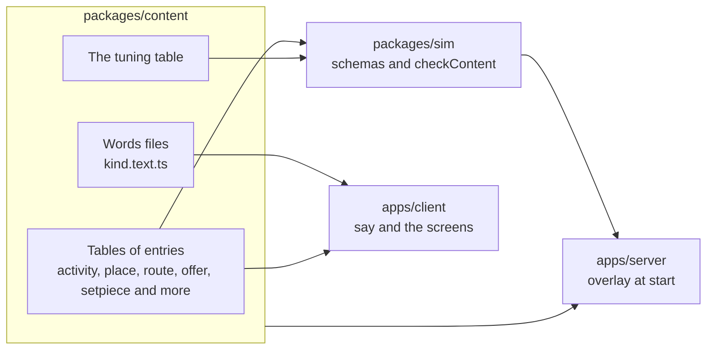
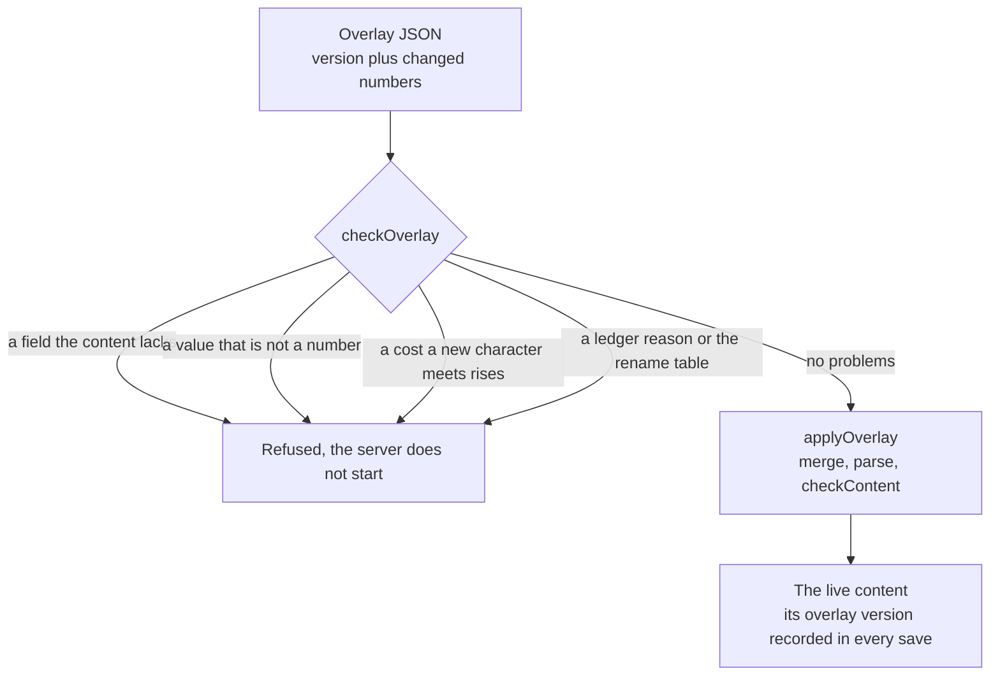
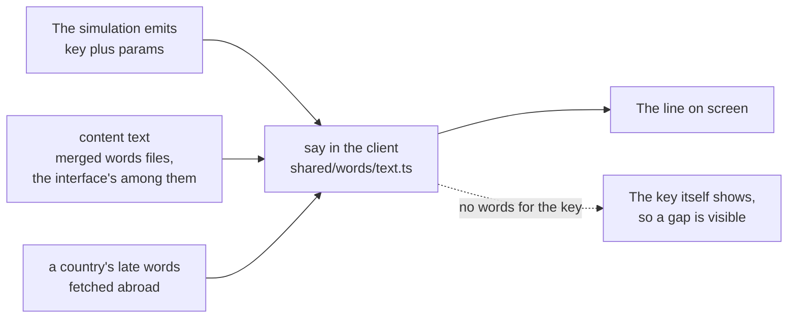

# The content

The simulation knows how a job pays, how a route is judged and how a month passes, but it holds no jobs, no routes and no words of its own. All of that is content: one plain object of tables in `packages/content`, checked against the simulation's schemas, with every number the game runs on and every line a player reads. Change the content and the game changes; the rules that read it stay the same.

## One object, many tables

`packages/content/src/index.ts` builds one `content` object of the simulation's `Content` type. Each table is a record from an id to its entry, and every id has the form `kind.slug`: `activity.job-teacher`, `place.ojuelegba`, `route.uk-care`. The content package may import only the simulation and `zod`, which the lint rules hold.

| Table | Holds | Where |
|---|---|---|
| `activity` | Jobs, side jobs and the acts that fill free time or happen at once | `activity/activity*.data.ts` |
| `place` | Every place in Lagos, abroad and on the road, with its real name or none | `place/place.data.ts` |
| `route` | The ways out: the gate each runs through, its country, its status abroad and its checklist | `route/route.data.ts` |
| `offer` | The asks that come up in a month: from family, a job, money, life, the road, abroad and the return | `offer/offer*.data.ts` |
| `setpiece` | The staged scenes with questions and answers, such as the visa interview | `setpiece/setpiece.data.ts` |
| `document`, `school`, `status`, `obligation` | The papers, the schools, the statuses held abroad and the debts and dues | each in its own folder |
| `chapter`, `goal`, `era`, `news`, `var` | The story's chapters, life goals, the director's eras and stories, and the world's moving figures | each in its own folder |
| `scenario`, `prologue` | The ready lives and the opening of a life from sixteen | `scenario/`, `prologue/` |
| `quality`, `country`, `person`, `phrase`, `points`, `interview` | The character's qualities, the countries, the people, the pair phrases, the points tables, the interview | each in its own folder |
| `advert`, `guide`, `analytics` | Advert slots, the route guides and the usage counters | each in its own folder |
| `thing` | The market's catalogue: the things a life can buy for the home, each with its price, what it does and what it costs to run (decision 0019) | `thing/thing.data.ts` |
| `tuning` | Every rule number that is not in an entry | `tuning/tuning.data.ts` |

A folder is named for its kind and its files for their role: `<kind>.data.ts` holds entries, `<kind>.text.ts` holds words, `<kind>.test.ts` holds the tests that read them. Large kinds split by theme (`activity.street.data.ts`, `offer.abroad.data.ts`) and are joined in the main table file.

::: info Whole numbers only
Money in content is in the smallest unit: kobo, pence, cents. Chances are basis points, where 10000 is 100%. `packages/content/src/units.ts` has `naira()`, `pounds()`, `dollars()`, `cad()`, `aed()`, `euros()` and `pct()` so a table reads like the rule page without a decimal point. The lint rules refuse a decimal literal in content, as they do in the simulation.
:::

### Activities

An activity says which slot it takes (`main` for a job, `free`, `side` or `none`), what it requires, what it costs, what it pays, the chance of being hired, and the effects it has each month. `activity.when.data.ts` marks which acts answer at once (a lottery ticket, asking around, a meetup) and which fill the month as a slot pick (activity:now-acts-and-month-acts in [the activity rules](../../rules/activity.md)). The rest of the table follows that page's "Jobs" and "Free-slot activities".

### Places

A place says where it is (`home`, `abroad` or the road), its city and area, whether its name is a real public name or made up, its position in thousandths of a degree with the data source it was read from, its crowd, and `stages`: the activities, offers and chapters it shows. Its words live in `place/place.text.ts` (its name, blurb, shop signs and talk overheard), and its scene lives in a `place.json` under `apps/client/public/assets/places/<folder>/`. [The city rules](../../rules/city.md) list every entry; city:place-entry-fields names the fields and city:place-words-are-text-keys says every word a place shows is a key.

::: warning Real names
A real business name may appear only as neutral scenery: a place the player visits, eats at, shops at or meets at. Never a bank, a lender, an agent, an employer, a school or an airline, and never in a fraud or bad news. The rules are city:sponsor-shows-name-only and city:invented-names-for-risky-businesses in [the city rules](../../rules/city.md). Made-up shop names are checked one by one, and `place.names.json` records each check.
:::

### Routes

A route names its gate (study, sponsor, points, endorsement, contract, partner, dependant or the road), its country and the status it leads to, when a character hears of it, its window, and its checklist. Each checklist item has a weight and the requirement that ticks it; the weights of every route but the road add up to exactly 100, which is what the japacity figure reads (japacity:figure-is-whole-percent in [the japacity rules](../../rules/japacity.md)). Each gate adds its own block, such as the sponsor's salary bar or the points table. See [Chapters and routes](./chapters.md) for how the story follows a route.

### Offers and set pieces

An offer is an ask that rolls each month while its `when` holds, with a chance, a cooldown, an expiry, terms drawn when it opens and choices with their effects. A fraud chance can be decided when it opens and kept secret. A set piece is a scene of questions, some drawn and some fixed, with answers that carry effects; the credibility interview, the December visit, and the road's night and its truth are set pieces. [The offer rules](../../rules/offer.md) and [the interview rules](../../rules/interview.md) hold the detail.

## The tuning

`tuning/tuning.data.ts` is one table of every rule number that does not belong to a single entry: the free time a month holds, the bank's charge, the start rates of the pound and the dollar, the refusal chance per point of strictness, the credit file's steps and many more. It is grouped by the rule page each number comes from, and its first comment says so: every "In content as" row of the rule pages' "Numbers" tables is here.

No rule number lives in code (engine:numbers-read-from-content in [the engine contract](../../rules/engine.md)). A rule reads its number from `content.tuning` or from the entry, and a test does the same unless it is testing that exact number.

## The overlay

The public content runs the whole game and passes every test. A deployment may change live numbers with an overlay: a plain object with a `version` and any part of the content to replace. `packages/sim/src/engine/overlay.ts` defines it.

- `applyOverlay(content, overlay)` merges the overlay into a copy, arrays replaced whole, and runs the schemas and `checkContent` on the result. It throws on any failure.
- `checkOverlay(base, overlay)` refuses more: a field the content does not have (an overlay has no factor field), anything that is not a number replacing a number, a list whose shape changes, a ledger reason, the rename table, money added to a scenario or to the opening of a life, and any cost or fee a new character can meet that goes up (server:overlays-never-multiply-prices and server:public-defaults-run-the-game in [the server rules](../../rules/server.md)).
- The server reads the overlay from its environment when its isolate starts (`apps/server/src/authority/overlay.ts`) and refuses to run on one that fails.
- A save records the overlay's version beside the content's (engine:state-is-plain-data), so a life replays under the numbers it was played with.

## The words

The simulation never holds prose. It emits a key and some numbers, and content holds the words. That keeps saves small and lets the words change without touching a save. [The words page](../../rules/text.md) is the guide for anyone writing them.

### How a word is keyed

Each kind has a words file, `<kind>.text.ts`: a plain table from key to text. Keys start from the entry's id.

| Thing | Key |
|---|---|
| An entry's name and blurb | `<id>.name`, `<id>.blurb` |
| An offer's title, body and choices | `<id>.title`, `<id>.body`, `<id>.choice.<choice>` |
| A set piece's question and answer | `<id>.q.<question>`, `<id>.a.<question>.<answer>` |
| A chapter and its items | `<id>.title`, `<id>.open`, `<id>.close`, `<id>.item.<item>` |
| A chapter's brief, as the player is handed it | `<id>.brief.title`, `<id>.brief.giver`, `<id>.brief.reward.<n>`, with `chapter.brief.*` shared |
| A report line | `line.<kind>.<what>` |
| A refusal | `reject.<code>` |
| A place's signs and talk | `<id>.sign.<n>`, `<id>.overheard.<n>` |

Figures go in braces: `"Salary: {amount}"`. Money in a line is a typed parameter with its currency and amount in minor units, and the screen formats it; the text never puts a currency sign next to a brace.

`index.ts` merges every words file into one `text` table with `mergeText`. Two files that give the same key make it throw, so one file can never hide another's line.

The interface's own words (labels, headings, sheets and each screen's lines) are content's too, in `packages/content/src/ui/`, one `ui.<screen>.text.ts` file each, merged into `text` with the rest. The words a first visit does not carry (each country's places and rides, the painted maps abroad, the send-off) sit there in files of their own that content's entry never imports; the client fetches each on its own path (`@japacity/content/ui/london` and the others) when the life needs it (engine:first-download-has-budget). The client's `say` looks a key up in content's table first, then in a country's late words. A key with no words shows as itself, so a gap is seen in play instead of hidden behind a guess.

### Jokes, and when there are none

A common neutral report line may carry three to five versions in `packages/content/src/comedy/`: one plain and the others with a joke. A draw picks one, and draw 0 is plain; the screens show the plain line. Bad news never takes a joke, and a month whose report holds bad news shows every line plain (text:jokes-keep-a-plain-version and text:bad-news-never-joked).

## How the content is checked

Content is checked before anything plays on it (engine:content-checked-before-play). For the public content that happens in the test suite, under `pnpm check`.

- `ContentSchema` parses the whole object, so every entry fits its schema and no unknown key slips in.
- `checkContent` in `packages/sim/src/engine/content.ts` checks that every key is a well-formed id of its kind, that every id an entry mentions exists, that every number is a whole number, that every route's checklist weights add up to 100 and that the director's stories are fair to every player.
- `packages/content/src/text.test.ts` checks the words: every entry has a name, every offer has a title, body and every choice, every set piece question and answer has words, every chapter has its title, opening, close and items, every rejection code has a line, and no em-dash or en-dash appears in any words file.
- Each kind's own tests read figures back from the rule page, so a number that drifts from its page fails.

## Show, then tell

The interface's own words show first and tell second (text:show-then-tell). A fact is an icon and two or three words, with its state as a mark that differs in shape and colour, never colour alone. A gain or a cost is a tag with its sign, not a sentence. Full sentences belong to a person or a paper speaking; the shell itself speaks in short lines. An act the scene shows gets no line at all: the figure lies on the bed, so nothing says "You lie down".

It is held in three ways:

1. **Shared pieces.** `Mark`, `FactChip` and `ToneTag` in `apps/client/src/shared/ui/` are the one way to show a state, a fact or a gain, each with its word for screen readers, and their tests cite text:show-then-tell.
2. **Screen tests.** Each screen held to short words has a test that cites text:show-then-tell for them. `apps/client/src/features/city/told.words.test.ts`, for one, holds every line the shell tells in the corner to one short line with no full stop.
3. **The voice walk.** `apps/client/src/sweep/voice.test.ts` walks every line in content's words and every table that rides a chunk of its own. It fails an em-dash, an en-dash, an exclamation mark (but for one scam's shout, which is a tell the player learns to read), stock app words such as "Oops" or "Get started", mirrored sentences and summing-up lines, and it checks who speaks on each surface (text:voice-by-surface).

::: tip Writing a new line
Read [the words page](../../rules/text.md) first. Put the line in the kind's words file under a key from the entry's id. If it is the interface's own word, it goes in the screen's table in `packages/content/src/ui/`; a new table there joins `textTables` in content's `index.ts`, so the walk in `voice.test.ts` reads it. Write the line plain and correct first, then give it its voice.
:::

## Rule pages

- [The engine contract](../../rules/engine.md): engine:state-is-plain-data, engine:content-checked-before-play and engine:numbers-read-from-content for saves, checks and the overlay.
- [Words](../../rules/text.md): the keys, money on screen and the voice.
- [The city](../../rules/city.md), [Activities and jobs](../../rules/activity.md), [Offers](../../rules/offer.md), [Japacity](../../rules/japacity.md), [The server](../../rules/server.md).
