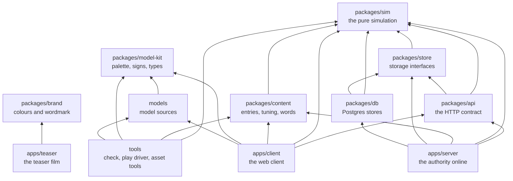
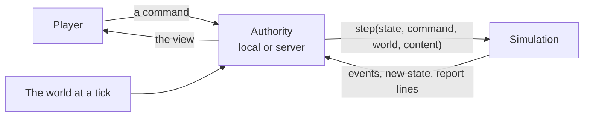
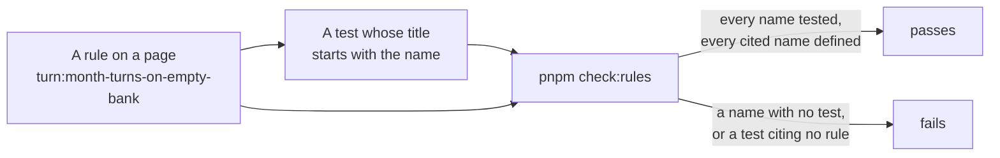
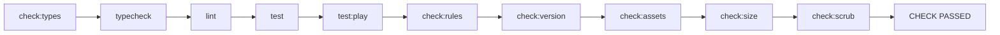

# How Japacity is built

Japacity is a game played in a phone's browser. At its centre is one pure function: it takes the life as it stands and the player's command, and returns what happened. The client, the server, the database and the tools are built around that function and around the rule pages that say what it must do. This page is the map; each page after it goes one level deeper.

## The game

The player lives a Nigerian life, in Lagos, one month at a time, from a first job to the choice of whether and how to leave. Ways out of the country (a master's in the UK, a tech job abroad, health care in the UK, Canada's points, a Gulf contract, the road through the desert and others) appear as the life comes to match them. One figure, japacity, says how ready the player is. The game is online and shared: the server holds every life, and players meet in the city's places and can pair up.

## The workspace

The repository is one pnpm workspace. The simulation is at the bottom and depends only on `zod`; everything else builds on it.

An arrow points from a package to one it imports. The arrows are the `@japacity/*` dependencies in each `package.json`; `tests/boundaries.test.ts` and the lint rules keep them that way.

| Folder | Package | Holds |
|---|---|---|
| `packages/sim/` | `@japacity/sim` | The engine and every kind of the game. Pure, deterministic, whole numbers only. Depends on `zod` alone |
| `packages/content/` | `@japacity/content` | The game's entries (activities, routes, offers, places), the tuning and every player-facing word, checked against the simulation's schemas |
| `packages/store/` | `@japacity/store` | The storage interfaces the server writes through, with in-memory versions and contract suites |
| `packages/api/` | `@japacity/api` | The HTTP and socket contract: each route's request and reply and the socket's messages, which the client and the server both import. Types, with the few lists and the one message reader both sides use |
| `packages/db/` | `@japacity/db` | The Postgres versions of the same stores (Drizzle and `pg`), and the migrations |
| `packages/model-kit/` | `@japacity/model-kit` | The palette, the signs and the types the asset pipeline and the client share |
| `packages/brand/` | `@japacity/brand` | The game's role colours, tints, face and wordmark letters as data, for the teaser, which draws outside the client |
| `models/` | `@japacity/models` | The city's model sources: builders, specs, reviews. Never shipped as such |
| `apps/client/` | `@japacity/client` | The web client: Vite, React, zustand, three.js through React Three Fiber |
| `apps/server/` | `@japacity/server` | The online authority: one Cloudflare Worker with Hono, Better Auth, the command log and the place rooms |
| `apps/teaser/` | `@japacity/teaser` | The teaser film, made with Remotion from the brand package |
| `tools/` | `@japacity/tools` | The checks (`tools/check/`), the golden tools (`tools/goldens/`), the asset pipeline, the load test and the play driver |
| `tests/` | | Guard tests across the whole repository, such as the import boundaries, the shipped build and the lint rules |

::: info The same engine runs in two places
The client can run the simulation in the tab (the local authority, for development, tests and offline play), and the server runs the same package online. The engine is pure, so both give the same result for the same save. See [The client](./client.md) and [The server and the data](./server.md).
:::

## How a command is handled

Every change to a life follows the same path, wherever the authority runs.

The player never sees the state, only the view: what one player may know. The seed, the draw counts and anything marked secret never leave the authority. [The simulation](./simulation.md) explains each word in this picture, and [the engine contract](../../rules/engine.md) is the rule page behind it.

## Rule pages and tests

`docs/rules/` holds one page per kind of thing in the game: turns, money, routes, the city, the server. Each rule has a name such as `turn:month-turns-on-empty-bank` (the page, then a short slug of what the rule holds), and at least one test must cite each name. The site shows these pages unchanged under [The rules](../../rules/engine.md) and never copies their text.

The workflow:

1. A new behaviour starts as a named rule on its kind's page. Only the maintainer adds rules.
2. A test beside the code cites it in its title: `test("[turn:month-turns-on-empty-bank] given no turn banked, when the turn is ended, then the month turns, as the bank gates nothing (decision 0011)", ...)`.
3. `pnpm check:rules` (`tools/check/rules.ts`) reads every rule definition under `docs/rules/` and every `[page:slug]` tag in every test file. It fails when a rule is defined twice, when a rule's name says another page, when a test cites a name no page defines, or when a rule has no test.
4. A rule that is written but not yet built is listed in `tools/rules-pending.json`. The check allows those, and fails when one of them gains a test and is still listed. The list is rewritten only with `pnpm check:rules --write-pending`, never by hand.

::: tip Why
A rule with no test has not been built. With the name in the test title, a failing test names the rule it guards, and the rule pages read as the game's specification with the tests as proof.
:::

When a rule page and a test disagree, neither is picked silently: the change stops and is reported. Changes to determinism, to the reasons money moves, or to the command and view types also need a short record in `docs/decisions/`.

## The check

`pnpm check` (`tools/check/all.ts`) is the command to run before a change is called done. It runs ten steps in order, stops at the first failure, and ends with one line: `CHECK PASSED` or `CHECK FAILED at step: <name>`.

| Step | Runs | Holds |
|---|---|---|
| `check:types` | `wrangler types --check` for the server | The Worker's generated type file (`worker-configuration.d.ts`) is not stale, so the typecheck that reads it is not misled |
| `typecheck` | `tsc` on the root files, then every package's own typecheck | The types line up across the workspace, under strict settings |
| `lint` | ESLint, zero warnings allowed | The simulation's purity rules (no clock, no `Math.random`, no division outside `engine/int.ts`, no decimal literals, imports of `zod` only), content's whole-number rule, and no focused or skipped test |
| `test` | Vitest, every project but `play` | The rule tests, the golden replays, the property tests, the client's component tests and the server's Worker tests |
| `test:play` | Vitest's `play` project | Simulated play: the economy meets its targets in whole lives played month by month, and random lives keep the invariants (scenario:economy-meets-its-targets) |
| `check:rules` | `tools/check/rules.ts` | Every rule has a test and every cited name exists |
| `check:version` | `tools/check/version.ts` | The content version moved with any change to the content's data or the simulation's code: the fingerprint in `packages/content/src/seal.json` still matches, or the version was raised and sealed (server:content-version-sealed) |
| `check:assets` | `tools/assets/assets-check.ts` | The city's models: file names, sizes, the palette, footprints, and a render of each staged place in Playwright's Chromium |
| `check:size` | `tools/check/size.ts` | A production build of the client, whose first visit stays inside each part's gzipped budget in `tools/check/size-budget.json`, with none of the admin page's code in it (engine:first-download-has-budget) |
| `check:scrub` | `tools/check/scrub.ts` | In every file git would publish: legal and regulatory wording only on the two pages players read (the terms and the privacy notice), each value that belongs to one deployment only in the files allowed to hold it, and no leftover process tag (a review code, a branch name, a comment tag) |

The browser tests (`pnpm test:browser`) are not part of the check. Neither is `pnpm docs:build`, which builds this site.

::: details Other guards
- Git hooks kept outside the repository check every commit. A refused commit is fixed, never forced.
- CI (`.github/workflows/check.yml`) runs in two tiers (decision 0040). Each push to a pull request runs the quick tier: generated types, typecheck, lint, content version, size, dependency audit, `pnpm check:protected`, the secret scan, and only the unit tests the change can reach. The merge queue, every push to `main` and a manual run take the full tier: every unit test and simulated play. A pull request merges only through the queue. See [Working on it](./working.md#the-check).
- `pnpm check:protected` fails a pull request that takes away a test, an assertion or a golden file, or grows the pending rules list, unless it carries the `approved-test-change` label.
- Golden files change only through `pnpm bless`. See [The simulation](./simulation.md#goldens-recorded-lives-and-simulated-play).
:::

## Other pages

| Page | For |
|---|---|
| [The simulation](./simulation.md) | The engine: kinds, commands, events, effects, the turn, the view, whole numbers, random streams, saves and goldens |
| [The character](./character.md) | How a life is made at the front door, what it holds, and how the view is built from it |
| [Chapters and routes](./chapters.md) | The story's chapters, the ways out and the japacity figure |
| [The content](./content.md) | The tables, the tuning, the overlay and the words |
| [The client](./client.md) | The React client, the authority modes, the city and the phone |
| [The server and the data](./server.md) | The Worker, sign-in, the command log, the place rooms, the crons and the schema |
| [From the browser to Postgres](./infrastructure.md) | Every piece a request passes through, the two environments and the deploy |
| [Working on it](./working.md) | Running it, the hooks, worktrees, the play driver and short recipes |
| [How it plays](../plays/index.md) | The game feature by feature, with pictures |
