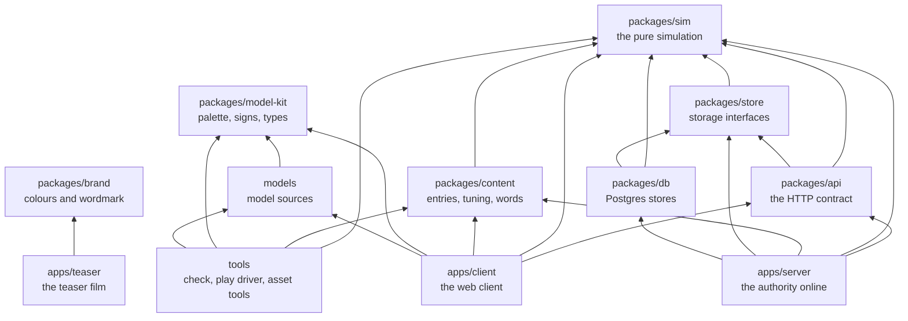
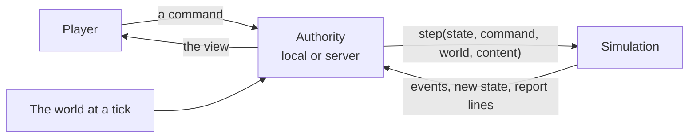
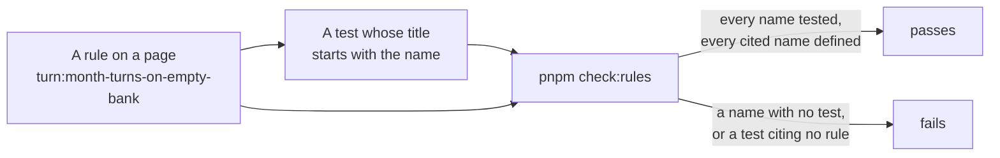
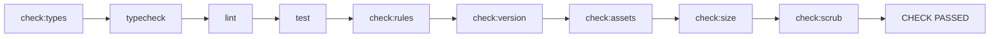

# How Japacity is built

Japacity is a game you play in a phone's browser. Under the screens sits a small, strict engine: one pure function takes the life as it stands and what the player asked for, and gives back what happened. Everything else in the repository, the client, the server, the database and the tools, is built around that one function and around a set of rule pages that say what it must do. This page is the map. The pages after it go one level deeper each.

## What the game is

You live a Nigerian life in Lagos a month at a time, from a first job to the choice of whether and how to leave. Ways out of the country (a master's in the UK, a tech job abroad, health care in the UK, Canada's points, a Gulf contract, the road through the desert and others) appear as your life comes to match them, and a single figure, japacity, says how ready you are. The game is shared and online: the server holds every life, and players meet in the city's places and can pair up with each other.

## The workspace

The repository is one pnpm workspace. The simulation is at the bottom and depends on nothing but `zod`. Everything that plays the game sits on top of it.

An arrow points from a package to one it imports. The arrows are the `@japacity/*` dependencies in each `package.json`; `tests/boundaries.test.ts` and the lint rules keep them that way.

| Folder | Package | Holds |
|---|---|---|
| `packages/sim/` | `@japacity/sim` | The engine and every kind of the game. Pure, deterministic, whole numbers only. Depends on `zod` alone |
| `packages/content/` | `@japacity/content` | The game's entries (activities, routes, offers, places), the tuning and every player-facing word, checked against the simulation's schemas |
| `packages/store/` | `@japacity/store` | The storage interfaces the server writes through, with in-memory versions and contract suites |
| `packages/api/` | `@japacity/api` | The HTTP and socket contract: each route's request and reply and the socket's messages, which the client and the server both import. Types, with the few lists and the one message reader both sides use |
| `packages/db/` | `@japacity/db` | The Postgres versions of the same stores (Drizzle and `pg`), and the migrations |
| `packages/model-kit/` | `@japacity/model-kit` | The palette, the signs and the types the asset pipeline and the client share |
| `packages/brand/` | `@japacity/brand` | The game's role colours, tints, face and wordmark letters as data, for the teaser, which draws outside the client |
| `models/` | `@japacity/models` | The city's model sources: builders, specs, reviews. Never shipped as such |
| `apps/client/` | `@japacity/client` | The web client: Vite, React, zustand, three.js through React Three Fiber |
| `apps/server/` | `@japacity/server` | The online authority: one Cloudflare Worker with Hono, Better Auth, the command log and the place rooms |
| `apps/teaser/` | `@japacity/teaser` | The teaser film, made with Remotion from the brand package |
| `tools/` | `@japacity/tools` | The checks (`tools/check/`), the golden tools (`tools/goldens/`), the asset pipeline, the load test and the play driver |
| `tests/` | | Guard tests across the whole repository, such as the import boundaries, the shipped build and the lint rules |

::: info Two places the same engine runs
The client can run the simulation in the tab (the local authority, for development, tests and offline play), and the server runs the very same package online. Because the engine is pure, both give the same result for the same save. See [The client](./client.md) and [The server and the data](./server.md).
:::

## The shape of one request

Every change to a life goes the same way, wherever the authority runs.

The player never sees the state itself, only the view: what one player may know. The seed, the draw counts and anything marked secret never leave the authority. [The simulation](./simulation.md) explains each word in this picture, and [the engine contract](../../rules/engine.md) is the rule page behind it.

## The rule pages are the contract

`docs/rules/` holds one page per kind of thing in the game: turns, money, routes, the city, the server. Each rule on a page has a name such as `turn:month-turns-on-empty-bank`, the page and a short slug of what the rule holds, and each name must be cited by at least one test. The site shows these pages as they are under [The rules](../../rules/engine.md); it never copies their text.

How the loop works:

1. A new behaviour starts as a named rule on its kind's page. Only the maintainer adds rules.
2. A test beside the code cites it in its title: `test("[turn:month-turns-on-empty-bank] given no turn banked, when the turn is ended, then the month turns, as the bank gates nothing (decision 0011)", ...)`.
3. `pnpm check:rules` (`tools/check/rules.ts`) reads every rule definition under `docs/rules/` and every `[page:slug]` tag in every test file. It fails when a rule is defined twice, when a rule's name says another page, when a test cites a name no page defines, or when a rule has no test.
4. A rule that is written but not yet built is listed in `tools/rules-pending.json`. The check allows those, and fails when one of them gains a test and is still listed. The list is rewritten only with `pnpm check:rules --write-pending`, never by hand.

::: tip Why it is built this way
A rule you cannot point a test at is a rule nobody has built. Keeping the id in the test title means a failing test names the rule it guards, and a rule page can be read as the game's specification with the tests as its proof.
:::

When a rule page and a test disagree, nobody quietly picks one: the change stops and is reported. Changes to determinism, to the reasons money moves, or to the command and view types also need a short record in `docs/decisions/`.

## The check

`pnpm check` (`tools/check/all.ts`) is the one command to run before a change is called done. It runs nine steps in order, stops at the first failure, and ends with one line: `CHECK PASSED` or `CHECK FAILED at step: <name>`.

| Step | Runs | Holds |
|---|---|---|
| `check:types` | `wrangler types --check` for the server | The Worker's generated type file is not stale, so the typecheck that reads them is not misled |
| `typecheck` | `tsc` on the root files, then every package's own typecheck | The types line up across the workspace, under strict settings |
| `lint` | ESLint, zero warnings allowed | The simulation's purity rules (no clock, no `Math.random`, no division outside `engine/int.ts`, no decimal literals, imports of `zod` only), content's whole-number rule, and no focused or skipped test |
| `test` | Vitest, every project | The rule tests, the golden replays, the property tests, the client's component tests and the server's Worker tests |
| `check:rules` | `tools/check/rules.ts` | Every rule has a test and every cited name exists |
| `check:version` | `tools/check/version.ts` | The content version moved with any change to the content's data or the simulation's code: the fingerprint in `packages/content/src/seal.json` still matches, or the version was raised and sealed (server:content-version-sealed) |
| `check:assets` | `tools/assets/assets-check.ts` | The city's models: file names, sizes, the palette, footprints, and a render of each staged place in Playwright's Chromium |
| `check:size` | `tools/check/size.ts` | A production build of the client, whose first visit stays inside each part's gzipped budget in `tools/check/size-budget.json`, with none of the admin page's code in it (engine:first-download-has-budget) |
| `check:scrub` | `tools/check/scrub.ts` | Every file git would publish is free of the words that would mark private planning notes, outside the two pages players read, and of the values that belong to one deployment, outside the files each may stand in |

The browser tests (`pnpm test:browser`) are not part of the check. Neither is `pnpm docs:build`, which builds this site.

::: details What else guards a change
- The maintainer's git hooks, kept outside the repository, refuse a commit message with an attribution line, a trailer or a long dash. A refused commit is fixed, never forced.
- In CI, `pnpm check:protected` asks for a label when a change touches a test, a golden file, a schema or the lint rules.
- Golden files change only through `pnpm bless`. See [The simulation](./simulation.md#goldens-recorded-lives-and-the-sweep).
:::

## Where to read next

| Page | For |
|---|---|
| [The simulation](./simulation.md) | The engine: kinds, commands, events, effects, the turn, the view, whole numbers, random streams, saves and goldens |
| [The character](./character.md) | How a life is made at the front door, what it holds, and how the view is built from it |
| [Chapters and routes](./chapters.md) | The story's chapters, the ways out and the japacity figure |
| [The content](./content.md) | The tables, the tuning, the overlay and the words |
| [The client](./client.md) | The React client, the authority modes, the city and the phone |
| [The server and the data](./server.md) | The Worker, sign-in, the command log, the place rooms, the crons and the schema |
| [From the browser to Postgres](./infrastructure.md) | Every piece a request passes through, the two environments and the deploy |
| [Working on it](./working.md) | Running it, the hooks, worktrees, the play driver and short recipes |
| [How it plays](../plays/index.md) | The game feature by feature, with pictures |
