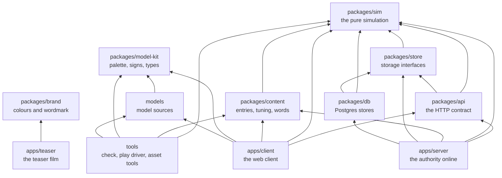
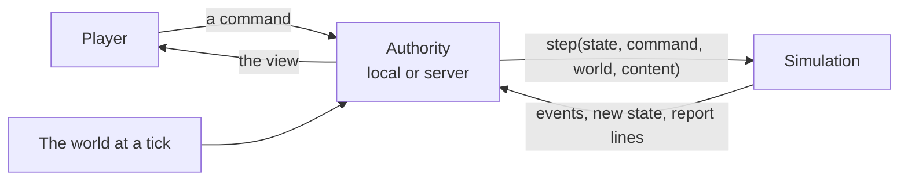

# How Japacity is built

Japacity is a game played in a phone's browser. At its centre is one pure function: it takes the life as it stands and the player's command, and returns what happened. The client, the server, the database and the tools are built around that function and around the rule pages that say what it must do. This page is the map; each page after it goes one level deeper.

## The game

The player lives a Nigerian life, in Lagos, one month at a time, from a first job to the choice of whether and how to leave. Ways out of the country (a master's in the UK, a tech job abroad, health care in the UK, Canada's points, a Gulf contract, the road through the desert and others) appear as the life comes to match them. One figure, japacity, says how ready the player is. The game is online and shared: the server holds every life, and players meet in the city's places and can pair up.

## The workspace

The repository is one pnpm workspace. The simulation is at the bottom and depends only on `zod`; everything else builds on it.

An arrow points from a package to one it imports. The arrows are the `@japacity/*` dependencies in each `package.json`; `tests/boundaries.test.ts` and the lint rules keep them that way.

| Folder | Package | Holds |
|---|---|---|
| `packages/sim/` | `@japacity/sim` | The engine and every kind of the game. Pure, deterministic, whole numbers only. Depends on `zod` alone |
| `packages/content/` | `@japacity/content` | The game's entries (activities, routes, offers, places), the tuning and every player-facing word, checked against the simulation's schemas |
| `packages/store/` | `@japacity/store` | The storage interfaces the server writes through, with in-memory versions and contract suites |
| `packages/api/` | `@japacity/api` | The HTTP and socket contract: each route's request and reply and the socket's messages, which the client and the server both import. Types, with the few lists and the one message reader both sides use |
| `packages/db/` | `@japacity/db` | The Postgres versions of the same stores (Drizzle and `pg`), and the migrations |
| `packages/model-kit/` | `@japacity/model-kit` | The palette, the signs and the types the asset pipeline and the client share |
| `packages/brand/` | `@japacity/brand` | The game's role colours, tints, face and wordmark letters as data, for the teaser, which draws outside the client |
| `models/` | `@japacity/models` | The city's model sources: builders, specs, reviews. Never shipped as such |
| `apps/client/` | `@japacity/client` | The web client: Vite, React, zustand, three.js through React Three Fiber |
| `apps/server/` | `@japacity/server` | The online authority: one Cloudflare Worker with Hono, Better Auth, the command log and the place rooms |
| `apps/teaser/` | `@japacity/teaser` | The teaser film, made with Remotion from the brand package |
| `tools/` | `@japacity/tools` | The checks (`tools/check/`), the golden tools (`tools/goldens/`), the asset pipeline, the load test and the play driver |
| `tests/` | | Guard tests across the whole repository, such as the import boundaries, the shipped build and the lint rules |

::: info The same engine runs in two places
The client can run the simulation in the tab (the local authority, for development, tests and offline play), and the server runs the same package online. The engine is pure, so both give the same result for the same save. See [The client](./client.md) and [The server and the data](./server.md).
:::

## How a command is handled

Every change to a life follows the same path, wherever the authority runs.

The player never sees the state, only the view: what one player may know. The seed, the draw counts and anything marked secret never leave the authority. [The simulation](./simulation.md) explains each word in this picture, and [the engine contract](../../rules/engine.md) is the rule page behind it.

## Rule pages and tests

`docs/rules/` holds one page per kind of thing in the game: turns, money, routes, the city, the server. Each rule has a name such as `turn:month-turns-on-empty-bank` (the page, then a short slug of what the rule holds), and at least one test cites each name in its title. The site shows these pages unchanged under [The rules](../../rules/engine.md) and never copies their text.

::: tip Why
A rule with no test has not been built. With the name in the test title, a failing test names the rule it guards, and the rule pages read as the game's specification with the tests as proof.
:::

How a rule gets its test, and what `pnpm check:rules` fails, are in [Rules and tests](./working.md#rules-and-tests).

## The check

`pnpm check` (`tools/check/all.ts`) is the command to run before a change is called done: ten steps, from the generated types to the scrub check, ending in `CHECK PASSED` or the step that failed. CI runs most of them in two tiers, and other guards (git hooks, the protected-tests check, `pnpm bless` as the only way goldens change) stand beside it. Each step, each tier and each guard is in [Working on it](./working.md#the-check).

## Other pages

| Page | For |
|---|---|
| [The simulation](./simulation.md) | The engine: kinds, commands, events, effects, the turn, the view, whole numbers, random streams, saves and goldens |
| [The character](./character.md) | How a life is made at the front door, what it holds, and how the view is built from it |
| [Chapters and routes](./chapters.md) | The story's chapters, the ways out and the japacity figure |
| [The content](./content.md) | The tables, the tuning, the overlay and the words |
| [The client](./client.md) | The React client, the authority modes, the city and the phone |
| [The server and the data](./server.md) | The Worker, sign-in, the command log, the place rooms, the crons and the schema |
| [From the browser to Postgres](./infrastructure.md) | Every piece a request passes through, the two environments and the deploy |
| [Working on it](./working.md) | Running it, every command, the check and CI, how work lands, the play driver, short recipes, and where each fact lives |
| [How it plays](../plays/index.md) | The game feature by feature, with pictures |
