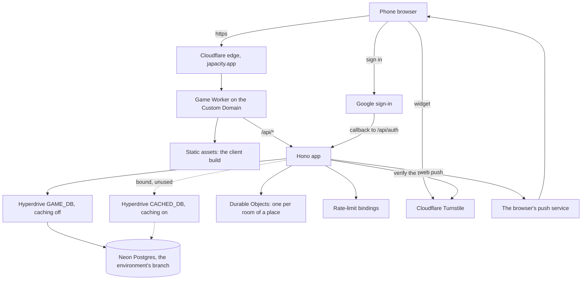
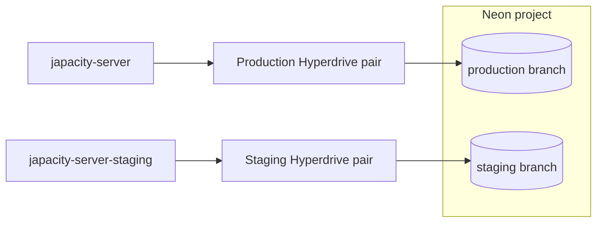

# From the browser to Postgres

How the online game is hosted: the services a request passes through, how production and staging differ, how a deploy is wired, and where each kind of secret is kept. It is for anyone looking after a deployment or curious how one runs. What each part must do is [the server's rule page](../../rules/server.md); the code is on [The server and the data](./server.md); every value to change for a deployment of your own is on [Run your own copy](./your-own-copy.md).

## Overview

A phone opens `japacity.app`. The game's own Worker serves the page and answers the API, and reaches Postgres on Neon through Cloudflare Hyperdrive. Outside services do one job each: Turnstile checks for bots, Google signs people in, Cloudflare Email Service sends the email codes, and the browsers' push services carry the one notice the game sends. There are two copies of all this, production and staging, which share nothing.

## The game's Worker

One Worker serves the client's build and runs the API under `/api/` on the same origin. All its configuration is in `apps/server/wrangler.jsonc`.

- It answers `japacity.app` as its Custom Domain (staging: `staging.japacity.app`). It has no workers.dev address and no preview URLs.
- It needs the Node compatibility layer (`nodejs_compat`) for Better Auth and node-postgres.
- Its rate limits use Cloudflare's rate-limit bindings, which count per location (server:limits-are-approximate).
- Who is in a place is kept in Durable Objects, one per room.

## Hyperdrive: two configurations

The Worker never connects to Postgres directly. It opens one `pg` client per request through Cloudflare Hyperdrive, which keeps a pool of connections to the database, so each request's client is cheap to open. Each environment has two Hyperdrive configurations, bound under two names:

| Binding | Caching | Serves |
|---|---|---|
| `GAME_DB` | Off | Everything: game state, every store, the auth library, the jobs |
| `CACHED_DB` | On | Reads that may be slightly stale. By design only the world's ticks and the auth library may use it; nothing reads it |

::: warning Why caching is off for game state
Every command reads the character it is about to change and must see the last write, or the version check refuses it as stale. Decision 0006 and the server's rules keep every game read on the uncached configuration.
:::

Both blocks of `apps/server/wrangler.jsonc` name their two configurations by id. Neither holds a connection string: that is stored inside the Hyperdrive configuration itself.

## Postgres on Neon

Postgres 18 is hosted on Neon: one project with a branch per environment, production and staging. Each environment reaches only its own branch, through its own pair of Hyperdrive configurations, so staging cannot read or write production data. `neon.ts` at the repository root is the config file Neon's own tooling reads; it sets nothing.

The schema reaches a branch through the migrations in `packages/db/migrations/` (`packages/db/README.md`). They are applied with the branch's direct connection string for the migrator role, which owns the schema: in a deploy, from the GitHub environment's `DATABASE_URL_UNPOOLED` secret; on a machine, from a git-ignored local file. The string never enters the repository. When a deploy migrates, and why a migration may only add, is server:migration-before-deploy.

## Production and staging

Both deployments come from one `apps/server/wrangler.jsonc`: production at the top level, staging under `env.staging`, deployed with `--env staging`. An environment does not inherit vars, bindings or the route, so staging repeats each of its own. Staging sits behind Cloudflare Access. Why staging differs is server:production-and-staging.

| | Production | Staging |
|---|---|---|
| Worker | `japacity-server` | `japacity-server-staging` |
| `SITE_URL` | `https://japacity.app` | `https://staging.japacity.app` |
| Passkeys' relying party id | `japacity.app` | `staging.japacity.app` |
| Turnstile host accepted | `japacity.app` | `staging.japacity.app` |
| Google OAuth redirect address | `https://japacity.app/api/auth/callback/google` | `https://staging.japacity.app/api/auth/callback/google` |
| Crons | `*/5 * * * *` and `0 0 * * *` | `*/30 * * * *` (its `TICK_CRON` var, standing in for the five-minute one, so its database can sleep) and `0 0 * * *` |
| Static files | Served by the platform before the Worker | Served by the Worker through its `ASSETS` binding, so every reply can be marked |
| Search engines | No tag | `NOINDEX`: `X-Robots-Tag` on every reply and a `/robots.txt` that disallows all |
| Rate-limit namespaces | Its own | Its own, so two Workers never share one count |
| Database, secrets, passkeys | Its own | Its own; nothing shared |

`SITE_URL` is the one address the server trusts. It is Better Auth's `baseURL` and its one trusted origin, the passkeys' relying party (its host, from `relyingPartyOf` in `apps/server/src/auth/auth.ts`, which refuses an address that is not a bare https origin), the bot check's host, the origin checked on writes, and the base of invite links (`/invite/<code>`). A passkey is bound to its relying party id permanently, so neither host may change once a real passkey exists (account:passkey-needs-signed-in-session).

`japacity.com`, `www.japacity.com`, `www.japacity.app` and `staging.japacity.com` only redirect, through redirect rules on those zones.

## Deploying

A deploy builds the client for the address it will run at, then deploys the Worker that serves that build: `wrangler deploy` from `apps/server` for production, `wrangler deploy --env staging` for staging. The full order of a deploy (migrate, snapshot, build, deploy, check) is server:migration-before-deploy; what each environment deploys and when is server:production-and-staging.

The client's build:

- It reads `VITE_SERVER_URL`. With it set, the client talks to that server. A production build without it refuses to start a local game unless explicitly told to (engine:browser-authority-for-dev-only).
- It also reads `VITE_TURNSTILE_SITE_KEY`, the public half of the Turnstile pair, which is in the page, and the optional `VITE_ANALYTICS_TOKEN`.
- A build for players (every mode except development, staging included) ships no source maps; drops every `debugger` statement and every console call except `console.error` and `console.info`; leaves out the development addresses and their code; and writes the licences of the libraries it bundles to `licenses.txt` beside the page. Nothing is obfuscated beyond minifying (`apps/client/vite/shipping.plugin.ts`, read from `apps/client/vite.config.ts`).

The workflows, `.github/workflows/deploy-staging.yml` and `deploy-production.yml`, run only in this repository, each in a GitHub environment of the same name, so a fork cannot deploy this project. The environment holds the Cloudflare token and account id as secrets and the build's addresses and keys as variables; `production` waits for its reviewer's approval. [Run your own copy](./your-own-copy.md#_10-github-the-environments-and-the-deploys) lists everything each environment holds. A deploy by hand, the fallback, is in `apps/server/README.md`.

## Secrets

No secret value is ever written in the repository: not in a config file, a doc or a commit. Each environment has its own set, kept in three places:

- **The Worker's secrets**, set with `wrangler secret put`: the world's seed, the salt, the keys for sessions, draw tickets, Google, Turnstile and web push, and the admin list.
- **The GitHub environment's secrets**, which only a deploy reads: the Cloudflare token and account id, the migrator's connection string, and staging's Access service token.
- **The database's connection string** for the app role, kept inside each Hyperdrive configuration in Cloudflare. The Worker reads it through its binding and never sees it in config.

[Run your own copy](./your-own-copy.md#_9-the-worker-secrets) lists each secret, what it is for and how to make it. Settings for one machine stay in git-ignored files ([What stays out of the repository](./your-own-copy.md)).

## Bots, sign-in, push and email

- **Turnstile.** The client shows Cloudflare's Turnstile widget once, when a guest life is created, and the server verifies the token (account:bot-check-on-guest-creation).
- **Google sign-in.** The browser goes to Google and returns to `/api/auth/callback/google` on the same host, where Better Auth finishes the sign-in.
- **Web push.** The five-minute job sends the bank-full notice through the push service each device's browser named when it subscribed (clock:full-bank-push-notification). Devices are kept in `push_subscriptions` only while the setting is on. The public key is served to the client at `/api/notify/key`.
- **Email.** The email codes and account notices go out through Cloudflare Email Service, the `send_email` binding `MAIL`, allowed one sender. It needs no secret, and a deployment without the binding sends no email. The sender, the reply address and the local stack's Mailpit are in account:sign-in-routes-rate-limited (decision 0007).
