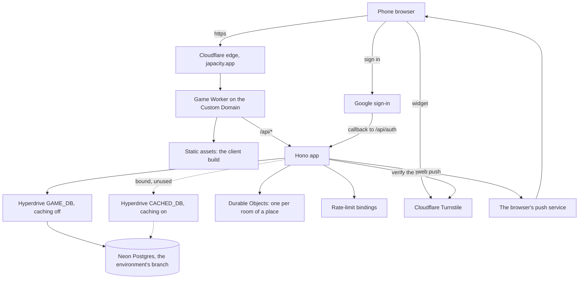
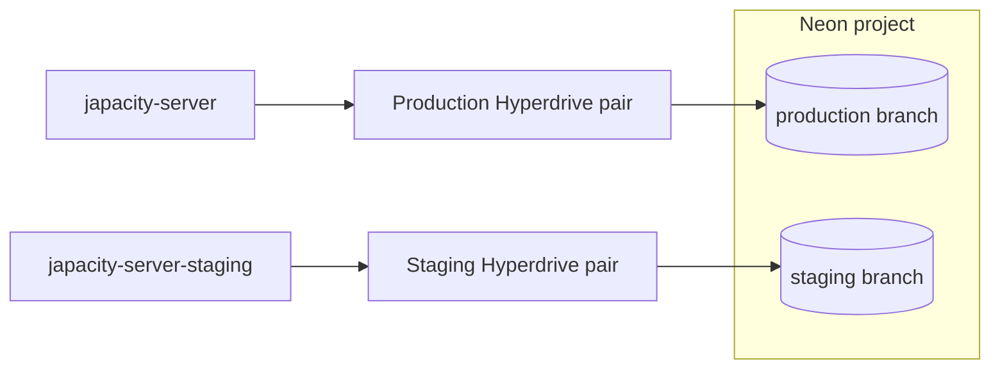
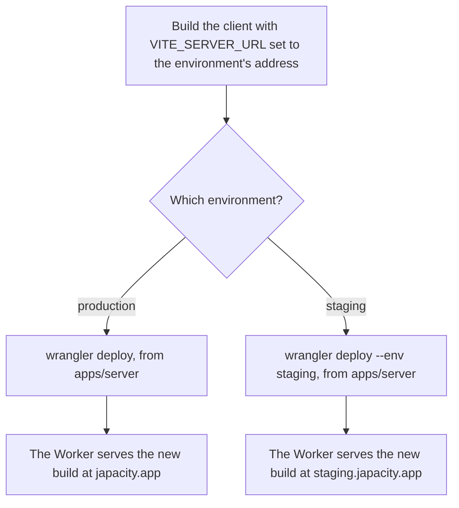

# From the browser to Postgres

The online game runs on a small number of hosted services. A phone opens `japacity.app`; the game's own Worker serves the page and answers the API; it reaches Postgres on Neon through Cloudflare Hyperdrive; and a few outside services do one job each: Turnstile checks for bots, Google signs people in, Cloudflare Email Service sends the email codes, and the browsers' push services carry the one notice the game sends. There are two copies of all this, production and staging, which share nothing. This page shows how the pieces connect, what differs between the two, how a deploy happens and what kinds of secret exist and where each kind is kept.

::: info How a deploy happens
A merge to `main` deploys staging, and a release tag `v*` deploys production once the `production` environment's reviewer approves the run (`.github/workflows/deploy-staging.yml` and `deploy-production.yml`, described below). The check workflow runs on every pull request with no secrets, and a fork cannot deploy this project. Every configuration here is in `apps/server/wrangler.jsonc`, read with [the server's rule page](../../rules/server.md) (server:production-and-staging for the two environments). Every value that belongs to one deployment is listed in [Run your own copy](./your-own-copy.md).
:::

## The whole picture

## The game's Worker

One Worker serves the client's build and runs the API under `/api/` on the same origin. It answers `japacity.app` as its Custom Domain (staging, `staging.japacity.app`), has no workers.dev address and no preview URLs, and needs the Node compatibility layer for Better Auth and node-postgres. Its rate limits use Cloudflare's rate-limit bindings, which count per location (server:per-account-rate-limits, server:anonymous-limit-by-address, server:noisy-socket-closed and server:limits-are-approximate). Who is in a place lives in Durable Objects, one per room. [The server and the data](./server.md) covers the code.

## Hyperdrive: two configurations

The Worker never connects to Postgres directly. It opens one `pg` client per request through Cloudflare Hyperdrive, which keeps a pool of connections to the database so each request's client is cheap to open. Each environment has two Hyperdrive configurations, bound under two names:

| Binding | Caching | Serves |
|---|---|---|
| `GAME_DB` | Off | Everything: game state, every store, the auth library, the jobs. A command must read what the last command wrote, so nothing here may be cached |
| `CACHED_DB` | On | Reads that may be a little stale. By design only the world's ticks and the auth library may use it; nothing reads it |

::: warning Why caching is off for game state
Every command reads the character it is about to change and must see the last write, or the version check refuses it as stale. Decision 0006 and the server's rules keep every game read on the uncached configuration.
:::

## Postgres on Neon

Postgres 18 is hosted on Neon, one project with a branch for each environment: production and staging. Each environment reaches only its own branch, through its own pair of Hyperdrive configurations, so nothing in staging can read or write production data. `neon.ts` at the repository root is the config file Neon's own tooling reads; it sets nothing.

The schema reaches a branch through the migrations in `packages/db/migrations/`: `db:migrate` in `packages/db` applies them using the branch's direct connection string from the environment, the migrator role's, which owns the schema. Every deploy runs it first, before the client is built and the Worker deployed, with that string as the environment's `DATABASE_URL_UNPOOLED` secret in GitHub (server:migration-before-deploy); a migration therefore only adds, so the Worker still running keeps working beside it. On a machine the string is kept in a git-ignored local file. It never enters the repository. The set starts from one file, `0000_japacity.sql`, and grows one migration at a time from there.

::: details Where the configurations stand
Both blocks of `apps/server/wrangler.jsonc` name their two Hyperdrive configurations by id. Neither block holds a connection string: that lives inside the Hyperdrive configuration itself.
:::

## The two environments

Both deployments come from the one `apps/server/wrangler.jsonc`: production at the top level, staging under `env.staging`, deployed with `--env staging`. Staging sits behind Cloudflare Access. Vars, bindings and the route are not inherited by an environment, so staging writes each of its own again.

| | Production | Staging |
|---|---|---|
| Worker | `japacity-server` | `japacity-server-staging` |
| Host and `SITE_URL` | `japacity.app` | `staging.japacity.app` |
| Passkeys' relying party id | `japacity.app` | `staging.japacity.app` |
| Turnstile host accepted | `japacity.app` | `staging.japacity.app` |
| Tick cron | Every 5 minutes | Every 30 minutes, through its `TICK_CRON` var, so its database can sleep |
| Daily cron | 00:00 UTC | 00:00 UTC |
| Static files | Served by the platform before the Worker | Served by the Worker through its `ASSETS` binding, so every reply can be marked |
| Search engines | No tag | `NOINDEX`: `X-Robots-Tag` on every reply and a `/robots.txt` that disallows all |
| Rate-limit namespaces | Its own | Its own, so two Workers never share one count |
| Database, secrets, passkeys | Its own | Its own; nothing shared |

`SITE_URL` is the one address the server trusts. Better Auth's base address and its trusted origin, the passkeys' relying party, the bot check's host and the origin check on writes all come from it. A passkey is bound to its relying party id for good, so neither host may change once a real passkey exists.

## Deploying

A deploy is two steps per environment: build the client for the address it will run at, then deploy the Worker that serves that build.

- The client's build reads `VITE_SERVER_URL`. With it set, the client talks to that server; a production build without it refuses to start a local game unless told otherwise in so many words (engine:browser-authority-for-dev-only).
- The client's build also reads `VITE_TURNSTILE_SITE_KEY`, the public half of the Turnstile pair. It is meant to be seen: it is in the page.
- A build for players (every mode but development, staging too) ships no source maps, drops every console call but `console.error` and `console.info` and every `debugger` statement, leaves out the development addresses and their code, and writes the licences of the libraries it bundles to `licenses.txt` beside the page. Nothing is obfuscated beyond minifying (`apps/client/vite/shipping.plugin.ts`, read from `apps/client/vite.config.ts`).
- The two workflows do both steps in GitHub Actions. Each runs only in this repository, in a GitHub environment of the same name that holds the Cloudflare token and account id as secrets and the build's addresses and keys as variables; `production` waits for its reviewer's approval. An environment without its Cloudflare secrets stops its job at the first step with a notice and deploys nothing.
- The admin accounts (server:ledger-alarm-lists-suspects) are the Worker secret `ADMIN_ACCOUNTS`, set once per environment with `wrangler secret put` and kept by every deploy. Neither `wrangler.jsonc` nor a workflow names it, so no account id is in a committed file.
- Staging's deploy starts only when the check workflow has passed on that push to `main`, and deploys the commit it passed. Both deploys run the wrangler version `apps/server/package.json` pins.

::: danger Before the first deploy
The bill has no cap, so the deployment carries spending alerts set in the Cloudflare account before anything is deployed (server:spending-alerts). Whoever holds the account sets them; no code can.
:::

## The secrets, in kind

No secret value is ever written in the repository, in a config file, a doc or a commit. This is what each kind of secret is and where that kind lives.

| Secret | What it is | Where it lives |
|---|---|---|
| `WORLD_SEED` | The seed of the shared world, made once at the first deploy (server:hidden-values-made-once) | A Worker secret, set with `wrangler secret put` |
| `BAN_SALT` | The salt of the banned identities' one-way hashes | A Worker secret |
| `DRAW_TOKEN_KEY` | The key that signs the draw's anonymous ticket tokens | A Worker secret |
| `BETTER_AUTH_SECRET` | The auth library's signing secret for sessions | A Worker secret |
| `GOOGLE_CLIENT_ID`, `GOOGLE_CLIENT_SECRET` | The game's OAuth client for Google sign-in | Created in Google's console with the environment's callback address; copied into Worker secrets |
| `TURNSTILE_SECRET_KEY` | The private half of the Turnstile pair, used to verify tokens | The Turnstile widget is made in Cloudflare; the secret half is a Worker secret, the site key goes into the client's build |
| `VAPID_PUBLIC_KEY`, `VAPID_PRIVATE_KEY`, `VAPID_SUBJECT` | The web push pair and the contact address push services may use | Worker secrets. Without all three, no notice is sent. The public key is served to the client at `/api/notify/key` |
| The database role's connection string | How Hyperdrive reaches the environment's Neon branch | Inside the Hyperdrive configuration, in Cloudflare. The Worker reads it from its binding and never sees it in config |

Each environment has its own set: a staging secret is never a production one.

::: tip Local files stay local
Local runs read their settings from files git ignores: `.dev.vars` for `wrangler dev`, `.env.local` and the like for the client and the database tools, and `.neon` for the Neon link. The `.gitignore` at the root keeps them out. Never commit one, and never paste a value from one into a page, an issue or a commit message.
:::

## Bots, sign-in and notices

- **Turnstile.** The client shows Cloudflare's Turnstile widget once, when a guest life is created. The server posts the token to Turnstile's verify endpoint and accepts a pass only when it was solved on its own host (account:bot-check-on-guest-creation).
- **Google sign-in.** The browser goes to Google and comes back to `/api/auth/callback/google` on the same host, where Better Auth finishes the sign-in.
- **Web push.** When a character's bank fills while its player is away, the five-minute job sends one web push to each device that agreed, through the push service that device's browser named when it subscribed (clock:full-bank-push-notification). The devices are kept in `push_subscriptions` only while the setting is on.
- **Email.** The email codes and the account notices leave through Cloudflare Email Service: the `send_email` binding `MAIL`, allowed one sender, `game@mail.japacity.app`, with replies going to `hello@japacity.app` (account:sign-in-routes-rate-limited, decision 0007). It needs no secret. A deployment without the binding sends no email.

## How things moved

The infrastructure was not always this shape. In order:

- **Closed, then open.** While the game was closed to the public, a small gate Worker held the route in front of the game's Worker and showed a holding page, and an access check stood in front of the host as well, so production could run before anyone played. When the game opened, the gate and the check came off, and the game's Worker now answers `japacity.app` itself as its Custom Domain.
- **One clean starting migration.** The migrations written while the schema settled were squashed into one file, `0000_japacity.sql`, before the first players, and both databases started from it; every migration since only adds (`packages/db/README.md`, server:migration-before-deploy).
- **Secrets out of config.** The admin list, `ADMIN_ACCOUNTS`, moved from a variable to a Worker secret, so no deployment's admins are written in a committed file.
- **Email.** Cloudflare Email Service was chosen to send the email codes and notices, as a binding on the Worker with no API key to keep (decision 0007).
- **The tick.** Production's world tick went from every thirty minutes to every five once its database no longer had to sleep between runs. Staging keeps thirty minutes so its database can sleep (clock:cron-stores-missing-ticks).
