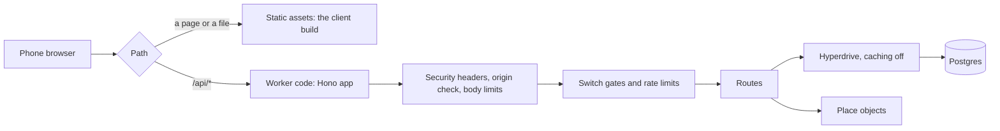
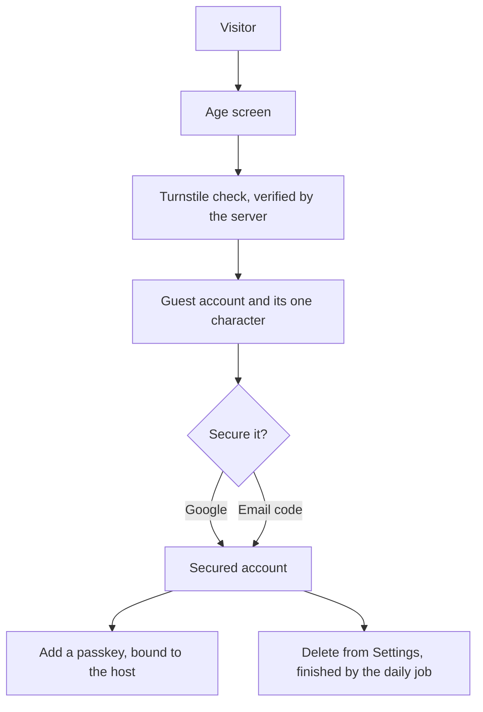
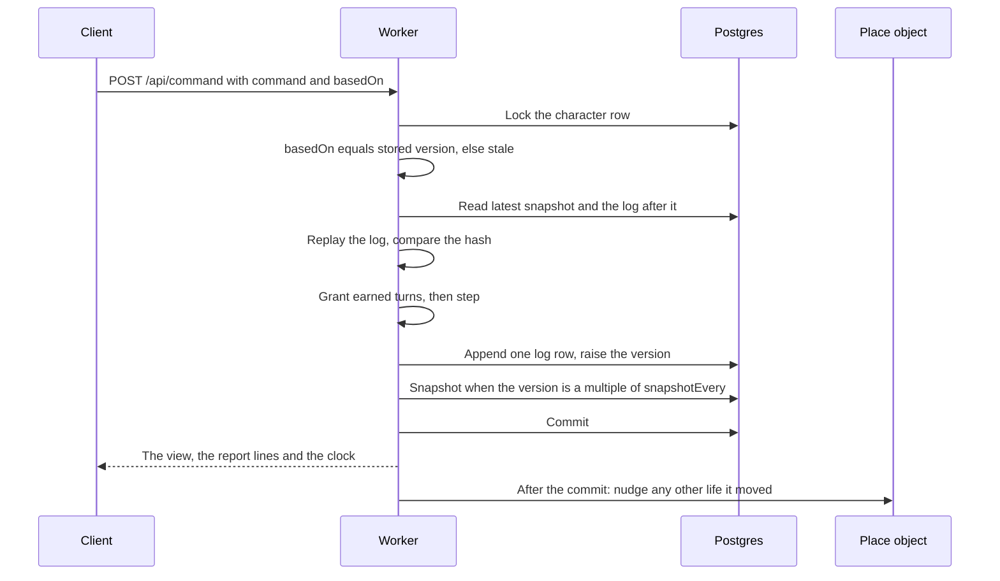
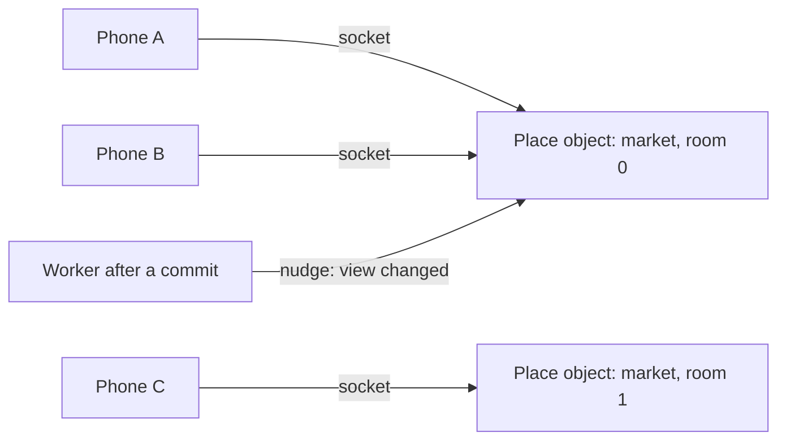
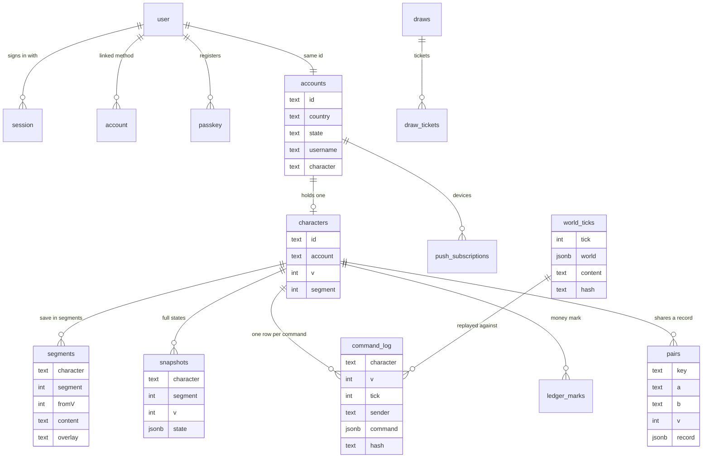
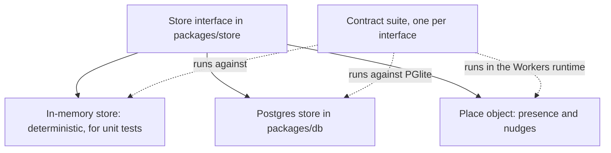

# The server and the data

Online, one program decides everything: a Cloudflare Worker in `apps/server`. It serves the game's pages and is the only authority over every character. For each command the Worker:

1. loads the character from Postgres;
2. replays its recent history to check nothing has gone wrong;
3. runs the same pure simulation the browser uses;
4. writes one new log row;
5. answers with the new view.

The only thing the phone is trusted to say is what the player wants to do. This page is for anyone reading or changing the server's code: the Worker, accounts, the log, the place objects, the scheduled jobs and the database. How it is hosted and deployed is [From the browser to Postgres](./infrastructure.md).

::: info The rules behind this page
The contract is [the server's rule page](../../rules/server.md), with [accounts](../../rules/account.md), [the clock](../../rules/clock.md) and [the engine](../../rules/engine.md). The stack and its pinned versions are in decision 0006 (`docs/decisions/0006-the-online-stack.md`). Where this page and a rule page differ, the rule page wins.
:::

## The Worker

The Worker is named in `apps/server/wrangler.jsonc`. It owns the game's address as a Cloudflare Custom Domain and serves the client's build (`apps/client/dist`) as static assets. Only paths under `/api/` run the Worker's code, so the page and the API share one origin: the session cookie stays first party and no cross-origin setup is needed.



### Middleware order

The Hono app is built in `apps/server/src/app.ts` from its dependencies, so a test can pass in-memory stores and a fixed clock. A request passes, in order:

1. the security headers, added to every reply (server:security-headers-on-replies);
2. refusal of a write from another origin (server:same-origin-writes-only);
3. refusal of an oversized body (server:body-size-limits);
4. counting of refusals, for the admin page;
5. the four off switches' gates (server:four-off-switches);
6. the routes.

### Per-request lifecycle

`apps/server/src/index.ts` is the Worker; its request plumbing is in `apps/server/src/worker.ts`.

- **Connections.** For each request it builds every store and the auth library over one `pg` client through Hyperdrive. The client connects only when the first statement is sent, so `/api/health` and other requests that read nothing open no connection (server:one-command-one-transaction). The client is closed once the reply and any background work have settled. Nothing holds a database client between requests.
- **Failures** are answered in JSON, `{ ok: false, code: "unavailable" }`: 503 with `Retry-After` when the database did not answer, 500 otherwise, never the platform's error page (server:no-platform-error-page). Each failure is written once to Workers Logs as a JSON line with no cookie, body, session, account id, address or secret (server:shared-observability-block, `apps/server/src/log.ts`). Logs, traces and Issues are on for every Worker.
- **What an isolate keeps:** the content with the private overlay applied once (server:hidden-values-made-once), the secrets, the rate-limit bindings and the place-object namespace. Nothing else.

### Routes

| Group | Paths | Does |
|---|---|---|
| Play | `/api/command`, `/api/prologue/preset`, `/api/view`, `/api/world`, `/api/character`, `/api/character/end` | Send a command; play the door's preset through the prologue in one request (server:server-plays-prologue-preset); read the view and the clock; read the world; make a character; end a life |
| Accounts | `/api/auth/*`, `/api/age`, `/api/guest`, `/api/account`, `/api/account/username` | The auth library, the age screen with the bot check, the guest start, deletion, the username |
| Places | `/api/place/:place`, `/api/place/:place/socket` | Who is here today, and the live socket that says "something changed" |
| People | `/api/invite/*`, `/api/pair/*` | Invite links, the shared record of two lives, the stored phrases |
| The draw | `/api/draw/:n` | A draw's published commitments and result |
| Notices | `/api/notify`, `/api/notify/key`, `/api/notify/subscribe` | The bank-full notice: the setting, the public key, a device that agreed |
| Moderation | `/api/moderation/*`, `/api/feedback` | Standing, appeals, feedback |
| Admin | `/api/admin/*` | Checks, figures, the moderation queue, adverts, switches and dials ([the admin page](../../rules/admin.md)). Open only to the accounts in the deployment's `ADMIN_ACCOUNTS` secret (server:ledger-alarm-lists-suspects) |
| Start screen | `/api/lights`, `/api/dedication/lights`, `/api/dedication/light` | The two lights of the lives being played (account:two-lights-and-wink-lines), and the dedication's lights (server:dedication-routes) |
| Other | `/api/health`, `/api/counters`, `/api/csp-report`, `/api/adverts`, `/api/boards/*` | Liveness, usage counts, the page policy's reports (server:csp-reports-to-own-origin), adverts, the place boards |

::: tip The offline game needs no server
Without `VITE_SERVER_URL` the client runs the same simulation in the browser as a local authority. Development, the tests and the play driver work this way. A production build refuses the local authority unless explicitly allowed. See [the client](./client.md).
:::

## Accounts

Accounts use Better Auth 1.7 (`apps/server/src/auth/auth.ts`), created inside each request over that request's database client. Its tables sit beside the game's own in `packages/db/src/schema/auth.ts`.

- **Guest first.** Online, a new player starts as a guest through the auth library's anonymous sign-in. The age screen comes first (account:age-screen-refuses-minors). Before the guest life is made, the client shows a Cloudflare Turnstile check and the server verifies its token; a pass counts only if it was solved on the game's own host (account:bot-check-on-guest-creation). Sign-up behaves the same from every country (account:sign-up-open-everywhere).
- **Securing the life.** A guest secures the account with Google or with a code sent to an email address (account:guest-secures-the-life). Codes and passkey notices are sent through Cloudflare Email Service, the Worker's `MAIL` binding, from the game's one sender (account:sign-in-routes-rate-limited, decision 0007). On the local stack they arrive in Mailpit.
- **Passkeys.** A secured player may add a passkey. Its relying party id is the host of `SITE_URL` (account:passkey-needs-signed-in-session), so a staging passkey can never sign in to production ([Production and staging](./infrastructure.md#production-and-staging)).
- **Sessions** are `HttpOnly`, `Secure`, `SameSite=Lax` cookies (account:session-is-secure-cookie). Sign-in routes are rate limited with the limit's store in the database, so the limit holds across isolates (account:sign-in-routes-rate-limited).
- **Deletion** is requested from Settings and completed by the daily job (account:player-deletes-account, account:deleted-data-removed-within-month and account:deletion-keeps-anonymous-totals). What remains names no one: day totals, a draw's anonymous ticket list, and a one-way hash with the date.



::: details Test stand-ins for the real providers
In tests, sign-in uses stand-ins that exist only in the test server's config (account:stand-ins-test-sign-in):

- email codes are read back from a stand-in for the send;
- Google goes to a stub provider that signs in a fixed test identity;
- passkeys come from a virtual authenticator in the browser tests.

Turnstile has published test keys that always pass or always fail. A non-production build uses the always-pass site key when none is given.
:::

## Command flow

`POST /api/command` is the only way a command reaches `step` online (server:commands-only-through-route). The body holds the command and the version it was based on; nothing else is read. One command is one database transaction (server:one-command-one-transaction).



- A rejected command writes nothing, logs nothing and raises nothing (server:rejections-write-nothing).
- An authority command, such as paying a draw's winnings or granting turns, goes through the same transaction with the sender `authority` (server:authority-commands-same-path).
- A command that touches two lives (a pair's shared step) locks both rows in ascending id order before reading either (server:paired-rows-locked-in-order).

### The log, segments and replay check

- **Log rows.** Each row holds the command, its tick, its sender, the version after it and the hash of the state after it (server:log-rows-hash-state).
- **Segments.** A save is a list of segments. Each names the content version and overlay it ran under, and starts from the scenario and seed or from a base state (server:save-is-list-of-segments).
- **Snapshots.** A full snapshot is written when a segment begins and every `snapshotEvery` versions (20, in `apps/server/src/config.ts`), so a load never replays more than that (server:snapshots-bound-replay).
- **Replay check.** Every load replays from the latest snapshot and compares the resulting hash with the last row's. On a mismatch, that one account is refused with `diverged`, queued for the rollback tool as an audit entry, and raised on the admin alarm. Every other account carries on.
- **Content changes.** When the content changes, the next load replays the old segment under its own content, carries the state forward with `upgradeState`, checks it, and opens a new segment (server:newer-content-upgrades-state, server:upgrade-state-is-pure, server:older-contents-bundled and server:overlay-change-opens-segment). The server bundles the current content and every older version a life may still name, each as shipped. Every lower content version is frozen and listed in `olderContents` (server:older-content-frozen). Any change to the content's data or the simulation's code raises the version; `pnpm check:version` enforces this (server:content-version-sealed).

::: details The rollback tool
- `pnpm rollback check <character>` (on the database at `DATABASE_URL_UNPOOLED`) or `pnpm rollback check <character> --memory <save.json>` (a save in a file) replays one account from the base of its first segment and reports the first version whose hash differs.
- `pnpm rollback apply <character>` corrects that account only (server:rollback-check-finds-divergence, server:rollback-apply-one-account).

No command freezes or corrects more than one account (server:no-mass-rollback). The one tool that walks every account is `pnpm snapshot:all`, which snapshots each in its own transaction before a deploy (server:snapshot-before-deploy). Retired rows go to the append-only `audit` table and are never deleted.
:::

::: warning What never leaves the server
Character seeds, the world seed, the random streams' draw counts, the director's book, any future world tick, a result not yet announced, the overlay's values and the alarm ceilings stay on the server (server:secrets-stay-on-server). A test builds the production client with sentinel values and scans every output file for them (server:build-scanned-for-secrets).
:::

## Place objects

Who is in a place is held only in memory by Cloudflare Durable Objects, one small object per room of a place, and never written to the database (clock:presence-held-in-memory). The class is `Place` in `apps/server/src/place/place.object.ts`, bound as `PLACE`.

- **Rooms.** A place is one or more numbered rooms, each its own object named after the place and the room number. A newcomer joins the fullest room that still has space, or the first empty room when every open room is full. Rooms are counted by asking each object, with no database (clock:busy-place-splits-rooms).
- **Sockets.** The objects use hibernatable WebSockets. Each socket carries a small attachment, so the room can be rebuilt after the object is evicted. A socket only ever says that something changed, never what the state is (clock:socket-only-nudges); on a view nudge the client asks for the view over plain HTTP.
- **Storage.** The one thing an object stores is the day's list of who was seen there (city:players-shown-present-not-tracked).



## Scheduled jobs

The Worker has two crons in production: every five minutes and daily at 00:00 UTC (clock:cron-stores-missing-ticks, server:daily-money-report). Each job runs in the same open, answer and close scope as a request.

| Cron | Job | Does |
|---|---|---|
| Every 5 minutes | World ticks | Stores every world tick from the last stored one up to now; the first row for a tick is kept (clock:world-is-stored-history, clock:cron-stores-missing-ticks) |
| Every 5 minutes | The draw | Closes and pays a draw whose close has begun, then opens the next with the jackpot it leaves ([the Friday draw](../../rules/lottery.md)) |
| Every 5 minutes | Bank-full notices | Sends one web push to each device whose character's bank filled while away, when the push keys are set (clock:full-bank-push-notification) |
| Every 5 minutes | Advert links | Rechecks the links of every approved campaign about to start, and pulls one that fails |
| Every 5 minutes | Board week | Turns the place boards' figures over to the new Lagos week (city:boards-switch-when-and-who) |
| Every 5 minutes | Online now | Samples how many are online, for the day's peak (analytics:session-split-by-command-gaps) |
| Every 5 minutes | Checks | Measures every check, records each change of state, and emails the admins when a check enters or leaves alarm (admin:checks-have-three-states, admin:check-change-sends-email) |
| Daily, 00:00 UTC | Deletions | Removes every account whose deletion is due (account:deleted-data-removed-within-month) |
| Daily, 00:00 UTC | Counters | Adds the day's game counters from the command log, once (analytics:nightly-game-counters) |
| Daily, 00:00 UTC | Lives | Counts the lives being played, home and abroad, for the two lights (account:two-lights-and-wink-lines) |
| Daily, 00:00 UTC | Money report | The day's money made and destroyed by reason, and the alarm on suspect accounts (server:daily-money-report, server:ledger-alarm-lists-suspects) |
| Daily, 00:00 UTC | Feedback, stand-in | Drops old feedback; turns on the stand-in for a pair's absent player ([people](../../rules/person.md)) |

Staging runs the five-minute jobs on its slower `TICK_CRON` instead (server:production-and-staging): `jobCron` in `apps/server/src/scheduled/ticks.ts` passes each of them the five-minute cron when the deployment's own tick cron fires, so the jobs run unchanged, only less often.

## The database

Postgres 18, reached with `pg` through Drizzle ORM 0.45. The schema lives in `packages/db/src/schema/`, one file per area, with Better Auth's tables in `auth.ts`. Ids are ordered in JavaScript, never by a collation. The main tables:



| Area | Tables |
|---|---|
| Characters | `characters`, `segments`, `snapshots`, `command_log`, `pairs` |
| Accounts | `accounts`, `push_subscriptions`, `deletions`, and the auth library's `user`, `session`, `account`, `verification`, `passkey`, `rate_limit` |
| The world | `world_ticks`, `draws`, `draw_tickets` |
| Money | `ledger_marks`, `ledger_days` |
| People | `invites`, `invite_rewards`, `conversation_rows`, `blocks`, `reports`, `holds` |
| Moderation | `moderation_log`, `banned_identities`, `appeals`, `feedback`, `feedback_sends` |
| Operations | `switches`, `switch_log`, `audit`, the analytics tables, the advert tables, `board_figures`, `dedication_lights` |

The command log, the snapshots, world ticks and draw tickets are never rewritten.

## Store contracts

The server never writes SQL directly. Every store is an interface in `packages/store/src/`: `PlayerStore`, `PairStore`, `WorldStore`, `PresenceStore`, `NudgeBus`, `AccountStore`, `LedgerStore`, `DeletionStore`, `AuditStore`, `PushStore`, and others for invites, conversations, moderation, adverts, counters, switches, boards and the dedication. Each has two implementations held to one contract suite.



The suites live in `packages/store/src/contract/`. `packages/db` runs them on PGlite (real Postgres 18 inside the test process) with the committed migrations applied, one database per test file. A few tests need two real connections racing for one row; they are in the `db-race` Vitest project, which runs only when named (`pnpm vitest run --project db-race`) against a local Postgres, and is not part of `pnpm check` or CI.

| Vitest project | Covers |
|---|---|
| `store` | The in-memory stores against the suites |
| `db` | The Postgres stores on PGlite |
| `db-race` | Lock races on a real Postgres, run by name only |
| `server` | Routes and jobs on Node with in-memory stores |
| `server-workers` | The place objects, the reply cache and the Worker as deployed, in the Workers runtime |

## Migrations

The schema in `packages/db/src/schema/` is the source; a change to it becomes a new migration file in `packages/db/migrations/`, and a committed one is never edited:

```sh
pnpm --filter @japacity/db db:generate --name <what-changed>
```

`packages/db/README.md` covers generating, applying (`db:migrate`, and `pnpm db:migrate:local` for the local stack) and the test that holds the migrations to the schema. Every deploy migrates first, so a migration may only add (server:migration-before-deploy); where the databases are is [From the browser to Postgres](./infrastructure.md#postgres-on-neon).
