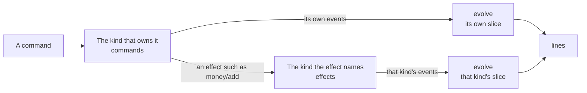
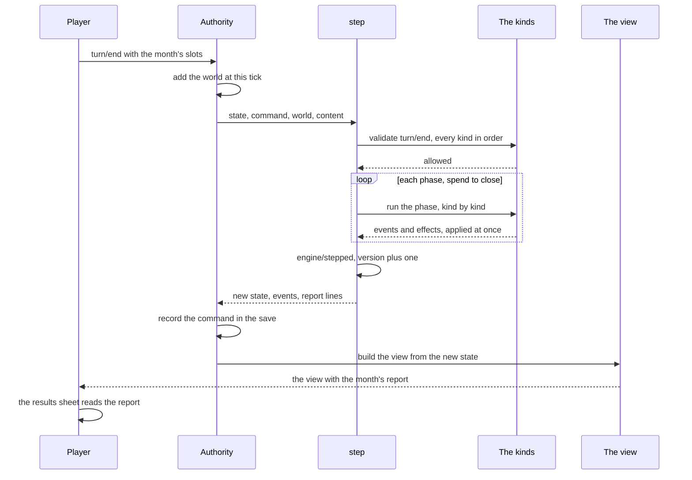
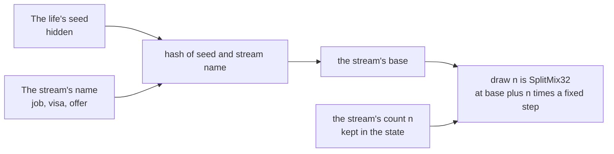
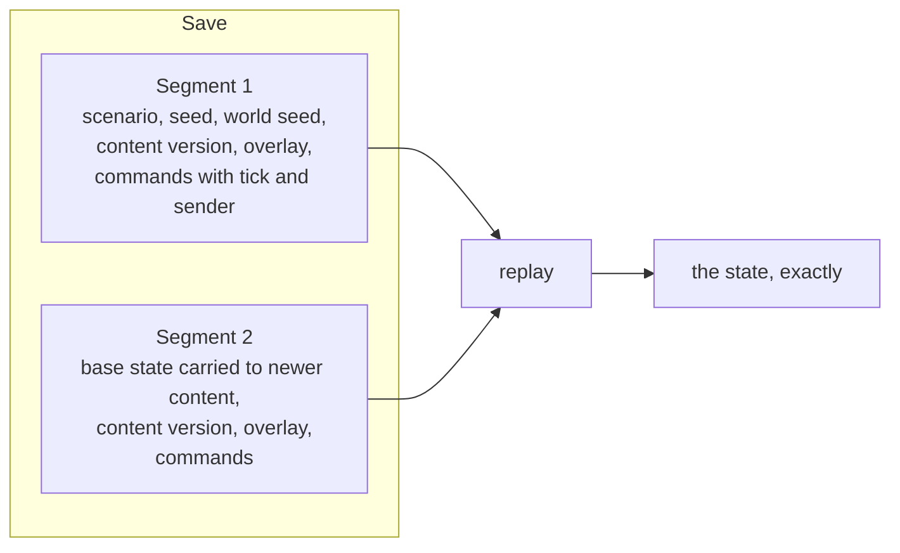
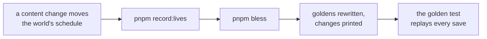

# The simulation

The simulation is the game's rules written as plain functions. It lives in `packages/sim` and does one thing: given a life as it stands, the world at that moment, the game's content and one command from the player, it says whether the command is allowed and, if it is, what happened and what the life looks like now. It never reads a clock, never makes up a random number of its own, never touches the network or the screen, and never uses a fraction. Because of that, the same inputs give the same answer on a phone and on the server, today and in a year, and a whole life can be rebuilt from the list of commands that made it.

## One function

```ts
step(state, command, world, content, sender) -> { ok: true, state, events, lines } | { ok: false, code, detail }
```

| Word | What it is |
|---|---|
| State | One character's whole life as plain data: ids and whole numbers, never words |
| Command | What the player asks for, such as `turn/end` or `wallet/move`. Each carries `basedOn`, the state version it was made against |
| World | What is the same for everyone at one tick: exchange rates, the era, rule numbers, news. Passed in, never stored in the state |
| Content | The data tables and tuning the rules read their numbers from. See [The content](./content.md) |
| Event | What happened, in the past tense: `wallet/credited`. Only events change the state |
| Line | What the player is told about an event: a text key and its numbers, never the words themselves |
| View | What one player may see of the state. The interface reads nothing else |
| Sender | `player`, `authority` or `stand-in`. Some commands only the authority may send |

`step` is in `packages/sim/src/engine/step.ts`. Before any kind runs, it refuses a command when the life has ended (`ended`), when a player sends an authority's command (`not-yours`), when the command was based on an older version (`stale`), when the world's tick has gone backwards (`clock-went-back`), or when the prologue is still open (`prologue-open`). A rejected command changes nothing and records nothing. An accepted one raises the version by one and ends with an `engine/stepped` event that carries the engine's own counters: the version, the tick, the draw counts and the next instance number.

The contract behind all this is [the engine page](../../rules/engine.md), with its types in `packages/sim/src/engine/types.ts`.

## Kinds

The game is split into kinds. Each kind owns one slice of the state and is one module of plain functions in `packages/sim/src/<kind>/`, with a schema, its events, its logic and its tests beside it. The registry (`packages/sim/src/kinds.ts`) lists the twenty-one kinds that own a slice, in the order the engine calls them:

`turn`, `quality`, `activity`, `wallet`, `document`, `route`, `setpiece`, `obligation`, `offer`, `chapter`, `news`, `place`, `status`, `credit`, `goal`, `prologue`, `lottery`, `people`, `interview`, `home`, `things`.

Two kinds sit in a folder named in the singular: `people` in `packages/sim/src/person/`, and `things` (what a life owns, decision 0019) in `packages/sim/src/thing/`.

Other folders hold helpers that own no slice: `japacity` (the readiness figure), `world` (the stand-in world, the director, rates), `scenario`, `school`, `country`, `era`, `var`, `pair`, `phrase` (the preset phrases), `guide` (the early win), `goldens` (the recorded saves), `simulated-play` (simulated players) and `testing`.

A kind adds only the parts it needs:

| Part | Its job |
|---|---|
| `initial` | The kind's slice of a new life |
| `commands` | Check a command the kind owns and say what happened, as events or a rejection |
| `effects` | Carry out an effect another kind asked of this one |
| `phases` | The kind's work during a month |
| `evolve` | Apply one of the kind's own events to its slice. The only place a slice changes |
| `invariants` | What must hold in every state; an empty list when all is well |
| `lines` | What the player is told about an event |
| `requirements` | Judge the requirement types about this kind |
| `view` | The kind's part of what the player sees |



**A kind may read any part of the state but change only its own.** When an offer pays money, the offer kind does not touch the wallet: it emits the effect `money/add`, the engine hands it to the wallet kind, and the wallet answers with `wallet/credited`. The engine enforces this at run time (`applyReturned` in `engine/draft.ts` throws if a kind returns another kind's event), and the table of which kind carries out which effect is `EFFECT_OWNER` in the same file.

**Requirements are data.** A checklist item, an offer's condition or a chapter's goal is written as an object such as `{ type: "quality/min", quality: "quality.tech", value: 60 }`. One function, `check` in `engine/check.ts`, judges them all: the part before the slash names the kind that judges it, and the engine itself judges a few that read no slice (`not`, `any`, `month/min`, `var/min`, `var/max`, `era/is`). Content never needs code to state a condition.

**Text never lives in the state.** A kind's `lines` give a key and numbers; the words are in content and the client looks them up. Money in a line's numbers is always a typed `{ currency, amount }` in minor units (engine:report-money-is-typed).

## One month

Most commands cost nothing and resolve at once: moving money, paying a bill, answering a question. `turn/end` is different. It runs the month. The month is lived (decision 0011): the acts done now spend its free time in half-days through the effect `turn/spend-days`, and the month turns only when the character sleeps (world:sleep-ends-the-month, decision 0011), whatever free time is left (turn:month-lived-in-half-days). The life also keeps a bank of turns: real time fills it, one turn every two real hours up to 24, a closed chapter fills it at once, and each month lived takes one while it holds any. It never holds a month back (turn:month-turns-on-empty-bank); its one use is the bank-full notice that tells a player who is away (clock:full-bank-push-notification).

First every kind that has a `turn/end` validator checks the command, in registry order: no set piece may be open, no more slots may be filled than the month has free, and every free slot must hold an activity the character may do now. A validator only refuses or allows; it never changes anything. Then fourteen phases run in a fixed order (`PHASES` in `engine/kind.ts`), and in each phase every kind that has it runs in registry order, its events applied before the next kind runs.



The phases, in order:

| # | Phase | In short |
|---|---|---|
| 1 | spend | The month moves on, a banked turn comes off while any is left, and spent locks drop |
| 2 | main | The job: pay, tax and the side job |
| 3 | slots | Each free slot resolves; the interview's month |
| 4 | due | Everything owed this month is charged, oldest first |
| 5 | settle | Queued conversions and remits arrive; the bank allowance resets |
| 6 | papers | Papers due are issued, old ones expire |
| 7 | clocks | Schools answer, route gates and funds checks run, visa decisions are made, status clocks run, the home's draws |
| 8 | expire | Offers past their date lapse |
| 9 | news | The world's stories reach the character; the draw is told |
| 10 | hear | Talk of routes reaches the character |
| 11 | month | Age and wellbeing, December abroad, status and credit months, the people's facts |
| 12 | come-up | New offers and requests are rolled |
| 13 | chapter | At most one chapter closes and the next opens; goals are checked |
| 14 | close | The month's report is stored with japacity after it, and the month's money is told |

The exact rules for each phase, and which kinds take part, are in [the engine page](../../rules/engine.md), section 4 (engine:turn-phases-in-fixed-order). The report the close phase stores is what the results sheet shows: the month's lines, japacity before and after, and whether something now needs the player.

::: info A set piece does not stop the month
If a set piece (an interview, a hard conversation) opens during the month, the month still finishes. The open set piece then blocks the next `turn/end` until it is answered, and at least one of its answers is always legal (engine:player-never-stuck). A player is never stuck.
:::

## The view

The view is everything the interface ever sees. `viewFor` in `engine/view.ts` asks every kind for its part and joins them. The engine adds the parts no kind owns: the japacity figure, the world's era read as this player's months, the share card that is due, and whether an advert may show.

Two checks run every time a view is built: no two kinds may give the same key, and every key of `PlayerView` must be present. A separate rule (engine:view-holds-no-hidden-field) says the view holds no hidden field, and the tests walk every view for keys named `seed`, `draws` or `secret`. The seed never leaves the authority (engine:seed-never-leaves-authority), so a result that needs a random draw is always decided there.

[The character](./character.md#how-the-view-is-built) shows the view's parts one by one.

## Whole numbers only

The simulation has no fractions (engine:no-fractions-in-simulation, engine:money-in-whole-minor-units):

- Money is a whole number of the smallest unit: kobo, pence or cents. No balance is ever below zero, and every change is an event with a named reason.
- An exchange rate is kobo for one pound or one dollar.
- A chance is in basis points: 10000 is certain, 2500 is one in four.
- Division happens only through the helpers in `packages/sim/src/engine/int.ts` (`divFloor`, `divCeil`, `mulDiv`, `bp` and the currency helpers), which round down unless their name says otherwise.

The lint rules hold this for every file under `packages/sim/src`: the `/` and `**` operators, decimal literals, `Math.random`, the floating-point `Math` functions, `Date`, `fetch`, `window` and the rest are refused, and only `engine/int.ts` may divide. Content is held to the decimal-literal rule as well. Floating-point maths can differ between browsers and the server; whole numbers cannot.

## Random streams

A life's randomness comes from named streams, each drawn by position (engine:randomness-from-named-streams; the reasons are in decision 0003, `docs/decisions/0003-random-draws-by-position.md`).



Because the nth draw depends only on the seed, the stream's name and n, a draw on one stream never changes what another gives. A new rule that draws on the `home` stream cannot shift a single job hunt. The state keeps only how many draws each stream has made, and those counts are hidden from the view.

The character's streams include `job`, `gig`, `test`, `school`, `document`, `visa`, `offer`, `fraud`, `street`, `prologue`, `status`, `credit`, `road`, `lotto`, `health` and `home`; [the engine page](../../rules/engine.md), section 6, says what each is for. The world has its own seed and its own streams (`rate`, `shock`, `rule`, `era`), which a character's draws never touch.

Kinds draw only through `ctx.random` on the stream their rule page names.

## The world

The world is what everyone shares at one tick: the official and street exchange rates, the running era, the world variables and the news. The simulation never builds it for itself; it is passed into `step`.

- Offline, `standInWorld` in `packages/sim/src/world/standIn.ts` produces it from a world seed and a tick, and one tick passes for each month played.
- Online, the server steps the same director (`stepWorld` in `world/director.ts`) on real time and stores one row per tick, each a pure function of the row before. The stand-in is that same step looped from tick 0, so offline and online share one director.

The rules for rates, news and eras are on [the rates page](../../rules/rate.md), [the news page](../../rules/news.md) and [the director page](../../rules/director.md).

## Saves and replays

A save is not a copy of the state. It is how the life began and the list of commands accepted since (engine:state-is-plain-data, `engine/replay.ts`):



Replaying the commands in order under the same content rebuilds the state exactly. When the content changes under a life, a new segment opens: its base is the old state carried to the new content by `upgradeState`, and a replay checks that the base is exactly that carried state (decision 0004). A command the save says was accepted but is now refused is a bug, and the replay throws.

The state also carries a `schema` number, so a change to its shape is read from that number, never guessed.

## Goldens, recorded lives and simulated play

Three kinds of test hold the engine to its rules over whole lives.

**Golden replays.** `packages/sim/src/goldens/` holds a small set of saves with the figures each must produce: for every month, the version, the turns banked, the naira in the bank and a hash of the state, and a hash of the final state. The golden test replays each save and compares (engine:same-inputs-same-result, engine:state-is-plain-data). Two goldens run on the small test content; the rest are recorded lives on the real content.

**Recorded lives.** `pnpm record:lives` (`tools/goldens/record-lives.ts`) plays simulated players with fixed strategies (careful, borrower, risky) through the starting lives on the real content and a fixed world, and writes their saves. Each blessed life is recorded twice: once to the flight, and once as a careful life that carries on three years abroad and comes home by choice. A recorded life that is not a golden goes into `packages/sim/src/simulated-play/lives.data.ts` (the lives in the other countries into `lives.countries.data.ts`) and is replayed by its own test there.

**Bless.** `pnpm bless` (`tools/goldens/bless.ts`) replays the scripts and rewrites the golden files, saying what changed. It is the only way a golden changes, and a change is explained in the commit.



**Simulated play.** `packages/sim/src/simulated-play/` plays many random lives and simulated players and, after every command, checks the invariants, that the view has every key and no hidden one, and that replay gives the same hash. It is how a rule that breaks some unlikely life gets caught. The heaviest files (the balance tests, the endings and the random play) are Vitest's `play` project: `pnpm test` leaves them out, `pnpm test:play` and `pnpm check` run them, and CI plays each on its own runner in the merge queue, before a pull request merges, and on every push to main.

::: warning Never by hand
Golden files and recorded lives are never edited by hand, and a failing golden is never re-blessed to get a pass without saying why. If a golden moves, something in the rules moved, and that is the thing to explain.
:::

## Rules this page rests on

- [The engine contract](../../rules/engine.md)
- [Turns](../../rules/turn.md): the month, lived in half-days, and the bank of turns
- [The clock](../../rules/clock.md): turns on real time, the world tick
- [Rates and the stand-in world](../../rules/rate.md)
