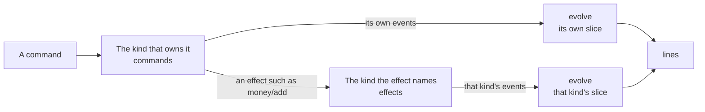
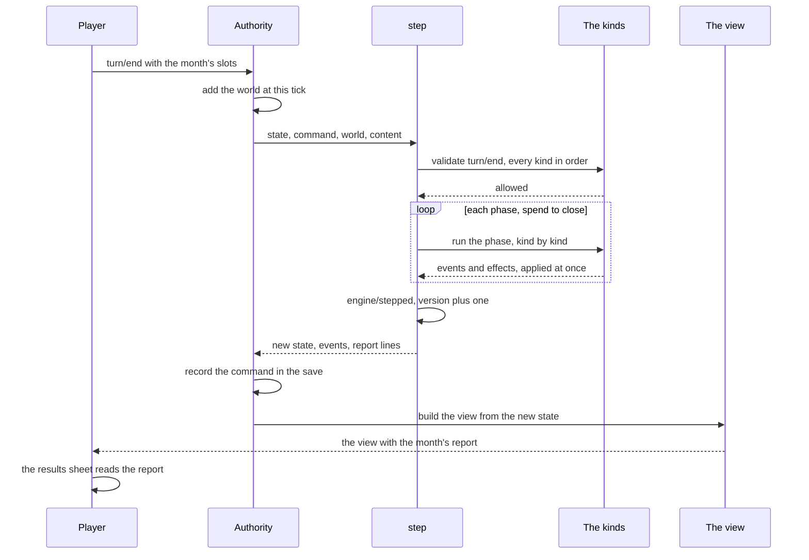
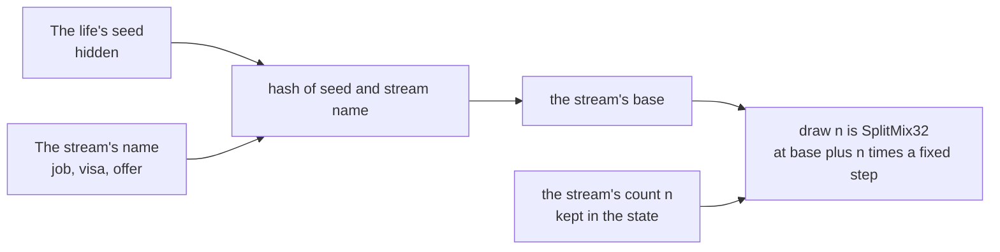
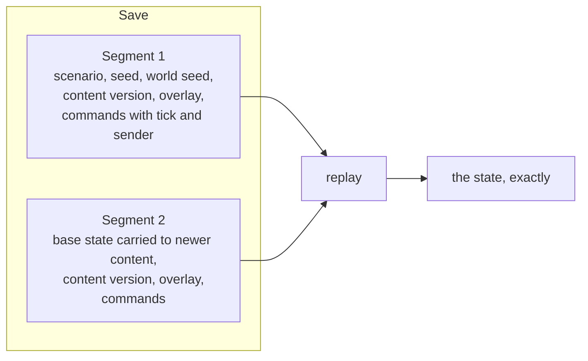
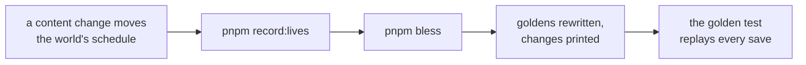

# The simulation

The simulation is the game's rules written as plain functions, in `packages/sim`. Given a life, the world at that moment, the game's content and one command, it says whether the command is allowed and, if so, what happened and what the life is now. This page explains how it is built; [the engine contract](../../rules/engine.md) holds its rules, and the project's terms (`docs/design/03-structure-and-conventions.md` section 1) define its words (state, command, event, effect, view and the rest).

It never reads a clock, makes its own random numbers, touches the network or the screen, or uses a fraction. So the same inputs give the same answer on a phone and on the server, now and later, and a whole life can be rebuilt from the list of commands that made it.

## The step function

`step` (`packages/sim/src/engine/step.ts`) plays one command. Its signature is in [the engine contract](../../rules/engine.md#_1-overview), with its types in `packages/sim/src/engine/types.ts`.

Before any kind runs, `step` refuses a command for these reasons, in this order: the life has `ended`, the sender may not send it (`not-yours`), it is `stale`, the `clock-went-back`, or the `prologue-open`. [The rejection codes](../../rules/engine.md#_3-commands) say when each applies. An accepted command ends with the `engine/stepped` event that carries the engine's own counters (engine:kinds-own-their-state).

## Kinds

Each kind is a module of plain functions in its own folder, laid out as structure and conventions, section 2 (`docs/design/03-structure-and-conventions.md` section 2) says. The registry (`packages/sim/src/kinds.ts`) lists the twenty-one kinds with a slice in the order the engine calls them (section 7 (`docs/design/03-structure-and-conventions.md` section 7)); [The character](./character.md#what-the-state-holds) says what each slice holds.

These folders hold helpers that own no slice: `japacity` (the readiness figure), `world` (the stand-in world, the director, rates), `scenario`, `school`, `country`, `era`, `var`, `pair`, `phrase` (the preset phrases), `guide` (the early win), `goldens` (the recorded saves), `simulated-play` (simulated players) and `testing`.

A kind defines only the parts it needs; [the engine contract, section 5](../../rules/engine.md#_5-kinds) lists them and the rules between kinds. In short, a command goes to the kind that owns it, which may ask another kind for a change through an effect:

Where the code holds this:

- `applyReturned` in `engine/draft.ts` throws if a kind returns another kind's event, and `EFFECT_OWNER` in the same file says which kind carries out each effect.
- `check` in `engine/check.ts` judges every requirement, handing each to the kind its type names.
- A kind's `lines` give a text key and numbers; the words are in content, and the client looks them up ([the words page](../../rules/text.md#where-words-live)).

## Running a month

Most commands cost nothing and resolve at once: moving money, paying a bill, answering a question. `turn/end` runs the month. The month is lived in half-days and turns when the character sleeps, and the bank of turns never holds it back ([Turns](../../rules/turn.md)).

`turn/end` is first checked by every kind that has a validator for it, which only allows or refuses. Then fourteen phases run in a fixed order (`PHASES` in `engine/kind.ts`), each kind's events applied before the next kind runs. The checks, the phases and the kinds in each are in [the engine contract, section 4](../../rules/engine.md#_4-turn-order).

The results sheet shows the report the close phase stores (turn:turn-stores-a-report). A set piece that opens during the month does not stop it; it blocks the next `turn/end` until answered (engine:player-never-stuck).

## The view

The view is all the interface ever sees. `viewFor` in `engine/view.ts` joins every kind's part and adds the parts no kind owns; [The character](./character.md#how-the-view-is-built) shows them one by one.

Each time a view is built, two checks run: no two kinds may give the same key, and every key of `PlayerView` must be present. The tests walk every view for keys named `seed`, `draws` or `secret` (engine:view-holds-no-hidden-field).

## Whole numbers only

The simulation has no fractions (engine:no-fractions-in-simulation, engine:money-in-whole-minor-units): money is in minor units, an exchange rate is kobo for one pound or one dollar, and a chance is in basis points. Division goes through the helpers in `packages/sim/src/engine/int.ts` (`divFloor`, `divCeil`, `mulDiv`, `bp` and the currency helpers). The reason: floating-point maths can differ between browsers and the server; whole numbers cannot.

Lint enforces this for every file under `packages/sim/src`. It refuses the `/` and `**` operators, decimal literals, `Math.random`, the floating-point `Math` functions, `Date`, `fetch`, `window` and similar, and only `engine/int.ts` may divide. Content is held to the decimal-literal rule too.

## Random streams

A life's randomness comes from named streams, each drawn by position (engine:randomness-from-named-streams; reasons in decision 0003):

So a new rule that draws on the `home` stream cannot shift a job hunt. Every stream, the world's own among them, is listed with its use in [the engine contract, section 6](../../rules/engine.md#_6-random-streams). Kinds draw only through `ctx.random`, on the stream their rule page names.

## The world

The world is passed into `step`; the simulation never builds it itself.

- Offline, `standInWorld` in `packages/sim/src/world/standIn.ts` produces it from a world seed and a tick ([the stand-in world](../../rules/engine.md#_7-the-stand-in-world)).
- Online, the server steps the same director (`stepWorld` in `world/director.ts`) on real time and stores one row per tick, each a pure function of the row before (clock:tick-row-is-pure-step). The stand-in is that step looped from tick 0, so offline and online share one director.

The rules for rates, news and eras are on [the rates page](../../rules/rate.md), [the news page](../../rules/news.md) and [the director page](../../rules/director.md).

## Saves and replays

A save is not a copy of the state. It holds how the life began and the commands accepted since, in segments (engine:state-is-plain-data, decision 0004). `engine/replay.ts` replays it:

- A replay checks that each later segment's base is exactly the state the segment before ended in, carried to the newer content by `upgradeState`.
- A command the save says was accepted but is now refused is a bug, and the replay throws.

## Goldens, recorded lives and simulated play

Three kinds of test check the engine over whole lives.

**Golden replays.** `packages/sim/src/goldens/` holds a small set of saves with the figures each must produce: for every month the version, the turns banked, the naira in the bank and a hash of the state, plus a hash of the final state. The golden test replays each save and compares (engine:same-inputs-same-result, engine:state-is-plain-data). Two goldens run on the small test content; the rest are recorded lives on the real content.

**Recorded lives.** `pnpm record:lives` (`tools/goldens/record-lives.ts`) plays simulated players with fixed strategies (careful, borrower, risky) through the starting lives on the real content and a fixed world, and writes their saves to `packages/sim/src/goldens/lives.data.ts`. Each blessed life is recorded twice: once to the flight, and once as a careful life that carries on 36 months abroad and comes home by choice. Recorded lives that are not goldens go into `packages/sim/src/simulated-play/lives.data.ts` (the lives in the other countries into `lives.countries.data.ts`) and are replayed by their own tests there.

**Bless.** `pnpm bless` (`tools/goldens/bless.ts`) replays the scripts, rewrites the golden files and prints what changed. It is the only way a golden changes; golden files and recorded lives are never edited by hand, and a moved golden is a finding to explain ([the simulation's safeguards](./working.md#the-simulation-s-safeguards)).

**Simulated play.** `packages/sim/src/simulated-play/` plays many random lives and simulated players. After every command it checks the invariants, that the view has every key and no hidden one, and that replay gives the same hash. It catches a rule that breaks some unlikely life.

The heaviest files (`balance.*.test.ts`, `endings.test.ts` and `randomPlay*.test.ts`) are Vitest's `play` project. Which commands and which CI tier run them is in [Working on it](./working.md#the-check-in-ci).

## Related rules

- [The engine contract](../../rules/engine.md)
- [Turns](../../rules/turn.md): the month, lived in half-days, and the bank of turns
- [The clock](../../rules/clock.md): turns on real time, the world tick
- [Rates and the stand-in world](../../rules/rate.md)
