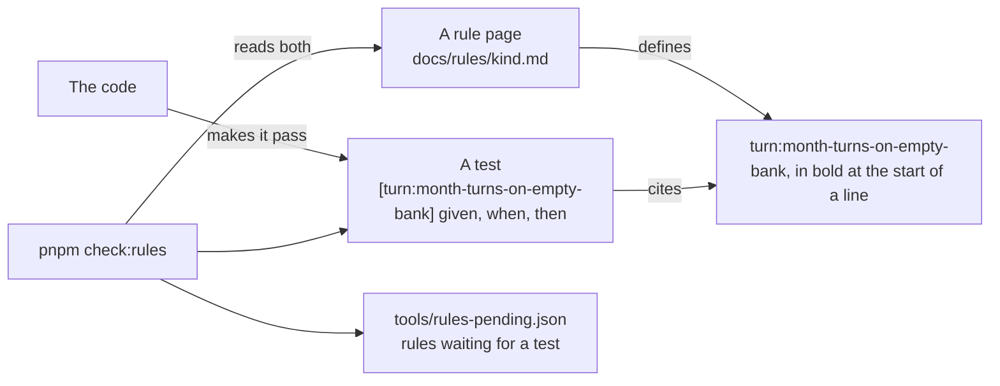
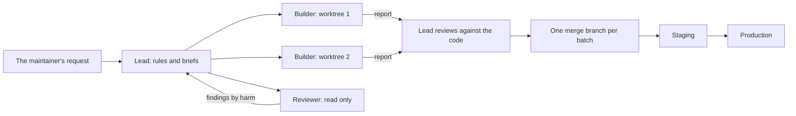

# Working on it

Japacity is changed in a fixed order: the rule first, then a test that cites it, then the code. One command, `pnpm check`, says whether a change holds, and it must end with `CHECK PASSED` before a change is done. Most of the code is written by AI coding agents working in parallel, each in its own git worktree, planned and reviewed by one lead session and the maintainer; [How the work is organised](#how-the-work-is-organised) is that workflow, written so another project can use it.

This page is the short way in for a person. `AGENTS.md` at the repository's root is the full contract for anyone changing code, person or agent, and the three skills in `.claude/skills/` (`japacity-dev`, `japacity-play`, `japacity-shipped-lives`) are the working order written down.

## Run it locally

You need:

- Node 24 (the pin in `.node-version`; Node 22 also works)
- pnpm 11, as pinned in `package.json`. With pnpm 10 or later installed, running any `pnpm` command here switches to the pinned version on its own. Corepack also works: `corepack enable`.

```sh
pnpm install
pnpm dev
```

`pnpm dev` runs the client with Vite. With no server named it runs the local authority: the whole simulation in the browser tab, the save on the device, no server, no account and no sign-in. In development the fast clock grants turns freely, so play never waits on real time. See [The client](./client.md) for how the authority is chosen.

::: tip Pick your own port
Vite's default port is likely taken when several checkouts run at once. Start the client on a port of your own:
`pnpm --filter @japacity/client exec vite --port <n> --strictPort`
:::

The online game needs the Worker, a database and its sign-in settings, which are described in [The server and the data](./server.md) and [From the browser to Postgres](./infrastructure.md). To run all of it on your machine, see [Running the whole thing locally](#running-the-whole-thing-locally).

The documentation you are reading is a VitePress site in `docs/site`:

```sh
pnpm docs:dev      # the site on port 5180, reloading as you write
pnpm docs:build    # the static site, which must build clean
pnpm docs:preview  # the built site on port 5181
```

## Commands

| Command | What it does |
|---|---|
| `pnpm install` | Install everything |
| `pnpm check` | The Workers' type files, typecheck, lint, test, rule-name check, content version check, asset check, size check, scrub check. Run before saying a change is done |
| `pnpm typecheck` | Type-check every package |
| `pnpm lint` | ESLint, including the simulation purity rules |
| `pnpm test` | Vitest, all projects |
| `pnpm check:rules` | Every rule in `docs/rules/` has a test, and every cited name exists |
| `pnpm check:rules --write-pending` | Rewrite `tools/rules-pending.json` to the rules that have no test yet |
| `pnpm check:version` | The content version moved with any change to the content's data or the simulation's code (server:content-version-sealed) |
| `pnpm check:assets` | The asset build check of `docs/decisions/0009-models-are-code.md`. It opens Playwright's Chromium for the last step |
| `pnpm check:protected -- <base-ref>` | CI only: changed tests, goldens or schemas need the `approved-test-change` label |
| `pnpm content:freeze` | Keep the shipped content before its version is raised: written to `packages/content/src/older/<version>` and listed (server:older-content-frozen) |
| `pnpm content:seal` | Seal the content version after raising it: the fingerprint `pnpm check:version` compares (server:content-version-sealed) |
| `pnpm record:lives`, `pnpm bless` | Record the simulated lives, then regenerate the golden files. Goldens change only this way |
| `pnpm assets:export`, `assets:shoot`, `assets:outline`, `assets:credits`, `assets:publish` | The asset pipeline in `tools/assets/`. Each file says its usage in its first lines |
| `pnpm rollback check\|apply <character> [--memory <save.json>]` | The server's correction tool, on the database or on a save in a file (server:rollback-check-finds-divergence, server:rollback-apply-one-account) |
| `pnpm snapshot:all` | Every character snapshotted before a deploy, from the live commit's checkout (server:snapshot-before-deploy) |
| `pnpm guests:clean --idle-days <n> [--apply]` | The guest clean-up, run by hand on the database at `DATABASE_URL` (account:idle-guests-cleaned-by-hand, the server's README) |
| `pnpm dev` | Run the client |
| `pnpm build` | Build the client |
| `pnpm test:browser` | The client's browser tests in Playwright. Not part of `pnpm check` |

The folders and what each holds are in the workspace table of [How Japacity is built](./index.md#the-workspace).

## Running the whole thing locally

The online game runs on one machine with no paid service and no account anywhere: Postgres and Mailpit in Docker, the Worker in `wrangler dev`, and the client built by Vite for that Worker (server:production-and-staging). Nothing here deploys anything, and nothing reads a Neon database.

Docker Desktop (or any Docker engine with Compose) must be running first, then:

```sh
pnpm dev:full
```

One command does it all, in this order:

1. `docker compose up --detach --wait` with `compose.yaml` at the root: Postgres 18 (database `japacity`, role `japacity`, port 5432, a named volume) and Mailpit (SMTP on 1025, its inbox and API on 8025). Both listen on this machine only.
2. The migrations, against the local database (`pnpm db:migrate:local` runs this step alone).
3. Vite builds the client, watching, with `VITE_SERVER_URL` set to the game's local address, into `apps/server/.wrangler/local/client` (git ignores it, and it never mixes with the deployable `dist`).
4. `wrangler dev` serves that build and `/api` on `https://localhost:8787`, as one Worker serves a deployment.
5. The world's five-minute job runs at once and every five minutes after, since `wrangler dev` runs no cron by itself.

If Docker is not running, nothing starts and it prints:

```
Docker is not running. Start Docker Desktop (or your Docker engine), then run this again.
A Postgres and a Mailpit of your own will do instead: pnpm dev:full --no-compose
```

| Address | What |
|---|---|
| `https://localhost:8787` | The game. wrangler serves it with its own self-signed certificate, so the browser asks once to trust it |
| `http://localhost:8025` | Mailpit's inbox: every email code and notice the game sends arrives here |
| `127.0.0.1:5432` | Postgres, as `LOCAL_DATABASE_URL` in `.env.example` names it |

The page and the server share one address on purpose. The server trusts only `SITE_URL`'s origin for writes, and `SITE_URL` must be a bare https origin for the sign-in library and the passkeys (account:passkey-needs-signed-in-session), so the online game cannot be played from Vite's own dev server on another port. `pnpm dev` is the offline game, the whole simulation in the tab.

Every value comes from `.env.example`, which is commented line by line. To change one, put the same name in `.env.local`, which git ignores; the tools read only the names in `.env.example`, so anything else in `.env.local` is never used. Every address is checked to be on this machine before anything starts. Already running a Postgres and a Mailpit of your own? Point `LOCAL_DATABASE_URL` and `MAILPIT_URL` at them and run `pnpm dev:full --no-compose`.

To stop: Ctrl+C stops Vite and wrangler. `docker compose stop` stops Postgres and Mailpit; `docker compose down --volumes` also deletes the local database and the inbox.

If the migration step fails because the local database's journal names a file this checkout does not hold (a database migrated from another branch, for one), reset it: `docker compose down -v`, then `pnpm dev:full`, which makes a fresh volume and migrates it.

To run a cron by hand, for the midnight jobs for instance:

```sh
curl -k -X POST 'https://localhost:8787/cdn-cgi/local/explorer/api/local/scheduled?worker=japacity-server' \
  -H 'content-type: application/json' -d '{"cron":"0 0 * * *"}'
```

That is wrangler's local explorer, at `/cdn-cgi/local/explorer/api/local/scheduled?worker=japacity-server`, which runs the Worker's scheduled handler with the cron given; `pnpm dev:full` calls it for the five-minute cron. wrangler's own `/__scheduled` page (`--test-scheduled`) does not reach this Worker: the static files answer every path outside `/api/` first, and it gets the game's page back.

`pnpm dev:full` also passes wrangler `--local-upstream localhost:8787` (SITE_URL's host). Without it, `wrangler dev` rewrites each request's address and origin to the route in `wrangler.jsonc`, `japacity.app`, and the sign-in library refuses every write as coming from another origin. Run `wrangler dev` by hand only with that flag.

What does not work locally: Google sign-in (its client is registered for the game's own addresses only; use an email code), the bank-full push notices (no VAPID keys are set) and, when the machine is offline, the public randomness beacon (drand) the Friday draw reads. The admin page opens only once your own account id is in `ADMIN_ACCOUNTS` in `.env.local`.

### The real browser tests

With the stack running, in another terminal:

```sh
pnpm test:browser:real
```

These are the Playwright project `real` (`apps/client/playwright.config.ts` and `apps/client/e2e/real/`), on a Pixel 7, against the stack with nothing faked: the way in, a life started and a month ended through `/api/command`, the life kept with an email code read from Mailpit's API, the Friday draw bought at the kiosk, the Credits in Settings, sign out and back in, the invite link's page, and the full screen while sign-ups are switched off. Each fails on any console error or failed request. They are not in `pnpm test:browser` and not in `pnpm check`. Set `PREVIEW_DIR` to keep their pictures.

The bot check runs with Cloudflare's always-pass test keys. Turnstile reports their passes as solved on `example.com`; the server takes such a pass only while `SITE_URL`'s host is `localhost` or `127.0.0.1` (account:bot-check-on-guest-creation), and nowhere else.

### Against staging

The same tests run against staging, which is behind Cloudflare Access, with an Access service token. Its two values come from the operating system's keychain (or another secret store) into the environment for one command, and are never written to a file, printed or committed:

```sh
CF_ACCESS_CLIENT_ID=<from the keychain> CF_ACCESS_CLIENT_SECRET=<from the keychain> pnpm test:browser:real --staging
```

On a Mac, `security find-generic-password -s <item> -w` reads one item, under the name you stored it with.

`--staging` points the tests at `https://staging.japacity.app` (or set `REAL_BASE_URL` to another address), and every request carries the headers `CF-Access-Client-Id` and `CF-Access-Client-Secret`; without them staging answers 302 to its sign-in page, and the run stops at once saying so. Staging has no Mailpit and the tests cannot reach its database, so the tests that need an email code or a switch are skipped there, each with its reason. No trace is kept on staging, since a trace holds every request's headers. The headers also go to Cloudflare's own bot check, which the page loads from `challenges.cloudflare.com`.

The play driver plays the local stack too: `pnpm play --out <folder> --life nurse --months 1 --url https://localhost:8787`. It goes through the start screen and the age screen before the door, and accepts wrangler's certificate on this machine only. With the two Access variables set the same way, `--url https://staging.japacity.app` plays staging.

## The check

```sh
pnpm check
```

`tools/check/all.ts` runs nine steps in order, stops at the first failure, and ends with one line: `CHECK PASSED`, or `CHECK FAILED at step: <step>`.



```mermaid
flowchart LR
  types["check:types<br/>the Workers' type files"] --> typecheck["typecheck<br/>every package"]
  typecheck --> lint["lint<br/>zero warnings, purity rules"]
  lint --> test["test<br/>every Vitest project"]
  test --> rules["check:rules<br/>every rule name has a test"]
  rules --> version["check:version<br/>the content version moved with what a replay reads"]
  version --> assets["check:assets<br/>models match their manifest"]
  assets --> size["check:size<br/>a first visit within budget"]
  size --> scrub["check:scrub<br/>nothing out of place in a published file"]
  scrub --> passed["CHECK PASSED"]
```

| Step | Alone | Holds |
|---|---|---|
| check:types | `pnpm check:types` | The type file `wrangler types` generated for the server is not stale |
| typecheck | `pnpm typecheck` | Every package's types, the browser tests' and this site's config too |
| lint | `pnpm lint` | ESLint with no warnings allowed, including the simulation's purity rules: no clock, no randomness of its own, no network, no division outside `int.ts`, no decimal literal |
| test | `pnpm test` | Every unit test project: sim, content, store, db, tools, models, server, the Workers' tests, the client and the teaser |
| check:rules | `pnpm check:rules` | Every rule name in `docs/rules/` has a test that cites it, and every cited name exists |
| check:version | `pnpm check:version` | The content's data and the simulation's code match the fingerprint sealed with the content version, or the version was raised and sealed with `pnpm content:seal` (server:content-version-sealed) |
| check:assets | `pnpm check:assets` | The city's models and pictures match their manifest. Its last step opens Playwright's Chromium |
| check:size | `pnpm check:size` | A production build of the client, whose first visit stays inside each part's gzipped budget in `tools/check/size-budget.json` (engine:first-download-has-budget) |
| check:scrub | `pnpm check:scrub` | Every file git would publish keeps legal and regulatory wording to the pages players read (the terms and the privacy notice), keeps each value that belongs to one deployment (an email address, an account id, a key) to the files it may stand in, and carries no leftover tag of the build's process where a comment should say what holds and why (`tools/check/scrub.ts`) |

While you work, run only the tests you touch:

```sh
pnpm exec vitest run packages/sim/src/turn/turn.test.ts
pnpm exec vitest run --project client apps/client/src/features/turn
```

The browser tests (`pnpm test:browser`, in `apps/client/e2e/`) run the client in Playwright on a phone profile. They are not part of the check.

## The hooks

The maintainer's checkout runs its own git hooks, switched on through `core.hooksPath`; every worktree of that clone shares them, so every agent working in one meets them. A commit a hook refuses is fixed, the message or the file, and never forced: `--no-verify` is not used here.

## The rules discipline



- **Every rule has a name.** A rule page defines it on a line that starts with the name in bold, such as `**turn:month-turns-on-empty-bank**`: the page's file name, a colon and a short slug of what the rule holds, unique on its page. Only the maintainer adds rules and edits rule pages; a contributor who needs one asks for it.
- **Every rule has a test.** The test's title starts with the name in brackets, then given, when, then: `[turn:month-turns-on-empty-bank] given no turn banked, when the turn is ended, then the month turns, as the bank gates nothing (decision 0011)`. A rule with numbers gets a test at each edge, and reads its numbers from content.
- **`pnpm check:rules`** fails a rule with no test, a test that cites a name that does not exist, and a name defined on a page it does not name. `tools/rules-pending.json` lists the rules still waiting; it is rewritten only by `pnpm check:rules --write-pending`, never by hand.
- **Tests are not loosened to pass.** An existing test, golden file, schema or lint rule is never edited, deleted, skipped or weakened to get a pass. If one is wrong, stop and report. CI fails a pull request that changes a protected file unless a maintainer adds the `approved-test-change` label (`tools/check/protected.ts`).
- **The test fails first.** It is written, run and seen to fail for the right reason before the code that makes it pass. A bug fix starts with a failing test that shows the bug.
- **Both ways.** `pnpm check:rules` fails a rule nobody tests and a test that cites a rule nobody wrote, so the rule pages and the tests cannot drift apart.
- **Goldens change one way.** The golden files in `packages/sim/src/goldens/` are recorded lives replayed against a stored result. Only the maintainer re-records them (`pnpm record:lives`) and blesses them (`pnpm bless`), with the reason in the commit.
- **Decisions are written down.** A change to determinism, the ledger's reasons, or the command and view types needs a record in `docs/decisions/`.

## How the work is organised

Most changes here are made by AI coding agents, several at once, each on one piece of work. What keeps that safe is not trust in any one agent: it is the order above (rule, failing test, code), one check that every change must pass, roles that keep planning, building and reviewing apart, and a few habits that keep parallel work from losing anything. None of it is specific to one tool; any agent that can run a shell and git can work this way, and so can a person.



### The roles

- **The lead** is one long session that owns the plan. It turns a request into rules on the rule pages and into briefs, one per piece. It reviews every hand-back against the code itself: it reads the diff, runs the tests the piece touched, and never takes a report's word for what landed. It merges, runs the full check, and deploys once a release is approved.
- **Builders** each take one brief, in their own git worktree on their own branch. A builder stays in the folders its brief names, writes the failing test before the code, runs only the tests it touches while it works, commits small with explicit paths, and hands back a report. It never pushes, merges or deploys.
- **Reviewers** read and never write. They audit one thing (security, the screens as a player meets them, the logic of one system, a tree before it is published) and return findings ranked by harm: what is wrong, where (file and line), and why it matters. Each finding becomes a brief of its own, or is dropped with a reason.

### The brief

A builder starts with nothing but its brief and the repository, so the brief carries everything the piece needs:

- **Why**: the request and what it is for, so the builder can judge the cases the brief did not foresee.
- **The piece**: numbered items, each small enough to commit alone, naming the files where that is known.
- **The rules to cite**: the rule names the tests must carry. New rules are on the rule pages before the brief goes out.
- **The standing rules**: stay in the worktree; never push, deploy or touch a database; which checks to run at the end; the report's shape.

```md
# Brief: <the piece>

Worktree `../japacity-wt/<dir>`, branch `<piece>/<name>`, from main <commit>.
Read `AGENTS.md` and `.claude/skills/japacity-dev/SKILL.md` first.

## Why
<The request and what it is for.>

## The piece
1. <One change, with its files and the rule it cites.>
2. <The next.>

Rules: `<kind>:<rule-name>`, ...

## Standing rules
- Stay in this worktree. Never push, deploy or touch a database.
- Failing test first. Never weaken an assertion.
- Run the tests you touch, then `pnpm typecheck`, `pnpm lint`, `pnpm check:rules`.
- Report: commits; each item with its files; rules you could not build or test, and why;
  the last lines of each command.
```

### Worktrees

Each piece gets its own branch in its own worktree beside the main checkout, so several builders can run at once without touching each other's files:

```sh
git worktree add -b <piece>/<name> ../japacity-wt/<dir> main
cd ../japacity-wt/<dir>
pnpm install --frozen-lockfile --offline
```

Each worktree uses its own dev server port, the one its brief gives. The main checkout is the lead's; a builder never commits there.

### Parallel work

- **Independent pieces run at once**, each in its own worktree. Pieces that touch the same files either wait for each other or merge in an order the lead sets, and the later one is rebased or merged on top of the earlier.
- **A conflicted file is read against both sides.** Before a hand merge is committed, the file is diffed against each branch, so neither side's change is lost to the side that was kept.
- **One full check at a time.** `pnpm check` builds and tests everything and is heavy, so on one machine it runs under a shared lock. `mkdir` either makes the folder or fails, atomically, so it is the lock:

  ```sh
  until mkdir /tmp/japacity-check-lock 2>/dev/null; do sleep 20; done; pnpm check; rmdir /tmp/japacity-check-lock
  ```

  A lock folder older than any check could take, with no check running, is stale and removed.
- **Browser suites wait for a quiet machine.** A loaded machine makes timing tests fail that are not broken, so the browser suite runs when nothing else heavy does, and a failure is run again alone before it is believed.

### Landing together

Finished pieces land together, in batches, so the expensive steps run once per batch and not once per piece:

1. The lead merges the batch's branches, in the order set, into one merge branch.
2. One full check and one browser suite run on that branch.
3. The branch lands in `main`, and a push to `main` deploys staging once CI passes.
4. Staging is looked at, then production is deployed from a release tag.

After every merge, a short script checks that every worktree's tip is in `main`, so no commit made on a side branch, or on a detached head, is lost:

```sh
git worktree list --porcelain | awk '/^worktree /{print $2}' | while read -r dir; do
  tip=$(git -C "$dir" rev-parse HEAD)
  git merge-base --is-ancestor "$tip" main || echo "not in main: $dir $tip"
done
```

### Keeping context across long sessions

A lead session runs for days, and an agent's context is compacted or restarted on the way. Nothing that matters lives only in the conversation:

- **A running log**: what was decided, what landed, what is next, kept short and updated as it happens.
- **Requests recorded as they arrive**, in order, so a later session follows the latest one and not a remembered one.
- **A handover file** that a fresh session reads first: where things stand, what is open, and the commands to pick up from.
- **Reports saved beside the work**: each builder writes its report to `REPORT.md` at its worktree's root and updates it as each item is done, so a builder that restarts loses nothing.

These are working files, not the product: they stay out of the published tree (`.gitignore` lists `REPORT.md`, `REPORT/` and `.scratch/`).

### The simulation's guard rails

The simulation is deterministic, so a life can be replayed from its commands, and a few checks hold that true however many agents change it:

- **Goldens and recorded lives replay.** The golden files in `packages/sim/src/goldens/` are recorded lives replayed turn by turn against a stored result, on every test run. A change that moves one is a finding, never something to fix by editing the file.
- **`pnpm bless` is the only way they change.** The maintainer re-records (`pnpm record:lives`), blesses, and says in the commit which golden moved, from which month, and why.
- **The content version is sealed.** `pnpm check:version` holds the content's data and the simulation's code to a fingerprint sealed with the content version (server:content-version-sealed). Before the version is raised, `pnpm content:freeze` keeps the shipped content as it shipped (server:older-content-frozen), so lives saved under it still replay; then the version is raised and sealed again with `pnpm content:seal`.

## The play driver

`pnpm play` plays the game from the front door on a phone-sized browser (390 by 844, touch), takes a picture at each step and writes a plain log. It is how a change is seen in the real game.

```sh
pnpm exec playwright install chromium   # once
pnpm play --life developer --months 3 --out /tmp/japacity-play
```

It starts a dev server (or uses one already on the port), goes through the front door on the life you name, follows the nudge each month, ends the month, reads the results, and at the end opens the phone and every app on it. `--ready` starts from a ready life, `--port` picks the port, `--played` hides the first-use labels, `--headed` shows the browser. The pictures and `play.log` go to the `--out` folder, which must be outside the repository. It asserts nothing; the browser tests do that. `tools/play/README.md` has every option.

## Recipes

Each recipe starts the same way: the entry and its rules are on the kind's rule page first, which the maintainer writes. Then content, words and a test.

### Add a place

1. The place is listed on [the city rules](../../rules/city.md) with its fields (city:place-entry-fields). `packages/content/src/place/place.test.ts` counts the places by kind from that page, so the count moves with the page.
2. Add the entry to `packages/content/src/place/place.data.ts` with `lagos(...)` for a public place in Lagos (its real name, area and position, checked against OpenStreetMap on a date), `abroad(...)` for one abroad, or `unnamed(...)` for an institution, a business by made-up name or a home. Give it its crowd, its traditional share and `stages`, the entries it shows.
3. Add its words to `place/place.text.ts`: `<id>.name` (for a public place, its real name exactly), `<id>.blurb`, at least two `<id>.sign.<n>` for a place with shopfronts, and at least three `<id>.overheard.<n>` for a hub or a market. A made-up shop name is checked and recorded in `place.names.json` (city:made-up-names-checked).
4. Add its scene: `apps/client/public/assets/places/<folder>/place.json` with a `stage` that places the models, the crowd's spots, the light, the start and the camera, `stage.things` for what can be tapped, and `staff: true` on the act of each seat someone works the place from (city:residents-fill-to-target). Without a file the place still opens as open ground with its crowd. Models are built from code under `models/` and published with the asset tools (decision 0009); `pnpm check:assets` holds them to the manifest.
5. The map reads the place table, so the place stands on the painted map as a sticker of its picture tile, which is its pin. A place tied to a chapter is held back until that chapter: see `apps/client/src/features/city/nudge/stops.ts`.
6. Run `pnpm exec vitest run packages/content/src/place` and the city tests in the client.

### Add an activity

1. The activity is on its kind's rule page with its figures, usually [Activities and jobs](../../rules/activity.md).
2. Add the entry to `packages/content/src/activity/activity.data.ts`, or the themed file for its place (`activity.street.data.ts`, `activity.room.data.ts` and so on), which the main table joins: its slot, what it requires, its cost, its pay, its hire chance and its monthly effects. Money in kobo or pence through `naira()` or `pounds()`, chances in basis points through `pct()`.
3. If it answers at once (a purchase, a conversation), mark it in `activity.when.data.ts`; anything else fills the month as a slot pick (activity:now-acts-and-month-acts).
4. Add `<id>.name` and `<id>.blurb` to `activity.text.ts`. `packages/content/src/text.test.ts` fails an entry with no name.
5. Stage it where it happens: add the id to the place's `stages` in `place.data.ts`, and an act on a thing in the place's `place.json`, `{ "kind": "sheet", "stages": "activity.<slug>" }`, with its label key in the city's words.
6. Write the test that cites the rule, beside the logic in `packages/sim/src/activity/` or the content's own tests, starting from a scenario and playing commands through it.

### Add a route

1. The route and its checklist are on [the route rules](../../rules/route.md) and [the route gates](../../rules/route-gates.md); its official page and guide follow [the guides rules](../../rules/guide.md).
2. Add the entry to `packages/content/src/route/route.data.ts`: its gate and the gate's own block (the sponsor, the points table, the endorsement, the contract), its country and status, when it is heard of (`hearIf`, `hearBy`), its window and its checklist. The checklist weights add up to exactly 100 (japacity:figure-is-whole-percent), which `checkContent` and `route.test.ts` both hold.
3. Add its words to `route/route.text.ts`: its name, its blurb and `<route id>.item.<item>` for each checklist item.
4. Add its one guide, "What the route really needs", with its three parts and dated sources (`packages/content/src/guide/`). `guide.test.ts` fails a route with no guide or with two (guide:every-route-has-a-guide).
5. If the story should follow it, its chapter variants for building the file and decision day go in `packages/content/src/chapter/chapter.data.ts`; see [Chapters and routes](./chapters.md).
6. A new route may move the recorded lives and so the goldens. That is a finding for the maintainer, who re-records and blesses; a contributor never touches `packages/sim/src/goldens/`.

## How rules, decisions and designs are written

Four kinds of page hold what the game is and why, each in a standard shape. Every one states what holds and the reason for it. None records who asked for a change, who decided it or when; the history of a page is in git.

- **A rule** (`docs/rules/<kind>.md`) is an entry in a business-rule catalogue: a bold id `kind:slug` at the start of one paragraph that states the rule in the present tense, so a test can cite it and `pnpm check:rules` can hold both. A number lives in the page's Numbers table with its value, its source, and, where the game departs from real life, the real figure and the factor applied ("Real: 14 days with a good reason; the game: one month, about twice as kind").
- **A decision record** (`docs/decisions/NNNN-title.md`) is an architecture decision record: Status, Context, Decision, Consequences, and the alternatives where the record weighed some. It states the decision that holds; where a later record changes part of an earlier one, the earlier one is worded to what holds and names the later. Its number is its id and never changes.
- **A design page** (`docs/design/`) is a design doc: the context and scope, what the design is for and not for, the design itself, and the alternatives weighed.
- **A research note** (`docs/research/`) keeps only facts the game rests on, each with its source and the date it was read.

## Writing anything here

- Short plain sentences. No emoji. No exclamation marks from the narrator.
- Player text follows [the words page](../../rules/text.md). See [The content](./content.md) for how words are keyed.
