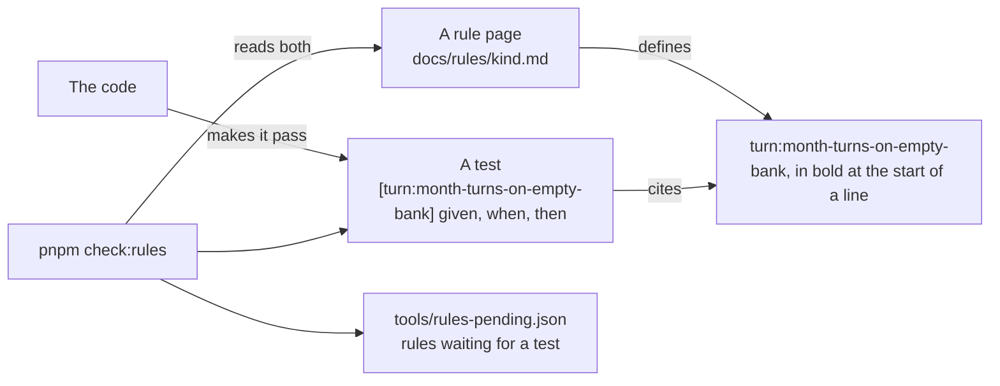
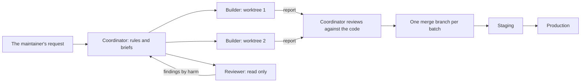

# Working on it

How to run Japacity, every command, the check, CI, and how a change gets from a worktree to production. It is for anyone changing the code, person or coding agent. The instructions an agent must follow are in `AGENTS.md` at the repository's root and in the skills in `.claude/skills/`; the rules for pull requests and review are in `CONTRIBUTING.md`.

Every change follows the same order: the rule first, then a test that cites it, then the code. `pnpm check` must end with `CHECK PASSED` before the change is done.

## Run it locally

Requirements:

- Node 24, as pinned in `.node-version` (Node 22 also works).
- pnpm 11, as pinned in `package.json`. With pnpm 10 or later installed, any `pnpm` command here switches to the pinned version by itself. Corepack also works: `corepack enable`.

```sh
pnpm install
pnpm dev
```

`pnpm dev` runs the client with Vite and the local authority: the whole simulation in the browser tab, the save on the device, and no server, account or sign-in. [The client](./client.md) explains how the authority is chosen. Play never waits on the bank of turns (turn:month-turns-on-empty-bank). A result real life makes you wait for, such as a test's band, is sealed until the world's next morning (clock:envelopes-show-real-waits); in development, `?morning=now` on the address opens every sealed result at once.

::: tip Pick your own port
Vite's default port is likely taken when several checkouts run at once. Start the client on a port of your own:
`pnpm --filter @japacity/client exec vite --port <n> --strictPort`
:::

The online game needs the Worker, a database and the sign-in settings. To run all of it on one machine, see [Running the whole thing locally](#running-the-whole-thing-locally); for how it is deployed, see [The server and the data](./server.md) and [From the browser to Postgres](./infrastructure.md).

## Commands

Run them from the repository root.

| Command | What it does |
|---|---|
| `pnpm install` | Install everything |
| `pnpm check` | Every step of [the check](#the-check), simulated play included. Run before saying a change is done |
| `pnpm typecheck` | Type-check every package |
| `pnpm lint` | ESLint, including the simulation's purity rules |
| `pnpm test` | Vitest, every project but simulated play. One file: `pnpm exec vitest run <file>`, or `--project <name> <path>` |
| `pnpm test:play` | Vitest's `play` project: the simulated-play files that play whole lives, most of the tests' time. One file: `pnpm test:play <file>` |
| `pnpm check:types` | The Worker's generated type file (`apps/server/worker-configuration.d.ts`) still matches `wrangler.jsonc`. `pnpm types` regenerates it |
| `pnpm check:rules` | Every rule in `docs/rules/` has a test, and every cited name exists ([Rules and tests](#rules-and-tests)) |
| `pnpm check:rules --write-pending` | Rewrite `tools/rules-pending.json` to the rules that have no test yet |
| `pnpm check:version` | The content version moved with any change to the content's data or the simulation's code (server:content-version-sealed) |
| `pnpm content:freeze` | Keep the shipped content before its version is raised: written to `packages/content/src/older/<version>` and listed (server:older-content-frozen). The full order is in the `japacity-shipped-lives` skill, "Raising the content version" |
| `pnpm content:seal` | Seal the content version after raising it: the fingerprint `pnpm check:version` compares (server:content-version-sealed) |
| `pnpm check:assets` | The asset build check of decision 0009. Its last step opens Playwright's Chromium |
| `pnpm check:size` | Builds the client and holds a first visit to `tools/check/size-budget.json` (engine:first-download-has-budget) |
| `pnpm check:scrub` | Nothing out of place in a published file (see [the check](#the-check)) |
| `pnpm check:protected -- <base-ref>` | Run by CI on a pull request: a deleted test file, fewer tests or assertions in one, a changed golden or a grown pending list needs the `approved-test-change` label |
| `pnpm record:lives [<life> ...]` | Record the simulated lives on the real content. Names given (`graduate-abroad`) record only those. `RECORD_FROM=<n>` starts the seed search further on, when the first seed fails a coupled test |
| `pnpm bless` | Regenerate the golden files and print which changed, from which month. Goldens change only this way |
| `pnpm assets:export`, `assets:shoot`, `assets:outline`, `assets:credits`, `assets:publish` | The asset pipeline in `tools/assets/`. Each file states its usage in its first lines |
| `pnpm rollback check\|apply <character> [--memory <save.json>]` | The server's correction tool, on the database or on a save in a file (server:rollback-check-finds-divergence, server:rollback-apply-one-account) |
| `pnpm snapshot:all` | Snapshot every character before a deploy, from the live commit's checkout (server:snapshot-before-deploy) |
| `pnpm guests:clean --idle-days <n> [--apply]` | The guest clean-up, run by hand on the database at `DATABASE_URL` (account:idle-guests-cleaned-by-hand; the server's README, `apps/server/README.md`) |
| `pnpm notices` | Rewrite `NOTICES.md`, the open source packages the client ships (guide:credits-screen-in-game) |
| `pnpm dev` | Run the client (the offline game) |
| `pnpm dev:full [--no-compose]` | Run the whole online game locally ([below](#running-the-whole-thing-locally)) |
| `pnpm db:migrate:local` | Run the migrations against the local database only |
| `pnpm build` | Build the client |
| `pnpm test:browser` | The client's browser tests in Playwright, in `apps/client/e2e/`, at a phone's size (Pixel 7) and a desktop's. Not part of `pnpm check`. `E2E_PORT` sets the dev server's port; `PREVIEW_DIR` makes some specs save pictures |
| `pnpm test:browser:real [--staging]` | The browser tests against the local stack or staging ([below](#the-real-browser-tests)) |
| `pnpm catalog` | Every screen shot as a player sees it on a phone ([The screen catalog](#the-screen-catalog)) |
| `pnpm play` | The play driver ([below](#the-play-driver)) |
| `pnpm teaser:record`, `pnpm teaser:render` | Record and render the teaser film (`apps/teaser`) |
| `pnpm docs:dev` | This site on port 5180, reloading as you write |
| `pnpm docs:build` | The static site, which must build clean. Not part of `pnpm check` |
| `pnpm docs:preview` | The built site on port 5181 |

The folders and what each holds are in the workspace table of [How Japacity is built](./index.md#the-workspace).

## Running the whole thing locally

The online game runs on one machine with no paid service and no account anywhere: Postgres and Mailpit in Docker, the Worker in `wrangler dev`, and the client built by Vite for that Worker (server:production-and-staging). Nothing here deploys anything or reads a Neon database.

Start Docker Desktop (or any Docker engine with Compose) first, then:

```sh
pnpm dev:full
```

It runs, in this order:

1. `docker compose up --detach --wait` with `compose.yaml` at the root: Postgres 18 (database `japacity`, role `japacity`, port 5432, a named volume) and Mailpit (SMTP on 1025, inbox and API on 8025). Both listen on this machine only.
2. The migrations, against the local database (`pnpm db:migrate:local` runs this step alone).
3. Vite builds the client, watching, with `VITE_SERVER_URL` set to the game's local address, into `apps/server/.wrangler/local/client`. Git ignores that folder, and it never mixes with the deployable `dist`.
4. `wrangler dev` serves that build and `/api` on `https://localhost:8787`, as one Worker serves a deployment.
5. The world's five-minute job runs at once and every five minutes after, since `wrangler dev` runs no cron by itself.

If Docker is not running, nothing starts and it prints:

```
Docker is not running. Start Docker Desktop (or your Docker engine), then run this again.
A Postgres and a Mailpit of your own will do instead: pnpm dev:full --no-compose
```

| Address | What |
|---|---|
| `https://localhost:8787` | The game. wrangler serves it with its own self-signed certificate, so the browser asks once to trust it |
| `http://localhost:8025` | Mailpit's inbox: every email code and notice the game sends arrives here |
| `127.0.0.1:5432` | Postgres, as `LOCAL_DATABASE_URL` in `.env.example` names it |

The page and the server share one address on purpose. The server trusts only `SITE_URL`'s origin for writes, and `SITE_URL` must be a bare https origin for the sign-in library and the passkeys (account:passkey-needs-signed-in-session). So the online game cannot be played from Vite's own dev server on another port. `pnpm dev` is the offline game.

Every value comes from `.env.example`, which is commented line by line. To change one, put the same name in `.env.local`, which git ignores; never put your own values in a committed file. The tools read only the names in `.env.example`, so any other name in `.env.local` is ignored. Every address is checked to be on this machine before anything starts. To use a Postgres and a Mailpit of your own, point `LOCAL_DATABASE_URL` and `MAILPIT_URL` at them and run `pnpm dev:full --no-compose`.

To stop: Ctrl+C stops Vite and wrangler. `docker compose stop` stops Postgres and Mailpit; `docker compose down --volumes` also deletes the local database and the inbox.

If the migration step fails because the local database was migrated with files this checkout does not have (another branch's, for example), so that its journal disagrees with this checkout's or a table it would create already exists, reset it: `docker compose down -v`, then `pnpm dev:full`, which creates a fresh volume and migrates it.

To run a cron by hand, for example the midnight jobs:

```sh
curl -k -X POST 'https://localhost:8787/cdn-cgi/local/explorer/api/local/scheduled?worker=japacity-server' \
  -H 'content-type: application/json' -d '{"cron":"0 0 * * *"}'
```

This is wrangler's local explorer, which runs the Worker's scheduled handler with the given cron; `pnpm dev:full` calls it for the five-minute cron. wrangler's own `/__scheduled` page (`--test-scheduled`) does not reach this Worker: the static files answer every path outside `/api/` first, so it returns the game's page.

`pnpm dev:full` passes wrangler `--local-upstream localhost:8787` (`SITE_URL`'s host). Without it, `wrangler dev` rewrites each request's address and origin to the route in `wrangler.jsonc`, `japacity.app`, and the sign-in library refuses every write as coming from another origin. Run `wrangler dev` by hand only with that flag.

Not available locally:

- Google sign-in: its client is registered for the game's own addresses only. Use an email code.
- The bank-full push notices: no VAPID keys are set.
- The public randomness beacon (drand) the Friday draw reads, when the machine is offline.

The admin page opens only once your own account id is in `ADMIN_ACCOUNTS` in `.env.local`.

### The real browser tests

With the stack running, in another terminal:

```sh
pnpm test:browser:real
```

This is the Playwright project `real` (`apps/client/playwright.config.ts` and `apps/client/e2e/real/`), on a Pixel 7, against the stack with nothing faked. It covers: the way in, a life started and a month ended through `/api/command`, the life kept with an email code read from Mailpit's API, the Friday draw bought at the kiosk, the Credits in Settings, sign out and back in, the invite link's page, and the full screen while sign-ups are switched off. Each test fails on any console error or failed request. They are not in `pnpm test:browser` or `pnpm check`. Set `PREVIEW_DIR` to keep their pictures.

The bot check uses Cloudflare's always-pass test keys. Turnstile reports their passes as solved on `example.com`; the server accepts such a pass only while `SITE_URL`'s host is `localhost` or `127.0.0.1` (account:bot-check-on-guest-creation), and nowhere else.

### Against staging

The same tests run against staging, which is behind Cloudflare Access, with an Access service token. Its two values go from the operating system's keychain (or another secret store) into the environment for one command, and are never written to a file, printed or committed:

```sh
CF_ACCESS_CLIENT_ID=<from the keychain> CF_ACCESS_CLIENT_SECRET=<from the keychain> pnpm test:browser:real --staging
```

On a Mac, `security find-generic-password -s <item> -w` reads one item, under the name it was stored with.

`--staging` points the tests at `https://staging.japacity.app` (or set `REAL_BASE_URL` to another address), and every request carries the headers `CF-Access-Client-Id` and `CF-Access-Client-Secret`. Without them staging answers 302 to its sign-in page, and the run stops at once and says so. Staging has no Mailpit and the tests cannot reach its database, so the tests that need an email code or a switch are skipped there, each with its reason. No trace is kept on staging, since a trace holds every request's headers. The headers also go to Cloudflare's bot check, which the page loads from `challenges.cloudflare.com`.

The play driver plays the local stack and staging too, with `--url` ([The play driver](#the-play-driver)).

## The check

```sh
pnpm check
```

`tools/check/all.ts` runs ten steps in order, stops at the first failure, and ends with one line: `CHECK PASSED`, or `CHECK FAILED at step: <step>`.



```mermaid
flowchart LR
  types["check:types<br/>the Worker's type file"] --> typecheck["typecheck<br/>every package"]
  typecheck --> lint["lint<br/>zero warnings, purity rules"]
  lint --> test["test<br/>every Vitest project but play"]
  test --> play["test:play<br/>simulated play"]
  play --> rules["check:rules<br/>every rule name has a test"]
  rules --> version["check:version<br/>the content version moved with what a replay reads"]
  version --> assets["check:assets<br/>models match their manifest"]
  assets --> size["check:size<br/>a first visit within budget"]
  size --> scrub["check:scrub<br/>nothing out of place in a published file"]
  scrub --> passed["CHECK PASSED"]
```

| Step | Runs | Holds |
|---|---|---|
| check:types | `wrangler types --check` in `apps/server` | The Worker's generated type file is not stale, so the typecheck that reads it is not misled. It runs first so a stale file is named before it misleads |
| typecheck | `tsc` on the root files, then every package's own typecheck | Every package's types under strict settings, including the browser tests' and this site's config |
| lint | ESLint, zero warnings allowed | The simulation's purity rules (no clock, no `Math.random`, no network, no division outside `engine/int.ts`, no decimal literal, imports of `zod` only), content's whole-number rule, and no focused, skipped or commented-out test |
| test | Vitest, every project but `play` | Every unit test project: sim, content, store, db, tools, models, server, the Workers' tests (server-workers), client and teaser. These hold the rule tests, the golden replays, the property tests, the client's component tests and the server's Worker tests |
| test:play | Vitest's `play` project | Simulated play: whole lives played month by month meet the economy's targets, and random lives keep the invariants (scenario:economy-meets-its-targets) |
| check:rules | `tools/check/rules.ts` | Every rule name in `docs/rules/` has a test that cites it, and every cited name exists ([Rules and tests](#rules-and-tests)) |
| check:version | `tools/check/version.ts` | The content's data and the simulation's code match the fingerprint in `packages/content/src/seal.json`, or the version was raised and sealed with `pnpm content:seal` (server:content-version-sealed) |
| check:assets | `tools/assets/assets-check.ts` | The city's models and pictures match their manifest: file names, sizes, the palette, footprints, and a render of each staged place in Playwright's Chromium |
| check:size | `tools/check/size.ts` | A production build of the client, whose first visit stays inside each part's gzipped budget in `tools/check/size-budget.json`, with none of the admin page's code in it (engine:first-download-has-budget) |
| check:scrub | `tools/check/scrub.ts` | In every file git would publish: legal and regulatory wording only on the pages players read (the terms and the privacy notice), each value that belongs to one deployment (an email address, an account id, a key) only in the files allowed to hold it, and no leftover process tag (a review code, a branch name, a comment tag) where a comment should say what holds and why |

While you work, run only the tests you touch:

```sh
pnpm exec vitest run packages/sim/src/turn/turn.test.ts
pnpm exec vitest run --project client apps/client/src/features/turn
```

The browser tests (`pnpm test:browser`), the screen catalog and `pnpm docs:build` are not part of the check.

### The check in CI

`.github/workflows/check.yml` runs in two tiers (decision 0040):

| Tier | When | Runs |
|---|---|---|
| Quick | Every push to a pull request | The Worker's generated types, typecheck, lint, the content version, the size budget, `pnpm audit --prod --audit-level=high`, `pnpm check:protected`, the gitleaks secret scan, and only the unit tests the change can reach (Vitest's `--changed` against the merge base, in three shards). Simulated play does not run |
| Full | The merge queue, every push to `main`, and a manual run | The same steps except the protected-files check and the secret scan (pull requests only), every unit test in three shards, and simulated play, one file to a runner |

- The unit tests run in full when a changed file matches `forceRerunTriggers` in `vitest.config.ts`: a `package.json`, the test config, the lockfile, the workspace, the Node version or a TypeScript config.
- `main` requires the checks `check`, `unit`, `play` and `secrets`. On a pull request `play` is skipped, which counts as passed.
- A pull request merges only through the merge queue, which runs the full tier on `main` with the change on top. A failure there takes the pull request out of the queue and leaves `main` unchanged. Branches do not need to be up to date with `main` before they join the queue.
- Once the quick tier passes, `gh pr merge --auto` (GitHub's "Merge when ready") puts the pull request in the queue.
- A test that reads a file without importing it (a workflow, a document, a fixture) is not picked by `--changed` when only that file changes. The queue's full run catches it.
- To run simulated play on a pull request's branch before it is queued: `gh workflow run check --ref <branch>`.
- CI does not run `check:rules`, `check:assets` or `check:scrub`. `pnpm check` runs them locally, with everything else, before every push.
- The check runs with no secrets, on `pull_request`, so a fork's code never meets the repository's secrets.

## The hooks

The maintainer's checkout runs its own git hooks through `core.hooksPath`. Every worktree of that clone shares them, so every agent working in one meets them. A commit a hook refuses is fixed (the message or the file), never forced: `--no-verify` is not used.

## Rules and tests



- **Every rule has a name.** A rule page defines it on a line that starts with the name in bold, such as `**turn:month-turns-on-empty-bank**`: the page's file name, a colon and a short slug of what the rule holds. Only the maintainer adds rules and edits rule pages; a contributor who needs one asks for it.
- **Every rule has a test.** The test's title starts with the name in brackets, then given, when, then: `[turn:month-turns-on-empty-bank] given no turn banked, when the turn is ended, then the month turns, as the bank gates nothing (decision 0011)`. A rule with numbers gets a test at each edge, and reads its numbers from content.
- **`pnpm check:rules` checks both ways.** It reads every rule definition under `docs/rules/` and every `[page:slug]` tag in every test file. It fails when a rule is defined twice, when a rule is defined on a page other than the one its name says, when a bold `**word:word**` at the start of a line is not a rule name, when a test cites a name no page defines, or when a rule has no test.
- **The pending list.** `tools/rules-pending.json` lists the rules written but not yet built. The check allows those, and fails when one of them gains a test and is still listed, or is listed but not defined. Only `pnpm check:rules --write-pending` rewrites it, never a hand edit.
- **Tests are not loosened to pass.** An existing test, golden file, schema or lint rule is never edited, deleted, skipped or weakened to get a pass. If one is wrong, stop and report. CI fails a pull request that takes a check away (a test file deleted, fewer tests or assertions in one, a golden changed, the pending list grown) unless a maintainer adds the `approved-test-change` label (`tools/check/protected.ts`, decision 0039). Changing a test together with the behaviour it describes is normal work.
- **The test fails first.** It is written, run and seen to fail for the right reason before the code that makes it pass. A bug fix starts with a failing test that shows the bug.
- **A rule page and a test that disagree** are not settled by picking one silently: the change stops and is reported.
- **Decisions are written down.** A change to determinism, the ledger's reasons, or the command and view types needs a record in `docs/decisions/`.

## How the work is organised

Most changes are made by AI coding agents, several at once, each on one piece of work. The safeguards are the order above (rule, failing test, code), one check every change must pass, separate roles for planning, building and reviewing, and a few habits that stop parallel work from losing anything. None of it depends on one tool: any agent that can run a shell and git can work this way, and so can a person.



### The roles

- **The coordinator** is one long session that owns the plan. It turns a request into rules on the rule pages and into briefs, one per piece. It reviews every hand-back against the code itself: it reads the diff, runs the tests the piece touched, and never takes a report's word for what landed. It merges, runs the full check, and deploys once a release is approved.
- **Builders** each take one brief, in their own git worktree on their own branch. A builder stays in the folders its brief names, writes the failing test before the code, runs only the tests it touches while it works, commits small with explicit paths, and hands back a report. It never pushes, merges or deploys.
- **Reviewers** read and never write. Each audits one thing (security, the screens as a player meets them, the logic of one system, a tree before it is published) and returns findings ranked by harm: what is wrong, where (file and line), and why it matters. Each finding becomes a brief of its own, or is dropped with a reason.

### The brief

A builder starts with only its brief and the repository, so the brief carries everything the piece needs:

- **Why**: the request and its purpose, so the builder can judge cases the brief did not foresee.
- **The piece**: numbered items, each small enough to commit alone, naming the files where known.
- **The rules to cite**: the rule names the tests must carry. New rules are on the rule pages before the brief goes out.
- **The standing rules**: stay in the worktree; never push, deploy or touch a database; which checks to run at the end; the report's shape.

```md
# Brief: <the piece>

Worktree `../japacity-wt/<dir>`, branch `<piece>/<name>`, from main <commit>.
Read `AGENTS.md` and `.claude/skills/japacity-dev/SKILL.md` first.

## Why
<The request and what it is for.>

## The piece
1. <One change, with its files and the rule it cites.>
2. <The next.>

Rules: `<kind>:<rule-name>`, ...

## Standing rules
- Stay in this worktree. Never push, deploy or touch a database.
- Failing test first. Never weaken an assertion.
- Run the tests you touch, then `pnpm typecheck`, `pnpm lint`, `pnpm check:rules`.
- Report: commits; each item with its files; rules you could not build or test, and why;
  the last lines of each command.
```

### Worktrees

Each piece gets its own branch in its own worktree beside the main checkout, so several builders can run at once without touching each other's files:

```sh
git worktree add -b <piece>/<name> ../japacity-wt/<dir> main
cd ../japacity-wt/<dir>
pnpm install --frozen-lockfile --offline
```

Each worktree uses its own dev server port, the one its brief gives. The main checkout belongs to the coordinator; a builder never commits there.

### Parallel work

- **Independent pieces run at once**, each in its own worktree. Pieces that touch the same files either wait for each other or merge in an order the coordinator sets, with the later one rebased or merged on top of the earlier.
- **A conflicted file is read against both sides.** Before a hand merge is committed, the file is diffed against each branch, so neither side's change is lost.
- **One full check at a time.** `pnpm check` builds and tests everything and is heavy, so on one machine it runs under a shared lock. `mkdir` either creates the folder or fails, atomically, so it serves as the lock:

  ```sh
  until mkdir /tmp/japacity-check-lock 2>/dev/null; do sleep 20; done; pnpm check; rmdir /tmp/japacity-check-lock
  ```

  A lock folder older than any check could take, with no check running, is stale and is removed.
- **Browser suites wait for a quiet machine.** A loaded machine makes timing tests fail when nothing is broken, so the browser suite runs when nothing else heavy does, and a failure is run again alone before it is believed.

### Merging and deploying

Finished pieces land together in batches, so the expensive steps run once per batch rather than once per piece:

1. The coordinator merges the batch's branches, in the order set, into one merge branch.
2. One full check and one browser suite run on that branch.
3. The branch reaches `main` through a pull request and the merge queue, squash merged (`CONTRIBUTING.md`, "Pull requests"). Each push to the pull request runs CI's quick tier; the queue runs the full tier before the merge ([The check in CI](#the-check-in-ci)).
4. Staging deploys from `main`, and production from a release once staging has been looked at and the maintainer approves. When each environment deploys is server:production-and-staging; what a deploy does, in order, is server:migration-before-deploy; how it is set up is [Deploying](./infrastructure.md#deploying).

The whole browser suite also runs each night, and when started by hand, in four shards with no secrets (`.github/workflows/browser.yml`). A pull request does not wait for it.

After every merge, a short script checks that every worktree's tip is in `main`, so no commit made on a side branch or a detached head is lost:

```sh
git worktree list --porcelain | awk '/^worktree /{print $2}' | while read -r dir; do
  tip=$(git -C "$dir" rev-parse HEAD)
  git merge-base --is-ancestor "$tip" main || echo "not in main: $dir $tip"
done
```

### Keeping context across long sessions

A coordinating session runs for days, and an agent's context is compacted or restarted along the way. Nothing that matters lives only in the conversation:

- **A running log**: what was decided, what landed, what is next, kept short and updated as it happens.
- **Requests recorded as they arrive**, in order, so a later session follows the latest one and not a remembered one.
- **A handover file** a fresh session reads first: where things stand, what is open, and the commands to pick up from.
- **Reports saved beside the work**: each builder writes its report to `REPORT.md` at its worktree's root and updates it as each item is done, so a builder that restarts loses nothing.

These are working files, not the product, and stay out of the published tree (`.gitignore` lists `REPORT.md`, `REPORT/` and `.scratch/`).

### The simulation's safeguards

The simulation is deterministic, so a life can be replayed from its commands. These checks keep it so, however many agents change it:

- **Goldens and recorded lives replay** on every test run. A change that moves one is a finding, never something to fix by editing the file. Only the maintainer re-records (`pnpm record:lives`) and blesses (`pnpm bless`), and says in the commit which golden moved, from which month, and why. [Goldens, recorded lives and simulated play](./simulation.md#goldens-recorded-lives-and-simulated-play) explains each.
- **The content version is sealed.** `pnpm check:version` holds the content's data and the simulation's code to a fingerprint sealed with the content version (server:content-version-sealed). Before the version is raised, `pnpm content:freeze` keeps the shipped content as it shipped (server:older-content-frozen), so lives saved under it still replay; then the version is raised and sealed again with `pnpm content:seal`.

## The play driver

`pnpm play` plays the game from the front door in a phone-sized browser, takes a picture at each step and writes a plain log. It is how a change is seen in the real game. It asserts nothing; the browser tests do that.

```sh
pnpm exec playwright install chromium   # once
pnpm play --life developer --months 3 --out /tmp/japacity-play
```

With `--url https://localhost:8787` it plays the local stack, and with `--url https://staging.japacity.app` and the two Access variables set as [above](#against-staging) it plays staging. Every option, the steps it takes and how to read its log are in `tools/play/README.md`.

## The screen catalog

`pnpm catalog` takes a picture of every screen of the game as a player sees it on a phone (Pixel 7 size, three device pixels to each CSS pixel). It covers the start screen and the door, each starting home, the room and every drawn place by day and by night, a thing's fan and sheets, the asks, the map and the ride, the phone and every app, a month's results and the morning, life abroad and its warnings, the send-off's steps and landings, the share cards, and the dedication. It reaches them the way the browser suite does: from the front door, from the recorded lives and through the development build's hooks.

**Where the pictures go:** `.catalog/<short commit>/` at the root of the main checkout, with an `index.html` contact sheet. Git ignores the folder, and every worktree writes to the same place. To write elsewhere, set `CATALOG_DIR` to the folder itself, for example `CATALOG_DIR=/tmp/japacity-catalog pnpm catalog`. It is used as given, with no commit folder added. A screen the catalog cannot reach is shown on the sheet with the reason.

**When and how to review:** run it after a set of changes is merged and before they are reviewed. Look at every picture against `CHECKLIST.md` (copied beside the pictures; its source is `apps/client/e2e/catalog/CHECKLIST.md`). Write `REVIEW.md` in the same folder, listing each fault with the picture's name, what is wrong and where in the code it probably is. The review fixes nothing; each fault becomes its own change.

**How it runs:** it is a tool, not a test. It is the Playwright project `catalog` in `apps/client/playwright.config.ts`, with its files in `apps/client/e2e/catalog/`. `pnpm test:browser` leaves it out and `pnpm check` never runs it. It uses the browser suite's ports (`E2E_PORT`, `E2E_ONLINE_PORT`). `CATALOG_WORKERS` sets how many lives are shot at once (default three). `CATALOG_SCALE` sets the device pixels (default three; one is quicker while you work on the catalog itself). To add a screen, list it in `screens.ts` (its position sets its number) and shoot it in `catalog.spec.ts`.

## Recipes

Every recipe starts the same way: the maintainer writes the entry and its rules on the kind's rule page first. Then come the content, the words and a test.

### Add a place

1. The place is listed on [the city rules](../../rules/city.md) with its fields (city:place-entry-fields). `packages/content/src/place/place.test.ts` counts the places by kind from that page, so the count moves with the page.
2. Add the entry to `packages/content/src/place/place.data.ts` with `lagos(...)` for a public place in Lagos (its real name, area and position, checked against OpenStreetMap on a date), `abroad(...)` for one abroad, or `unnamed(...)` for an institution, a business with a made-up name, or a home. Give it its crowd, its traditional share and `stages`, the entries it shows.
3. Add its words to `place/place.text.ts` (city:place-words-are-text-keys): `<id>.name` (for a public place, its real name exactly), `<id>.blurb`, at least two `<id>.sign.<n>` for a place with shopfronts, and at least three `<id>.overheard.<n>` for a hub or a market. A made-up shop name is checked and recorded in `place.names.json` (city:made-up-names-checked).
4. Add its scene: `apps/client/public/assets/places/<folder>/place.json`, with a `stage` that places the models, the crowd's spots, the light, the start and the camera; `stage.things` for what can be tapped; and `staff: true` on the act of each seat someone works the place from (city:residents-fill-to-target). Without the file the place still opens as open ground with its crowd. Models are built from code under `models/` and published with the asset tools (decision 0009); `pnpm check:assets` holds them to the manifest.
5. The map reads the place table, so the place appears on the painted map as a sticker of its picture tile, which is its pin. A place tied to a chapter is held back until that chapter: see `apps/client/src/features/city/nudge/stops.ts`.
6. Run `pnpm exec vitest run packages/content/src/place` and the city tests in the client.

### Add an activity

1. The activity is on its kind's rule page with its figures, usually [Activities and jobs](../../rules/activity.md).
2. Add the entry to `packages/content/src/activity/activity.data.ts`, or to the themed file for its place (`activity.street.data.ts`, `activity.room.data.ts` and so on), which the main table joins: its slot, requirements, cost, pay, hire chance and monthly effects. Money is in kobo or pence through `naira()` or `pounds()`; chances are in basis points through `pct()`.
3. Say when it answers in `activity.when.data.ts` (activity:now-acts-and-month-acts).
4. Add `<id>.name` and `<id>.blurb` to `activity.text.ts`. `packages/content/src/text.test.ts` fails an entry with no name.
5. Stage it where it happens: add the id to the place's `stages` in `place.data.ts`, and an act on a thing in the place's `place.json`, `{ "kind": "sheet", "stages": "activity.<slug>" }`, with its label key in the city's words.
6. Write the test that cites the rule, beside the logic in `packages/sim/src/activity/` or in the content's own tests, starting from a scenario and playing commands through it.

### Add a route

1. The route and its checklist are on [the route rules](../../rules/route.md) and [the route gates](../../rules/route-gates.md); its official page and guide follow [the guides rules](../../rules/guide.md).
2. Add the entry to `packages/content/src/route/route.data.ts`: its gate and the gate's own block (the sponsor, the points table, the endorsement, the contract), its country and status, when it is heard of (`hearIf`, `hearBy`), its window and its checklist. The checklist's weights follow japacity:figure-is-whole-percent, which `checkContent` and `route.test.ts` both hold.
3. Add its words to `route/route.text.ts`: its name, its blurb and `<route id>.item.<item>` for each checklist item.
4. Add its one guide in `packages/content/src/guide/` (guide:every-route-has-a-guide). `guide.test.ts` fails a route with no guide or with two.
5. If the story should follow it, its chapter variants for building the file and decision day go in `packages/content/src/chapter/chapter.data.ts`; see [Chapters and routes](./chapters.md).
6. A new route may move the recorded lives and so the goldens. That is a finding for the maintainer, who re-records and blesses; a contributor never touches `packages/sim/src/goldens/`.

## Where each fact lives

Each kind of fact has one home. Everywhere else links to it, so a change is made in one place.

| Fact | Its home | Elsewhere |
|---|---|---|
| What the game does: every rule, condition, number, threshold and words key | The rule page in [`docs/rules/`](../../rules/engine.md) that defines it; the rule's name says its page (`turn:month-turns-on-empty-bank` is on `turn.md`) | Cite the rule's name or link the page; never restate the rule or its numbers |
| The values themselves | The content (`packages/content`), shown in each rule page's Numbers table | Name the tuning key or the rule, not the value |
| Why the game is built as it is | The design pages in `docs/design/` | Link the section |
| What was decided, where a choice had alternatives | The decision records in `docs/decisions/` | Cite "decision 00NN" |
| The project's own terms (kind, slice, effect, command, view and the rest) | Section 1 of `docs/design/03-structure-and-conventions.md` | Use plain words; where a term is needed, link it there the first time on a page |
| Commands, the check, CI, worktrees and how work lands | This page | Link the section. `AGENTS.md` and the skills keep the instructions an agent must follow and link the rest |
| Pull requests, titles, the DCO, review and licences | `CONTRIBUTING.md` | Link it |
| Deploys, environments and secrets | The `server:` rules for what must hold; [From the browser to Postgres](./infrastructure.md) for how it is set up; `apps/server/README.md` for running the server by hand | Link them; never repeat a deploy's order |
| How the code is laid out | The pages of this section and each package's README, each for its own package | Link them |
| How the game plays, for a reader | The pages of [How it plays](../plays/index.md), which link the rule pages for the exact rules | No tuning numbers |

## How rules, decisions and designs are written

Four kinds of page say what the game is and why, each in a standard shape. Each states what holds and the reason for it. None records who asked for a change, who decided it or when; git holds a page's history.

- **A rule** (`docs/rules/<kind>.md`) is an entry in a business-rule catalogue: a bold id `kind:slug` at the start of one paragraph that states the rule in the present tense, so a test can cite it and `pnpm check:rules` can hold both. A number lives in the page's Numbers table with its value, its source and, where the game departs from real life, the real figure and the factor applied ("Real: 14 days with a good reason; the game: one month, about twice as kind").
- **A decision record** (`docs/decisions/NNNN-title.md`) is an architecture decision record: Status, Context, Decision, Consequences, and the alternatives where the record weighed some. It states the decision that holds. Where a later record changes part of an earlier one, the earlier one is worded to what holds and names the later one. Its number is its id and never changes.
- **A design page** (`docs/design/`) is a design doc: the context and scope, what the design is for and not for, the design itself, and the alternatives weighed.
- **A research note** (`docs/research/`) keeps only facts the game rests on, each with its source and the date it was read.

## Writing style

- Short plain sentences. No emoji. No exclamation marks from the narrator.
- Player text follows [the words page](../../rules/text.md). See [The content](./content.md) for how words are keyed.
