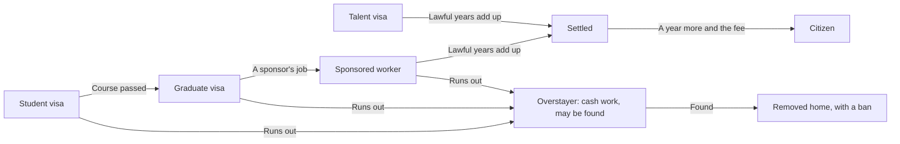

# Abroad

The life does not end at the airport. The flight is a scene of its own:

1. the queue at Departures, with the family behind the rope;
2. the counter, with the passport and the stub (window or aisle);
3. the gate, where they wave and Board the plane sends the flight;
4. the plane over Lagos at night;
5. the first ride from the airport abroad, with the family's first messages pinging in.

The send-off card is saved on that ride and opens from a tile on the phone's home until the first month abroad ends. After the flight the character lands in the country the route leads to, in a shared room, with a visa that says what work is allowed and for how long. The months go on: rent, a first job, a credit file, money sent home, the family's requests, a December visit, and the long count towards settling. Or the way home, by choice or not. Two chapters cover it: "Landing" and "Secure".

## The room

Arriving opens the country's upkeep and a shared room; no credit is needed.

- **Upkeep** is the phone alone, since food and fares are paid as you go: pay as you go in the UK, £15 a month, and a prepaid phone in Canada (C$30), the UAE (AED 50) and Italy (€10).
- **Cooking.** The room's cooking corner cooks a meal of your own in the country's money.
- **The room** is named for where it is: the shared room in Peckham, the basement room in north-east Calgary, the bed space at the camp in Dubai, the room in a shared flat on the Domitiana.
- **A flat in your own name** comes later, once the credit file reaches a mark and a month's deposit is paid.
- **What is left at home.** Whatever was rented at home is let go when you fly, and the family house stops charging while you are away. Everything the life owned in Lagos is sold at its resale share as you leave, and one line says so: "Before you left, what you owned was sold", with what came in.

::: info The first nudge abroad
When the month's dues in the local currency are more than the local money you hold, the nudge names the gap ("Find £4,687 this month: £746 held"). A tap opens the Bank at the exchange, where naira can be changed into the local currency.
:::

## Getting about and eating

London is lived the way Lagos is: a fare at the stop, food bought when it is eaten.

| What | Where | Costs |
|---|---|---|
| The bus | Any stop | £1.75, one fare whatever the distance |
| The train | Peckham Rye station | £2.80 and 10p a kilometre, rounded up to five pence |
| On foot | Within walking distance, and home to the room from anywhere | Nothing |
| The bus pass | The ticket machine at Peckham Rye station | £95, once a month: the bus asks nothing for the rest of that month, the train still does |
| The weekly shop | The big shop on the high street | £45, fills the belly for days |
| A meal of your own | The room's cooking corner | £6 |
| The chicken shop, the Nigerian shop, a pint | Rye Lane | £7, £25 (a taste of home), £6 |
| A fresh cut, new clothes | Rye Lane | £15 and £40, once a month each |
| The stalls | Rye Lane | £20 |

Each fare and each meal leaves your pounds when it happens, cash first and the bank for the rest. The ride sheet prices each way from the same figures the game uses.

The other three countries work the same way, each in its own currency:

- **Calgary.** The bus and the CTrain are one flat fare, C$3.80, and a taxi grows with the distance. The transit pass at the CTrain station's machine, C$118 a month, makes both the bus and the train free for the rest of that month. The superstore sells the weekly shop (C$90) and winter clothes, the basement room cooks a meal of your own (C$8), and the strip mall has a coffee (C$3), the African store and the barber.
- **Dubai.** The bus and the metro ask AED 4 and 50 fils a kilometre, a taxi more, and a walk is slower in the heat. The zone pass at Union station's machine, AED 140 a month, covers the bus and the metro. The labour bus at the camp's gate takes you to the site free, every day. The hypermarket sells the weekly shop (AED 150), the camp cooks a meal (AED 8), Deira has the cafeteria, the African foods shop and the barber, and Naif has the souq, the tailor and the laundry.
- **Castel Volturno.** The coast road's bus is €1.60 each time, with no pass, no train and no taxi; it goes as far as Naples airport. The gangmaster's van takes you to the fields free. The discount supermarket sells the weekly shop (€35), the shared flat cooks a meal (€4), the roundabout has a coffee at the bar (€1.20) and the African shop, the Domitiana has the barber, the market stall and the Nigerian shop's evening, and the church is free.

In London the jobs have doors too: the big shop's tills, the care home in Nunhead, the ward on Denmark Hill, the office at London Bridge, the warehouse on the Old Kent Road and the chicken shop's kitchen on Rye Lane.

- A job can be got at its door as well as through the notice in Peckham. Once it is yours, its thing says On shift.
- The rota board offers overtime, and the manager's door or the glass office offers the next rung.
- A colleague at the tea point has something new to say each time you talk.
- The church on the Old Kent Road is where the community meets, and the test centre at Elephant and Castle holds the UK's tests.

London has a painted map, as Lagos does: south-east London with the Thames across the top, the railway through Peckham Rye, a card for each neighbourhood, and Heathrow on an inset in the corner, since it is too far west for the paper.

## Work

What work you may take depends on the visa:

| The visa allows | Which jobs |
|---|---|
| Any work | Any job in the country |
| Part-time (a student) | Jobs marked part-time, the twenty-hour cap |
| One employer (sponsored) | Only the job the visa names. Lose it and a clock starts |
| Cash only (no papers) | Cash jobs only: no tax, and some months the pay never comes |

Pay goes into the local bank, less tax above the country's line (none in the Gulf). Months in any job in the country add up, which is how a first survival job turns into a professional one.

## The visa and the way up

Japa abroad shows "Your visa": its name, the months left, what it lets you do, and the way up. Papers lists the visa first.

- A visa that can be renewed shows what renewing would cost today.
- A sponsored worker who loses the job has two months to find another the visa allows.
- The Gulf contract is renewed by the employer, not the player, by a draw in its last month.
- Canada's permanent residence counts towards citizenship from the day you land.

::: warning Running out
A visa that runs out with nothing after it turns into overstaying: cash work only, and each month a chance of being found and removed. Removal sends you home with a ban on that country for years.
:::

## The chapters abroad

"Landing" asks for five things:

1. a roof over your head;
2. one month in a job here;
3. knowing what your visa lets you do;
4. the first request from home answered;
5. a first mark on your credit file.

A phone contract paid on time is the cheapest way to build the credit file.

"Secure", the last chapter, closes on any one of: a settled or citizen status, a return home with papers or by choice, or a second route granted after a return.

## Money home

Abroad the family expects more: their requests come at a larger figure, and any monthly support to the house reopens larger too. Money goes home from the Bank through an app, a bank (it arrives next month), or informally at the street rate with no fee and a chance it never arrives. What each would deliver is shown before you send. See [Money](./money.md).

## The December visit

Once a year abroad, in December, the scene "December at home" opens and holds the month: "December is coming. Everybody at home is asking if you will come."

- The first question is whether to go. "Not this year" is free and always allowed; booking pays the fare both ways at the December price.
- Going brings three more questions: the party, the gifts for your mother's list, and the look people expect.
- Each answer trades money abroad for standing at home and the family's goodwill.

## The return

The Go home card shows the way home as it stands today:

- what kind of return it would be, in one line;
- whether your status here ends;
- that the family house takes you back;
- whether standing at home rises, holds or falls (in words, never a figure);
- the fare, on its one button, in the local currency, or in naira when it must be bought from naira.

It is a forecast, never the record. The kind of return is decided when it happens:

| Return | When | Standing |
|---|---|---|
| With papers | Holding a settled or citizen status | +10 |
| By choice | The fare paid, money left | 0 |
| Broke | The fare paid, little left | -8 |
| Assisted | No status and no fare: the assisted scheme | -12 |
| Removed | Found overstaying | -20 |

Money brought home lifts standing back, a little for each million naira, once. For a year after any return, home has its own offers: the question everyone asks, a cousin's shop idea, a company that wants the experience, a friend's connection to leave again. From home every route runs again, with earlier refusals and bans still on the record. A settled or citizen status is kept: that country's door stays open for the price of a flight.

::: warning Where to go home from
The Go home card is on the bag by the door in the room abroad, the one place a return is sent from. With no fare it is shut with "Short of the fare", or with "No way home today" when there is no way at all. Papers also shows the fare home and the times the life came home.
:::

::: details Exceptions
- **December fares.** In December the fare home is the off-peak fare times the country's December factor.
- **No fare in local currency.** The fare can be bought from naira at the official rate with the bank's charge.
- **The Gulf.** Leaving the employer's job ends the contract's status at once, and what is left is cash work with no papers.
- **Canada's residence**, kept as a status token, lapses after two years away.
- **A car abroad** is handed back on return; any shortfall follows you home in naira.
- **A student whose tuition defaulted** is withdrawn at the end of the missed-tuition stages. The permission then ends 2 months later, and in those months three ways stay open from inside the country, as in the grace.
:::

## Rules it rests on

- [Place](../../rules/place.md): moving, the fare home, the kinds of return, the way home forecast, rides abroad and the bus pass.
- [Streets](../../rules/streets.md): streets:street-shopping-abroad, streets:london-life-by-hand (Rye Lane, the big shop and the room in pounds).
- [Status abroad](../../rules/status.md).
- [Ladders: working life abroad](../../rules/ladders.md): ladders:activities-filtered-by-where, ladders:local-tenure-counted, ladders:cash-jobs-paid-in-hand and ladders:car-bonus-needs-car.
- [Money abroad](../../rules/abroad-money.md).
- [Coming home](../../rules/return.md): the whole page, with the December set piece and the Go home card.
- [Chapters](../../rules/chapter.md): chapter:send-off-card-on-close, chapter:long-game-after-last-chapter (the send-off card, Landing and Secure).
- [The world](../../rules/world.md): world:nudge-says-one-thing (the nudge abroad).
