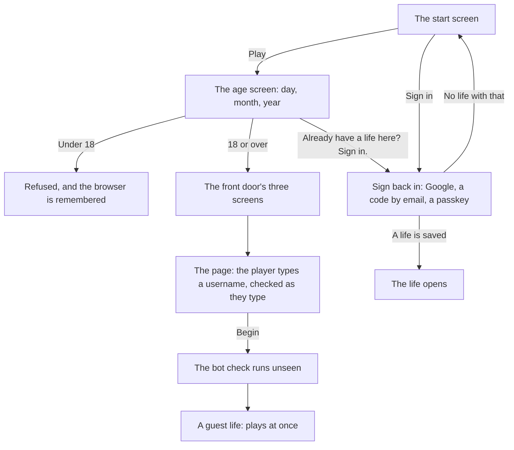

# Accounts

Playing needs no sign-in at all. Online, a new player answers one question about their age, walks through the front door and starts as a guest: the life lives in that browser on that phone. Saving it, so it can be opened anywhere, is asked for later, at moments that matter, with Google or a code sent by email. A passkey can be added once the life is saved. This page shows what a player sees; the rules are on [Accounts](../../rules/account.md).

::: info Locally there are no accounts
The development build, the browser tests, offline play and the play driver keep the life in the browser, and nothing on this page applies. See [The client](../built/client.md).
:::

## Starting as a guest

- **The start screen.** In a browser where a saved life was open, the start screen swaps its two buttons: "Sign in" first, "Start a new life" under it. Either way, Sign in carries the small line "Carry on a saved life".
- **The age screen** asks for a date of birth with nothing filled in and no hint of the age needed. One quiet line under it is for a returning player who tapped Play by habit. The account keeps only that the screen was passed, never the date.
- **The username** is typed on the page into an empty box, which says whether it is free as it is typed. It is made of letters, numbers and underscores, must be unique, and may never be a name of the game's own people (the limits are in the [Accounts](../../rules/account.md) rules). Other players see it; it is never the character's name and never a way in. One change is free, then there is a wait between changes. The box that changes it in Settings checks it the same way as it is typed.

## What a guest can do

A guest plays the whole single life: the city, the month, the news, the rates. A few things need a saved life, because they touch other people or real value:

- buying lottery tickets;
- appearing on a board or a public card;
- inviting or being invited as a partner or sibling;
- sending or reading messages;
- having the life restored on another device.

Trying any of these as a guest brings the ask to save the life, never a dead end. The server enforces every one.

## Saving the life

The ask comes:

- once the first month's results are read;
- before the visa decision;
- whenever a guest tries one of the things above.

It never comes at the door, and never before the life's first win. A small "Not saved" chip under the money stays over the world for as long as the life is a guest's; a tap on it opens the same sheet, and it goes the moment the life is saved. A quiet line in Settings and on the month's results says the same thing plainly: this life lives only on this phone until you save it.

Once the life is saved, the sheet says so and offers a passkey as the next step, so the next sign-in is a face, a fingerprint or the screen lock. "Not now" skips it.

| Way in | How |
|---|---|
| Google | First, wherever Google sign-in opens |
| A code by email | A short code, good for a few minutes and a few tries; a new code replaces the old (account:email-code-is-short-lived) |
| A passkey | Offered right after the life is saved, and added from Settings any time after; bound to the game's own address |

::: tip Inside a chat app's browser
Some apps' built-in browsers block Google sign-in, so the game does not show Google there. The ways back in offer the email code and a way to open the game in the phone's own browser. A guest life there is saved with the email code alone, since it lives in that app's browser; once saved it opens in any browser.
:::

::: details Exceptions
- **A sign-in already used.** Saving a guest life with a Google account or email that already has a life joins nothing and overwrites nothing: the game says so and the guest life stays as it is. It also offers "Sign in to my saved life" instead, which ends the guest one. A guest's account sheet offers "Sign in" the same way.
- **A sign-in with no life.** The code goes to every address alike, so the ways back in never reveal whether an address plays here.
  - The right code for an address with no saved life leads into starting one, already saved with that email: the age question, then the username on its own step, whose Continue makes the account. The door follows, and the account opens on it from any phone signed in with that email. A code that ran out before Continue is reported there and a new one sent, with the username kept.
  - "Continue with Google" with no life behind it leads into the same steps, under the same line, with "Use another way" to go back. Continue makes the account saved with Google, so the next "Continue with Google" opens it. A Google sign-in that ran out before Continue is offered again on the step, with the username kept.
  - A passkey with no life behind it, or a Google account whose address Google has not verified, says so and sends you back to Play.
- **Google did not finish.** A no at Google's own screen comes back as "Nothing happened. Try again when you are ready."; a trip that lost its way as "Google sign-in did not finish. Try again, or use a code by email.", at the top of the sheet it came back to.
- **Full.** While sign-ups are switched off, a full screen says to try again shortly, and checks again by itself once the wait is over.
- **Too many new lives.** Guest lives from one device or one connection in a day are limited.
- **One character.** An account holds one life at a time. Settings' "Start a new life" ends it for good first.
- **Deleting the account.** From Settings, with a recent sign-in or a fresh code. Every session ends at once, and everything the account held is gone within a month (account:deleted-data-removed-within-month).
:::

## Invite links

A friend's invite opens on a page of its own: the friend's card first, with a report control, then the age screen and the username, or the ways back in for a player who already saved a life. A card's link works once, for a limited time (pair:invite-link-single-use). Only a saved life may be invited, so a new guest saves the life before taking the card. No advert shows on this page. See [People](./people.md).

## Rules it rests on

- [Accounts](../../rules/account.md): account:sign-in-without-secret, account:email-code-is-short-lived, account:passkey-needs-signed-in-session, account:no-text-message-codes, account:stand-ins-test-sign-in and account:session-is-secure-cookie (signing in), account:same-contact-for-everyone, account:sign-up-open-everywhere, account:age-screen-refuses-minors and account:bot-check-on-guest-creation (one game for every country, the age screen, the bot check), account:one-character-per-account, account:player-deletes-account, account:deleted-data-removed-within-month and account:deletion-keeps-anonymous-totals (one character, deletion), account:guest-and-secured-states, account:social-needs-secured-account, account:guest-secures-the-life, account:username-and-unconfirmed-email, account:guest-floods-are-capped, account:idle-guests-cleaned-by-hand, account:guest-reminded-to-secure, account:play-starts-without-email, account:start-screen-over-live-city and account:start-a-new-life (guests, saving a life, the username, the start screen, a new life).
- [Pairs](../../rules/pair.md): pair:invite-card-contents, pair:invite-link-single-use (the invite page).
- [The server](../../rules/server.md): server:signups-off-shows-full (the full screen).
- [Guides, sources and credits](../../rules/guide.md): guide:nothing-asked-before-early-win (never before the early win).
