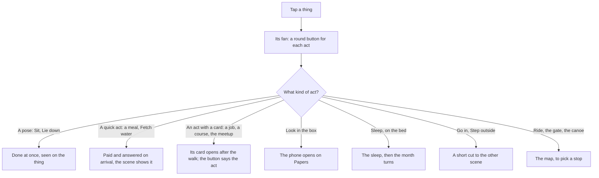

# The city and the places

This page shows how a player moves about Lagos and uses what is there: the screen over the world, tapping things, the talk of the street and the map. The exact rules are in [the world rules](../../rules/world.md) and [the city rules](../../rules/city.md).

The game is a 3D Lagos seen from above, one place to a screen: a street, a market, a home. The player taps a thing to walk to it and pick what to do there; people nearby speak over their heads; the map rides across the city. Walking round a place costs nothing and changes nothing in the life: only acts do.

  
  
  

## What is on screen

The world fills the screen. Over it sit only:

- **The band** at the top: the character's name and the part of the day, the age and the place, and the money. Tapping the name or the age opens the character's data page; tapping the part of the day opens the Calendar.
- **The nudge**, one line under the band, only when something waits. It is explained on [the first months](./first-months.md#the-nudge-and-the-marker) page.
- **Two round buttons** at the bottom corners: Map on the left and Phone on the right. A dot on Phone means an app has something new. On a first play each carries its word ("Go places", "Chats, bank, news") until it is tapped once.

Sheets, the phone, the map and the month's results open over the world and close back to it.

## Walking and the camera

Nothing wanders by itself. A tap on a thing walks the character straight to it, quickly, and what was asked follows; a tap on open ground walks there. The camera always looks down at an angle: one finger turns the view a little, and a pinch moves between the whole place and close on the character.

## Things and their acts

Each thing the player can use carries a small dot. Tapping it fans its acts out of it as round sticker buttons, each with a picture, a name and a price where there is one. A tap elsewhere closes the fan. Where there is no room beside the thing, the same buttons open on a small sheet.

- **A quick act** is done as soon as the character reaches the thing. While its button is held, the money in the band shows what would be left.
- **An act with a card** opens the card after the walk. Its one button names the act and the price, with the balance before and after.
- **An act that fills the month** (a job, study, a course) carries on every month until the player stops it; its button then shows Ongoing, with Stop beside it. See [the month](./month.md#commitments-and-free-time).
- **Going into a building** is a quick cut to the room as its own scene.

  
  
  

## Speech bubbles and the corner line

Nothing narrates over the middle of the world. Words go to one of two places:

- **Over a head.** A person near the character may say a short line in a bubble, now and then, never over a sheet or the phone. A line one person plainly says is theirs (Mama at home, a conductor calling his stop); other talk comes from Someone nearby. A long line opens whole on a tap. The rest of the street's life shows as small pictures over people. How much talk there is, and when, is world:street-talk-budget.
- **In the bottom corner.** Only the answer to the player's own act, one line at a time ("Mama presses a bag of oranges on you.").

Money that comes in slides in under the band with a coin flying to the counter, and a refused act shakes its button.

::: info People in a place
A place shows a sample of people, never a list or a count. Online, other players fill it before the city's own residents, while the people a place needs (the trader at her stall, the clerk at the counter) always stay. Everyone sees the same sample on the same day. See the presence rules in [the city rules](../../rules/city.md).
:::

## The map and the rides

  
  

The map is one painted Lagos in the game's sticker style. Folded, it is a strip of the whole city over a card for one neighbourhood, swiped sideways; a tap or a drag unfolds the whole map. Each place stands as a sticker of its own picture, and a place the story has not reached yet (the visa centre, the airport) appears later in the life.

Picking a stop opens the ride sheet: danfo, keke, okada and on foot, each with its fare and its time, the balance before and after, and Go. Walking is free and slowest, and only for a stop close by. With a car at home, Drive comes first. The ride then plays out from a few angles and can be skipped. Fares and the walking distance are in [the place rules](../../rules/place.md).

::: details Exceptions in the city
- **No money for a fare.** The sheet opens on the first way the money can pay; a far stop with no fare says "Too far to walk", and the nudge names a free step instead.
- **An ask that belongs at a place** is answered there. Away from it, the asks sheet says who is waiting and offers the way there.
- **One country at a time.** The map names the country shown; other countries are listed locked, with the reason.
- **Slow devices** start in a lighter graphics mode with fewer people; motion is never turned off.
:::

::: tip One look, two paints
The interface is one light look: pale sky, white cards with a navy edge, navy ink, danfo yellow for the one action. At the world's night the same shapes repaint in navy with cream ink. There is no theme to pick. The 3D world keeps its own colours, its sky and lamps following the world's clock.

:::

## Rules it rests on

- [The world](../../rules/world.md): world:world-fills-the-screen, world:top-band-is-a-pill, world:thumb-buttons-carry-dots, world:no-walkthrough-before-play, world:things-are-tappable-models, world:fan-of-sticker-buttons, world:camera-always-raised, world:nothing-roams, world:place-is-one-screen, world:entering-is-a-cut, world:street-talk-budget, world:map-is-painted-lagos, world:one-country-at-a-time, world:ride-sheet-shows-fares, world:ride-cuts-between-angles, world:colours-are-role-tokens.
- [The city](../../rules/city.md): city:places-change-no-state, city:tap-to-walk, city:overheard-talk-from-view, city:crowd-sample-capped, city:players-fill-the-crowd, city:sample-seeded-by-date, city:residents-fill-to-target, city:residents-carry-no-tag, city:players-carry-name-tags, city:two-graphics-modes, city:motion-never-turned-off.
- [Place](../../rules/place.md): place:rides-between-city-places (fares and walking).
