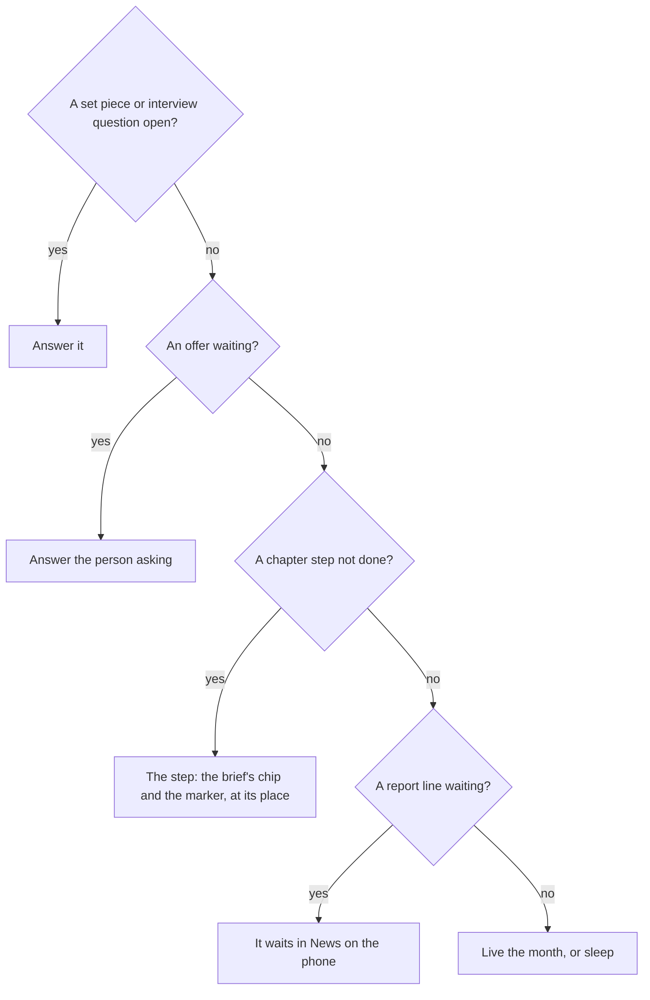
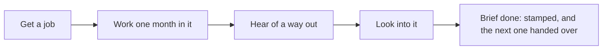

# The first months

The first months teach the game by playing it, with no tutorial:

- A person hands the player a brief.
- A marker at the place shows the thing to do.
- One line under the top band, the nudge, appears only when something waits on the player.

The first chapter, "Find your feet" ("Work first, abeg" on its brief), asks for four things: get a job, work a month in it, hear of a way out and look into it. Every job hunt draws at its job's own chance, and a starting life's first miss opens a lead, so no new player meets a dead end in the first three months.

  
  
  

## The first brief

Before the first month is played, the first chapter is handed over as a brief: a mission card from the person who sets it, in their voice. It has:

- a title with a wink;
- the four things as sticker tiles, with the place under each;
- the rewards as picture chips;
- the next brief, faint;
- one button, Let's go.

It shows once per life: a mark kept on the device stops a reload from showing it again. After Let's go, a chip with the brief's picture and title stands under the band for about two seconds, then slides into the Phone, whose Japa app takes a dot. A chapter that closes while the world is open comes back as its close card, with every tick, the stamp, confetti and the next briefs as picture cards. The player never sees the word "chapter": to them it is a brief.

## The nudge

The nudge is one sentence of at most eight words. It picks the next thing to notice from the view, in this order:

In the world, the line under the band shows only for a question, an offer, money due or, at night, the bed ("Night. Go to bed"). Tapping it opens the way there: the asks sheet for a question or an offer, the Bank for money due, the bed's acts at night.

The chapter step shows only in the moment, while the player is at the step's place or beside its person:

- the brief's chip under the band;
- a marker on the thing or person that does it: a white pill with two words and an arrow, and a yellow ring at the feet.

Tapping the chip or the marker opens that thing's acts. Walking out of the place takes both away. The Japa app keeps the log of the briefs, and the map's strip marks the step's place with a yellow dot. A step already started names the wait instead ("Applied. Live the month to see."). A step the player cannot afford names the gap and a way to the money.

::: tip Each start has its own first step
- The developer is sent to ask at the hub in Yaba.
- The nurse is sent to apply for staff nurse at the clinic.
- The child of the water is sent to the fish racks beside the room.
- A trade asks around at the motor park.
:::

## Find your feet

1. **Get a job.** The jobs board at the hub lists every job the life may hunt, with its pay and its chance in words, from "Likely" to "A long shot", and the jobs not open yet below. Looking for a job answers at once: the application goes in now, and the employer answers at the month's end with a job offer that waits on the asks sheet.
2. **Work one month in it.** Accept the offer, live a month in the job and sleep. The first salary leads the month's results as payday.
3. **Hear of a way out.** A life's first meetup hears for sure of the way that fits it: health care for a nurse, tech work for a developer, otherwise the master's. A trade's first ask-around at the motor park hears of the Gulf for sure.
4. **Look into it.** Read the way's official page, ask someone who went, or see an adviser or an agent. Any of these moves the way from heard to known.

  
  
  

When every step is met, the chapter closes at the month's end: its brief comes back stamped, and the next one becomes current and is handed over.

## The early win and the lead after a miss

In every starting life, playing the first three months as the nudge suggests meets no dead end and brings at least one good line that follows from the player's own choice. Nothing is fudged to make it so.

Each job shows its own chance on the board and on the hunt's card: "Likely", "A fair chance" or "A long shot". Only a job that is truly near certain, the fish racks at Makoko, says "As good as certain". The odds follow the trade: the wards are short of nurses, so a staff nurse post is likely; teaching, sales and the phones are easy to get; a junior developer's or a bank officer's post is hard.

When a starting life's first hunt in its first three months misses:

1. The month says the job came to nothing.
2. Lanre at the hub gives a lead: an offer for the lowest-paid job the life may hunt whose pay covers what the life owes each month (upkeep, rent, support, instalments). He says it in his own words, with the place ("a call centre in Ikeja that is hiring").
3. When that job is not the trade the life hunted, he says what it costs. For the nurse: it pays, but it will not count for the wards, whose months the health care route asks for.
4. Take it starts the job, Keep looking lets it go, and it lapses after two months.

A life that hunted that same job and missed hears instead that Lanre put in a word for it. The lead comes once a life, and its line counts as the early win whether or not it is taken.

::: details Why the lead's job must cover the dues
A job that pays less than the life owes each month would trap it: the money drains away while the job is held. So the lead names the cheapest job that still covers the dues, not the cheapest job.
:::

::: details Exceptions in the first months
- **No fare for the ride.** When the money held cannot pay the cheapest ride and the step's stop is too far to walk, the nudge names a free step instead: walking home, the racks for a life in Makoko with no job, or a job on a board within walking distance.
- **A later miss.** The lead comes once. A later miss with other jobs on the board names another way ("Try again, or pick another job").
- **The trader with a settlement.** A trader from sixteen whose settlement is in hand opens the shop with it instead of hunting.
- **Nothing is asked first.** No sign-in, email, notification permission, invite or share is asked before the early win. The first ask, to secure the account, comes after it.
:::

## Rules it rests on

- [Chapters](../../rules/chapter.md): chapter:first-chapter-starts-current, chapter:met-items-close-the-chapter (a chapter closes and the next becomes current), chapter:chapters-follow-lean-route (the chapters follow the life's way out), chapter:first-chapter-mission-card (the first brief, handed over once per life, and the close card).
- [The world](../../rules/world.md): world:nudge-says-one-thing (the nudge, the step only in the moment, and where a tap goes), world:things-are-tappable-models (the marker), world:phone-holds-what-phones-hold (the Japa app's log of briefs).
- [Guides](../../rules/guide.md): guide:early-win-in-three-turns (the early win and no dead end), guide:nothing-asked-before-early-win (nothing asked before it), guide:first-meetup-hears-fitting-route (the first meetup and the motor park).
- [Activities and jobs](../../rules/activity.md): activity:job-hunt-lands-offer (the hunt and how the board reads it), activity:missed-hunt-opens-a-lead (the lead after a first miss), activity:now-acts-and-month-acts (acts that answer now).
- [Finding out where you stand](../../rules/advice.md): advice:four-ways-to-learn-route (the four ways to look into a route).
