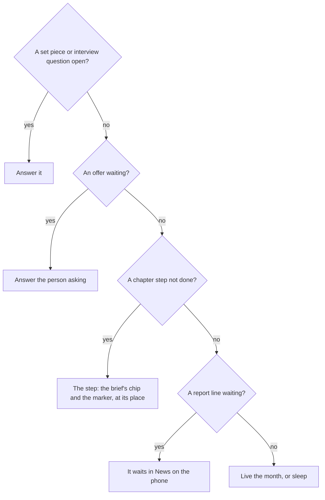
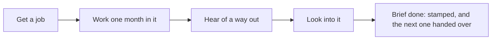

# The first months

The first months teach the game by playing it, with no tutorial. A person hands the player a brief, a marker at the place shows the thing to do, and a single line under the top band, the nudge, comes only when something waits on the player. The first chapter, "Find your feet" ("Work first, abeg" on its brief), asks for four things: get a job, work a month in it, hear of a way out and look into it. The first job hunt of a life is made sure, so every new player sees money come in within three months.

  
  
  

## The first brief

Before the first month is played, the first chapter is handed over as a brief: a mission card from the person who sets it, in their voice, with a title that winks, the four things as sticker tiles with the place under each, the rewards as picture chips, the next brief faint, and one button, Let's go. It shows once per life: a mark kept on the device stops a reload from showing it again. After Let's go, a chip with the brief's picture and title stands under the band for about two seconds, then slides into the Phone, whose Japa app takes a dot. A chapter that closes while the world is open comes back as its close card, with every tick, the stamp, confetti and the next briefs as picture cards. The player is never told "chapter": to them it is a brief.

## The nudge

The nudge is one sentence of at most eight words. It picks the next thing to notice from the view, in a fixed order:

In the world the line stands only for a question, an offer, money due or, at night, the bed ("Night. Go to bed"), and a tap on it opens the way: the asks sheet for a question or an offer, the Bank for money due, the bed's acts at night. The step shows only in the moment: the brief's chip under the band, and a marker on the thing or person that does it (a white pill with two words and an arrow, and a yellow ring at the feet), while the player is at the step's place or beside its person. A tap on the chip or the marker opens that thing's acts; walking out of the place takes both away. The Japa app keeps the log of the briefs, and the map's strip marks the step's place with a yellow dot. A step already started names the wait instead ("Applied. Live the month to see."), and a step the player cannot afford names the gap and a way to the money.

::: tip The nudge follows the life
Each start has its own first step. The developer is sent to ask at the hub in Yaba. The nurse is sent to apply for staff nurse at the clinic. The child of the water is sent to the fish racks beside the room. A trade asks around at the motor park.
:::

## Find your feet

1. **Get a job.** At the hub, the jobs board lists every job the life may hunt, with its pay and its chance in words, from "Likely" to "A long shot", and the jobs not open yet below. Looking for a job is answered now: the application goes in at once and the employer answers with the month's end, as a job offer that waits on the asks sheet.
2. **Work one month in it.** Accept the offer, then live a month in the job and sleep. The first salary leads the month's results as payday.
3. **Hear of a way out.** The first meetup of a life hears for sure of the way that fits it: health care for a nurse, tech work for a developer, else the master's. The first time a trade asks around at the motor park, it hears of the Gulf for sure.
4. **Look into it.** Read the way's official page, ask someone who went, see an adviser or an agent. Any of them moves the way from heard to known.

  
  
  

When every step is met, the chapter closes at the month's end: its brief comes back stamped, and the next one becomes current and is handed over.

## The sure first hunt

The game promises an early win: in every starting life, playing the first three months as the nudge suggests brings at least one good line that follows from the player's own choice. To make that sure, the first job hunt of a starting life in its first three months always succeeds. The draw is still made. When it misses, the life is given the lowest-paid job it may hunt whose pay covers what it owes each month (upkeep, rent, support, instalments), and only when none covers it, the lowest of all. While that hunt is still to come, the board reads every job "As good as certain".

::: details Why the job must cover the dues
A job that pays less than the life owes each month would trap it: the chapter has stopped asking it to hunt, and the money drains away anyway. So the sure hunt picks the cheapest job that still covers the dues, not the cheapest job.
:::

::: details Exceptions in the first months
- **No fare for the ride.** When the money held cannot pay the cheapest ride and the step's stop is too far to walk, the nudge names a free step instead: walking home, the racks for a life in Makoko with no job, or a job on a board within walking distance.
- **A hunt that misses after the first.** The sure hunt is the first only. A later miss with other jobs on the board names another way ("Try again, or pick another job").
- **The trader with a settlement.** A trader from sixteen whose settlement is in hand opens the shop with it instead of hunting.
- **Nothing is asked first.** No sign-in, email, notification permission, invite or share is asked before the early win. The first ask, to secure the account, comes after it.
:::

## Rules it rests on

- [Chapters](../../rules/chapter.md): chapter:first-chapter-starts-current, chapter:met-items-close-the-chapter (a chapter closes and the next becomes current), chapter:chapters-follow-lean-route (the chapters follow the life's way out), chapter:first-chapter-mission-card (the first brief, handed over once per life, and the close card).
- [The world](../../rules/world.md): world:nudge-says-one-thing (the nudge, the step only in the moment, and where a tap goes), world:things-are-tappable-models (the marker), world:phone-holds-what-phones-hold (the Japa app's log of briefs).
- [Guides](../../rules/guide.md): guide:early-win-in-three-turns (the early win and the sure first hunt), guide:nothing-asked-before-early-win (nothing asked before it), guide:first-meetup-hears-fitting-route (the first meetup and the motor park).
- [Activities and jobs](../../rules/activity.md): activity:job-hunt-lands-offer (the hunt and how the board reads it), activity:now-acts-and-month-acts (acts that answer now).
- [Finding out where you stand](../../rules/advice.md): advice:four-ways-to-learn-route (the four ways to look into a route).
