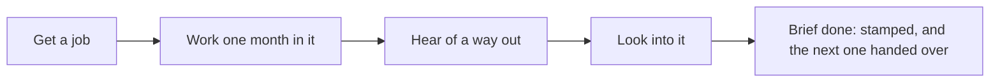

# The first months

This page shows how the game teaches itself in a new life's first months, with no tutorial: a person hands over a brief, a marker shows where to go, and one line under the band, the nudge, speaks only when something waits on the player.

  
  
  

## The first brief

The game's chapters reach the player as briefs; the word "chapter" is never shown. Before the first month, the first one, "Work first, abeg", is handed over as a mission card by the person who sets it, in their voice: a title, the four things to do as sticker tiles with the place under each, the rewards as picture chips, the next brief faint, and one button, Let's go.

The card shows once per life. After Let's go it shrinks into the phone, where the Japa app keeps the log of briefs. When a brief is finished it comes back stamped, with confetti and the next brief. How chapters open and close is in [the chapter rules](../../rules/chapter.md).

## The nudge and the marker

The nudge is one short line under the band. It appears only when something waits: a question to answer, an offer, money due, or at night, the bed. Tapping it goes straight there. The order in which it picks the one thing to say is world:nudge-says-one-thing in [the world rules](../../rules/world.md).

The brief's current step shows only in the moment, when the player is at its place or beside its person:

- the brief's chip under the band;
- a marker on the thing or person to use: a white pill with two words and an arrow, and a yellow ring at the feet.

Tapping either opens that thing's acts. Away from the place, the map marks it with a yellow dot. A step already under way names the wait instead ("Applied. Live the month to see."), and a step the player cannot afford names the gap and a way to the money.

::: tip Each start has its own first step
The developer is sent to ask at the hub in Yaba, the nurse to apply at the clinic, the child of the water to the fish racks beside the room, and a trade to ask around at the motor park.
:::

## Find your feet

1. **Get a job.** The jobs board lists the jobs the life may hunt, each with its pay and its chance in words ("Likely", "A fair chance", "A long shot"), and the jobs not open yet below. Applying is quick; the employer answers at the month's end, and an offer waits on the asks sheet.
2. **Work one month in it.** Accept the offer, live the month and sleep. The first salary leads the month's results.
3. **Hear of a way out.** A life's first meetup, or a trade's first ask-around at the motor park, is sure to hear of the way out that fits it (guide:first-meetup-hears-fitting-route).
4. **Look into it.** Read the way's official page, ask someone who went, or see an adviser or an agent. Any of these makes the way known ([finding out where you stand](../../rules/advice.md)).

  
  
  

When every step is met, the brief closes at the month's end and the next one is handed over.

## No dead end at the start

A player who follows the nudge through the first few months meets no dead end and gets at least one good result from their own choice ([the early win, in the guide rules](../../rules/guide.md)). Nothing is fudged to make it so: every job hunt draws at its job's own chance.

What makes it hold is the lead after a miss. When a starting life's first hunt comes to nothing, Lanre at the hub offers a lead to a job that pays at least what the life owes each month, since a job that paid less would drain the life while it was held. If that job is outside the life's own trade, he says what it costs (for the nurse, months that will not count for the wards). The player can take it or keep looking; the lead comes once a life. The exact rule is activity:missed-hunt-opens-a-lead in [the activity rules](../../rules/activity.md).

::: details Exceptions in the first months
- **No fare for the ride.** When the money cannot pay a ride and the step is too far to walk, the nudge names a free step instead.
- **A later miss** gets no lead; the board says to try again or pick another job.
- **A trader with a settlement** opens the shop with it instead of hunting.
- **Nothing is asked first.** No sign-in, email, notification permission, invite or share is asked before the early win.
:::

## Rules it rests on

- [Chapters](../../rules/chapter.md): chapter:first-chapter-starts-current, chapter:first-chapter-mission-card, chapter:met-items-close-the-chapter, chapter:chapters-follow-lean-route.
- [The world](../../rules/world.md): world:nudge-says-one-thing, world:things-are-tappable-models (the marker), world:phone-holds-what-phones-hold (the Japa app's log).
- [Guides](../../rules/guide.md): guide:early-win-in-three-turns, guide:nothing-asked-before-early-win, guide:first-meetup-hears-fitting-route.
- [Activities and jobs](../../rules/activity.md): activity:job-hunt-lands-offer, activity:missed-hunt-opens-a-lead, activity:now-acts-and-month-acts.
- [Finding out where you stand](../../rules/advice.md): advice:four-ways-to-learn-route.
