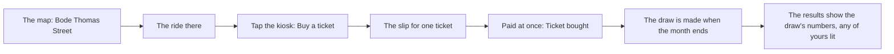
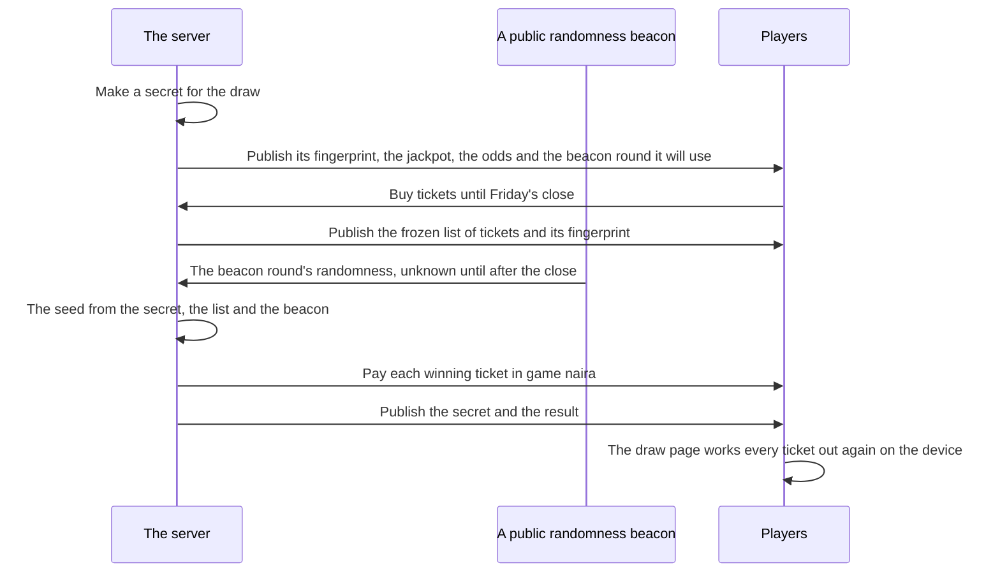

# The Friday draw

A lotto ticket is part of street life in Nigeria, so the game has one, kept small and fair. This page shows what a player sees at the kiosk and in the Lotto app; the exact rules, odds and prizes are on the rule pages [The Friday draw](../../rules/lottery.md) and [Luck, the safety net, and the kiosk](../../rules/luck.md).

- **Offline**, a kiosk on Bode Thomas Street sells tickets, and its draw is made with the month.
- **Online**, the whole world draws together once a week, on Friday evening, at fixed odds that anyone can check afterwards.

A ticket is cheap and the number a player may buy is capped, so the draw is a small treat, never a strategy.

## Offline: the kiosk

The kiosk stands on Bode Thomas Street, beside a betting shop. Tapping it fans out its one act, Buy a ticket, which opens the slip for one ticket.

A ticket is paid on the spot, cash first. There are three prizes, from a small one that comes up often to a rare jackpot, and on average a ticket gives back well under what it cost. The price, the monthly cap and the odds are in the kiosk's [Numbers table](../../rules/luck.md#numbers).

Winnings go to the bank, with a letter that explains them. The Lotto app on the phone says how many tickets you bought this month and what they cost, so the money spent on the lotto is in plain view. Once you reach the month's cap, the kiosk man says so in his own voice (keep the rest for transport), and the slip's button is shut with his line.

The betting shop next door takes a slip on the weekend's matches. It wins a little under half the time and pays less than twice the stake, so on average it loses. A win lifts wellbeing a little and a loss takes a little (luck:bet-slip-stake-and-odds).

## Online: the Friday draw

Online, the kiosk's own draw is closed and the world runs one draw a week for every player. Tickets are paid from the naira in the bank, with a cap on each draw, and sales close on Friday evening.

- The small and middle prizes are fixed sums.
- The jackpot starts at a set sum. When nobody hits it, it grows with the week's sales up to a cap; when somebody does, it is shared among the tickets that hit it and starts again.
- Every ticket is drawn on its own, so the number sold changes nothing about anyone's chances. There is no shared pot, no top-up and no forced win.

The odds, the prizes, the cap and the close are in the draw's [Numbers table](../../rules/lottery.md#numbers).

### Buying a ticket

The draw is sold at the same kiosk on Bode Thomas Street. Online, tapping it opens the draw's sheet in place of the offline slip.

The face of the sheet holds:

- the jackpot and whether it rolled over;
- the close, counting down;
- the price and the cap;
- the tickets you hold;
- one button that names the act ("Buy 2 tickets", its cost paid now).

The odds in plain words, the draw's seal and the last draw with its check sit behind a tap on a row, so the face is never a wall of words.

The Lotto app on the phone only informs. It shows the next draw and its jackpot, the tickets you hold and their numbers, and the last draw (how many tickets won each prize, with any of yours lit), and says tickets are sold at the kiosk. A win arrives as a letter. A jackpot or middle prize gets a moment of its own and a [share card](./share.md) that says "won the Friday draw" and never a figure.

::: info Nobody is named
Tickets in the published list are tokens, never accounts. A winner's name or character is never shown. Computer characters never buy a ticket.
:::

### How the draw is made and checked

The server commits to its secret before sales open and cannot change it, and the beacon's value is not known until after the close, so neither the server nor anyone else can steer the result. The draw page fetches a draw's public data, works out every ticket again on the device with the same functions the server used, and says plainly whether the two match.

::: danger What the draw may never become
A ticket is bought only with naira earned in the game, and a prize is only game naira in the winner's own pocket. Game naira is never sold, given to another player or taken out of the game.
:::

## Rules it rests on

- [The Friday draw](../../rules/lottery.md): tickets (lottery:draw-runs-online-only, lottery:draw-sells-between-ticks, lottery:ticket-buying-capped, lottery:tickets-kept-per-draw, lottery:tickets-numbered-by-commit and lottery:view-shows-draw-state), the draw and its check (lottery:fingerprint-commits-secret, lottery:ticket-list-frozen-anonymously, lottery:seed-from-secret-and-beacon, lottery:ticket-result-is-public-function, lottery:fixed-prizes-shared-jackpot, lottery:jackpot-rolls-over, lottery:winners-paid-by-authority, lottery:money-report-checks-draws, lottery:result-published-in-tick-row, lottery:draw-result-on-front-page and lottery:payment-waits-for-away-player), what it may never become (lottery:tickets-bought-with-earned-naira and lottery:prizes-never-leave-game), the odds (lottery:odds-fixed-at-draw-open, lottery:expected-return-below-price, lottery:screen-states-odds-plainly and lottery:safeguards-beside-the-odds).
- [Luck, the safety net, and the kiosk](../../rules/luck.md): the kiosk (luck:kiosk-sells-lotto-tickets), the bet slip (luck:bet-slip-stake-and-odds), big wins staged (luck:big-wins-are-staged).
- [People](../../rules/person.md): computer characters never win anything scarce (person:computers-never-win-scarce).
- [Share cards](../../rules/share.md): no sum on a card (share:card-carries-no-money).
- [The clock](../../rules/clock.md): when the week's draw closes (clock:world-tick-length-and-epoch).
