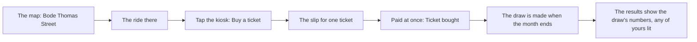
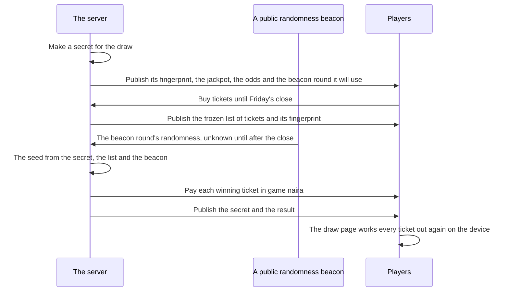
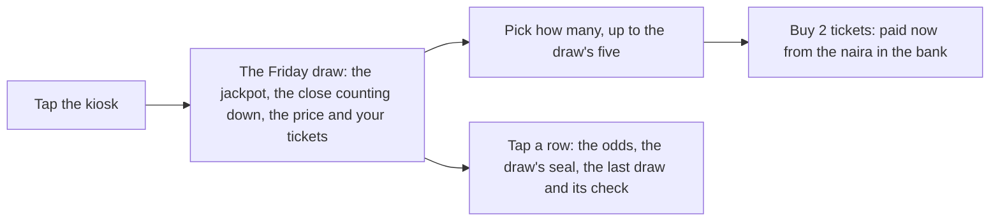

# The Friday draw

A lotto ticket is part of street life in Lagos, so the game has one, kept small and fair. Offline, a kiosk on Bode Thomas Street sells tickets and its draw is made with the month. Online, the whole world draws together once a week, on Friday evening, at fixed odds that anyone can check afterwards. Tickets are bought only with game naira earned by playing. A prize is only game naira. Nothing about the draw can be bought, sold or taken out of the game, and the most a player can stake is a small treat, never a strategy.

## Offline: the kiosk

The kiosk stands on Bode Thomas Street, beside a betting shop. Tapping it fans out its one act, Buy a ticket, which opens the slip for one ticket.

| | The kiosk |
|---|---|
| A ticket | ₦200, paid on the spot, cash first for small sums |
| Most a month | 5 tickets |
| Small prize | 1 in 10 wins ₦500 |
| Middle prize | 1 in 2,000 wins ₦50,000 |
| Jackpot | 1 in 100,000 wins ₦2,000,000 |
| Expected return | Under half the stake |

Winnings go to the bank, with a letter that explains them. The Lotto app on the phone says how many tickets you bought this month and what they cost, so the money spent on the lotto shows where you look.

::: details The fifth ticket
Once you have bought five this month, the kiosk man says so in his own voice: that is five this month, keep the rest for transport. Once the ceiling is reached, the slip's button is shut with his line.
:::

::: details The bet slip next door
The betting shop takes a ₦2,000 slip on the weekend's matches. It wins a little under half the time and pays less than twice the stake, so the expected return is under the stake. A win lifts wellbeing a little; a loss takes a little.
:::

## Online: the Friday draw

Online, the kiosk's own draw is closed and the world runs one draw a week for every player. The same kiosk sells its tickets.

| | The Friday draw |
|---|---|
| A ticket | ₦200, from the naira in the bank |
| Most a draw | 5 tickets |
| Sales close | Friday at 18:00 UTC (19:00 in Lagos) |
| Small prize | 1 in 10 wins ₦500 |
| Middle prize | 1 in 2,000 wins ₦50,000 |
| Jackpot | 1 in 5,000, starting at ₦200,000 |
| When nobody hits the jackpot | It grows by a tenth of the week's sales, up to ₦380,000 |
| When somebody hits it | Shared equally among the tickets that hit it; the next draw starts again at ₦200,000 |

Every ticket is drawn on its own, so the number of tickets sold changes nothing about anyone's chances. There is no shared pot, no top-up and no forced win. The odds stand on the screen as plain words, with the jackpot and whether it rolled over.

### How the draw is made, and checked

The server commits to its secret before sales open and cannot change it, and the beacon's value is not known until after the close, so neither the server nor anyone else can steer the result. The draw page fetches a draw's public data, works out every ticket again on the device with the same functions the server used, and says plainly whether the two match.

On the phone, the Lotto app shows the next draw and its jackpot, the tickets you hold and their numbers, and the last draw: how many tickets won each prize, with any of yours lit. A win arrives as a letter; a jackpot or middle prize gets a moment of its own and a [share card](./share.md) that says "won the Friday draw" and never a figure.

::: info Nobody is named
Tickets in the published list are tokens, never accounts. A winner's name or character is never shown. Computer characters never buy a ticket.
:::

### Where the draw is sold

Online, the draw is sold at the same kiosk on Bode Thomas Street. Its act opens the draw's sheet in place of the offline slip.

The sheet's face holds the jackpot standing and whether it rolled over, the close counting down, the price and the cap, the tickets you hold, and one button that says the act ("Buy 2 tickets", its cost paid now). The odds in plain words, the draw's seal and the last draw with its check fold behind a tap on a row, so the face is never a wall of words. The Lotto app on the phone only tells: it shows the draw and your tickets and says tickets are sold at the kiosk.

::: danger What the draw may never become
A ticket is bought only with naira earned in the game. Topped-up naira (no top-up is on sale) would pay for anything in Lagos except a Friday ticket, so the draw stays a game of money earned by playing, with the odds as published. A prize is only game naira in the winner's own pocket. Game naira is never sold, given to another player or taken out of the game, and a prize can never leave it.
:::

## Rules it rests on

- [The Friday draw](../../rules/lottery.md): tickets (lottery:draw-runs-online-only, lottery:draw-sells-between-ticks, lottery:ticket-buying-capped, lottery:tickets-kept-per-draw, lottery:tickets-numbered-by-commit and lottery:view-shows-draw-state), the draw and its check (lottery:fingerprint-commits-secret, lottery:ticket-list-frozen-anonymously, lottery:seed-from-secret-and-beacon, lottery:ticket-result-is-public-function, lottery:fixed-prizes-shared-jackpot, lottery:jackpot-rolls-over, lottery:winners-paid-by-authority, lottery:money-report-checks-draws, lottery:result-published-in-tick-row, lottery:draw-result-on-front-page and lottery:payment-waits-for-away-player), what it may never become (lottery:tickets-bought-with-earned-naira and lottery:prizes-never-leave-game), the odds (lottery:odds-fixed-at-draw-open, lottery:expected-return-below-price, lottery:screen-states-odds-plainly and lottery:safeguards-beside-the-odds).
- [Luck, the safety net, and the kiosk](../../rules/luck.md): the kiosk (luck:kiosk-sells-lotto-tickets), the bet slip (luck:bet-slip-stake-and-odds), big wins staged (luck:big-wins-are-staged).
- [People](../../rules/person.md): computer characters never win anything scarce (person:computers-never-win-scarce).
- [Share cards](../../rules/share.md): no sum on a card (share:card-carries-no-money).
- [The clock](../../rules/clock.md): when the week's draw closes (clock:world-tick-length-and-epoch).
