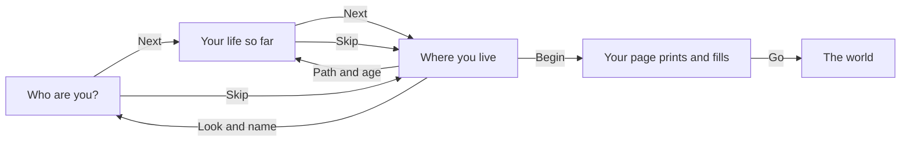

# The front door

This page shows how a new player makes a person and starts a life: the three screens of the front door, then the page that prints after Begin. The exact rules are in [the prologue's rules](../../rules/prologue.md).

Everything on the door is already chosen except the name, so a name, Next, Next and Begin start a life in under a minute.

  
  
  

## The three screens

The screens stand on a flat sky with nothing behind them. Shuffle, at the top of the first two, picks a look and a life at random and leaves a typed name as it is; Skip goes straight to Where you live.

### Who are you?

The player's figure stands on a photo card with the name on a sticker. Under it:

- **The name box.** It starts empty, with a suggested name in light ink. The dice fills it from the game's pool of names, or the player taps one of the names under it or types one. The suggestion is never taken as the name: Begin with an empty box comes back here.
- **The looks**, as round face stickers. A look is a whole character, never sliders, and changes nothing in the life.
- **Make it yours**, which opens a skin tone, a hair colour, a top colour and, on a printed top, the fabric.

### Your life so far

The lives the player can start from, called archetypes, sit as big sticker cards swiped sideways. Each card says what the years before were, what the life is like now and what it starts with, and the chosen life's ways out show as picture chips under the deck. The age is set in steps under the cards, and each step says what an older or younger start changes.

### Where you live

A strip at the top repeats the face, the name, the path and the age; tapping it goes back to change them. Below it, the chosen home stands as a postcard, its stamp showing the money the life will hold at Begin, with the other homes behind it and a row of small tiles to switch. A home the savings cannot pay for is shut with a lock and says what is short. A self-contain flat is shown locked, as something to aim for. The homes themselves are explained on [the home](./home.md) page.

Begin, at the foot, starts the life.

## The archetypes

Each archetype is a ready set of answers to the years from sixteen, from school to a first trade, and each opens at least one way out the player can reach by their own effort.

| Archetype | The years before |
|---|---|
| The developer | Science, then computer science |
| The nurse | Science, then nursing school |
| The accountant | Commercial, then accounting |
| The writer | Arts, then mass communication |
| The trader | Years under a spare parts master |
| The shop worker | Straight from school to a shop counter |
| The child of the water | Grew up in Makoko, a canoe to school, then the fish racks; starts in Makoko |

The ways out each one opens, and its full set of answers, are in [the archetypes table](../../rules/prologue.md#the-archetypes).

## Begin and the page

After Begin, the archetype's answers play out year by year without showing a card for each, and a travel data page prints with the person on it. The page fills with:

- the family the game drew;
- the years before, as chips, each showing Not yet until it is lived;
- the figure cheering beside a card of the home, saying where the life starts and when rent is next due;
- the money and japacity as they stand;
- the first step.

The world opens when the player taps Go; the page never closes by itself. Later, a tap on the name or the age in the band opens the same page again, kept up to date.

  
  

::: info The data page is invented
The page is drawn in the game's own style with a made-up country code. It carries no real passport number, coat of arms or issuing authority, and no stamp until a visa is granted.
:::

::: details Exceptions
- **A name that fails its checks** sends the player back to the first screen, saying why.
- **The family draw.** On the device, the game makes sure the archetype's path is open from the first year. Online, each life gets one draw, so the card warns that the years may go another way, and the page tells the life as it was lived.
- **Online,** the account's age screen comes before the door (see [accounts](./accounts.md)). The date of birth asked there is only for the terms and is never part of the character.
- **The ready lives** are not on the door; they sit behind Settings. See [the ready lives](./ready-lives.md).
:::

## Rules it rests on

- [The prologue](../../rules/prologue.md): prologue:front-door-builds-a-person, prologue:front-door-three-screens, prologue:archetype-presets-answers, prologue:tile-path-open-from-start, prologue:makoko-start-never-a-trap, prologue:printed-page-hands-over, prologue:player-colours-on-looks, prologue:nothing-behind-the-door.
- [Home](../../rules/home.md): home:compound-room-is-a-home, home:move-home-once-a-month, home:living-by-hand (what each home costs).
- [Accounts](../../rules/account.md): account:age-screen-refuses-minors.
- [The server](../../rules/server.md): server:server-plays-prologue-preset (online, the years are played by the server in one request; decision 0008).
