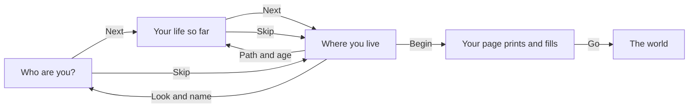

# The front door

A new player builds a person before the life starts: a look, a first name, a path through the years before, an age and a home. The front door is three screens on a flat sky, and everything on them is already chosen, so Next, Next, then Begin starts a life in under a minute. The last screen is Where you live, with Begin. After Begin a travel data page prints with every answer on it and fills with how the years went, and Go opens the world.

  
  
  

## The three screens

**Who are you?** The player's figure stands whole on a photo card, under the sun by day or the moon at night, with the name on a sticker. Under it sit a first name, already filled from the name pool, with a dice for another, and the looks as round face stickers. A look is a whole character model, never sliders, and it carries no stat. Under the looks, a tap on "Make it yours" opens a skin tone, a hair colour, a top colour and, on a printed top, the fabric (plain, ankara, adire, aso-oke). Nothing stands behind the screen but the sky.

**Your life so far.** The archetypes, as big sticker cards swiped sideways, the first one chosen. Each card shows the life's own thing, the player's face, a tag, its name, the life in a few words, what the years before were and the savings it starts with; the picked life's ways out show as picture chips. Under the cards sits the age, set in steps.

**Where you live.** A strip with the face, the name, the path and the age: a tap on the face goes back to change the look and name, a tap on the name to change the path and age. Under it the home picked stands as a postcard, its stamp carrying the money to start, with the other homes fanned behind and a row of small home tiles to switch. Begin starts the life.

Shuffle, at the top of the first two screens, picks a look, a name and a tile at random. Skip goes straight to Where you live.

::: info The page is the game's own
The data page is drawn on pale green security paper in the game's own style. Its country code is a made-up "JPC", and its machine-readable strip is built from the game's own data. It carries no real number, coat of arms or issuing authority, and no stamp until a visa is granted.
:::

## The archetypes

An archetype is a preset of answers to the years from sixteen. The presets live in the game's content, where the client and the server read the same ones; the simulation only ever sees the answers, one card at a time. Every tile opens at least one way out the player can reach by their own effort.

| Tile | The years before | Ways out it opens |
|---|---|---|
| The developer | Science, then computer science | UK talent, UK skilled, the UK master's |
| The nurse | Science, then nursing school | UK health care, the Gulf contract, Canada's points |
| The accountant | Commercial, then accounting | Canada's points, UK skilled, the UK master's |
| The writer | Arts, then mass communication | The UK master's, Canada's points |
| The trader | Six years under a spare parts master | The Gulf contract, the road through the desert |
| The shop worker | Straight from school to a shop counter | The Gulf contract, the road through the desert |
| The child of the water | Grew up in Makoko, a canoe to school, then the fish racks | The Gulf contract, the road through the desert |

The full table, with each tile's preset answers, is in [the prologue's rules](../../rules/prologue.md).

## The age and the home

The age starts at the tile's own and goes up to three years older, never past 29. Each step says what it does: an older start has a little more saved and more papers in order; a younger one has more years before the routes that favour the young close.

"Where you live" offers, in this order, your own room (a room in a compound in Ojuelegba), a hostel room in Yaba and the family house to every tile, and Makoko to the child of the water alone, where it is the default. Each home has a line saying what it is and its costs as chips, and its stamp shows the money the life holds at Begin once moving in is paid. A tile's own home is picked first: the family house, or Makoko for the child of the water. A self-contain flat is always shown locked, as a goal with its yearly rent, and says "reached" when the savings would already cover it. The homes themselves are on [the home](./home.md) page.

::: details When a home cannot be paid
The room in a compound asks a year's rent plus the agent's and the agreement's fees at once. If the savings at the age picked do not cover that and a month of living there, its tile is shut with a lock and shows the sum still needed. When the tile or the age changes, a home already picked is kept while it can still be paid, else the tile's own, else the first that can be.
:::

## Begin and the page

Begin runs the archetype's answers card by card while the page stands on the door's sky, under "Your page, printed" and "Over to you" with the character's name. No card is shown; the draws still happen. Online the whole preset goes to the server as one request, the server plays every card in turn, and the page's chips come in one after another over about two seconds (decision 0008). Then the page fills: the family the game drew, said in two lines with small tags; the years before as chips with marks (the school certificate, the entrance exam, the course or the trade, the service year, any setback), each showing Not yet until it is lived; the figure cheering on a sticker beside a card with the home's picture, saying where the life starts and when rent is next due; the money and japacity as they stand; and the first step. The world opens only when Go is tapped. The page never closes on a timer.

  
  

The same page stays with the character. In the world, a tap on the name or the age in the band opens it again, with the age kept current and how ready the character is.

::: details Exceptions on the way in
- **A name that fails its checks.** A typed name passes the same checks as a username. One that fails sends the player back to the first screen, saying why.
- **The family draw shuts the tile's path.** Locally, the door tries up to eight seeds until the draw allows the tile's first answer, so the tile's path is open from the first card. Online the server makes one seed per life and retries none, so the tile's words say the years may go another way, and the page reads the life as it was lived, not the tile.
- **A preset answer is shut by a draw later on.** The open answer that suits the archetype is sent instead.
- **Online.** The account's age screen comes before the door (see [accounts](./accounts.md)). The date of birth asked there is the terms' check only and is never part of the character.
:::

::: tip The ready lives
The ready lives are not on the door. They sit behind Settings, as "Start from a ready life", where a life may be started over. See [the ready lives](./ready-lives.md).
:::

## Rules it rests on

- [The prologue](../../rules/prologue.md): prologue:front-door-builds-a-person (the door builds a person, the data page), prologue:archetype-presets-answers (archetypes as presets), prologue:tile-path-open-from-start (a tile's path open from the first card), prologue:makoko-start-never-a-trap (the Makoko start), prologue:front-door-three-screens (the three screens and Where you live), prologue:printed-page-hands-over (the page is the handover), prologue:player-colours-on-looks (your colours), prologue:nothing-behind-the-door (nothing stands behind the door).
- [Home](../../rules/home.md): home:move-home-once-a-month (the hostel room by the month), home:compound-room-is-a-home (the room in a compound and its rent), home:living-by-hand (the family house: your share, nothing charged).
- [Accounts](../../rules/account.md): account:age-screen-refuses-minors (the age screen online).
- [The server](../../rules/server.md): server:server-plays-prologue-preset (the preset played by the server in one request).
