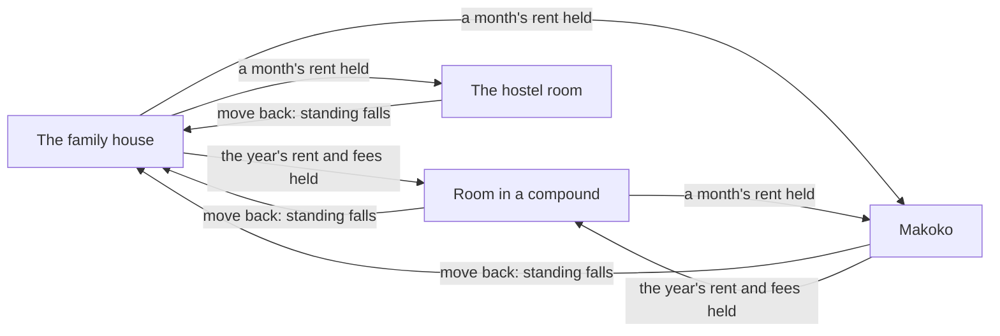
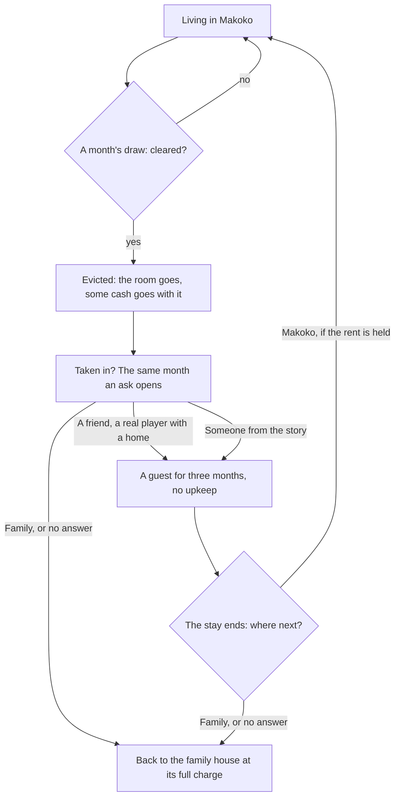

# The home

Where the character sleeps decides what each month costs, and so how fast the saving goes. There are four homes in Lagos: the family house, a room of your own in a compound in Ojuelegba, a hostel room in Yaba, and a room on the water in Makoko. The game opens at home, and home holds the things a month needs: the bed, the papers box, the cooking corner and the water drum. Cheaper homes save faster and carry their own risks, which the game says plainly.

  
  
  

## The four homes

| | The family house | Your room in a compound | The hostel room | The room on the water |
|---|---|---|---|---|
| Where | Surulere | Ojuelegba | Yaba | Makoko, on the lagoon |
| What it asks | Nothing is charged: the month's measure (₦95,000 for a life from sixteen) is told as your share for the house, bought as you go, and Papa pays the rest | A year's rent upfront, ₦350,000, plus a tenth each for the agent and the agreement; then living of about ₦50,000 a month, paid as you go | ₦15,000 a month, with no year's rent | The first month's ₦25,000 on moving in; then the living is paid as you go |
| The catch | The family talks and leans | The next year's rent falls due twelve months on | The rent falls due every month | Some months the settlement is cleared |
| Who can start there | Every tile | Every tile whose savings cover the move and a month | Every tile | The child of the water alone |
| Water | Fetched from the borehole down the street | Free from the yard's tap: you fill the drum | Free from the tap: you fill the drum | Fetched from the borehole sellers |

A self-contain flat stands on the door's Where you live as a goal with its yearly rent, always locked. It is not a home the character can live in.

## The wide house

The family house, the room in a compound and the hostel are each one wide house of walled rooms, seen whole from above, straight down its length, with the near walls cut low. The family house has the parlour, the kitchen, the bathroom, your corner as its own small room, the dining part, and the yard along one side with a carport, the clothes line, the generator and the gate. The room in a compound is your room, a bathroom, a kitchenette and the compound yard with your spot by the gate. The hostel is one small room of your own off a shared corridor.

A tap on a room, or a pinch, eases the camera in on it; a thing tapped from the whole house eases in first, so its fan opens close. A tap outside the room, a pinch out or "See the whole place" eases back out. The round button over Phone, "See another side", turns the house a quarter, and a sideways finger does the same, snapping to the nearest quarter; the house opens as it was left. A finger up or down tilts the view toward one from above.

In a home of your own, the things bought on the phone's Market stand in the room, and a hold on one lifts it to move or turn. A car bought stands at the home's car spot.

## Moving

The home card in the Bills app shows where the character lives, the monthly charge, and a move to each other home with what it costs a month and what it takes now. A move is made at home, at most once a month.

Moving back to the family house reopens its upkeep and costs a little standing: the family talks.

::: details When a move is shut
The card names the reason. "Moved" means a move was already made this month. "Short" means the money for the move is not held: the first month's rent for Makoko or the hostel, or the year's rent and the fees for the room. The card reads one refusal from the view, the same one the command would give.
:::

## The chores

Each home's things carry the chores. They answer at once and may be done again as the body allows, the scene shows them (the pot steams, the drum fills), and each takes a little of the month's time: a meal a morning, water a day, a big pot a weekend.

  
  

- **Meals**, at the cooking corner or the stove. At the family house, Food from the pot is free, since Mama's pot is the house's, and A big pot for the house buys ₦7,500 of foodstuff for everyone, with Mama's thanks. In a home of your own the meal is your own and is paid: Indomie and egg (₦1,500) or a pot of jollof (₦7,500). A meal fills the character.
- **Water**, at the drum: Fetch water at the family house and in Makoko, where water comes from the borehole. In the room in a compound and the hostel the drum is filled free from the tap (Fill the drum).

The Calendar lists the chores done this month. The month's results do not list them again: a chore is answered where it is done.

## Makoko and the clearing

Each month in Makoko there is a small chance (5 per cent, halved while the character is down) that the settlement is cleared. The room is gone, its charge closes with nothing owed, and up to ₦20,000 of cash goes with it. Standing does not fall: it was not the character's doing. The month's results lead with it, News carries the story, and the same month an ask opens: who will take you in.

::: warning Told straight
Eviction is part of life on the water and part of the game. It is told plainly, never as a joke line, and the risk is said once on the home card ("Some months the settlement is cleared") and heard in the city's talk before any move.
:::

::: details Exceptions at home
- **The room's rent unpaid.** The room's yearly rent defaults on the third miss in a row. The landlord takes the room back, and the character goes back to the family house as after a clearing, with the standing cost.
- **A guest's host.** When a real player takes the character in, the host's own upkeep rises by a quarter while the guest stays. No money moves between the two lives.
- **Abroad.** The home in Lagos is kept as it was and not read; the room abroad is its own place with its own money.
- **The first entry.** The first time a life enters a home, the home's blurb shows once as a small card the player dismisses ("One room in a compound of ten. One tap in the yard for everybody, and the buses all night.").
:::

## Rules it rests on

- [Home](../../rules/home.md): home:home-slice-fields (the home slice), home:move-home-once-a-month (moving, the hostel by the month), home:makoko-eviction-draw (eviction), home:taken-in-after-eviction (taken in), home:hosting-costs-the-host (hosting), home:home-is-the-home-point (the home point and its things), home:view-carries-home and home:moves-carry-cost-and-reason (the home card and its moves), home:compound-room-is-a-home (the room in a compound), home:rent-default-returns-to-family (a defaulted rent), home:living-by-hand (living by hand, the family's pot), home:things-a-life-owns (what a life owns).
- [Obligations](../../rules/obligation.md): obligation:cooking-and-fetching-water (cooking and water), obligation:prepaid-entries-skip-first-charge (rent paid ahead).
- [The prologue](../../rules/prologue.md): prologue:makoko-start-never-a-trap (the Makoko start), prologue:front-door-three-screens (Where you live on the door).
- [The world](../../rules/world.md): world:thumb-buttons-carry-dots (the turn button), world:camera-always-raised (the camera's two states), world:opens-where-last-stopped (the game opens at home), world:room-seen-down-its-length (the wide house, eased in on a room, turned in quarters), world:room-things-and-buy-mode (the things in the room and buy mode).
