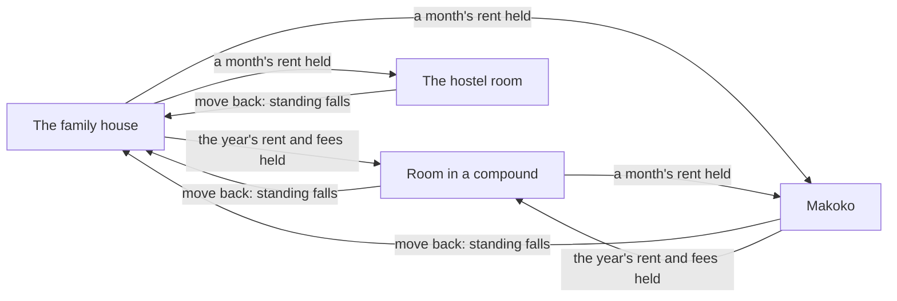
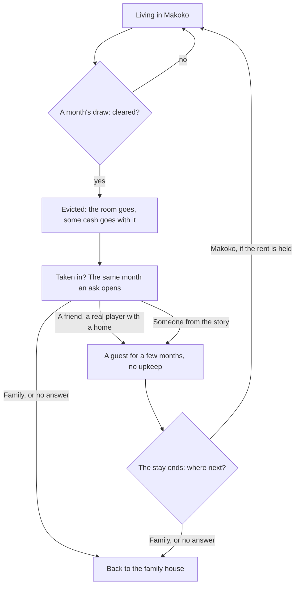

# The home

This page shows the homes a life can have in Lagos, how the player moves between them, and the chores done there. Where the character sleeps decides what each month costs, and so how fast saving goes. The exact rules and costs are in [the home rules](../../rules/home.md).

The game opens at home. Home holds what a month needs: the bed, the papers box, the cooking corner and the water drum.

  
  
  

## The four homes

Cheaper homes save faster and carry their own risks, which the game says plainly.

| | The family house | Your room in a compound | The hostel room | The room on the water |
|---|---|---|---|---|
| Where | Surulere | Ojuelegba | Yaba | Makoko, on the lagoon |
| How it is paid | Nothing is charged; your share for the house is bought as you go, and Papa pays the rest | A year's rent up front, with the agent's and the agreement's fees, then living paid as you go | Rent every month, no year's rent | The first month's rent on moving in, then living paid as you go |
| The catch | The family talks and leans | The next year's rent falls due a year on | Rent is due every month | Some months the settlement is cleared |
| Water | Fetched from the borehole | Filled free from the tap | Filled free from the tap | Fetched from the borehole sellers |

Every archetype can start in the family house or the hostel, the room in a compound when the savings cover moving in, and only the child of the water in Makoko. A self-contain flat is shown on the front door as a goal, never as a home to live in. What each home costs is in home:compound-room-is-a-home, home:move-home-once-a-month and home:living-by-hand.

## The house on screen

Each home is one house of walled rooms seen whole from above, with the near walls cut low:

- **The family house:** the parlour, the kitchen, the bathroom, your corner, the dining part, and the yard with the carport, the clothes line, the generator and the gate.
- **The room in a compound:** your room, a bathroom, a kitchenette and the compound yard.
- **The hostel:** one small room off a shared corridor.

A tap on a room, or a pinch, eases the camera in; "See the whole place" eases back out. The round button over Phone, "See another side", turns the house a quarter, as does a sideways finger.

In a home of your own, things bought on the phone's Market stand in the room, and holding one lifts it to move or turn. A car stands at the home's car spot.

## Moving

The home card at the top of the [Bills app](./money.md#bills) shows where the character lives, what it costs, and a move to each other home with what it takes. A move is made at home, at most once a month.

Moving back to the family house costs a little standing: the family talks. A move that cannot be made says why on its card: already moved this month, or not enough money held.

## The chores

Each home's things carry the chores. They answer at once, the scene shows them (the pot steams, the drum fills), and each takes a little of the month's time.

  
  

- **Meals.** At the family house, food from Mama's pot is free, and a big pot for the house buys food for everyone, with Mama's thanks. In a home of your own the meal is paid for.
- **Water.** At the family house and in Makoko it is fetched from the borehole; in the room and the hostel the drum is filled free from the tap.

The Calendar lists the chores done this month. Their prices are in obligation:cooking-and-fetching-water ([the obligation rules](../../rules/obligation.md)).

## Makoko and eviction

Each month in Makoko carries a small chance that the settlement is cleared. The room goes, with some of the cash held, and nothing is owed; standing does not fall, since it was not the character's doing. The month's results lead with it, News carries the story, and the same month someone offers to take the character in. The chance and the losses are home:makoko-eviction-draw and home:taken-in-after-eviction.

::: warning Told straight
Eviction is part of life on the water and part of the game. It is told plainly, never as a joke, and the risk is said on the home card and heard in the city's talk before any move.
:::

::: details Exceptions at home
- **The room's rent unpaid.** After repeated misses the landlord takes the room back and the character goes home to the family house (home:rent-default-returns-to-family).
- **A guest's host.** When a real player takes the character in, the host's own upkeep rises while the guest stays. No money moves between the two lives.
- **Abroad.** The home in Lagos is kept as it was; the room abroad is its own place with its own money.
- **The first time a life enters a home**, a small card describes it once.
:::

## Rules it rests on

- [Home](../../rules/home.md): home:home-slice-fields, home:move-home-once-a-month, home:makoko-eviction-draw, home:taken-in-after-eviction, home:hosting-costs-the-host, home:home-is-the-home-point, home:view-carries-home, home:moves-carry-cost-and-reason, home:compound-room-is-a-home, home:rent-default-returns-to-family, home:living-by-hand, home:things-a-life-owns.
- [Obligations](../../rules/obligation.md): obligation:cooking-and-fetching-water, obligation:prepaid-entries-skip-first-charge.
- [The prologue](../../rules/prologue.md): prologue:makoko-start-never-a-trap, prologue:front-door-three-screens (the homes on the front door).
- [The world](../../rules/world.md): world:opens-where-last-stopped, world:room-seen-down-its-length, world:room-things-and-buy-mode.
