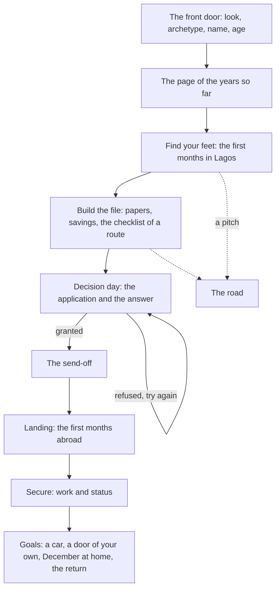
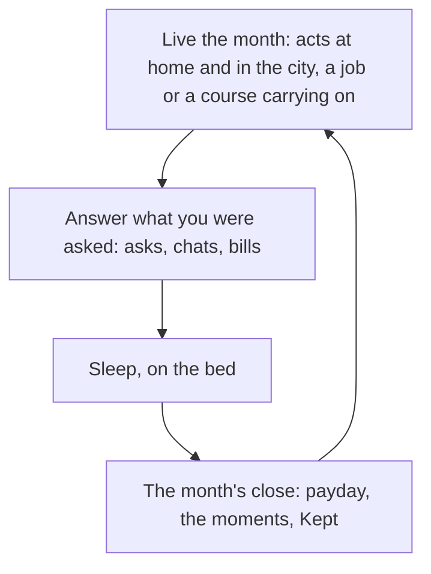

# How it plays

Japacity is a life in Lagos, played a month at a time on a phone. You make a person at the front door, start them in a home with a little money, and spend each month on work, study, people and errands across the city. Nobody picks a way out at the start: routes abroad become known as the life comes to match them, and your japacity is how ready you are for the best of them. Leaving is the main journey, and the life goes on after it, abroad and, if you choose, back home.

## A life, end to end

The game teaches itself in chapters, which the player knows as briefs. Each is a short checklist handed over by a person; finishing it opens the next.

::: info The chapters vary by route
Build the file and Decision day each come in a version for the route you are on, so the checklist is the right one for talent, points, health care or the Gulf. See [Chapters and routes](../built/chapters.md) for how they are put together, and the [chapter rules](../../rules/chapter.md).
:::

## One month

Every month has the same shape: live it by hand at home and across the city, answer what you are asked, then sleep on the bed to turn it and read what happened.

## The features

| Part of the game | Page |
|---|---|
| Making a person, the page, Begin | [The front door](./front-door.md) |
| The first brief, the nudge and the first sure job hunt | [The first months](./first-months.md) |
| Starting from a finished life of a given kind | [The ready lives](./ready-lives.md) |
| Walking Lagos: places, things, the fan of acts, the words over heads, the map | [The city and the places](./city.md) |
| The family house, a room in a compound, the hostel, Makoko | [The home](./home.md) |
| Living the month, Sleep, the results, the Calendar | [The month and the Calendar](./month.md) |
| Cash, the bank, the float, Bills | [Money](./money.md) |
| The phone and each app | [The phone](./phone.md) |
| Family, the circle, asks, pairs and invites | [People](./people.md) |
| The weekly draw | [The Friday draw](./friday-draw.md) |
| The Papers app, the passport office, the file chapter | [Papers and the file chapter](./papers.md) |
| Official pages, advisers, points, the visa, decision day | [Routes and japacity](./routes.md) |
| The interview and the staged moments | [The interview and the set pieces](./interview.md) |
| The dangerous route, told plainly | [The road](./road.md) |
| The room, work, status, December, the return | [Abroad](./abroad.md) |
| Cards to share and the japa type | [Share cards and the japa type](./share.md) |
| Settings and starting again | [Settings and a new life](./settings.md) |
| Guest play, sign-in, invite links | [Accounts](./accounts.md) |
| Block, report and the pages players read | [Moderation and the legal pages](./moderation.md) |
| Every source the game cites, built at each build | [Every source](./sources.md) |

::: tip Where the rules are
Every feature rests on rule pages with ids, such as [the turn rules](../../rules/turn.md) or [the home rules](../../rules/home.md). Each page here ends with the rules it rests on. The rule pages are the source of truth; this half of the site explains them with pictures.
:::
