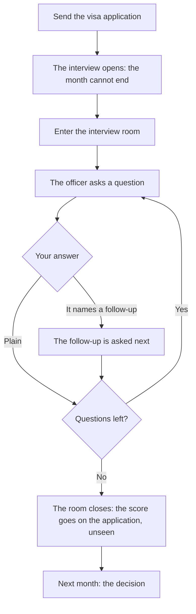

# The interview and the set pieces

Some moments in a life are scenes, not acts: the visa interview, the night meeting on the road, the December visit home, a nurse's certification exam, a talk at the hub. The game calls them set pieces. This page shows how they play; the questions and how answers are scored are on [Routes, schools and the interview](../../rules/route.md#rules-the-interview) and [The genuineness interview](../../rules/interview.md). A set piece:

- asks one question at a time, and shows how far along it is ("Question 1 of 3");
- never shows a score;
- holds the month open: the month cannot end until it is finished, though every other act still works.

## The visa interview

The visa interview is the set piece most lives meet, and its answers move the chance of the visa.

Sending a visa application opens the interview at once. The nudge says it waits at the visa centre, and a tap opens it among the things waiting on you. "Enter the interview room" starts it. That tap also lets the browser play sound, so the officer's lines are spoken and shown as text together. Every line is on screen, so the sound is never needed, and a switch mutes it.

The officer asks a few questions, drawn from those that fit your file:

- Some always come up: why this course, who pays, what you will do after, what the course covers, where you will live.
- Some come only when something in the file calls for them: a large share of the funds that you cannot explain, or a transcript that is not genuine.
- Some answers bring a follow-up question, chosen by the answer you tapped, never by what it scored.

The score is never shown; a better score lowers the chance of a refusal (route:visa-refusal-chance). An answer that names real modules and real figures does better with interview practice behind it.

::: tip Practice
Interview practice at the hub is an act like any other. It turns a detailed answer from a risk into a strength, and with enough of it the screen marks the answers that would count against you before you choose.
:::

Two things in the file change the room:

- **Fake papers.** If the transcript you used was bought, the officer says the university has no record of it. Every answer to that question counts against you.
- **Unexplained money.** If too much of the funds you show came from unexplained sources, the officer asks about the large sum. Saying it was a gift from an uncle brings a follow-up.

## The partner interview

A route that rests on a relationship (joining a partner in the UK, being sponsored by a spouse in Canada) ends in a different interview. Both partners answer a handful of questions on their own, such as where they first met, what they did, how often they have met, what the other does for work and where they will live. The questions come from the pair's own shared record, and the answers are compared. While the interview is open, each partner answers from memory: the shared moments are hidden.

The more answers match, the better it goes. Enough matches pass; fewer raise doubt, and the refusal chance rises; too few fail, and the application is refused. A thin record with answers that do not agree is caught as a sham: refused, every route into that country shut for years, and standing falls. The thresholds are on [The genuineness interview](../../rules/interview.md#numbers).

::: warning A marriage for papers
The game lets you choose one. A thin record with answers that do not agree is how it is caught, and both lives carry the ban.
:::

::: details Exceptions
- A dependant with a long shared history is not called in at all; only a thin record is interviewed.
- When the other partner is a computer character, its answers are made when the interview opens.
- When the other player is away, a stand-in answers for them after a set number of real days, as a partner who lived the history would, so nobody waits for ever.
- If the bond ends before both have answered, the interview closes unscored and the application is withdrawn.
:::

## The other set pieces

| Set piece | When | What it asks |
|---|---|---|
| The night meeting | After paying the road's deposit | Get on the bus, or go home. See [The road](./road.md) |
| The truth | Three days north on the road | Pay, call home, or find the migration agency |
| December at home | Once a year abroad, in December | First whether to go, then the party, the gifts and the look. See [Abroad](./abroad.md#the-december-visit) |
| The certification exam | A nurse sitting her certification | A few exam questions, with a pass mark |
| The talk | A developer giving a talk at the hub, once a life | How you start |

## Rules it rests on

- [Routes, schools and the interview](../../rules/route.md): route:application-fixes-figures, route:application-opens-interview and route:visa-refusal-chance and the set pieces.
- [The genuineness interview](../../rules/interview.md).
- [Activities and jobs](../../rules/activity.md): activity:waiting-months-build-profile (the certification exam and the talk).
- [Coming home](../../rules/return.md): return:december-visit-set-piece (the December visit).
- [The road](../../rules/road.md): road:road-night-allows-turn-back, road:road-truth-asks-more.
