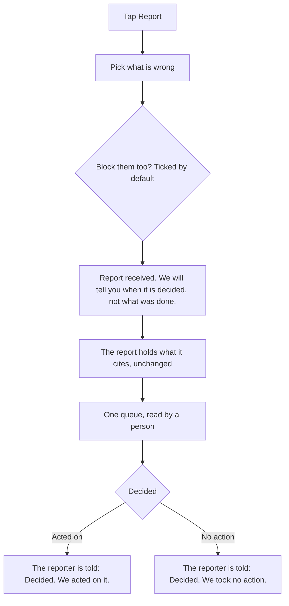

# Moderation and the legal pages

Wherever a player meets another player, or anything the game did not write, there is a way to block and a way to report. This page shows those controls, what the team does with a report, and the legal pages beside the game; the rules are on [Block, report, the queue and the admin view](../../rules/moderation.md).

- Players cannot type to each other: they speak in set phrases, so a report never carries typed text.
- Every report is read by a person on the team, in one queue, and the reporter hears back when it is decided.
- Beside the game are two plain pages every player can read: the Terms of play and the Privacy notice.

## Block

One tap blocks. From then on nothing passes between the two accounts in either direction: no phrase, no invite, no pair request, no joint application, and neither sees the other's character in a place.

- A block needs no reason.
- The blocked player is never told: their sends are refused the same way as a connection that has lapsed.
- A block ends any shared record the two had, as a break-up does, at no cost to the one who blocked.
- Unblocking brings nothing back; a new invite is needed.

## Report

A report can be sent from every surface where a player meets another player or something the game did not write:

| Surface | What the report cites |
|---|---|
| A conversation | The messages |
| A phrase said in a place | The place, the phrase and the time, marked unverified, since spoken phrases are not stored |
| A character, a display name, an invite card | The card or the account |
| A pair record, a stand-in's behaviour | The pair record |
| An advert | The campaign and the slot |

The reasons are a fixed list: a scam or asking for money, harassment or bullying, pretending to be someone, under 18, sexual content, hate, self-harm, something illegal, cheating, a bad advert (on an advert), something else. A player can send only so many reports a day.

::: info While a report is open
What a report cites is kept as it was until the report is decided, up to a limit, even if either account is deleted meanwhile (the limits are in the [Numbers table](../../rules/moderation.md#numbers)). A reported conversation is paused in the reported player's direction: nothing new reaches the reporter from them.
:::

## The queue and the team

Every report, every advert sent in and every appeal enters one queue, the most serious reasons first and oldest first within each (moderation:one-queue-by-reason-weight). The aim is a decision within a day.

The team works in an admin view reached only by accounts on the admin list, each from a session that has shown its passkey.

- It shows the report, what it cites, both accounts' sign-up country and age in the game, and their past reports and actions.
- It never shows an email address, a seed, or anything of another player's character beyond what that player's own screen would show.

| Action | What it does |
|---|---|
| Dismiss, warn | Nothing more, or a warning |
| Mute | No phrases or invites for some days |
| Suspend | No sign-in for some days |
| Ban | The account is closed and its sign-in barred, even after deletion |
| Reset the name | The display name goes back to a generated one |
| Advert actions | Approve, refuse or pull an advert |
| Refer | Record that the matter was passed to an outside body |
| Rollback | Open the server's correction tool for that one account |

No action edits a balance, a state or a world value directly. Every action goes into a log that can only be added to.

## Lives across rule changes

A life is never lost to a change in the game's rules.

- Before a version that changes the game's rules goes live, every life is saved whole as it stands. The new rules carry it on from there and never replay its past.
- A life that does not come out the same is left as it was and listed for the team.
- If a life ever needs checking, the phone says "Your life needs checking on our side. Try again in a while." with a Retry that asks for it again.
- The team checks and repairs that one life with the server's correction tool, one life at a time, while everyone else plays on.

::: warning Under 18
An upheld report that an account is under 18 closes it and deletes its data, keeping only what the hold and the log need. A new date-of-birth answer from the same sign-in does not reopen it.
:::

A player who is warned, muted, suspended or banned is told what was done, the reason from the list, and how to appeal, under "From the team", a row in the phone's Settings. An appeal is made once, and decided by a different person on the team where there is more than one.

## Feedback

Online, a Feedback row sits in the phone's Settings. It opens a box for a short text and a send button. Only the team reads it, it does not say who sent it, and it is never shown to another player. Together with the name on a dedication light (below), it is one of the two typed texts the game accepts.

## Dedication lights

On the dedication page a player may light one light and name it for someone of their own, with the years if they want.

- The light shows to everyone at once, bare. Its name reaches other players only once the team has approved it.
- The admin page's moderation tab lists the lights waiting, oldest first, with the name, the years, the account's username and sign-up country and when it was lit, and Approve or Refuse on each.
- Refusing puts the light out, and the player may light again.
- Both are written to the log with the reason `dedication`.

## The legal pages

Two plain pages are served beside the game, readable with no game, no sign-in and no script:

- **Terms of play**: who runs the game, agreeing to the terms, adults only, your account, that it is a game, game money, other players, what you must not do, complaints, deleting your account, changes, licences, the game's responsibility, and the law the terms follow.
- **Privacy notice**: who runs it, the law the notice follows, the short version, what is kept and why and for how long, who else handles it, adults only, your rights, deleting your account, and changes.

They are linked from the start screen, the age screen, the invite page, the account settings and the guides menu. Who runs the game is written once, in the content, and filled into both pages when they are built. A complaint beyond the game goes to the address the terms give, and gets a reply (moderation:actioned-player-told-and-appeals).

::: details Exceptions
- **Locally** there is no team and no server: the block and report controls do not show, and nothing is sent.
- **A card before sign-up** can be reported but not blocked: there is no pair yet to block.
- **No screen shows a phrase said in a place** or a player seen in one, so those two surfaces have no control on screen yet; the control is built to take them.
:::

## Rules it rests on

- [Block, report, the queue and the admin view](../../rules/moderation.md): the whole page, with the notice and the feedback box as rows in Settings (moderation:actioned-player-told-and-appeals, moderation:feedback-box-in-settings), and the dedication's lights list (moderation:dedication-lights-await-approval).
- [Pairs](../../rules/pair.md): the block and report controls on a pair, phrases and invites.
- [Accounts](../../rules/account.md): account:age-screen-refuses-minors (the age screen), account:player-deletes-account (deletion).
- [Who can play, and who runs the game](../../rules/region.md).
- [Adverts](../../rules/advert.md): advert reports and the queue.
- [The server](../../rules/server.md): every life saved whole before a change of rules goes live (server:snapshot-before-deploy), and the correction tool for one life (server:rollback-check-finds-divergence, server:rollback-apply-one-account).
