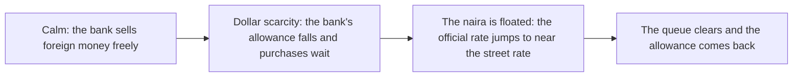
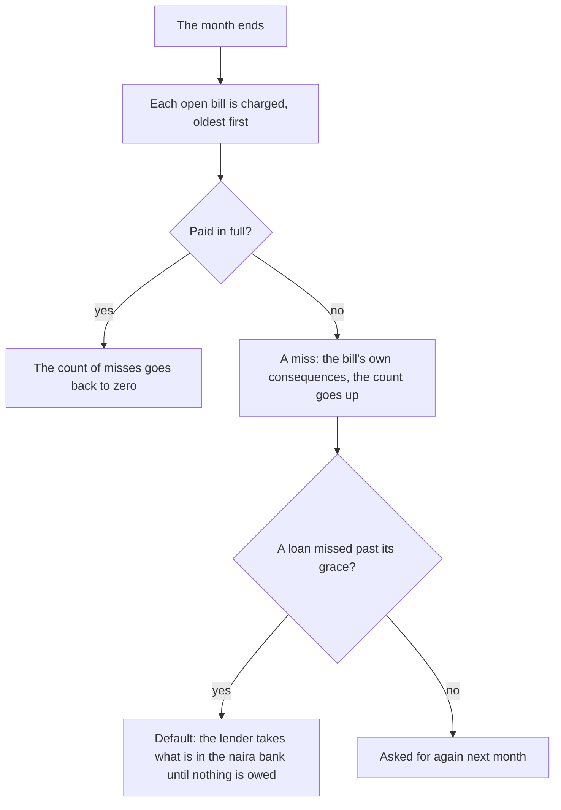

# Money

This page shows how money is held and moved in a life: the pockets, the Bank app, changing naira, the warnings, Bills and the month's results. The exact rules and figures are in [the money rules](../../rules/wallet.md) and [the obligation rules](../../rules/obligation.md).

Money is held as it is in Lagos: some in the bank, some as cash on you, in naira and, once you can get them, in pounds and dollars. Pay comes in, the month's costs leave, family asks for help, and you decide where the rest sits and what it is changed into. Nothing moves by itself, and every movement has a reason.

## The pockets

Each currency has three pockets.

| Pocket | What it is | Can be spent |
|---|---|---|
| In the bank | Documented money | Yes |
| Cash | Money on you, not documented | Yes |
| Locked | Money in the bank held for a lender, which still counts when funds are shown | No |

No pocket goes below zero. A payment that cannot be met in full does not happen at all, and its button says so before it is pressed.

Salary goes to the bank. Other money that comes in goes to cash when it is small and to the bank when it is large. Going out, transfers (rent, fees, bills) come from the bank first, while small street payments (a fare, the kiosk) come from cash first. The threshold and the order are wallet:money-lands-as-in-lagos.

## The Bank app

The Bank app on the [phone](./phone.md) opens at home on the passbook:

- **The bar:** the money held for the road against the road's whole cost (funds to show, fees ahead and the flight), with cash and bank as chips under it.
- **The pace line:** how soon the road is paid for at the pace of recent months, and how much sooner one road to money would make it ("At this pace: ready in 15 months. With Papa's loan: 4.").
- **The stamps:** round stickers that fill as savings pass a few milestones on the way to the whole cost.
- **Last month:** money in before money out.
- **The roads to it:** one-tap cards to the next rung of work, a side job, the savings circle, the family, or a scholarship.

Behind the passbook are Saved for the move (what decision day will ask to see, in the way's own currency, once a plan is made), any change of money on its way, recent movements, and two acts:

- **Change money:** where (at the bank or with the FX man), from which currency, into which, and how much, then one card with what goes in, what comes out and what you hold after.
- **Move money:** naira between the bank and cash.

Abroad, the country's own money stands first, and when the month's dues are more than it, the Bank leads with the gap. The Bank also sends money home: by app, by bank transfer (it arrives the next month) or through someone (no fee, but it may never arrive), each showing its fee and the naira that arrives (abroad-money:remit-sends-money-home). Family requests are paid from the naira at home, so money must be sent home first. See [Abroad](./abroad.md).

## The bank and the FX man

| | At the bank | With the FX man |
|---|---|---|
| Rate | The official rate | The street rate: more naira to the dollar |
| Limit | A monthly allowance for buying foreign money | None |
| Speed | At once, or months later while the bank has a queue | At once |
| Pockets | Bank only | Cash only |
| Risk | None | Now and then he counts short |

The charges, the allowance and the odds of a short count are in the [money rules](../../rules/wallet.md) (wallet:bank-converts-at-official-rate, wallet:monthly-fx-allowance, wallet:aboki-short-count). A lot of cash paid into the bank in one month is noticed and remembered for a while (wallet:large-deposits-record-lots); pay that arrives as salary never is.

## The float

The rates are the same for everyone at the same moment of the world, and two news stories can move them a great deal.

After the float, naira savings buy fewer pounds than the night before, and money already in pounds or dollars is worth more in naira. Since funds are valued in pounds on the day, a naira balance can fall short without a kobo leaving it. The stories come as rumour first, then announced, then in force, so a player who reads [News](./phone.md#news) has time to act. See [the rate rules](../../rules/rate.md).

## The warnings

- **Cash on you.** When a month closes with a lot of naira in cash, Mama calls once in a life to say it is not safe, and the news carries a story of a robbery in a danfo. Nothing is moved for you.
- **The month's dues.** Any button that spends money says what is left after, and warns when that would be less than the month's dues. Abroad, the nudge says so first when the month's dues are more than the money held.

::: details A prize that asks for a fee
A message may say your line has won a promo and ask a small fee to claim it. Most are frauds; an honest one pays. The card shows what you notice (a deadline within the hour, an ordinary phone number), and the game never says which it was before you choose (luck:telco-promo-may-be-fraud).

:::

## Bills

The Bills app lists every regular charge. At the top is the home card: where you live, what it costs, and the moves you could make (see [The home](./home.md)). Under it, each bill, with what is due this month first.

- Most bills are taken at the month's end and say so; one taken every few months says when the next falls.
- Loans and some other debts can be paid now, from a slip with the amount.
- A missed charge shows its count of misses.

Living costs are the exception: when money falls short they take what there is and record the rest as a miss, and they never go into default (obligation:upkeep-never-defaults). Every stage of debt has a way out: paying a loan ahead, answering a family request, and, once in a life, a whip-round from friends for someone who has nothing left (obligation:way-out-at-every-stage, luck:whip-round-once-per-life).

## The results

Each month ends with the results sheet. Its first figure is what was kept or lost this month, in the currency of the place you live; changing money counts for nothing either way. Below it is every line in or out. See [the month](./month.md#how-the-month-turns).

The game also counts how many months were kept above zero. It is never shown as a figure; the [japa type](./share.md#the-japa-type) reads it.

## Rules it rests on

- [Money](../../rules/wallet.md): wallet:no-pocket-below-zero, wallet:money-lands-as-in-lagos, wallet:bank-converts-at-official-rate, wallet:monthly-fx-allowance, wallet:bank-queue-delays-purchases, wallet:aboki-trades-at-street-rate, wallet:aboki-short-count, wallet:large-deposits-record-lots, wallet:months-kept-counted, wallet:cash-pile-warning, wallet:passbook-against-plan-cost, wallet:savings-stamps, wallet:saving-pace, wallet:roads-to-the-target.
- [Rates](../../rules/rate.md): rate:official-rates-drift-together, rate:street-premium-tracks-target, rate:float-jumps-official-rate.
- [News](../../rules/news.md): the dollar scarcity and the naira float.
- [Obligations](../../rules/obligation.md): obligation:due-phase-charges-oldest-first, obligation:charges-paid-whole-or-missed, obligation:miss-applies-its-effects, obligation:upkeep-never-defaults, obligation:loan-default-and-recovery, obligation:paying-down-obligations, obligation:group-loan-fees-up-front, obligation:group-covers-misses-at-cost, obligation:three-roads-to-group-loan, obligation:way-out-at-every-stage.
- [Luck, the safety net, and the kiosk](../../rules/luck.md): luck:whip-round-once-per-life, luck:telco-promo-may-be-fraud.
- [The world](../../rules/world.md): world:phone-holds-what-phones-hold, world:one-action-one-sheet, world:month-end-results-sheet.
- [Money abroad](../../rules/abroad-money.md): abroad-money:salary-abroad-taxed-locally, abroad-money:remit-sends-money-home.
