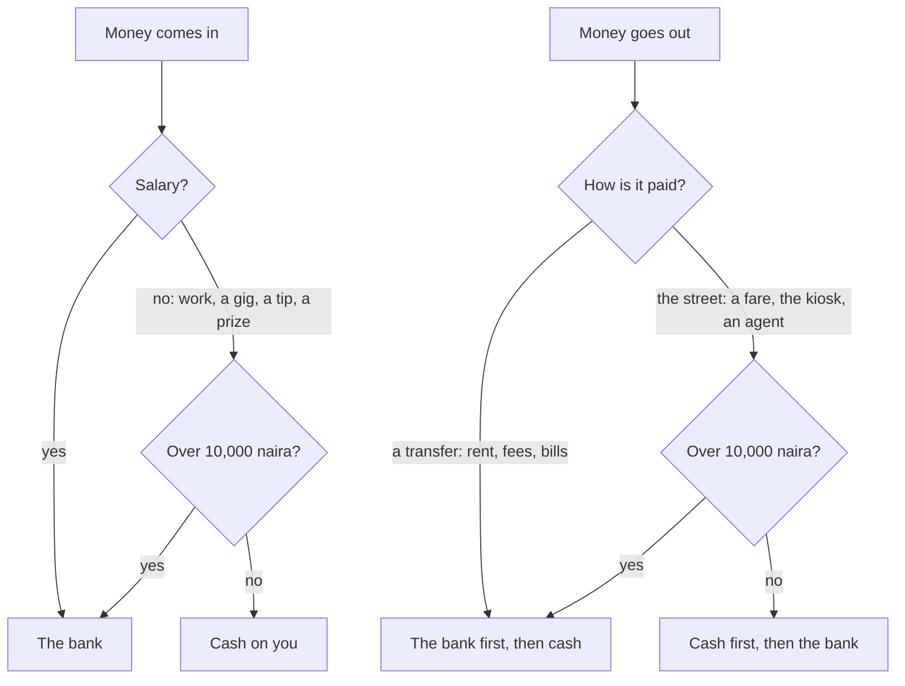
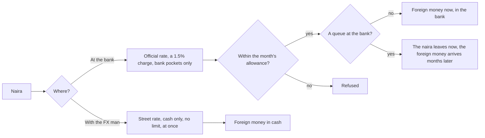
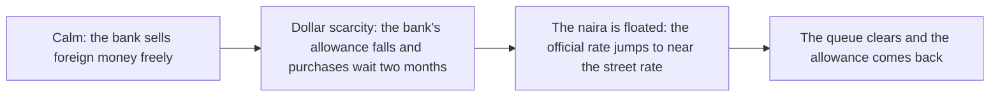
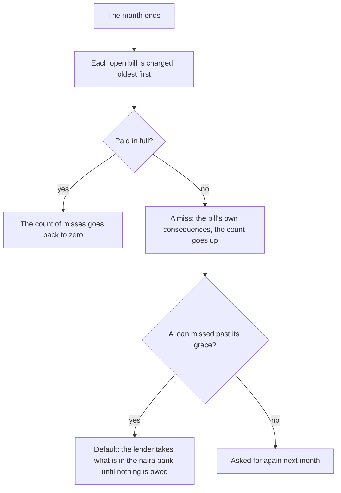

# Money

Money in Japacity is held the way it is held in Lagos: some in the bank, some as cash on you, in naira and, once you can get them, in pounds and dollars. Every kobo is a whole number, every movement has a reason, and nothing moves by itself. Your pay comes in, the month's costs leave, family asks for help, and you decide where the rest sits and what it is changed into. The bank is slow and limited; the FX man on the street is fast, has no limit and is not always honest.

## The pockets

For each currency there are three pockets.

| Pocket | What it is | Can be spent |
|---|---|---|
| In the bank | Documented money | Yes |
| Cash | Money on you, not documented | Yes |
| Locked | Money in the bank that counts when funds are shown, held for a lender | No |

No pocket ever goes below zero. A payment that cannot be met in full does not happen at all, and the button that would send it says so before you press it.

### Where money goes in, and where it is taken from

Locked money is never taken by an ordinary payment. Only the FX man, a theft and a robbery take cash alone.

## The Bank app

The Bank app on the [phone](./phone.md) opens at home on the passbook: the money held for the road (the bank and cash of every money at the official rate, never locked money) against the road's whole cost (the funds still to show, the fees ahead and the flight), with a bar that fills and the cash on you and the bank as chips under it. A pace line says how soon the road is paid for at the rate money has been kept lately, and how much sooner one road would make it: "At this pace: ready in 15 months. With Papa's loan: 4." Under it stand the stamps, round stickers at ₦1m, ₦2.5m, ₦5m and the whole cost, each filled once a month closes with that much held; last month's money in before out; and the roads to it as cards with one tap each: the next rung of work, a side job, the street's savings circle, the family, and the scholarship where the plan names one. Behind the passbook stand Saved for the move, any change on its way, the money that moved lately, and two acts at the foot.

- **Change money** picks where (at the bank or with the FX man), from which money, into which, and how much, then shows one card that says what goes in, what comes out and what you hold after.
- **Move money** moves naira between the bank and cash.

**Saved for the move** appears once a plan is made. It counts what the plan's decision day will ask to see plus the fees still ahead, against everything held in the bank and as cash at the official rate. The passbook counts the whole road in naira; Saved for the move keeps its own figure in the way's money.

::: info Abroad
Abroad the country's own money stands first, with naira and dollars under it, each with its own Change money. When the month's dues are more than the country's money held, the Bank leads with the gap and the way to close it. Abroad the Bank also sends money home: by app, by bank transfer (it arrives next month) or through someone (no fee, the street rate, and a chance it never arrives), each with its fee and the naira that arrives. Family requests abroad are paid from the naira at home, so money must be sent before one can be met. In every country abroad the month's upkeep is the phone alone (£15 in the UK, C$30 in Canada, AED 50 in the UAE, €10 in Italy); food, fares and the month's pass leave the country's money as they are bought, and the employer's bus to the site or the fields asks nothing. See [Abroad](./abroad.md).
:::

## The bank and the FX man

| | At the bank | With the FX man |
|---|---|---|
| Rate | The official rate | The street rate, which is higher |
| Charge | 1.5% of what is paid in | Selling foreign money back earns the street rate less 2% |
| Limit | Buying foreign money is capped each month by a world allowance | None |
| Speed | At once, or months later while the bank has a queue | At once |
| Pockets | Bank only | Cash only |
| Risk | None | A small chance he counts short |

::: warning The short count
With the FX man there is a small chance (1.5%) that what you receive is 3% to 8% short. It shows as its own line, money out, in the month's results.
:::

::: details Cash paid into the bank
Moving a lot of cash into the bank in one month is noticed. Past ₦500,000 of cash paid in during a month, each such move is recorded as a lot that is remembered for three months. Money that arrives as documented pay never is.
:::

## The float

The rates are the same for everyone at the same moment of the world. Two stories in the news can change them a great deal.

When the float comes into force, the official rate jumps so the gap to the street rate is small, and the street rate stays where it was. Naira savings buy fewer pounds the morning after than the night before; money already in pounds or dollars is worth more in naira. The stories come as rumour first, then announced, then in force, so a player who reads [News](./phone.md#news) has time to act.

::: tip Why this matters
Funds are valued in pounds on the day. A naira balance can fall below the line without a kobo leaving it. Dollars and pounds are the hedge, and the bank sells few of them.
:::

## The warnings

**Cash on you.** When a month closes with more than ₦100,000 in naira cash, after the years before the world, Mama calls once in a life: cash carried about is not safe, keep small for transport and put the rest in the bank. In the first months at home the news also carries one story of a robbery inside a danfo, so the warning is heard before it bites. Nothing is moved for you; moving the money stays your act in the Bank app.

**The month's dues.** The main button of any sheet that spends money says what is left after. When that would leave less than the month's dues, the button stays open and its line carries a warning. Abroad, when the month's dues are more than the country's money held plus the pay still coming this month, the nudge under the band says so first: "Find ... this month: ... held".

::: details A prize that asks for a fee
A message may say your line has won a promo and ask for a small fee to claim it. Most of these are frauds; an honest one pays. The card shows what you notice about it (a deadline within the hour, an ordinary phone number), and those signs can be learnt. The game never tells you which it was before you choose.

:::

## Bills

The Bills app is where every regular charge is listed. At the top is the home card: where you live, what it is, what it costs each month, and the moves you could make (see [The home](./home.md)). Under it, each bill: what is due this month first, then what is only owed.

- Most bills are **taken at the month's end** and say so.
- A bill taken every few months says when the next one falls ("Next instalment in 2 months").
- A loan, a group loan, held funds, a car payment that is behind, and what a sponsor owes can be **paid now**: a paper slip opens with the amount, and paying it sends the payment at once.
- A missed charge is shown with its count of misses.

::: details The living costs never default
The upkeep where you live is the one charge that is not all or nothing. Short of it, it takes every naira you hold and the shortfall is the miss, told as what was paid and what was short. Upkeep and support never build arrears and never go into default.
:::

::: details Ways out of debt
Every stage has a way out: a loan can be paid ahead from Bills, a family request can be answered, and once in a life a whip-round from friends can reach someone at home who has played a year and holds almost nothing. The words never make a recovery a joke.
:::

## The results

Each month ends with the results sheet. Its first figure is what was kept or lost this month, in the money of the place you live. A change of money counts for nothing either way; the bank's charge and a short count stay as money out. Below it, every line in or out.

The game also counts how many months were kept above zero. It is never shown as a figure; the [japa type](./share.md#the-japa-type) reads it.

## Rules it rests on

- [Money](../../rules/wallet.md): the pockets and their order (wallet:no-pocket-below-zero, wallet:money-lands-as-in-lagos), the bank and the FX man (wallet:bank-converts-at-official-rate, wallet:monthly-fx-allowance, wallet:bank-queue-delays-purchases, wallet:aboki-trades-at-street-rate and wallet:aboki-short-count), cash paid in (wallet:large-deposits-record-lots), the months kept (wallet:months-kept-counted), the cash warning (wallet:cash-pile-warning), the passbook, its stamps, its pace and its roads (wallet:passbook-against-plan-cost, wallet:savings-stamps, wallet:saving-pace and wallet:roads-to-the-target).
- [Rates and the stand-in world](../../rules/rate.md): the official and street rates and the float (rate:official-rates-drift-together, rate:street-premium-tracks-target and rate:float-jumps-official-rate).
- [News](../../rules/news.md): the dollar scarcity and the naira float.
- [Obligations](../../rules/obligation.md): charges, misses and default (obligation:due-phase-charges-oldest-first, obligation:charges-paid-whole-or-missed, obligation:miss-applies-its-effects, obligation:upkeep-never-defaults and obligation:loan-default-and-recovery), paying now (obligation:paying-down-obligations), the group loan (obligation:group-loan-fees-up-front, obligation:group-covers-misses-at-cost, obligation:three-roads-to-group-loan and obligation:way-out-at-every-stage).
- [Luck, the safety net, and the kiosk](../../rules/luck.md): the whip-round (luck:whip-round-once-per-life) and the promo (luck:telco-promo-may-be-fraud).
- [The world first](../../rules/world.md): the Bank's saved for the move (world:phone-holds-what-phones-hold), one action and one sheet (world:one-action-one-sheet), the results (world:month-end-results-sheet).
- [Money abroad](../../rules/abroad-money.md): pay, tax and sending money home (abroad-money:salary-abroad-taxed-locally, abroad-money:remit-sends-money-home).
