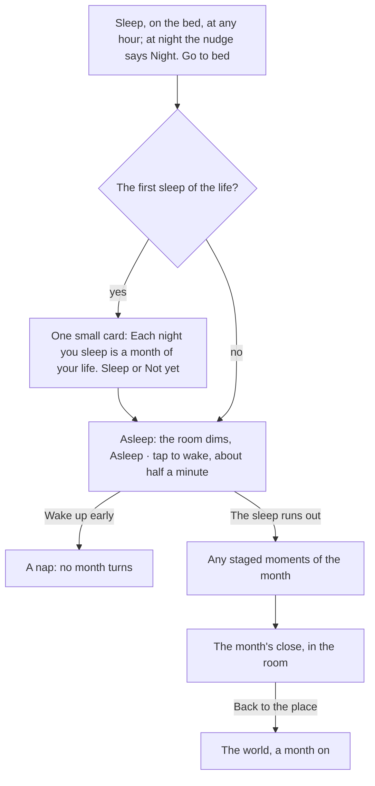

# The month and the Calendar

A life moves a month at a time, and the month is lived by hand. Acts at home and across the city each take a little of its time (a morning, a day, a weekend); a job or a course takes its days by itself; talking, looking and buying take none. The month turns when the character sleeps on the bed, and everything the month held comes at once on the month's close, in the room. The phone's Calendar app holds the month: the job, what carries on, the chores done and what is coming. There is no Next month button and no count of months to spend.

  
  
  

## Commitments and free time

There is no plan to fill in each month. A month-act the player starts at a thing (a job, a course, study, the portfolio, practice) is a commitment: it carries on every month until the player stops it, from its Stop on the thing's fan or from the Calendar, or until it ends by itself (a course finished, a way shut, a hunt whose job is now held).

What carries on is held to the month's free time:

| The life | Free time a month |
|---|---|
| With a job | Two |
| With no job | Three |
| Worn down (wellbeing under 25) | One fewer |
| Ill, or holding a side job | Fewer again, as each lock says |

Free time left empty rests, so rest is never planned. Quick acts (a purchase, a conversation, an application, a chore) answer now and never count against it. They spend the month's time instead, counted in half-days and never shown as a number: a life with no job has the whole month, one whose job takes its own days has a third of it. What stops a run of acts is the body, not the count: once the character's energy is low, every act that takes time says "You are spent. Sleep." where its button was, while talking, looking and buying stay open.

The Calendar lists, in order: the job; what carries on, each with its Stop, and any lock with its reason; the chores done this month; and what is coming, soonest first, each as months away.

## The month turns

Sleep is a timed act from the bed: the figure lies down, the room takes a soft dark wash, a chip under the band says "Asleep · tap to wake" and a Wake up button stands above the Phone thumb. Waking early turns no month and counts as a nap ("Up again. The night is still yours."). When the sleep runs out the month turns once. Then come any moments the month staged, and then the month's close, short, in the room: the best thing that happened (payday, or the best moment) leads as a card with its picture, money in comes before money out, rent shows as a chip when it was due, three moments show with the rest behind See the whole month, then Kept, and one button back to the place. A loss is said in quiet ink, never the loudest thing. What was bought or done by hand during the month was paid as it was done and is not listed again; the rest of the month's report stays in the phone's News app. On the twelfth month the results say the character turned a year older.

::: info No month numbers
No running month number shows anywhere a player sees. A deadline reads as months away ("in 2 months", "next month"), and a past month as months ago. The band shows the age in years and months; the phone's wallpaper shows the real date, since the world runs on the real calendar.
:::

## Quiet months

Nothing runs months in a row for the player: a quiet month is lived in minutes by hand, with the home's free acts, and turns when the character sleeps. Abroad the months go the same way.

## The world's day and the life's months

The world keeps its own day, the same for every player: one game day runs in an hour and three quarters of real time, so a sitting sees the sun move, and the band names the part of the day in words (Morning, Afternoon, Evening, Night). The months of a life are its own: they turn only when that life sleeps, as many in a sitting as the player likes. There is no count of months left and no wait for the next month. Only a result real life makes you wait for (an English test band, the endorsing body's answer, a visa decision) waits for the world's next morning, then arrives as an envelope on the phone's lock screen; play goes on meanwhile.

::: details Exceptions in a month
- **A spent body.** Acts that take time are shut with "You are spent. Sleep." until the character sleeps. The city and the phone stay open meanwhile.
- **Online.** The server's clock gives the world's day on every reply, and the client reads the same clock on the device between replies, the server's reading winning. Nothing in a life moves on that clock while its player is away. Nothing on the phone or in the world counts the months held or the time to the next one.
- **A month with nothing new.** "A quiet month. Nothing changed that you need to know about."
:::

## Rules it rests on

- [Turns](../../rules/turn.md): turn:month-turns-on-empty-bank (the month turns whatever the bank holds), turn:free-slots-per-month (free time and rest), turn:turn-stores-a-report (the month's report), turn:slots-can-be-locked (locked free time), turn:month-lived-in-half-days (the lived month and its time in half-days).
- [The world](../../rules/world.md): world:top-band-is-a-pill (the band, no month numbers), world:month-acts-carry-on (commitments and the Calendar), world:month-end-results-sheet (the month's close), world:sleep-ends-the-month (the bed's Sleep), world:no-months-left-count (no count of the months left, no Next month), world:no-auto-run-months (no months run in a row: a quiet month turns when the player sleeps), world:month-passes-as-lived (the month's time is the simulation's).
- [The clock](../../rules/clock.md): clock:no-month-countdown-shown (nothing counts the months held), clock:envelopes-show-real-waits (envelopes), clock:game-day-on-real-time (the world's own clock).
- [Activities and jobs](../../rules/activity.md): activity:now-acts-and-month-acts (acts that answer now), activity:now-acts-spend-half-days (the time an act takes), activity:spent-body-refuses-acts (the spent body).
- [Chapters](../../rules/chapter.md): chapter:met-items-close-the-chapter (a chapter closes at the month's end).
