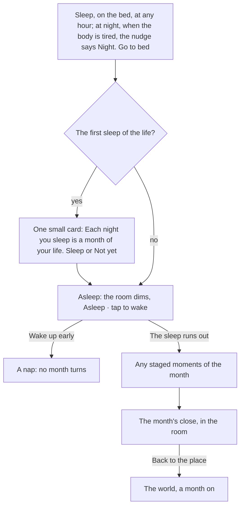

# The month and the Calendar

This page shows how a month of a life is lived and how it ends: what carries on from month to month, how sleep turns the month, and what the month's close shows. The exact rules are in [the turn rules](../../rules/turn.md) and [the clock rules](../../rules/clock.md).

A life moves a month at a time, and the month is lived by hand. Acts at home and in the city each take a little of the month; a job or a course takes its days by itself; talking, looking and buying take no time. The month turns when the character sleeps on the bed, and there is no Next month button.

  
  
  

## Commitments and free time

There is no plan to fill in. A job, a course, study or practice, once started at its thing, carries on every month until the player stops it (from its Stop in the city or in the Calendar) or until it ends by itself.

How much can carry on is limited by the month's free time: a life with a job has less than one without, and being worn down or ill takes some away. Free time left empty is rest. The figures are turn:free-slots-per-month and turn:slots-can-be-locked.

Quick acts (a purchase, a conversation, an application, a chore) never use free time, but each takes a little of the month's days, which are never shown as a number. When the character is tired, every act that takes time says "You are spent. Sleep." while talking, looking and buying stay open.

## The Calendar

The phone's Calendar app holds the month, in this order:

1. the job held;
2. what carries on, each with its Stop, and anything locked with its reason;
3. the chores done this month;
4. what is coming, soonest first, as months away.

Each row opens where it is dealt with. Nothing in the Calendar ends the month.

## How the month turns

Sleep is a short timed act. The figure lies down, the room dims, and a Wake up button stands ready; waking early is only a nap. When the sleep runs out, the month turns once, any moments it staged play, and the month's close opens over the room:

- the best thing that happened (payday, or the best moment) leads as a card;
- money in, then money out, and rent when it was due;
- a few moments, with the rest behind See the whole month;
- what was kept, and one button back to the place.

A loss is said quietly, never as the loudest thing. What was bought or done during the month is not listed again, and the rest of the month's report stays in the phone's [News](./phone.md#news). On the twelfth month the character turns a year older.

::: info No month numbers
No month number or count of months left shows anywhere. A deadline reads as months away ("in 2 months", "next month"), the band shows the age, and the phone shows the real date.
:::

## The world's day and the life's months

The world keeps its own day, the same for every player and much shorter than a real one, so a sitting sees the sun move; the band names the part of the day. The months of a life are its own: they turn only when that life sleeps, as many in a sitting as the player likes, and nothing in the life moves while the player is away.

Only a result that real life makes you wait for (an English test, an assessment body's answer, a visa decision) waits for the world's next morning. It then arrives as an envelope on the phone's lock screen, and play goes on meanwhile. See clock:game-day-on-real-time and clock:envelopes-show-real-waits.

The game never runs months in a row for the player: a quiet month is lived in minutes with the home's free acts and turns when the character sleeps. Abroad the months work the same way.

## Rules it rests on

- [Turns](../../rules/turn.md): turn:month-turns-on-empty-bank, turn:free-slots-per-month, turn:slots-can-be-locked, turn:turn-stores-a-report, turn:month-lived-in-half-days.
- [The world](../../rules/world.md): world:month-acts-carry-on, world:sleep-ends-the-month, world:month-end-results-sheet, world:no-months-left-count, world:no-auto-run-months, world:month-passes-as-lived.
- [The clock](../../rules/clock.md): clock:no-month-countdown-shown, clock:envelopes-show-real-waits, clock:game-day-on-real-time.
- [Activities and jobs](../../rules/activity.md): activity:now-acts-and-month-acts, activity:now-acts-spend-half-days, activity:spent-body-refuses-acts.
- [Chapters](../../rules/chapter.md): chapter:met-items-close-the-chapter (a brief closes at the month's end).
