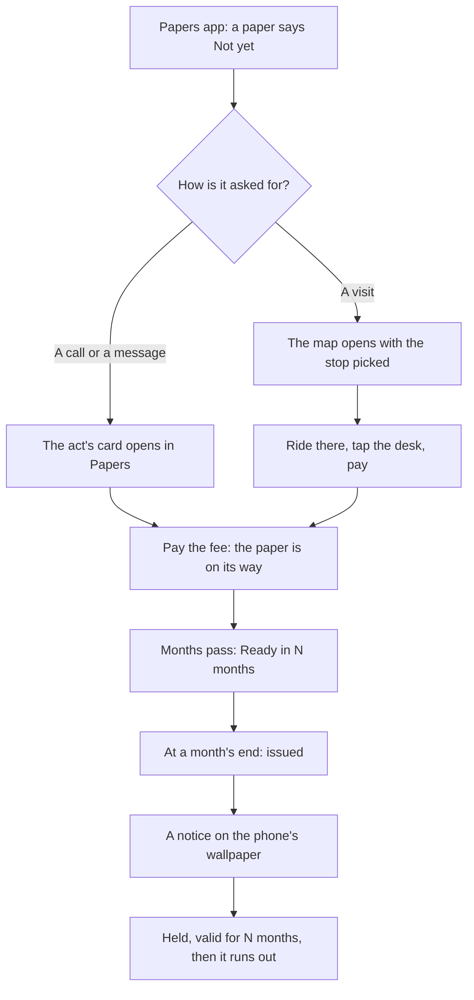
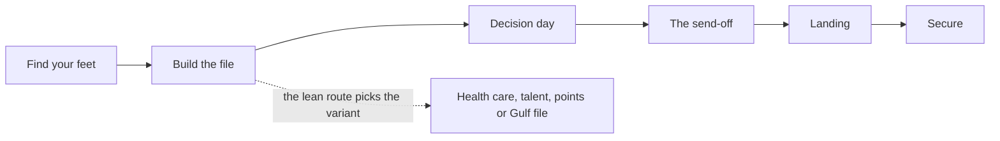

# Papers and the file chapter

Every way out of the country asks for papers: a passport, a transcript, an English result, a TB certificate, and for some ways a council's verification or a police certificate. Each paper takes a fee and a wait, and most run out after a while. The phone's Papers app holds them all in one list and says where each one stands in plain words. It is also where a paper asked for by call or message is requested. The second chapter, "Build the file", teaches this part of the game.

## The Papers app

Papers sits beside Japa on the phone. Its title is "The box under the bed": the papers are a box at home, and the box in the room opens the same app. It lists, in this order:

1. The visa, once one is granted, and after the flight the status held abroad, with the months it has left.
2. Each paper the plan's way out asks for, in the order the way asks for it.
3. Any other paper the life holds.

Each row gives the paper's state in words:

- "Not yet";
- "Ready next month" (on its way);
- "Valid for 42 more months";
- "Held", for one that never runs out;
- run out (struck through).

A paper close to running out carries a warning line. The English result also shows its band. Under the state, a line says which ways out the paper counts towards, the plan's first, at most two by name.

When a paper can be asked for now, the row carries its act:

| The act is | The row shows | A tap |
|---|---|---|
| A call or a message in real life: the transcript from the registry, the degree assessment, the council's verification, the licence's renewal | The act's name, such as "Chase your transcript" | Opens the act's card inside Papers, the same card a thing's sheet shows. The answer is told in the corner |
| A visit: the passport, the English test, the TB test, the police certificate | "At the passport office", "At the clinic" | Opens the map with that stop picked |

::: tip A paper on its way
A paper being made is "on its way" whether it is a first copy or a renewal of one you hold. A held paper with a new copy coming is not warned of as running out, because its replacement is already coming.
:::

## The passport office

The passport is a visit. Papers says "At the passport office" and opens the map with the passport office in Ikoyi picked. The ride sheet shows the fares by danfo, keke and okada, and whether it is close enough to walk. At the office's desk the act is "Apply for a passport". The office is a stop of its own on the map; inside, it uses the visa centre's hall, with its own passport desk.

The other visits are at their own places: the English test centre and the clinic for the TB test are in Ikeja, and the police certificate is asked for at the visa centre's notice.

## Speeding up a paper

Each paper waits a number of months within a range: a passport one to three, a transcript one to four, an English result one month, a TB certificate none. Two kinds of person can bring a paper forward. Both are found through people (a friend's chat line, asking around at the motor park), never in a shop:

- **The chaser** follows up the office for you: slower and cheaper, one month sooner.
- **The fixer** moves the paper's date himself: dearer, two months sooner.

Both come as agent offers, and the fee never tells you which kind you met. See [Routes and japacity](./routes.md) for the agents who are neither.

::: warning Fake papers
A scammer may offer fake papers for a little more. A fake paper used in an application is marked for good: the routes that check it refuse the application, and the interview asks about it. A fake never used can be replaced by asking for the real one.
:::

## The notices

A paper that is issued, runs out, is made void, is asked for, or is brought forward at the month's end is announced on the phone's wallpaper, above the month's lines, as a message from the office in the paper's own words: "Your passport is ready to collect.", "The council has verified your licence.", "Your English result is out: band 6.5." A tap on it opens Papers. The notice and the app's dot stay until Papers is opened. Nothing opens by itself.

## The file chapter

The second chapter, "Build the file", opens with one line: "A file is paper and legwork: a passport, a transcript, a score, a letter." For the master's in the UK it asks for four things: the passport held, the transcript held, the English, which the bachelor's degree meets with no test and which is ticked from the start, and an offer from a school.

Lanre hands it over at the hub as a brief, "Papers, abeg", with each thing it asks for as a picture and the place to get it. The brief stays in Japa, each thing ticked as it comes in. In the world it shows only in the moment: under the band for a few seconds when it is handed over, and while you stand at the step's place, where a marker shows what to do.

The chapter follows the way out the life leans to. Other ways have their own file:

| The way | Its file asks for |
|---|---|
| A master's in the UK | Passport, transcript, the English (met by the degree), a school's offer |
| Health care in the UK | 24 months on the ward, the council's verification, a sponsor, the application |
| The UK talent visa | The portfolio, the endorsement, the application |
| Permanent residence in Canada | The degree assessment, English at band 6.0, the pool, the invitation |
| A contract in the Gulf | The passport first, the medical, the agent, the contract |

::: details Exceptions
- A second request for a paper already on its way still costs the fee and changes nothing; the results say so.
- A paper with no wait, such as the TB certificate, is issued at the first month's end after it is asked for.
- The English result waits for the next morning after the month it is due. Until then Papers still shows it on its way, and it arrives as a notice on the lock screen.
- The English result's band is drawn when it is issued, from English plus a small draw either way, so the same English can come out half a band apart.
- A held passport stays in force while its renewal is being made, and the new one replaces it when issued.
- Abroad, the papers list starts with the status held, and the acts that are visits point at places in the country you are in.
:::

## Rules it rests on

- [Documents](../../rules/document.md): the waits, the expiry, one copy at a time, the police certificate and papers on their way.
- [The world](../../rules/world.md): world:phone-rises-over-scene (the phone and the Papers app), world:phone-holds-what-phones-hold (the papers on the phone, the passport office, Japa's log of briefs), world:month-passes-as-lived (the paper notices on the wallpaper), world:nudge-says-one-thing (the step only in the moment).
- [The clock](../../rules/clock.md): clock:envelopes-show-real-waits (a result that waits for the morning).
- [Chapters](../../rules/chapter.md): chapter:met-items-close-the-chapter, chapter:items-are-live-requirements, chapter:chapters-follow-lean-route (the file follows the lean route).
- [Finding out where you stand](../../rules/advice.md): advice:agent-kind-drawn-on-offer, advice:agent-loss-is-the-fee (fake papers), advice:chaser-runs-around-cheaper (the chaser).
