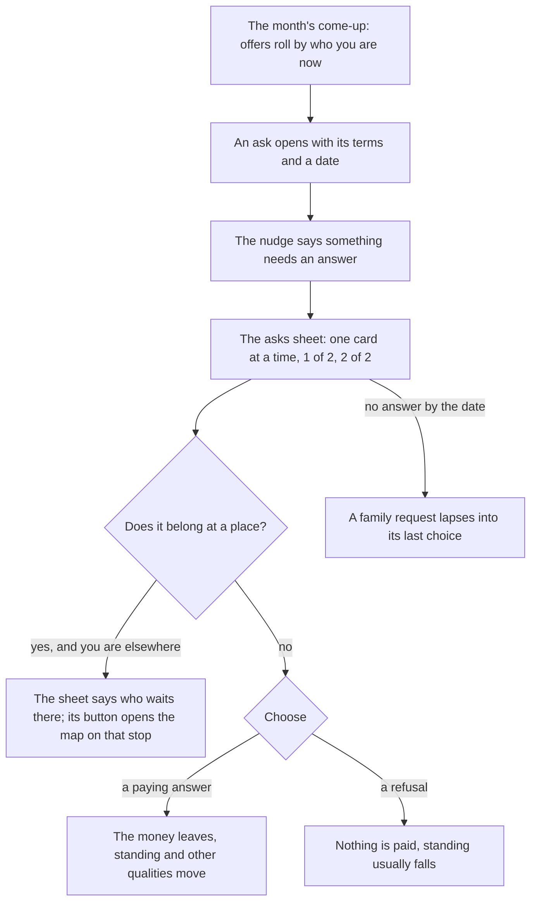
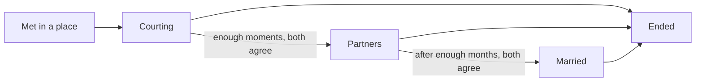
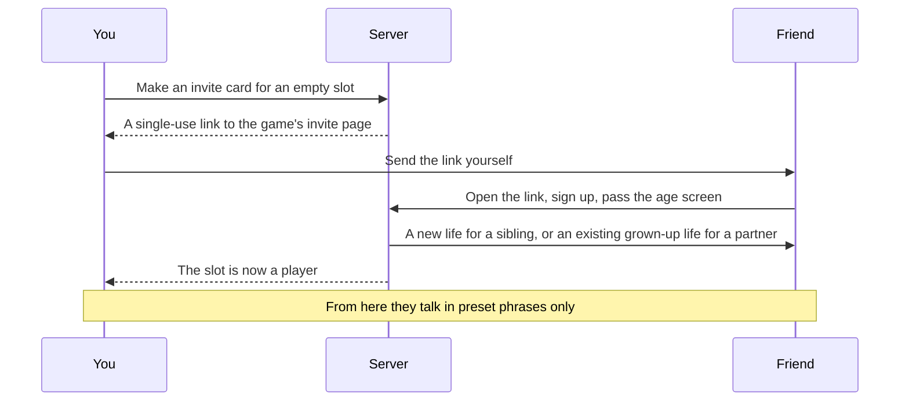

# People

Nobody leaves alone. A life in Japacity comes with a family: parents, brothers and sisters drawn when the life is made, and a family group chat that never goes quiet. They ask for help, and how you answer moves your standing at home. Neighbours and groups bring their own offers, a savings circle or a loan. Later there can be a partner, and a friend who really plays can join as a sibling or a partner through an invite. Everything a person can give can also come from a computer character, or not at all: the main journey needs nobody.

## Family

A character has slots for a partner, one slot per sibling, a mother and a father. The number of siblings comes from the family drawn when the life is made (or from the ready life's own story). Each sibling starts as a computer character drawn with the family; a sibling may later go abroad on their own schedule.

| Who | What they bring |
|---|---|
| Parents | The family house, the family meeting that can pledge money behind a plan, and many of the asks |
| A sibling at home | Asks of their own, such as school fees |
| A sibling abroad | Early news from their country, a couch for the first months on arrival, and points toward Canada once they are resident there |
| A partner | A way to go together as a dependant, a partner route, points, and the genuineness interview |

**The family group** in Chats carries at most one post a month, from Mama, an aunt, an uncle or a cousin, and some posts wait until something has happened in the life (once you have flown, the group is renamed "Our Person Abroad").

## The asks

An ask is anything that comes to the character with choices and a date: a family request, a job offer, a loan, a man who says he can arrange things. When something new needs an answer, the nudge says so and the asks sheet opens over the place.

Each card says who is asking, a line in their voice, the choices with their cost, and how long you have ("Answer by next month", "Answer within 2 months"). Back and Next move between cards.

The family requests include the light bill, a brother's school fees, Mama's shop, the cloth for a cousin's wedding, the roof, the harvest pledge and an uncle's burial. Each paying answer raises standing at home; each refusal lowers it, some by a lot.

::: tip No kicking while down
Family requests only roll while you hold at least ₦150,000 in naira across the bank and cash. A family that knows you are broke does not ask.
:::

::: details Abroad, the family asks for more
Once a relative is abroad, the family's requests come with larger amounts, and they are paid from the naira at home, so money has to be sent home before an ask can be met. An ask that belongs at home cannot be answered from abroad; flying closes it, unanswered and unpaid.
:::

::: details A real sibling shares the asks
When a real player is your sibling and both lives are at home, a family request that opens in one life opens in the other too, with the same terms. The first of you to pay closes it for both.
:::

## The circle and the group

Neighbours and groups bring money offers that rest on people rather than banks.

**The savings circle (ajo).** A neighbour runs a circle: ₦20,000 a month for ten months, and each month one member collects the whole pot. There is no interest. Each month after your share is paid, there is a chance (one in the months still to come) that it is your turn, and the pot goes into the bank. On average you get back exactly what you paid in; the win is the timing. Miss a month and you are out, with no pot and standing lost.

**The group loan.** A lending group offers a loan for a side business, with fees and compulsory savings taken up front and the savings returned when the loan is paid. The group stands behind you, and it costs: the first miss is covered and added to what you owe, the second brings the officer and the group to the house, the third is default and the asset named on the loan is seized.

::: warning A relative asks you to stand guarantor
Saying yes raises standing. Some months later, the relative may vanish and leave the loan with you.
:::

## Partners

By the rules, a computer partner is met in a place you already spend time in (the hub's meetup, the family house), never picked from a list. Time together is a slot in the month: a visit at their room or a call. Moments build up; with enough of them you can propose to be partners, and later to marry. Courting someone else while partnered is allowed, and gossip follows. A computer partner who hears nothing for too long drifts away.

Either side can end a bond at any time. The one who ends it pays in standing; the one left keeps everything earned alone and loses only the joint parts. An ended bond keeps its record.

::: info A computer character is always marked
A computer partner or sibling carries a small mark on its card, and a plain line says so when one is chosen. Computer characters are never counted as players, never buy a ticket or win anything scarce, never give or receive money, and never write free text.
:::

## Pairs and invites

A real friend can join your life as a sibling or a partner. The game is played alone inside; another person reaches your life only as facts the server hands over, and money is counted together but never moved between lives.

- **The invite card** shows the character's name (never the account's), the japacity figure and best route, what the slot is looking for from a fixed list, and the words "Japacity is a game". It never carries a photo, a sum or a contact.
- **The link** is single-use, valid for 14 days, and fills only the slot it was made for. A sibling link always starts a new life with your family; a partner link needs a grown-up life.
- **Rewards** come from what the friend goes on to do (finishing the years before, closing a chapter, departing), never from the sending, and are never worth cash.
- **Talking** is preset phrases only, each with at most one fill-in from a fixed list. No phrase asks for or offers money, a document or a contact.
- **Block and report** are one tap from anywhere another player appears. A block is immediate and ends every bond between the two at no cost to either.

::: details When a partner goes quiet
If a real partner sends nothing for a week, the other life is warned; after two weeks a stand-in takes their place for what cannot wait. The stand-in can answer the genuineness interview and say yes to a joint step the absent side allowed in advance. It never proposes, spends or ends anything.
:::

::: details The same everywhere
Every player meets others the same way, from any country: friends who joined through each other's invites, in the game's phrases, with block and report. A player with no friend in the game plays every rule on this page with computer characters.
:::

::: info In the world
A computer partner stands still in the place where they are met, a small dot over them; a tap shows their name with the Not a player mark and one act, Talk. Their card has their first line and one button, Start seeing them; it is shut, with the reason, while three bonds already court, and while you have a partner its button says that seeing someone else costs standing if it comes out. Once you start seeing them, they answer in their own words, in the corner and as the first message of their thread. A partner who lives abroad is home only for December, so stands only then. The meetup's people stand at the meetup in the hub in Yaba. The people met after the service come home with the family: they stand in the parlour of the family house, as does a friend of the family visiting. Once a bond courts, their room is on the map, and time together is spent on its chair; nobody is met there. The room is dressed for the person whose room it is: a thing or two of theirs, and them standing in it, alone, a tap showing their name with the Not a player mark. Each bond's thread in Chats opens with a head: the stage, an answer waiting, what can be asked, applying together, sponsoring, and ending it, one row each, the details behind a tap. A bond that ends is told on the month's results, and its thread stays that month with what happened and, if they left, why in their words; then it goes. The People row at the top of Chats shows the slots of this life, with the invite card on an empty partner slot or a computer sibling. The invite link keeps its own page.
:::

## The interview practice

Once the UK master's route is known, the hub in Yaba offers **Practise for the interview**, a free-time act: a friend plays the officer and you rehearse until the answers sound like you. Each month of it raises interview prep. In the visa interview that comes with the application, better answers open once prep reaches 20, and more at 40.

The genuineness interview for a partner route is a different thing: both partners answer the same questions from memory, apart, and the answers are compared. See [The interview and the set pieces](./interview.md).

## Rules it rests on

- [People](../../rules/person.md): two lives and one server (person:others-known-by-facts, person:lives-meet-by-authority-command, person:both-lives-step-together and person:money-counted-never-moved), the slots (person:family-and-partner-slots, person:nobody-real-is-needed), courting and marriage (person:courting-opens-a-bond, person:time-together-is-an-act, person:talking-adds-moments, person:proposing-a-step, person:agreed-partner-and-marriage and person:one-partner-at-a-time), what a sibling gives (person:canada-sibling-bonus, person:sibling-couch-delays-rent, person:sibling-hears-news-early and person:family-requests-shared), letting people down (person:either-side-ends-a-bond, person:joint-collapses-with-bond, person:ender-pays-in-standing, person:one-left-keeps-own-gains, person:ended-bond-record-kept, person:leaving-player-ends-bonds, person:gossip-when-two-timing and person:computer-partner-drifts), the stand-in (person:stand-in-after-absence, person:stand-in-acts-narrowly), computer characters (person:computer-is-a-person-entry, person:computer-siblings-drawn-with-family, person:computer-partner-facts, person:behaviour-block-fields, person:papers-marriage-offer, person:view-shows-people, person:computers-follow-same-rules, person:computer-names-generated, person:computer-mark-is-quiet, person:computers-never-counted, person:computers-never-win-scarce, person:computers-never-handle-money, person:computers-never-free-text and person:computers-never-shown-as-players).
- [Pairs](../../rules/pair.md): the invite card and link (pair:invite-card-contents, pair:invite-link-single-use and pair:invite-rewards-never-cash), phrases (pair:preset-phrases-only, pair:conversation-phrases-stored, pair:place-phrases-not-stored and pair:phrase-checks-before-send), block and report (pair:block-and-report-one-tap, pair:block-ends-every-bond and pair:report-holds-conversation), one way to meet for everyone (pair:everyone-meets-by-invite).
- [Offers](../../rules/offer.md): how asks open, are chosen and lapse (offer:come-up-rolls-in-order, offer:opening-fixes-terms-and-fraud, offer:choice-needs-conditions-and-funds, offer:fraud-effects-replace-ordinary and offer:lapsed-offer-removed), the family requests.
- [Luck, the safety net, and the kiosk](../../rules/luck.md): the savings circle (luck:savings-circle-holds-pot).
- [Obligations](../../rules/obligation.md): the group loan (obligation:group-loan-fees-up-front, obligation:group-covers-misses-at-cost and obligation:three-roads-to-group-loan).
- [The world first](../../rules/world.md): meeting people where you already are (world:nobody-picked-from-list), one action and one sheet (world:one-action-one-sheet).
- [Money abroad](../../rules/abroad-money.md): family requests abroad (abroad-money:remit-sends-money-home, abroad-money:family-asks-more-abroad).
- [The genuineness interview](../../rules/interview.md).
