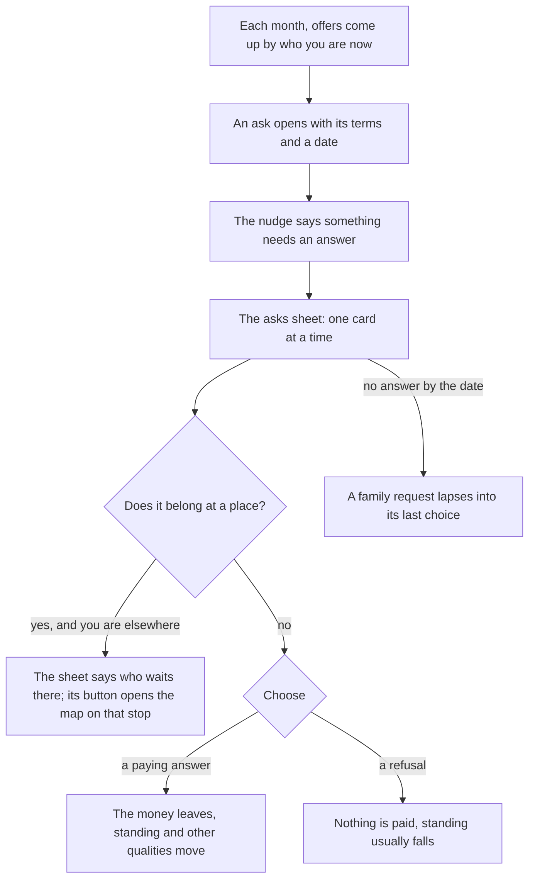
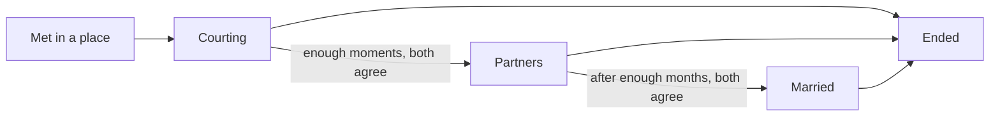
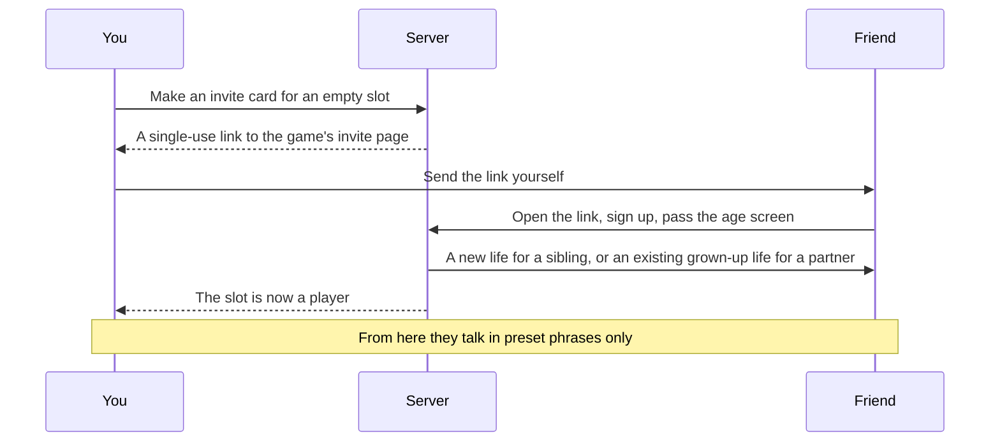

# People

This page shows the people in a life: the family and what it asks, the money offers that rest on neighbours, partners, and friends who join through an invite. The exact rules are in [the people rules](../../rules/person.md), [the offer rules](../../rules/offer.md) and [the pair rules](../../rules/pair.md).

Nobody leaves alone. A life comes with parents, brothers and sisters drawn when it is made, and a family group chat that never goes quiet. The family asks for help, and how you answer moves your standing at home. Neighbours bring a savings circle or a loan; later there can be a partner; and a friend who really plays can join as a sibling or a partner. Everything a person gives can also come from a computer character, or not at all: the main journey needs nobody.

## Family

| Who | What they bring |
|---|---|
| Parents | The family house, the family meeting that can pledge money behind a plan, and many of the asks |
| A sibling at home | Asks of their own, such as school fees |
| A sibling abroad | Early news from their country, a couch for the first months on arrival, and points towards Canada once resident there |
| A partner | A way to go together, a partner route, points, and the genuineness interview |

Each sibling starts as a computer character and may later go abroad on their own. The family group in Chats carries at most one post a month, from Mama, an aunt, an uncle or a cousin; once you have flown, it is renamed "Our Person Abroad".

## The asks

An ask is anything that comes with choices and a date: a family request, a job offer, a loan, a man who says he can arrange things. When one opens, the nudge says so and the asks sheet opens over the place.

Each card shows who is asking, a line in their voice, the choices with their cost, and how long you have. Family requests run from the light bill and a brother's school fees to the roof, a cousin's wedding cloth and an uncle's burial. Paying raises standing at home; refusing lowers it, some by a lot. A family that knows you are broke does not ask: requests come only while you hold a certain amount ("Not when broke" in [the offer rules](../../rules/offer.md)).

::: details Abroad, and with a real sibling
- **Abroad,** the family asks for more, paid from the naira at home, so money must be sent home first. An ask that belongs at home closes unanswered when you fly.
- **A real sibling** at home sees the same family requests with the same terms, and the first of you to pay closes it for both.
:::

## The savings circle and the group loan

**The savings circle (ajo).** A neighbour runs a circle: each member pays a share every month, and each month one member collects the whole pot. There is no interest; on average you get back what you paid in, and the gain is getting it early. Miss a month and you are out, with no pot and standing lost (luck:savings-circle-holds-pot).

**The group loan.** A lending group lends for a side business, taking fees and compulsory savings up front. The group covers a first miss at a cost, comes to the house after a second, and seizes the asset named on the loan after a third (obligation:group-covers-misses-at-cost).

::: warning A relative asks you to stand guarantor
Saying yes raises standing. Some months later, the relative may vanish and leave the loan with you.
:::

## Partners

A computer partner is met in a place you already spend time in, the hub's meetup or the family house, never picked from a list. They stand there with a small dot over them; a tap shows their name with a Not a player mark and one act, Talk. Their card offers Start seeing them.

- Time together is a commitment in the month: a visit to their room, which appears on the map, or a call.
- Moments build up, and with enough of them you can propose to be partners, and later to marry.
- Seeing someone else while partnered is allowed, and gossip follows. A computer partner who hears nothing for too long drifts away.
- Each bond's thread in Chats opens with its stage and what can be asked: applying together, sponsoring, or ending it.

Either side can end a bond at any time. The one who ends it pays in standing; the one left keeps what they earned alone and loses only what was joint. An ended bond is told on the month's results.

::: info A computer character is always marked
A computer partner or sibling carries a small mark, and a plain line says so when one is chosen. Computer characters are never counted as players, never win anything scarce, never handle money and never write free text.
:::

## Pairs and invites

A real friend can join your life as a sibling or a partner. Each life is still played alone: the other life reaches yours only through facts the server passes between them, and money is never moved between lives.

- **The invite card** shows the character's name, the japacity figure and best route, what the slot is looking for, and the words "Japacity is a game". It never carries a photo, a sum or a contact.
- **The link** is used once, expires, and fills only the slot it was made for.
- **Rewards** come from what the friend goes on to do, never from sending the link, and are never worth cash.
- **Talking** is preset phrases only. No phrase asks for or offers money, a document or a contact.
- **Block and report** are one tap from anywhere another player appears. A block ends every bond between the two at no cost to either.

Every player meets others this way, from any country. A player with no friend in the game plays everything on this page with computer characters. If a real partner goes quiet for too long, a stand-in covers only what cannot wait, such as the genuineness interview, and never proposes, spends or ends anything (person:stand-in-after-absence, person:stand-in-acts-narrowly).

## Interview practice

Once the UK master's route is known, the hub in Yaba offers Practise for the interview: a friend plays the officer and you rehearse. Each month of it builds interview preparation, which opens better answers in the visa interview (the question table in [the route rules](../../rules/route.md)). The genuineness interview for a partner route is different: both partners answer the same questions apart, and the answers are compared. See [The interview and the set pieces](./interview.md).

## Rules it rests on

- [People](../../rules/person.md): two lives and one server (person:others-known-by-facts, person:lives-meet-by-authority-command, person:both-lives-step-together, person:money-counted-never-moved), the slots (person:family-and-partner-slots, person:nobody-real-is-needed), courting and marriage (person:courting-opens-a-bond, person:time-together-is-an-act, person:talking-adds-moments, person:proposing-a-step, person:agreed-partner-and-marriage, person:one-partner-at-a-time), what a sibling gives (person:canada-sibling-bonus, person:sibling-couch-delays-rent, person:sibling-hears-news-early, person:family-requests-shared), ending a bond (person:either-side-ends-a-bond, person:joint-collapses-with-bond, person:ender-pays-in-standing, person:one-left-keeps-own-gains, person:ended-bond-record-kept, person:leaving-player-ends-bonds, person:gossip-when-two-timing, person:computer-partner-drifts), the stand-in (person:stand-in-after-absence, person:stand-in-acts-narrowly), computer characters (person:computer-is-a-person-entry, person:computer-siblings-drawn-with-family, person:computer-partner-facts, person:behaviour-block-fields, person:papers-marriage-offer, person:view-shows-people, person:computers-follow-same-rules, person:computer-names-generated, person:computer-mark-is-quiet, person:computers-never-counted, person:computers-never-win-scarce, person:computers-never-handle-money, person:computers-never-free-text, person:computers-never-shown-as-players).
- [Pairs](../../rules/pair.md): pair:invite-card-contents, pair:invite-link-single-use, pair:invite-rewards-never-cash, pair:preset-phrases-only, pair:conversation-phrases-stored, pair:place-phrases-not-stored, pair:phrase-checks-before-send, pair:block-and-report-one-tap, pair:block-ends-every-bond, pair:report-holds-conversation, pair:everyone-meets-by-invite.
- [Offers](../../rules/offer.md): offer:come-up-rolls-in-order, offer:opening-fixes-terms-and-fraud, offer:choice-needs-conditions-and-funds, offer:fraud-effects-replace-ordinary, offer:lapsed-offer-removed.
- [Luck, the safety net, and the kiosk](../../rules/luck.md): luck:savings-circle-holds-pot.
- [Obligations](../../rules/obligation.md): obligation:group-loan-fees-up-front, obligation:group-covers-misses-at-cost, obligation:three-roads-to-group-loan.
- [The world](../../rules/world.md): world:nobody-picked-from-list, world:one-action-one-sheet.
- [Money abroad](../../rules/abroad-money.md): abroad-money:remit-sends-money-home, abroad-money:family-asks-more-abroad.
- [The genuineness interview](../../rules/interview.md).
