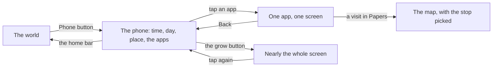

# The phone

This page walks through the character's phone and each of its apps. The phone holds everything that is not in front of the character: the month, money, family, the plan to leave, papers, work, the market, the draw, bills and the news. Its rules are world:phone-rises-over-scene and world:phone-holds-what-phones-hold in [the world rules](../../rules/world.md).

The phone rises tilted over the scene from the Phone button at the bottom right. Its lock screen shows the clock, the day, where you are, the notices as cards naming their app, and the apps under them. A dot on an app means something new is in it; a dot on the Phone button means some app has one.

## How it works

- Each app has one job and one short screen. A small pill beside its name says what matters now (offers waiting, the next draw, the next rent).
- The corner button grows the phone to nearly the whole screen and back; Back returns to the apps, and the bar at the foot puts the phone away.
- What an act inside an app did is told in the corner over the handset, so it can be read while the phone covers the world.
- Lines under the band can open the phone straight on the right app: the coming chip opens the Calendar, and abroad the line about the month's dues opens the Bank.

## The apps

The apps are, in order: Calendar, Bank, Chats, Japa, Papers, Jobs, Market, Lotto, Bills, News, Settings.

### Calendar

The month as it stands: the job, what carries on, the chores done and what is coming. See [The month and the Calendar](./month.md#the-calendar).

### Bank

The passbook of savings against the cost of the road, and the acts to change and move money. See [Money](./money.md#the-bank-app).

### Chats

The family group, a row of the people in this life at the top, and a thread for each partner or sibling. A real player is answered in preset phrases picked from chips; nobody types. See [People](./people.md).

### Japa

The log of the road: the way out the briefs follow, with how ready you are as a filling bar (never a percentage); the briefs so far, each step ticked or not with where it is done; the other ways out heard of; and what is coming. Each other way opens its own page, where you can make it the plan. See [Routes and japacity](./routes.md).

### Papers

What is in the box under the bed: every paper held or awaited, its state, what it counts towards, and the act that moves it. A visit opens the map on its stop. See [Papers and the file chapter](./papers.md).

### Jobs

The job held, its pay and months in, with Quit; then the offers waiting. With no offer, it points to the jobs board at the hub on the map.

### Market

A grid of things for the room and the road, each pictured as it stands in the room, with what it does, its price and any monthly cost. Buying pays at once and a rider brings it to the gate; things owned can be sold. It sells only in Lagos. See [The home](./home.md).

### Lotto

The draw as seen from the phone: the next draw, your tickets and the last results. Tickets are bought at a kiosk in the city, never in the app. See [The Friday draw](./friday-draw.md).

### Bills

Where you live and the moves you could make, then every bill. See [Money](./money.md#bills) and [The home](./home.md).

### News

In order: a line on the times (Calm, or what is happening); the last month's report, which stays here after the results close; and the stories that have reached you, what is happening now first, talk next, the past last. Once you have flown on a way, its news stops asking for you. The stories and the times are in [the news rules](../../rules/news.md) and [the director rules](../../rules/director.md).

### Settings

Sound, graphics, the account, a ready life, feedback, the credits and guides, and Start a new life. See [Settings and a new life](./settings.md).

::: details What the phone does not hold
The papers themselves are in the box under the bed at home; the phone only shows what is in it. The map is separate from the phone, and the Map button never carries a dot.
:::

## Rules it rests on

- [The world](../../rules/world.md): world:phone-rises-over-scene, world:phone-holds-what-phones-hold, world:thumb-buttons-carry-dots, world:nobody-picked-from-list, world:street-talk-budget, world:month-passes-as-lived, world:nudge-says-one-thing.
- [Documents](../../rules/document.md): document:paper-on-its-way.
- [Money](../../rules/wallet.md): wallet:passbook-against-plan-cost, wallet:savings-stamps, wallet:saving-pace, wallet:roads-to-the-target.
- [Home](../../rules/home.md): home:things-a-life-owns.
- [Chapters](../../rules/chapter.md): chapter:chapters-follow-lean-route.
- [Pairs](../../rules/pair.md): pair:preset-phrases-only, pair:conversation-phrases-stored.
- [News](../../rules/news.md) and [The director](../../rules/director.md): the stories and the times.
