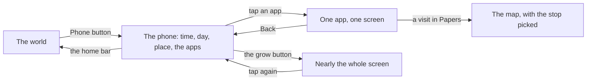

# The phone

The phone keeps the character up to date with everything that is not in front of them: money, family, the plan to leave, papers, work, the market, the draw, bills and the news.

It rises tilted over the scene from the Phone button at the bottom right. The lock screen is plain navy and shows:

- the big clock;
- the day in words;
- where you are, as a pill with its picture;
- the notices, as white cards naming their app;
- the eleven apps under it.

Each app has one job and one short screen. A dot on an app means it holds something you have not seen yet; a dot on the Phone button means some app does.

## How it works

- One tap on the corner button grows the phone to nearly the whole screen; another shrinks it back.
- Back returns to the apps; the bar at the foot puts the phone away.
- Each app's head is its own picture and name. A small pill beside the name says what matters now: Jobs' offers or open jobs, Lotto's Draw on Friday, Bills' bills to pay or the next rent, the Bank's next stamp or All in.
- What an act inside an app did is told in the corner over the handset, so it can be read while the phone covers the world.
- Once the character is home, the month's acts report themselves on the wallpaper as the days pass.

::: info The band opens the phone
What stands under the band can open the phone straight on the right app. The coming chip opens the Calendar on what is coming; abroad, the nudge about the month's dues opens the Bank. The brief's chip, while it stands, goes to the step; for a paper asked for by a call or a message, that is Papers on that act's card.
:::

## The apps

The apps sit four across in this order: Calendar, Bank, Chats, Japa, Papers, Jobs, Market, Lotto, Bills, News, Settings. Each is made of cards, pictures and chips in the game's light look.

### Calendar

The month as it stands: the job held, what carries on until it is stopped, the chores done this month, and what is coming up in months. Each row opens where it is dealt with. Nothing in it ends the month, which turns when it is lived. It carries no dot. See [The month and the Calendar](./month.md).

### Bank

At home it opens on the passbook: the money held for the road against its whole cost, the pace line, the stamps, last month, and the roads to it. Behind them are what is saved towards the move, the money that moved lately, and the acts Change money and Move money. Abroad, the balance stands first. See [Money](./money.md).

### Chats

- The family group, at most one post a month, with the month's lines about people under it.
- The People row at the top opens the people of this life, with the invite card and the boards.
- Online, a partner or sibling played by a real person has a thread of their own, where you answer with preset phrases picked from chips. Nobody types.
- A computer partner's thread shows the moments you had together.

See [People](./people.md).

### Japa

The log of the road:

- the way the chapters follow and its file, with how ready you are to go as a filling bar, never a percentage;
- the briefs handed over so far, the current one first with its things ticked as they come in;
- each step, ticked or not, with where it is done;
- the other ways out heard of;
- what is coming (the visa decision, a paper's ready month).

Each other way opens its own page, where you can make it the plan. See [Routes and japacity](./routes.md).

### Papers

The box under the bed: every paper the life has or waits for, its state in words, what it counts towards, and the act that moves it. A call or a message opens its card here; a visit says where and opens the map on it. See [Papers and the file chapter](./papers.md).

### Jobs

The job held, its pay and how many months in, with Quit. Then the job offers, as picture cards with the pay as a chip and when to answer. With no offer waiting, it shows the board at the hub where jobs go up, and the way to it on the map. Picking an offer and taking it, or quitting, each opens its own card.

### Market

A grid of things for the room and the road. Each is a picture of the same model that stands in the room, with one line on what it does, its price and any running cost a month. The order is: what can be bought, what you own, what needs something first, and what has no place where you live. Buy pays at once and a rider delivers the thing to the gate; a thing you own can be sold. It sells only at home in Lagos: elsewhere in Lagos it says the rider brings it to your gate, and abroad it says the market is a Lagos thing. See [The home](./home.md).

### Lotto

The draw as seen from the phone. Offline: the street kiosk runs its own draw, and what this month's tickets cost. Online: the next Friday draw, the jackpot, your tickets and numbers, and the last draw with any of yours lit. Tickets are bought at a kiosk, never in the app, and the app shows the way to the kiosk on the map. See [The Friday draw](./friday-draw.md).

### Bills

Where you live and what it costs, the moves you could make, then every bill with what is due this month, and a Pay now slip for the ones that can be paid early. See [Money](./money.md#bills) and [The home](./home.md).

### News

In order:

1. The era line (Calm, or what is happening).
2. The last month's lines, which stay here after the results sheet closes.
3. The stories that have reached you: what is happening now first, talk next, the past last.

Once you have flown on a way, its news stops asking for you.

### Settings

The sound, the graphics, the account when there is one, a ready life, the feedback box online, the Credits and the guides, and Start a new life. See [Settings and a new life](./settings.md).

::: details What the phone does not hold
The papers themselves are a thing at home, the box under the bed; the phone only shows what is in it. On the day of an appointment the character takes the file from under the bed before the ride. The Map and the phone are separate: the Map button never carries a dot.
:::

## Rules it rests on

- [The world](../../rules/world.md): the phone and its apps (world:phone-rises-over-scene), what the phone carries (world:phone-holds-what-phones-hold), the people of a life (world:nobody-picked-from-list), the dot on the Phone button (world:thumb-buttons-carry-dots), the corner line (world:street-talk-budget), the month's acts reporting themselves (world:month-passes-as-lived), the nudge (world:nudge-says-one-thing).
- [Documents](../../rules/document.md): the Papers app (document:paper-on-its-way).
- [Money](../../rules/wallet.md): the passbook (wallet:passbook-against-plan-cost, wallet:savings-stamps, wallet:saving-pace and wallet:roads-to-the-target).
- [The home](../../rules/home.md): what a life owns and the Market (home:things-a-life-owns).
- [Chapters](../../rules/chapter.md): the plan and the switch between ways out (chapter:chapters-follow-lean-route).
- [Pairs](../../rules/pair.md): preset phrases (pair:preset-phrases-only, pair:conversation-phrases-stored).
- [News](../../rules/news.md) and [The director](../../rules/director.md): the stories and the eras.
