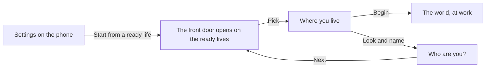

# The ready lives

A ready life skips the years before and starts at work: a graduate fresh from the service year, a banker, a developer, a nurse or a teacher, each with money, a job or the lack of one, and dues already running. They are quick starts for a player who has played before, and fixed lives the tests and the recorded lives are built on. The front door never offers them; they sit behind Settings, as "Start from a ready life".

  
  

## How a player reaches one

Settings asks the next front door to open on the ready lives, once. The door opens on their list in place of the archetype tiles, with the look and the name a screen back. Pick a kind, and Where you live opens with that path and the life's own age in its strip, and the home the life starts in. Begin goes straight to the world: there are no years before to fill, so no page fills after it.

::: info A person, not a named character
The ready lives are kept in content as fixed scenarios with people's names, but the door shows only their kind ("The nurse") and a line. The player still builds the person: the look and the name are the player's own, and a line says no he or she, since the look carries that.
:::

## The five lives

| Kind | Starts | Work | Money at the start | Each month |
|---|---|---|---|---|
| The graduate | 23 | None yet, fresh from the service year, a good degree | ₦355,000 in the bank, ₦25,000 cash | Upkeep ₦95,000 |
| The banker | 28 | A bank officer four years in, a lower grade, a plot of land, a passport | ₦4,200,000 in the bank, ₦60,000 cash | Upkeep ₦140,000 |
| The developer | 25 | A junior developer eighteen months in | ₦900,000 in the bank, ₦40,000 cash | Upkeep ₦130,000, ₦60,000 sent home |
| The nurse | 27 | A staff nurse thirty months in, with a licence and a passport | ₦650,000 in the bank, ₦30,000 cash | Upkeep ₦120,000, ₦40,000 sent home |
| The teacher | 26 | A maths teacher four years in, who codes after marking | ₦350,000 in the bank | Upkeep ₦80,000, ₦25,000 sent home |

Each tests something different. The graduate has everything still to build and the family can carry part of the weight. The banker has money and a job on day one and a harder file. The developer is closest to the pay that makes the funds easy and furthest from any help. The nurse is the life the health care route is built for.

::: details Where a ready life is not offered
"Start from a ready life" shows only where a life may be started over, which is the local authority on the device. Online the server holds the life and the client cannot start one over by itself, so the entry is not shown there.
:::

::: details What the tests use them for
Every rule test starts from a scenario and plays commands through the engine, and the recorded lives (the goldens) replay these starts month by month. That is why the fixed lives stay in content even though the door builds a person: they are the game's fixtures.
:::

## Rules it rests on

- [Starting lives](../../rules/scenario.md): scenario:state-built-from-scenario, scenario:new-state-starts-clean and scenario:first-turn-always-endable, and the table of the lives.
- [The prologue](../../rules/prologue.md): prologue:fixed-life-skips-prologue (a fixed life has the prologue closed), prologue:front-door-builds-a-person (the door builds a person), prologue:front-door-three-screens (the ready lives behind Settings, and Where you live).
- [Home](../../rules/home.md): home:starting-charges-from-one-function (a fixed life's starting charges).
