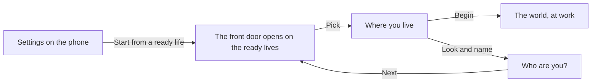

# The ready lives

A ready life skips the years before and starts at work. This page is for a player who has played before and wants a quick start, and for anyone reading the tests, which are built on these same lives.

There are five: the graduate, the banker, the developer, the nurse and the teacher. They are not on the front door; they sit behind Settings, as "Start from a ready life".

  
  

## How a player reaches one

The front door opens with the list of ready lives where the archetype cards usually stand. Picking one opens Where you live with that life's age and home, and Begin goes straight to the world, since there are no years before to print.

The player still builds the person: the look and the name are the player's own. A ready life is known only by its kind ("The nurse"), with no name or sex of its own.

The entry shows only where a life may be started over on the device. Online the server holds the life, so it is not offered.

## The five lives

| Kind | What it is |
|---|---|
| The graduate | Fresh from the service year with a good degree and no job yet. Everything is still to build, and the family can carry part of the weight. |
| The banker | A bank officer some years in, with money, land and a passport on day one, and a harder file. |
| The developer | A junior developer, closest to the pay that makes the funds easy and furthest from any help. |
| The nurse | A staff nurse with a licence and a passport: the life the health care route is built for. |
| The teacher | A maths teacher who codes after marking on a small salary: a way into tech from the classroom. |

Each life's age, money, job, papers and monthly costs are in [the starting lives rules](../../rules/scenario.md); the nurse's are in [the route gates rules](../../rules/route-gates.md).

## Rules it rests on

- [Starting lives](../../rules/scenario.md): scenario:state-built-from-scenario, scenario:new-state-starts-clean, scenario:first-turn-always-endable, and the tables of the lives.
- [The prologue](../../rules/prologue.md): prologue:fixed-life-skips-prologue, prologue:front-door-builds-a-person, prologue:front-door-three-screens (the ready lives behind Settings).
- [Home](../../rules/home.md): home:starting-charges-from-one-function (a ready life's starting charges), home:living-by-hand.
